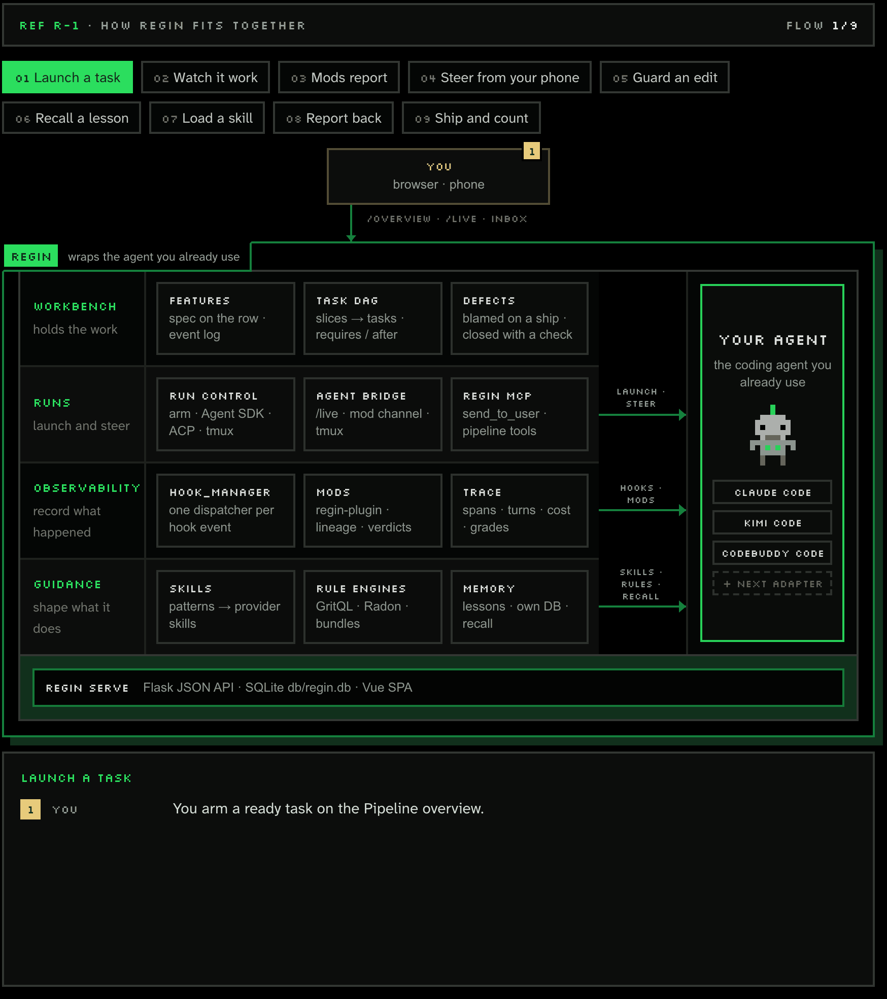
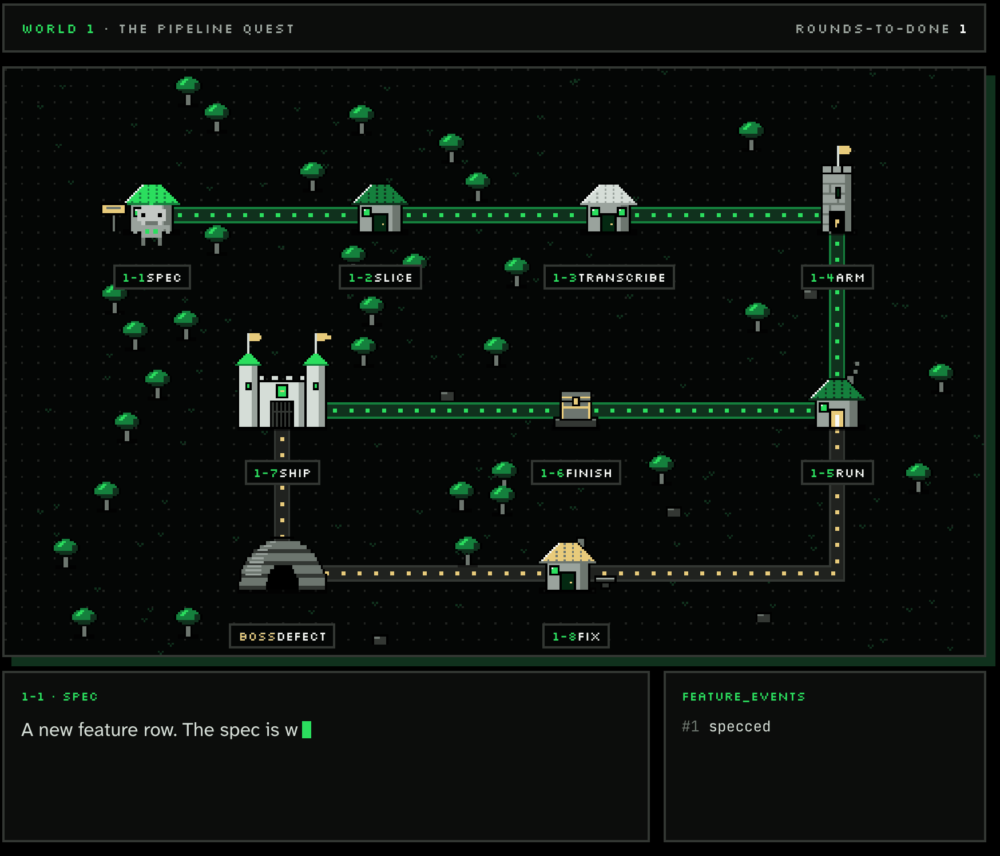

# regin

**A workbench for building software with AI coding agents.**
Plan the feature, run the agents, see what they did, count what they got wrong.

🌐 **[regin.ccday.top](https://regin.ccday.top)** — the official project site.

> ⚠️ **Early beta.** regin is under active development and breaking changes are expected at any time. Database schemas, settings keys, hook contracts, skill bundles, and CLI flags may all change without backward-compatible shims. Pin a commit if you need stability.

regin runs one loop around the coding agent you already use:

```
Spec  →  Run  →  Watch  →  Count
 │        │        │         └─ defects declared against the done-claim; rounds-to-done per feature
 │        │        └─ every session traced: tools, edits, tokens, time, grades
 │        └─ task runs launched on Claude or Kimi, steered and stopped from /live
 └─ a feature row carries the spec, its acceptance tests, and the slices cut from it
```

It is organized in four layers. The first two are where you spend the day; the last two make the runs inspectable and keep the agent on-spec.

| Layer | What it covers | Dashboard |
|---|---|---|
| [Workbench](#workbench--features-tasks-defects) | feature → spec → acceptance tests → tasks → done-claim; the defect ledger | `/overview` (Pipeline), `/inbox` |
| [Runs](#runs--launch-steer-hear-back) | launching task runs, steering live sessions, the agent's messages back to you | `/live`, `/inbox` |
| [Observability](#observability--what-the-agents-actually-did) | session traces, time and cost analytics, post-hoc grades, audit | `/trace`, `/audit` |
| [Guidance](#guidance--what-steers-the-agent) | patterns & skills, rule engines in hooks, cross-session memory, topic wikis | `/patterns`, `/rules`, `/memory`, `/repos/:name/topics` |

<p align="center">
  <a href="https://regin.ccday.top/architecture#s-how-it-works"></a>
  <br><sub>The four layers around your agent, with a few flows traced through them. <a href="https://regin.ccday.top/architecture#s-how-it-works">Open the interactive version</a> to pick any of the nine.</sub>
</p>

## Workbench — features, tasks, defects

A **feature** is a row. Its spec lives on that row (or on its tracker issue when the feature is tracked remotely), and its acceptance items are named tests in the repo — red before the build, green at ship. The spec is cut into **slices**; each slice becomes a **task** with its dependencies, and tasks run in dependency order. When the work is called done, that is a **done-claim**, and anything found wrong afterwards is a **defect** declared against the feature.

The number the pipeline is held to is **rounds-to-done**: one build plus each time a done-claim was walked back. Only declarations feed it — nothing is inferred from prose, branch names or timing.

<p align="center">
  <a href="https://regin.ccday.top/pipeline#s-loop"></a>
  <br><sub>One feature from spec to ship — and the round an escaped defect costs. <a href="https://regin.ccday.top/pipeline#s-loop">Play it on the site</a>: drag the levels, click one to read it.</sub>
</p>

- Dashboard: `/overview` is the Pipeline — Overview, Features and Tasks behind one tab strip; defects are reached from the Overview and the Features triage rail. `/features/:id` is a feature's ledger.
- **Projects and workspaces** — the Pipeline is scoped to one project (a registered repo) or to a **workspace** (a root directory whose members are the repos under it; a run armed on a workspace starts in its root). `/projects/:id` holds a project's step stages, each stage's prompt, and the language its task runs write in.
- CLI: `regin feature` (where a feature stands and what it cost), `regin task` (capture, inspect, check a slice table, `arm` a run; runs are launched from the dashboard), `regin defects` (what a feature got wrong, and what escaped), `regin workspace` (add, list, remove).
- Internals: [Feature pipeline](ARCHITECTURE.md#feature-pipeline-features-defects-slices), and [docs/defect-task-feature.md](docs/defect-task-feature.md) for how the three join.

## Runs — launch, steer, hear back

A task is **armed** with a provider, a model and a launch mode, then started from the dashboard. Claude runs go through the Python Claude Agent SDK, so regin owns the process and keeps a typed channel to it — an `AskUserQuestion` is answered from the browser rather than by typing into a terminal. Kimi Code and CodeBuddy Code runs go over ACP or into a tmux pane on regin's own tmux server.

- **`/live`** follows a running session: its current state, recent steps, any question it is blocked on, with steer and Stop.
- **Agent bridge** — a guarded channel that relays a prompt or steering message into a live session's terminal. Off by default; see [docs/setup.md](docs/setup.md#agent-bridge-steer-live-sessions-from-live).
- **Inbox** — agents report progress, results and lessons through the `send_to_user` tool; messages land in `/inbox` and can fan out to a webhook, Telegram or Lark. CLI: `regin messages`, `regin bridge`.
- **`regin` MCP server** — carries `send_to_user` and the pipeline's tools (features, tasks, defects), so any MCP-speaking agent can read and write the pipeline. `regin mcp register` wires it, with the memory server, into each provider's config.
- **Mobile card — *experimental*.** `/live` renders a phone-sized card that can answer permission prompts while you are away from the desk. Rough edges and breaking changes are expected; see [docs/agent-bridge-design.md](docs/agent-bridge-design.md).

Internals: [Agent SDK tier](ARCHITECTURE.md#agent-sdk-tier-regin-launched-sessions), [Provider launch capabilities](ARCHITECTURE.md#provider-launch-capabilities-task-runs-on-a-non-claude-agent), [Agent Messages](ARCHITECTURE.md#agent-messages-send_to_user-inbox).

## Observability — what the agents actually did

Hooks and transcripts produce a stream of events: tool calls, model thoughts, file edits, hook decisions, token usage. regin ingests that stream into a session trace you can filter by tool, agent and phase, replay, and roll up (tokens by tool, skill reads, MCP calls).

- `/trace/sessions` lists sessions; each opens into a timeline and a conversation view.
- `regin stats time` shows where build time goes (attended vs. agent vs. human); `regin stats session <trace-id>` ranks why one session was slow; `regin stats sessions` exports per-session rows.
- `regin grade` scores finished sessions against a rubric; its aspects and judge are configured under Settings → Grading. `/audit` is the ops history of regin itself.

Internals: [Turn & Token Tracing](ARCHITECTURE.md#turn--token-tracing), [Session Grader](ARCHITECTURE.md#session-grader-post-hoc-rubric-grades).

## Guidance — what steers the agent

The supporting layer: what the agent is told before it acts, and what pushes back when it drifts.

- **Patterns & skills** — local procedure guides for recurring implementation shapes, deployed into the active provider's skills directory; `regin pattern promote` packages a proven pattern as a versioned skill. Dashboard: `/patterns`, `/skills`.
- **Rule engines** — GritQL, Radon and bundle checkers wired into `PostToolUse` hooks, so a violation is reported to the agent in the same turn as the edit. Dashboard: `/rules`; CLI: `regin rules`, `regin hooks`.
- **Agent memory** — lessons captured from past sessions, ranked, consolidated and superseded as they go stale, then recalled into later sessions when they match the task. Dashboard: `/memory`; CLI: `regin memory`.
- **Topic wikis** — per-repo knowledge as a reviewed graph of topics; an agent proposes drafts, you approve them, and drift detection flags pages whose files have moved on. Dashboard: `/repos/:name/topics`; CLI: `regin topics`, `regin wiki`.

Internals: [Patterns](ARCHITECTURE.md#patterns-procedure-guides), [Rule engines](ARCHITECTURE.md#rule-engines), [Agent Memory](ARCHITECTURE.md#agent-memory-cross-session-experience), [docs/topics/proposals.md](docs/topics/proposals.md).

## Quick start

```bash
git clone https://github.com/caiuswang/regin && cd regin
./scripts/setup.sh                       # needs Python ≥ 3.11 and Node; asks to wire the Claude Code hooks
.venv/bin/python cli/regin.py serve      # dashboard on http://localhost:8321
```

- **Windows** — run `.\scripts\setup.cmd` instead (PowerShell or cmd; `./scripts/setup.sh` there only opens the file in an editor), then `regin serve` in a new terminal. Same steps, except the live-session terminal and agent bridge, which need tmux. See [docs/setup.md](docs/setup.md#windows).
- **Hooks** — setup offers to wire them; otherwise run `regin hooks install --provider claude`. Without them no session is recorded.
- **Upgrade** — `git pull && ./scripts/setup.sh`; it keeps your database, settings and users and runs `regin migrate`.
- **Uninstall** — `regin uninstall` (`--dry-run` to preview, `--purge-data` to drop data too), then delete the checkout.

Manual setup, settings, server mode and the CLI reference: [docs/setup.md](docs/setup.md).

## Supported agents

| Agent | Status |
|---|---|
| Claude Code | Full: hooks, rule engines, trace, memory, and task runs through the Agent SDK. |
| Kimi Code | Task runs only (ACP or tmux), with known limits — runs are unattended and a steer is cancel-then-re-prompt. See [Run a task with Kimi](docs/setup.md#run-a-task-with-kimi). |
| CodeBuddy Code | Hooks, skills, MCP servers and transcript capture, plus task runs over ACP or tmux with a model and permission mode. |
| WorkBuddy | Hooks, skills, MCP servers and transcript capture; cannot be armed for task runs, and its sessions are not offered Resume. |
| Codex, generic | Provider adapters exist; cannot be armed for task runs. See [Agent provider architecture](docs/setup.md#agent-provider-architecture). |

## What regin is not

Not a chat UI, not a model, not a hosted service. It assumes you already have a coding agent and a codebase, and runs locally beside them.

## Acknowledgements

- [Qoder Repo Wiki](https://docs.qoder.com/user-guide/repo-wiki) — inspiration for the per-repo topic wiki design.
- [SkillRouter](https://github.com/zhengyanzhao1997/SkillRouter) — inspiration for embedding-based skill/pattern routing.
- [GritQL](https://github.com/biomejs/gritql) — the query language powering regin's grit rule engine.

## Further reading

- [docs/setup.md](docs/setup.md) — install, configuration, modes, Kimi task runs, CLI reference, troubleshooting.
- [ARCHITECTURE.md](ARCHITECTURE.md) — system internals, module layout, each subsystem's contracts.
- [CONTEXT.md](CONTEXT.md) — the glossary: what a feature, a plan and "done" mean here.
- [docs/spec-notation.md](docs/spec-notation.md) — the notation regin specs are written in: types, state machines, decision tables and invariants instead of prose.
- [docs/defect-task-feature.md](docs/defect-task-feature.md) — how a defect, a task and a feature join.
- [docs/topics/proposals.md](docs/topics/proposals.md) — topic graph proposals via external tool-using agents.
- [docs/topics/multi-user.md](docs/topics/multi-user.md) — sharing approved topics across users via git without a shared database.
- [website/README.md](website/README.md) — the standalone Vue 3 marketing/docs site.
- [CLAUDE.md](CLAUDE.md) — instructions for AI agents working in this codebase.
