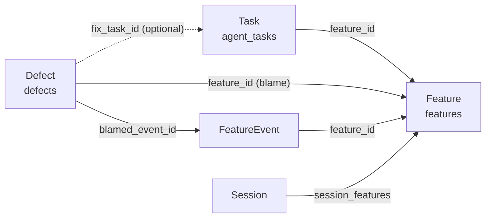

# Defect, Task and Feature

Written in the notation of [`docs/spec-notation.md`](spec-notation.md). The
canonical definitions live in `lib/orm/models/features.py`,
`lib/orm/models/tasks.py`, `lib/orm/models/defects.py` and
`lib/defects/store.py`; the redesign that produced this model, with its
acceptance tests, is [`docs/feature-ledger-redesign.md`](feature-ledger-redesign.md).

## Intent

Three entities joined by **integer foreign keys to `features.id`**. A task is a
step of at most one feature; a defect is blamed on at most one feature. Nothing
infers either edge — not from a cwd, a branch, a session or a suspect path.

**Non-goals**

- No `defects.task_id` as blame. A defect names the feature that *caused* it;
  the task that will *fix* it is a separate, optional pointer (`fix_task_id`).
- A task's status never writes a defect, and a defect never writes a task's
  status. `defects.status` asks *is this bug still real*; a task asks *is this
  work still scheduled*.
- Reporting is not triage. `regin defects open` files; it never closes, reopens
  or re-attributes.

## Model

```typescript
type Feature = {               // features
  id: FeatureId
  origin: "native" | "linear"  // (origin, external_ref) unique
  external_ref: string | null  // e.g. "CAI-274"
  body: string | null          // the spec
}

type FeatureEvent = {          // feature_events — append-only, never updated
  id: EventId
  feature_id: FeatureId
  kind: "specced" | "build_started" | "shipped" | "restarted" | "abandoned"
}

type Task = {                  // agent_tasks
  id: TaskId
  feature_id: FeatureId | null // ONE column: a task holding two features is unwritable
  kind: "spec" | "build" | "fix" | "task"  // orthogonal to status
  status: "idea" | "armed" | "queued" | "running" | "done" | "failed" | "archived"
}

type Defect = {                // defects
  id: DefectId
  feature_id: FeatureId | null // null = unattributed, a first-class state
  symptom_key: string          // dedup axis with feature_id
  status: "open" | "closed"
  triage_state: null | "declined" | "snoozed"   // null = still in the queue
  blamed_event_id: EventId | null  // the feature's last event when blame was assigned
  fix_task_id: TaskId | null
  reported_by_trace: TraceId | null  // who REPORTED it, never who caused it
}

type SessionFeature = {        // session_features — a session may build two features
  trace_id: TraceId
  feature_id: FeatureId
  provenance: "declared" | "recalled"   // `run` is derived at read time via run → task → feature
}
```



## Rules

| Question | Answer |
|---|---|
| feature stage | the last `feature_events.kind`; `shipped` splits into `shipped` / `escaped` on whether a defect is blamed against *that* event |
| rounds | `1 + count(restarted)` |
| is a defect an escape | `blamed_event.kind = 'shipped'` |
| dedup on `open` | `(feature_id, symptom_key)`; an unattributed defect dedups on `(reported_by_trace, symptom_key)` |
| attribute late | `regin defects attribute <id> <F>` sets `feature_id` and `blamed_event_id` |
| close | `regin defects close` requires the check that would have caught it (`missing_check`) |
| reopen | `regin defects reopen` — the only thing that moves a defect's `round` |
| point at a fix | `regin defects fix-item` sets `fix_task_id`; one task may serve many defects |

| Scope | Predicate | Read by |
|---|---|---|
| `unattributed` | `feature_id IS NULL` | the Features triage rail, `regin defects list` |
| `feature` | `feature_id = ?` | the feature ledger, the task page, `/defects?feature=<id>` |
| `escaped` | `blamed_event.kind = 'shipped'` | the ledger's escape count, `regin defects rounds` |

## Invariants

1. A task carries at most one `feature_id`.
2. `feature_events` rows are never updated or deleted; every lifecycle figure is
   a query over them.
3. A run settling `done` writes no `shipped` event. Only `regin feature ship`
   (or a Linear `completed` state folded in by `regin feature refresh`) does.
4. No writer derives `defects.feature_id` from `reported_by_trace`, a session's
   declared feature, or `fix_task_id` — in either direction.

## Acceptance

```gherkin
Scenario: a defect is blamed on the shipped event
  Given feature F has a `shipped` event E
  When  `regin defects open "<symptom>" --feature F` runs
  Then  the defect's blamed_event_id is E
  And   F's stage reads `escaped`

Scenario: re-opening the same symptom is idempotent
  Given an open defect on F with symptom_key K
  When  the same symptom is opened on F again
  Then  no second row is written

Scenario: a settled run does not ship its feature
  Given a task with feature_id F
  When  its run settles `done`
  Then  F has no new `shipped` event
```
