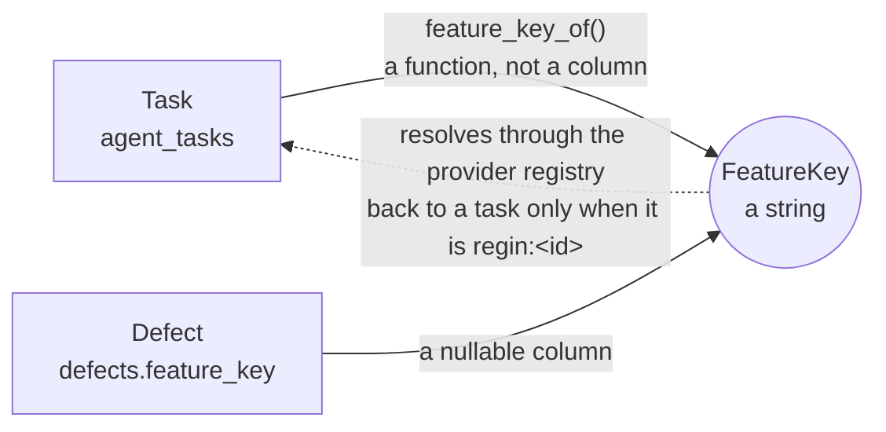
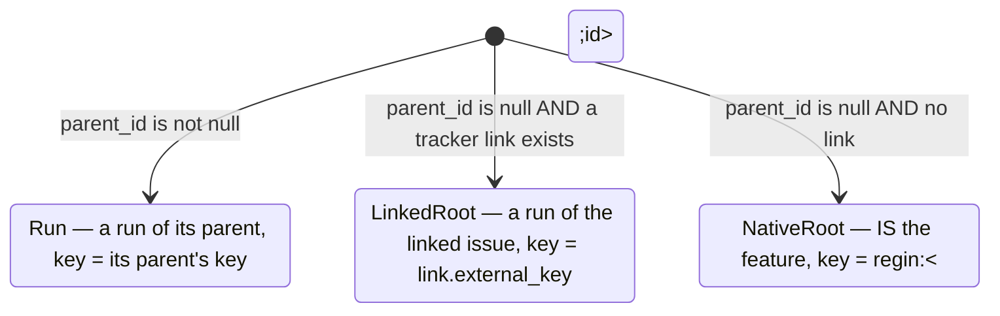

# Defect, Task and Feature

Written in the notation of [`docs/spec-notation.md`](spec-notation.md). The
canonical definitions live in `lib/orm/models/defects.py`,
`lib/orm/models/tasks.py`, `lib/defects/store.py`, `lib/tasks/links.py` and
`lib/features/lane.py`.

## Intent

Three entities, two joins, and **both joins are strings rather than foreign
keys**. A defect names a *feature key*; a task *holds* a feature key. There is
no edge between a defect and a task, and every path from one to the other is
that key. This spec exists because the three surfaces that write the key and
the three that read it had drifted: a defect could be written under a key no
surface would ever list it under.

**Non-goals**

- No `defects.task_id`. A feature outlives the tracker row that scheduled it,
  and a defect blamed on `CAI-274` must stay legible with no local task at all.
- Nothing infers the key: not from a cwd, a session, a suspect path, or a cost.
- A task's status never writes a defect, and a defect never writes a task.
  `defects.status` asks *is this bug still real*; a task asks *is this work
  still scheduled*.
- Reporting is not triage. The report path files; it never closes, reopens or
  re-attributes.

## Model

```typescript
type FeatureKey = string
// A provider-namespaced ref: `regin:<task id>` (native) | `CAI-###` (Linear) | …
// `regin:` is disjoint from every remote scheme by construction — the colon
// defeats Linear's fullmatch — so a key resolves to exactly one provider.

type Task = {
  id: TaskId
  parent_id: TaskId | null      // null = the feature; non-null = one run of it
}

type TaskLink = {               // agent_task_links
  task_id: TaskId
  provider: string
  external_key: FeatureKey      // the issue this task is a run of
}

type Defect = {
  feature_key: FeatureKey | null // null = unattributed, a first-class state
  session_id: TraceId | null     // the trace that REPORTED it, never a blame
  symptom: string                // the reporter's wording, verbatim
  symptom_key: string            // the dedup axis, case/whitespace-insensitive
  status: 'open' | 'closed'
  round: int                     // moved only by `reopen`, never by a re-report
  blamed_against_state: string | null  // write-once, at the instant of blame
}
```

Two joins, and neither is enforced by the database:



`feature_key_of(task)` is a **function over two tables**, not a stored column.
It is the rule the whole spec turns on, and it is the rule the report control
got wrong.

### The feature key a task holds



A task holds **at most one** key. Three doors lead to a second one and all
three refuse (`lib/tasks/links.py::_refuse_second_key`): attaching a link to a
task that already has one, attaching to a task something names as parent, and
re-parenting a child onto a linked task.

## Rules

**Which key a defect filed from a task page is blamed on.**

| task shape | reported against | why |
|---|---|---|
| root, no link | `regin:<id>` | the task *is* the feature |
| root, linked | `<link.external_key>` | the task is a run of that issue; the issue is the feature |
| child (`parent_id` set) | — the control is absent | a defect filed from a run reads as blamed on the run |
| root, ambiguous (two keys) | — refused upstream | such a task cannot exist; the link write refuses it |

**What `record_reporting` does with an incoming report.**

| existing row matching the dedup axis | its status | → outcome |
|---|---|---|
| none | — | `opened`, a new row, HTTP `201` |
| one | `open` | `deduped`, suspect paths unioned, HTTP `200` |
| one | `closed` | refused, HTTP `409`, pointing at `reopen` |

The dedup axis is `(feature_key, symptom_key)` when the report names a feature,
`(session_id, symptom_key)` when it does not, and **nothing** when it has
neither — a row with no feature and no session collides with nothing and is
always a fresh record.

**What `attribute` does to the blame snapshot.** `blamed_against_state` is the
tracker's raw `state_category` for the blamed feature, frozen at the instant of
blame, and it is what `escapes` is counted from.

| the incoming key | vs. the row's current key | → snapshot |
|---|---|---|
| any | the row had none | taken, for the first time |
| the same key | unchanged | kept — re-typing a key is not a new blame |
| a different key | changed | **re-taken** against the new feature |

Write-once is per *blame*, not per row. Keeping the first feature's state
across a re-attribution would leave the escape verdict describing a feature the
defect is no longer blamed on — one feature's escape counted on another's
ledger.

**How a `feature_key` is normalized on the way in.** It is identity — every
reader joins on it by equality — so the store normalizes at the one writer
rather than each caller.

| incoming | → stored | why it matters |
|---|---|---|
| `"CAI-206"` | `CAI-206` | — |
| `" CAI-206 "` | `CAI-206` | padded, it is a key `for_feature` cannot find **and** a second feature in the index's population |
| `""` / `"   "` | `NULL` | an empty string is in no scope: `unattributed` filters on NULL |
| over 200 chars | refused | the cap the model declares |

**Where a defect can be read back.** Every scope below is one predicate over
`defects`, and the union of the listable ones must be the whole table.

| scope | predicate | reached from |
|---|---|---|
| `all` | — | `/defects`, `regin defects list --all` |
| `unattributed` | `feature_key IS NULL` | `/defects?scope=unattributed`, the `/features` counter |
| `feature` | `feature_key = ?` | `/defects?feature=<key>`, the task page, the `/features` row, the feature ledger |
| `fix-item` | `(fix_provider, fix_external_key) = ?` | `/defects?fix_item=…`, `regin defects list --fix-item …` |

A fix-item query names its item the way the *write* did — a bare `CAI-241`, a
pasted issue URL, `regin:42` — and resolves it through the tracker before
querying. Both surfaces read the canonical key the write stored, so no spelling
the write accepts can read back as "nothing points at this item".

## Invariants

1. **For all defects, some listable scope contains it.** `unattributed` and
   `feature` partition the table, so `all` is their union and no row is
   unreachable. This is the invariant the ledger violated: `all` did not
   exist, no surface linked to `feature`, and every defect filed from a task
   page landed in the one scope nothing could open.
2. For all tasks, `|feature keys held|` ≤ 1.
3. For all defects filed from a task page, `feature_key` is non-null — so such
   a defect is **never** in the `unattributed` scope. Reporting against a
   feature *is* attributing it.
4. `feature_key` carries no referential integrity. A defect whose key names no
   local task is a valid row, not an orphan to clean up.
5. `session_id` on a defect records **who reported it**, never what caused it.
   Nothing derives `feature_key` from it, in either direction.
6. A defect and its feature move independently: closing a defect writes no
   task and no link, and shipping a feature closes no defect.
7. `round` moves only through `reopen`. Re-reporting the same symptom can
   never increment it, which is why a closed twin refuses rather than reopens.
8. For all defects, `blamed_against_state` describes **the feature currently
   in `feature_key`**, never a previous one. Nothing else re-reads it: a
   feature shipping after the blame must not turn an old report into an
   escape, so only a change of key re-takes the snapshot.
9. A surface rendering a scope re-reads it after any write, because a write
   can move a row out of the predicate — attributing a defect on the
   unattributed list is what that list is *for*. Patching the returned row in
   place leaves the page asserting what it has just disproved.

## Acceptance

```gherkin
Given a root task with no tracker link
When  a defect is reported from its page
Then  it is stored with feature_key "regin:<id>"
And   GET /api/defects?feature=regin:<id> returns it
And   the task page lists it on the next load

Given a root task linked to CAI-274
When  a defect is reported from its page
Then  it is stored with feature_key "CAI-274", not "regin:<id>"

Given a child task
When  its page is opened
Then  no report-defect control is rendered

Given defects exist both with and without a feature_key
When  GET /api/defects?scope=all runs
Then  every row in the table is returned
And   the unattributed scope returns exactly the rows with feature_key NULL

Given a defect already open for this feature and symptom
When  the same symptom is reported again from the task page
Then  the response is 200 with outcome "deduped" and no second row exists
And   round has not moved

Given a defect blamed on a feature the tracker reported as completed
When  it is re-attributed to a feature the tracker reports as started
Then  blamed_against_state reads "started", not "completed"

Given a defect blamed on a feature that has shipped since the blame
When  the same feature key is attributed to it again
Then  blamed_against_state is unchanged

Given a defect is opened with the feature key " CAI-206 "
When  the row is read back
Then  feature_key is "CAI-206" and /features lists no second key

Given a defect whose fix item was set from a pasted issue URL
When  the fix-item scope is queried by that URL, by the bare key, or by
      <provider>:<key>
Then  all three return the defect

Given the unattributed scope is open and one of its rows is attributed
When  the write returns
Then  that row is gone from the list and the count has dropped
```
