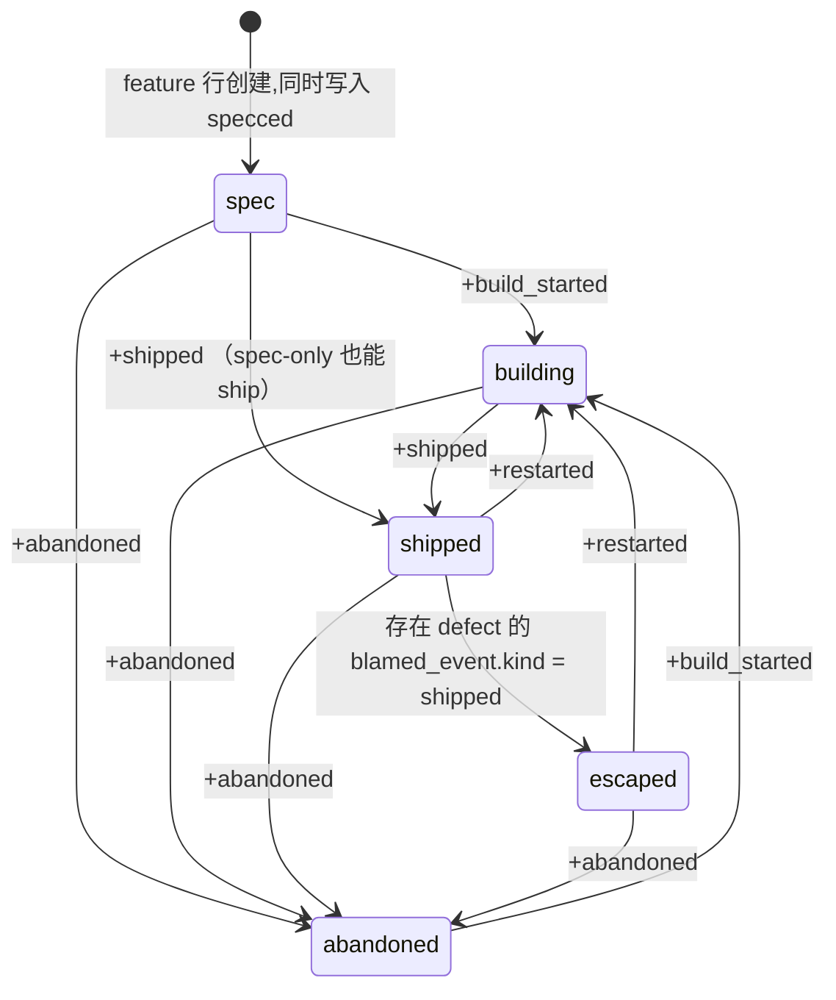
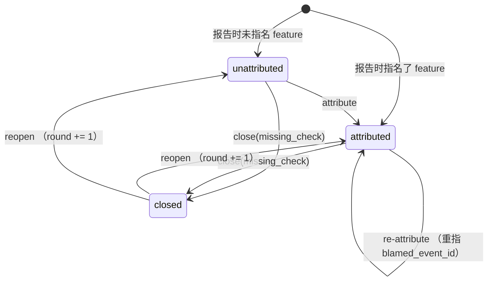

# Feature 账本重设计

规格,写在 [`docs/spec-notation.md`](spec-notation.md) 的记法里。取代
[`docs/defect-task-feature.md`](defect-task-feature.md) 所描述的模型 —— 那份文档准确地
记录了今天的设计,包括它为什么需要那么多守卫。本文的目标是让那些守卫失去存在的理由。

跟踪于 `regin:82`。

## Intent

今天 `agent_tasks` 一张表同时是**待办事项**、**feature** 和**一次 agent 尝试**,
`parent_id` 因此有两种含义。于是「什么算一个 feature」这个问题,在四个界面上有四个
互不引用的判据 —— 两个比权威口径宽、一个比它窄;而权威口径本身是一个跨五张表的
字符串 union,并且不含 done-claim 这条臂,所以一个被 ship 的 feature 可以不在人口里。

这次重设计做三件事:**feature 拿到自己的表和主键**;**它的生命周期改由一张
append-only 的事件表承载**,于是 `rounds` / `claimed_at` / `stage` / 逃逸判定全部是查询
而不是会漂的列;**一次尝试拿回自己的参数**,于是「子任务即一次运行」这个形态不再
需要存在。

判断标准不是「缺陷被修好了几条」,而是**有几条变成不可表达**。

### Non-goals

- **不重命名 `tasks`。** 混乱来自一行有三种语义,不来自那个词。feature 独立成表、
  run 拿回参数之后,`task` 重新只有一个意思。一次波及三十余个前端组件的改名换不到
  任何语义收益。
- **不改 defect 的轮次模型。** `defects.round` 仍是一个整数列,仍只由 `reopen` 推动。
  把它也事件化是另一个问题的答案,不是这个问题的。
- **不做兼容层。** 迁移期的解析端点在第 6 步被删除,不保留退役 key 注册表,不保留
  双写开关。
- **不引入推断。** 没有任何状态由 cwd、分支名、时间戳、成本或路径推出。每一条事件
  都记名。
- **不碰六个子系统。** 优先级、标签、依赖、图片、评论、项目原样保留,只改外键指向。

## Model

```typescript
type Feature = {
  id: int                      // 主键。URL、外键、span 属性一律用它
  title: string                // ≤200
  body: string                 // spec 本身,上限沿用 DESCRIPTION_MAX
  origin: 'native' | 'linear'  // 可扩展;provider 注册表决定合法值
  external_ref: string | null  // 'CAI-274';UNIQUE(origin, external_ref)
  external_url: string | null
  sync_error: string | null    // 远端不可达时的最后一条错误,不清空 external_ref
  synced_at: timestamp | null  // 远端最后一次被拉取的时刻;native 恒为 null
  created_at: timestamp
}
// `issue_cache` 整张表被这行吸收:它今天只有
// (provider, external_key, snapshot_json, synced_at) 四列,而 title / url /
// sync_error / synced_at 在这里各有一列,状态历史则由 feature_events 承载。

type FeatureEvent = {          // append-only:永不 UPDATE,永不 DELETE
  id: int
  feature_id: FK<Feature>
  kind: 'specced' | 'build_started' | 'shipped' | 'restarted' | 'abandoned'
  declared_by: 'operator' | `run:${int}` | `sync:${string}`
  trace_id: TraceId | null     // 声明发生在哪次会话里,若有
  at: timestamp
}

type Task = {                  // 今天的 agent_tasks,语义收窄
  id: int
  feature_id: FK<Feature> | null   // 单列 ⇒ 「两个 key」不可表示
  title, body, status, priority, priority_rank, project_id, assignee, tags_json
  // 移除:parent_id, claimed_at, completions_walked_back,
  //       params_json, autorun
}

type Run = {                   // 今天的 agent_task_runs,扩列
  id: int
  task_id: FK<Task>            // NOT NULL。一次尝试永远针对一个 task
  trace_id: TraceId | null
  attempt: int
  params_json, autorun   // 从 Task 搬来
  status, started_at, ended_at, exit_reason
}

type Defect = {
  id: int
  feature_id: FK<Feature> | null     // null = 未归属,仍是一等状态
  blamed_event_id: FK<FeatureEvent> | null   // 归责快照 = 指针,不是字符串
  fix_task_id: FK<Task> | null       // 闭环,在 schema 里
  reported_by_trace: TraceId | null  // 谁报的,永远不是谁造成的
  symptom, symptom_key, status: 'open' | 'closed', missing_check, round: int
}

type SessionFeature = {
  trace_id: TraceId
  feature_id: FK<Feature>
  is_primary: bool
  provenance: 'declared' | 'recalled'   // 与今天的存储值一致
  created_at: timestamp
}
// 今天 ledger 的证据列表里还有第三个 provenance:`task-link`。它从来不是存储值,
// 是读取时合成的。新设计里它改称 `run`,同样只在读取时合成 —— 由
// run → task → feature 的 join 产生,带上 run id 作为它自己的证据。
```

Feature 到 session 的另一条路不再需要一张表:`run.trace_id → run.task_id →
task.feature_id` 是一个两跳 join,取代了今天 [`lib/features/lane.py`](../lib/features/lane.py)
的四段 CTE 链。

### 状态机一:Feature 的 stage

全部从 `feature_events` 派生,没有任何存储列。



`abandoned` 从任何 stage 都可达 —— 一个已经 ship 的能力也可能被下架,而那不是一次
walk-back,不计一轮。它也不是终态:一个被放弃的 feature 重新开工,写的是
`build_started`(见下面的完整判定),同样不计一轮,因为上一次并没有被称作完成过。

`abandoned` 是新增的第五个 stage。今天一个 archived 的 feature 经
`STATE_CANCELED` 落到 `name_for` 的 else 分支,读作 `spec` —— 「已放弃」被渲染成
「已写规格、尚未开工」。这是一处顺带修掉的既有缺陷,不是范围扩张。

### 状态机二:Defect 的生命周期

与 feature 的 stage 完全正交 —— 两根轴,两张图。



## Rules

### 建一个 feature 写哪几行

| 入口 | 写入 | 说明 |
|---|---|---|
| 界面上「新建 feature」 | `features` 一行 + `feature_events` 一条 `specced` + `tasks` 一行 | 一次操作,两张表三行,同一事务 |
| `POST /api/features` | `features` + `specced`,`tasks` 可选 | 允许零 task 的 feature —— 它能被 ship,不能被 run |
| 一个已有 task 被指到某 feature | 只写 `tasks.feature_id` | 不产生事件:归属不是生命周期 |

**标题的权威在 `features.title`。**新建时两行取同一标题,此后各自独立可编辑 ——
feature 的标题回答「交付的是什么」,task 的标题回答「这一步要做什么」,两者本就
会分叉。`/features` 的每一处渲染只读 `features.title`,永不回落到某个 task 的标题。

### 事件的顺序由 id 决定,不由时刻

「最后一条事件」恒指 `ORDER BY id DESC LIMIT 1`。`at` 只用于显示。同一事务里
写入的两条事件可以共享时间戳,而自增主键是全序的 —— 用时刻排序会让一次
ship-then-restart 的先后取决于时钟精度。

### 派生值,一律不存

| 值 | 定义 | 今天由什么维护 |
|---|---|---|
| `rounds(f)` | `1 + count(feature_events WHERE feature_id=f AND kind='restarted')` | `agent_tasks.completions_walked_back` |
| `claimed_at(f)` | 最后一条 `shipped` 的 `at`,且其后无 `restarted` / `abandoned` | `agent_tasks.claimed_at` |
| `stage(f)` | 见下表 | tracker 的 `state_category` 经 `name_for` 映射 |
| `is_escape(d)` | `d.blamed_event.kind == 'shipped'` | `blamed_against_state == 'completed'` |
| `escapes(f)` | `count(defects WHERE feature_id=f AND is_escape)` —— 全时段 | 同左,但读的是可空字符串 |
| 人口 | `SELECT * FROM features` | 五臂 union |

### stage 的完整判定

读最后一条事件,再问一次逃逸。两列穷尽,无缺口。

| 最后一条事件的 kind | escapes > 0 | → stage |
|---|---|---|
| `specced` | — | `spec` |
| `build_started` | — | `building` |
| `restarted` | — | `building` |
| `shipped` | 否 | `shipped` |
| `shipped` | 是 | `escaped` |
| `abandoned` | — | `abandoned` |

「没有事件」不在表内:每个 feature 至少有一条 `specced`,见不变式 3。

### 谁可以写哪种事件

`declared_by` 是必填列,所以每条事件都记名。一条事件由谁写,决定了它的合法 kind。

| 写入者 | 可写 kind | 触发时机 |
|---|---|---|
| `operator` | `specced` | feature 行创建,同一事务 |
| `operator` | `shipped` / `abandoned` | 按下 Ship / 归档,一次人的声明 |
| `run:<id>` | `build_started` / `restarted` / 不写 | 该 run 开始,见下表 |
| `sync:<provider>` | 见远端映射表 | 远端状态被拉取,且映射后的 kind 与最后一条不同 |

### 一个 run 开始时写什么 —— 按当前 stage 穷尽

| run 开始时的 stage | → 写入 | 为什么 |
|---|---|---|
| `spec` | `build_started` | 第一次开工 |
| `building` | **不写** | 同一轮里的第二次尝试不是新的一轮 |
| `shipped` | `restarted` | 被称作完成过又重新开工 —— 这就是一轮 |
| `escaped` | `restarted` | 同上 |
| `abandoned` | `build_started` | 重新捡起,但上一次并没有被称作完成过 |

五个 stage 全部在表内。规则是幂等的:只读最后一条事件的 kind,不读时钟,
不读 run 的序号 —— 所以同一个 run 被重复上报开始也不会多计一轮。

### 远端状态 → 事件 kind

远端 feature 与 native feature 走同一条派生路径,靠这张映射表把远端词汇折进来。

| `state_category` | → kind | 说明 |
|---|---|---|
| `completed` | `shipped` | |
| `started` | `build_started` | |
| `backlog` / `unstarted` / `triage` | `specced` | |
| `canceled` | `abandoned` | |
| `unknown` | **不写事件** | 记进 `features.sync_error`。猜一个 kind 会静默决定逃逸 |

**只在映射后的 kind 与最后一条事件的 kind 不同时追加。** 于是一次 Refresh 不产生
噪声行,而一次真实的状态迁移一定留下一行。判据是标识符比较,不是时间窗。

### 一个 run 折叠成一个 session —— 原样沿用

`agent_run_sessions` 对至少一个 trace 持有两行,所以 `run.trace_id` 一旦用
`LEFT JOIN` 展开,同一个 run 会被算成两个 session。这是摄取侧的产物,与本次重设计
正交,但**新的两跳 join 必须带上同一条折叠规则**:按 `id` 取第一个别名,
`LIMIT 1`。今天这条规则住在 `lane.py` 的 `CANONICAL_TRACE` 里;`lane.py` 被删除时
它要搬家,不是消失。

历史上正是这条规则只在三处中的一处生效,导致索引数出 51 个 session 而账本数出 50。

### Defect 的去重轴

与今天同义,但连接的是整数。

| 报告是否指名 feature | 去重轴 | 约束 |
|---|---|---|
| 是 | `(feature_id, symptom_key)` | `UNIQUE` |
| 否,但有 trace | `(reported_by_trace, symptom_key)` | 部分 `UNIQUE WHERE feature_id IS NULL` |
| 两者皆无 | 不去重 | 永远是一条新记录 |

### 归责与快照

| 传入的 feature | 与行上现有的 | → `blamed_event_id` |
|---|---|---|
| 任意 | 行上原本没有 | 取该 feature 当前最后一条事件 |
| 同一个 | 未变 | 保持不变 —— 重复输入不是一次新归责 |
| 另一个 | 改变了 | 重取:新 feature 的当前最后一条事件 |

快照指向一行不可变记录,所以它**没有漂移这个可能**。今天需要写代码守的
「write-once per blame」在这里是 append-only 的自然结果。

## Invariants

1. **对任意 task,它属于至多一个 feature。**由单列外键结构性保证。今天这条由
   [`lib/tasks/links.py`](../lib/tasks/links.py) 的三道 refuse、`lane.py` 的
   `ambiguous` CTE、以及每个 reader 各自的排除子句共同维持。
2. **人口就是 `features` 表。**不存在「能被 ship 却不在列表里」的 feature。
3. **每个 feature 至少有一条事件,且第一条恒为 `specced`。**由建行事务保证,所以
   `stage` 永远有定义,不需要「尚未同步」这个第六种答案。
4. **`feature_events` append-only。**撤销一次 ship 是追加 `restarted`,不是清空一个列。
   因此 rounds 可重算、历史可审计、计数器与事实之间不存在对不上的可能。
5. **每条事件都记名。**`declared_by` NOT NULL。没有无主的状态变更。
6. **`defects.feature_id IS NULL` 是一等状态。**任何界面不得由 suspect path、
   reporting session 或成本推断它。
7. **`reported_by_trace` 记录谁报的,永不记录谁造成的。**两个方向都不推导。
8. **一条 defect 的 `blamed_event_id` 恒描述它当前归责的那个 feature。**换 feature
   才重取,feature 此后 ship 与否都不改写它。
9. **`runs.task_id` NOT NULL。**一次尝试永远针对一个 task,feature 经 task 到达。
   两个可空外键就是一根新的歧义轴。
10. **`features.external_ref` 无参照完整性要求。**远端删掉了那个 issue,本地这行
    依然是一条有效记录,不是需要清理的孤儿。
11. **事件的全序由 `id` 给出。**任何读取「最后一条」的地方都按 `id` 排序,不按 `at`。
12. **feature 不被删除,只被 `abandoned`。**删除会连带删掉它的事件,而事件是
    rounds 与逃逸的唯一来源 —— 删一个 feature 等于篡改历史。界面上没有删除控件;
    一次误建由 `abandoned` 收尾,它在人口里但不在任何未完成口径里。

## 接口与命令面

主键从字符串换成整数,所以这些面都要改。逐条列出,因为漏掉任何一条都会留下一个
读不回来的 key —— 那正是上一轮审计里第一条不变式被违反的方式。

| 面 | 今天 | 新 |
|---|---|---|
| 浏览器路由 | `/features/:key`,key 需 URL 编码 | `/features/:id` |
| 索引 | `GET /api/features` 返回 `key` | 返回 `id`,`origin`,`external_ref` |
| 账本 | `GET /api/features/<path:key>` | `GET /api/features/<int:id>` |
| defect 作用域 | `/api/defects?feature=<key>` | `?feature_id=<id>` |
| 归属 | `POST /api/features/<key>/attribute` | `POST /api/features/<id>/attribute` |
| CLI | `regin feature stage <KEY>` | `regin feature stage <ID>`,并接受 `--ref CAI-274` |
| CLI | `regin defects open --feature <KEY>` | `--feature <ID>` / `--ref` |
| span 属性 | `feature.stage` 携带 `feature_key` | 携带 `feature_id` |

`regin gate pipeline-ran` 只按 span 名计数(`feature.stage`、`defect.declared`),
不读属性值,所以属性改名不影响它 —— 但属性是 `regin feature stage` 的输出契约,
仍需同步。

**两份文档必须同改,它们是一对镜像:**[`ARCHITECTURE.md`](../ARCHITECTURE.md) 的
*Feature pipeline* 一节与 `~/.claude/skills/feature-pipeline/SKILL.md`。两边都写着命令的形状;
只改一边,技能会教下一个会话去执行一条不存在的命令。

## Acceptance

验收项即测试名。实现前先让它们红,再写实现 —— 没红过的测试不是证据。

### `tests/features/test_population.py`

```gherkin
Given 一个 feature,没有 task、没有 run、没有 defect
When  操作者声明 shipped
Then  GET /api/features 列出它
And   它的 stage 为 shipped
```
`test_spec_only_feature_ships_and_is_listed`

```gherkin
Given 库中有 N 个 feature 行
When  读取人口
Then  返回恰好 N 行,且不执行任何 UNION
```
`test_population_is_the_table`

### `tests/features/test_feature_events.py`

```gherkin
Given 一个 shipped 的 feature
When  它的某个 task 的一个 run 开始
Then  追加一条 restarted,rounds 变为 2
And   claimed_at 读出为 null
And   那条 shipped 事件仍在表里
```
`test_restart_appends_and_keeps_history`

```gherkin
Given 一个 building 中的 feature
When  第二个 run 开始
Then  不追加任何事件,rounds 仍为 1
```
`test_second_run_in_one_round_is_not_a_round`

```gherkin
Given 五个 feature,分别停在 spec / building / shipped / escaped / abandoned
When  每个都有一个 run 开始
Then  写入与判定表逐行相符,且没有一种 stage 落到默认分支
```
`test_run_start_table_is_exhaustive`

```gherkin
Given 一个被 abandoned 的 feature
When  一个 run 开始
Then  写入 build_started,rounds 仍为 1
```
`test_resuming_an_abandoned_feature_costs_no_round`

```gherkin
Given 一个 shipped 的 feature
When  它被 abandoned
Then  stage 为 abandoned,rounds 仍为 1,claimed_at 读出为 null
```
`test_abandoning_a_shipped_feature_is_not_a_walk_back`

```gherkin
Given 一个远端 feature,最后一条事件由 sync 写成 build_started
When  再次 Refresh 且远端状态未变
Then  不追加事件
```
`test_sync_is_idempotent_on_unchanged_state`

```gherkin
Given 一个远端 feature,远端返回 unknown
When  Refresh 完成
Then  不追加事件,且 sync_error 被写入
```
`test_unknown_remote_state_writes_no_event`

```gherkin
Given 一个 feature 在同一事务里被写入 shipped 与 restarted 两条事件
When  读取「最后一条事件」
Then  得到 restarted,与两行的时间戳是否相等无关
```
`test_event_order_is_by_id_not_time`

```gherkin
Given 一个 feature 与它的第一个 task 标题已被分别编辑
When  渲染 /features 与账本页
Then  两处都显示 features.title,不回落到 task 的标题
```
`test_feature_title_is_authoritative`

```gherkin
Given 一个没有 task 的 feature
When  请求运行它
Then  被拒绝,理由是没有可运行的 task —— 而它仍可被 ship
```
`test_feature_without_task_cannot_run_but_can_ship`

### `tests/features/test_stage.py`

```gherkin
Given 每一种 kind 作为最后一条事件
When  读取 stage
Then  与判定表逐行相符,且没有一种 kind 落到默认分支
```
`test_stage_table_is_exhaustive`

```gherkin
Given 一个被 abandoned 的 feature
When  读取 stage
Then  为 abandoned,不是 spec
```
`test_abandoned_is_not_spec`

### `tests/defects/test_blame_pointer.py`

```gherkin
Given 一条 defect 归责于 feature A 的某条 shipped 事件
When  重新归责到处于 building 的 feature B
Then  blamed_event_id 指向 B 的当前最后一条事件
And   它不再计入 A 的 escapes
```
`test_reattribution_repoints_snapshot`

```gherkin
Given 一条 defect 已归责于某 feature
When  该 feature 此后被 ship
Then  blamed_event_id 不变,它不因此成为逃逸
```
`test_later_ship_does_not_forge_an_escape`

```gherkin
Given 一条归责于 shipped 事件的 defect
When  统计该 feature 的 escapes
Then  计数为 1,且不读取任何字符串状态列
```
`test_escape_is_a_pointer_comparison`

### `tests/tasks/test_single_feature.py`

```gherkin
Given 一个 task 已属于 feature A
When  把它置于 feature B
Then  这是一次 UPDATE,不是第二行 —— 「两个 key」无法被写出
```
`test_one_task_one_feature`

### `tests/tasks/test_run_params.py`

```gherkin
Given 一个 task 已有一个 run
When  以不同参数再跑一次
Then  新建的是一行 run,不是一个子 task
And   两个 run 的 params_json 各自独立
```
`test_reparametrised_rerun_creates_a_run_not_a_task`

### `tests/features/test_migration_parity.py`

迁移第 5 步的对账门,四个数逐 feature 相等。

`test_sessions_match_pre_migration`
`test_cost_matches_pre_migration`
`test_rounds_match_pre_migration`
`test_escapes_match_pre_migration`

## 迁移

schema 改动按 CLAUDE.md 的规矩是两处编辑:`alembic/versions/0027_*.py`(当前 head 为
`0026`)与 `db/schema.sql` 的同步改动,外加 `lib/orm/models/` 下的字段。

1. **建新表,不动旧表。**`features`、`feature_events`,并给 `agent_task_runs` 加
   `params_json` / `autorun`,给 `agent_tasks` 加 `feature_id`,
   给 `defects` 加 `blamed_event_id` / `fix_task_id`,并把 `defects.session_id`
   改名为 `reported_by_trace` —— 让不变式 7 写在列名里,而不是只写在注释里。
   旧列一律保留。
2. **Backfill `features`。**今天人口里的每个 key 一行:`regin:N` →
   `origin='native'`;远端 key → `origin='linear', external_ref=…`。纯映射,无损。
3. **Backfill `feature_events`。**每个 feature 一条 `specced`;`claimed_at` 有值 →
   一条 `shipped`;`completions_walked_back = N` → N 对 `shipped`/`restarted`。
   全部标 `declared_by='sync:backfill'`。
4. **Backfill 指针与归属。**`agent_tasks.feature_id` 由今天的 link / parent /
   自身 key 三条路推出;`defects.blamed_event_id` 由 `blamed_against_state` 推出,
   `'completed'` 指向 shipped 事件,其余指向 `specced`。
5. **先切读,后切写。**读路径改指新表,并与旧路径逐 feature 对账
   sessions / cost / rounds / escapes 四个数。全等之后再切写路径。
   这一步同时改两份镜像文档与接口面(见上一节),因为新命令要能被跑起来。
6. **删。**`lib/features/lane.py`、`links.py` 的三道 refuse、`KEY_SQL` / `key_sql` /
   `task_id_for` 与两个正则、`agent_task_links` 表、`issue_cache` 表、`agent_tasks` 的
   `parent_id` / `claimed_at` / `completions_walked_back` / `params_json` /
   `autorun`、以及迁移期的 ref 解析端点。不留兼容层。

**迁移期唯一的临时件**是一个把旧 key 字符串解析成 `feature_id` 的解析端点,
存在于第 1 步、消失于第 6 步。它不是兼容层:它有明确的删除步骤,并且
第 6 步的验收就是「它已经不存在」。

### 两段不可还原的历史

按项目一贯的纪律,**记成 gap,不替换成零**。两者都靠
`declared_by='sync:backfill'` 可被查询区分,任何统计遇到它单独计数。

| 丢失的是 | 为什么不可还原 | 迁移后读作 |
|---|---|---|
| rounds 的**时刻** | `completions_walked_back` 只是一个整数,何时被加过没有任何记录 | 数值正确,时间戳等于迁移时刻,历史为空 |
| 9 条 defect 的归责快照 | 它们的 `blamed_against_state` 是 NULL,当时 feature 处于什么状态从未记录 | 指向 `specced`,即「不算逃逸」,并由 backfill 标记暴露这是推测 |

第二条意味着迁移后的 escapes 总数可能偏低。这个偏差有确定的上界 —— 恰好是那 9 条 ——
并且可以被查询出来,所以它是一个已知量,不是一个未知数。

## 这份设计解决了什么

对照上一轮审计([artifact](https://claude.ai/artifact/2U1YMvXm3DTjTEsWQvdrLU))的八条:

| 审计问题 | 在新设计中 |
|---|---|
| 能 Ship 一个不在人口里的 feature | **不可表达** —— 人口即 feature 表 |
| 四个互相冲突的 feature 判据 | **不可表达** —— 判据只剩主键存在性 |
| 逃逸判定静默缺失 | **不可表达** —— 快照是外键,不是可空字符串 |
| 31 个 key 的 stage 未拉取 | **不可表达** —— native 的 stage 本地即可算 |
| fix-item 闭环走不通 | 降为外键;web 控件仍需另写 |
| defect 到 task 无直达 | 降为一次 join;链接仍需另写 |
| native feature 看不到 stage | 两种 origin 共用一条派生路径 |
| web 报不了未归属 defect | **不受影响** —— 纯界面问题,schema 早已允许 |
