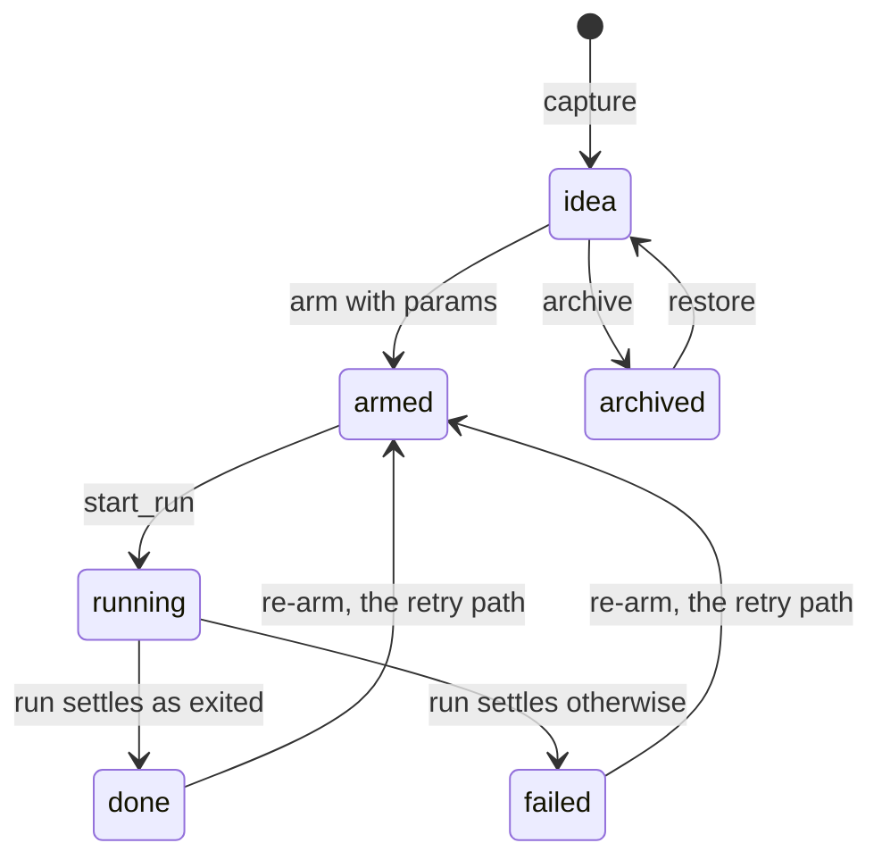
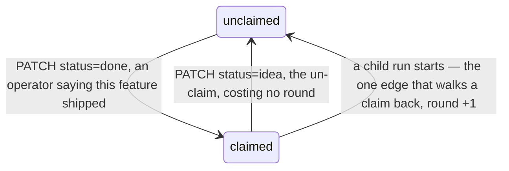

```mermaid
stateDiagram-v2
  [*] --> active: the first span lands
  active --> active: ingest — counters, tokens and cost advance; last_seen moves forward
  active --> ended: /clear, with ended_reason='clear'
  active --> ended: a manual stop, with ended_reason='manual'
  ended --> ended: a late span arrives — status holds at ended and ended_at is kept
```

# A notation for specs

Prose specs fail three ways at once: they are verbose, they are ambiguous, and
they drop branches. All three have one cause — **using prose to describe
something that is really a structure**. A state machine written as paragraphs
forces every reader to rebuild the table in their head, and the state a reader
drops while rebuilding it is a state nobody ever notices is missing.

This document defines the notation regin specs are written in, and works it
through on three of regin's own entities.

## The principle

No single language replaces prose. What works is **layering**: each layer gets a
notation a machine can check, and prose keeps only the part no machine can —
the intent, and the non-goals.

Three tests for whether a notation belongs in a spec:

1. **It is executable or checkable.** A state machine renders, a type compiles,
   an acceptance item runs. Ambiguity is caught by a tool, not by a careful
   reader.
2. **It is the single source of truth.** A rule appears in exactly one notation.
   Restating it in prose alongside is where redundancy and drift come from.
3. **It is inside the model's distribution.** TypeScript, JSON Schema, Gherkin,
   mermaid, SQL, TLA+. **Do not invent a DSL** — humans have to learn it and
   models have never seen it, so it loses on both sides.

## Choosing a notation

| What you are describing | Notation |
|---|---|
| Data shape and bounds | TypeScript type / JSON Schema / Pydantic |
| Behaviour and lifecycle | state machine (mermaid `stateDiagram-v2`) |
| Branching business rules | decision table (a Markdown table will do) |
| Concrete scenarios, acceptance | Gherkin / example table / golden test |
| Properties that always hold | an invariant list; better still, property-based tests |
| Cross-component interaction | mermaid `sequenceDiagram` |
| Concurrency and protocols | TLA+ / Alloy — worth the cost only when there is a real concurrency invariant |

## The five sections

Every spec has these five, in this order. The order is load-bearing: a reader
needs the *why* before any constraint below it can be interpreted.

### Intent
Prose, ten lines or fewer. Whose problem, and what it is. Followed immediately
by **Non-goals**, stated explicitly. This is the one place prose cannot be
replaced, because "why not" has no formal notation.

### Model
Types plus state machines. Types carry only the load-bearing fields; point at
the source for the full set (see the doc-hygiene note below).

When an entity has two orthogonal axes, **draw two diagrams**. Collapsing them
into one usually costs you a bug: two facts land in one column, and then a
change to one of them can forge the other.

### Rules
Decision tables. One row per rule, so overlaps and gaps are visible at a glance.

Every "if A and B, unless C" sentence becomes a table. A rule that will not fit
in a table is a rule that needs splitting.

### Invariants
Properties that always hold, phrased "for all X". This is the layer neither
types nor state machines reach, and it is usually where the real content of a
spec lives.

### Acceptance
Gherkin, or test names. Each item maps to a test that runs. An acceptance item
you cannot phrase as Given/When/Then is not an acceptance item — it is a wish.
Title each `Scenario:` — slicing reads the title as the test's name
(`test_<snake_case_title>`), so an untitled Given/When/Then block names no test.

## Relation to doc-hygiene

A Model section copies from source, and source moves. The constraints come from
the `doc-hygiene` skill:

- **R1** — do not copy the full field list into a doc. Copy the load-bearing
  ones and point at `lib/orm/models/`. Likewise, cite `file.py`, never
  `file.py:93`; line numbers rot on the next edit.
- **R2** — enum members and contract numbers ("the grain is exactly two deep")
  are fine to write down. Measurements are not.
- **R5** — every path reference must resolve.

The canonical definition of a Model section is always the code. The types in a
spec are **a demonstration of the notation**, not a second definition.

---

# Worked example

The three sections below are regin's own entities written in this notation. The
canonical definitions live in `lib/orm/models/`, `lib/tasks/`, `lib/features/`
and `lib/defects/`.

## 1. Task

### Intent

A task is **an idea** first. Capture has to be cheap and reachable by a third
party holding a machine key, so nothing at capture time carries an execution
parameter. Arming and execution are a later, authenticated surface.

**Non-goals**
- The capture path accepts no `cwd`, `model` or `permission_mode`.
- Nothing is inferred from a cwd, a branch name or a clock.
- The grain is exactly two deep — this is not an arbitrary tree.

### Model

Full field set in `lib/orm/models/tasks.py`.

```typescript
type TaskStatus = 'idea' | 'armed' | 'queued' | 'running'
                | 'done' | 'failed' | 'archived'

type Task = {
  parent_id: TaskId | null   // null = a feature; non-null = one run of that feature
  status: TaskStatus         // axis A: the execution lifecycle
  claimed_at: Timestamp|null // axis B: the ship claim
  completions_walked_back: int   // rounds = 1 + this; rounds itself is never stored
  params_json: Json | null   // written by the arm route alone; null = an inert task
  external_id: string | null // UNIQUE(source, external_id) — idempotency for capture replay
}

type Run = {                 // agent_task_runs, append-only
  attempt: int               // UNIQUE(task_id, attempt) — what settles a concurrent double-start
  trace_id: TraceId | null   // null = the window between writing the row and minting the id
  status: 'starting' | 'running' | 'done' | 'failed'  // a claim about intent, not liveness
}

type Dep = { task_id: TaskId; depends_on_id: TaskId }  // an edge table; both directions are queried
```

A task carries two orthogonal axes, so it gets two diagrams.

**Axis A — `status`, the execution lifecycle.** Written by run events.



**Axis B — `claimed_at`, the ship claim.** Written by the authenticated edit
surface alone.



The axes have to stay apart. Folded into one column, a run settling would ship a
feature nobody claimed.

### Rules

**Whether arming is allowed** (`ARMABLE_FROM` in `lib/tasks/store.py`; the
payload itself is validated in `lib/tasks/arm.py`)

| status | has children | → |
|---|---|---|
| idea / armed / done / failed | no | allowed; re-arming is the retry path |
| running | * | refused: parameters are already in flight |
| archived | * | refused: restore first |
| * | yes | refused: a feature holds no runs |

**Whether a parentage is allowed** — the feature grain, in `lib/tasks/grain.py`.
Every rule refuses at the act, never at read.

| condition | refusal |
|---|---|
| `parent_id == task_id` | a task cannot be its own run |
| parent does not exist | unknown task |
| `parent.parent_id != null` | the grain is exactly two deep; a run cannot hold runs |
| parent has runs | something holding runs is a run, not a feature |
| parent holds a link | one task cannot hold two feature keys |
| `task_id` has children | it is a feature, so it cannot also be a run |

**Parent status recompute** — driven by child events, reading the parent's
current status first, never bumped.

| parent is | event | → |
|---|---|---|
| archived | any | archived — a filing decision, terminal against every trigger |
| done (an operator's ship claim) | run_started | recompute, and `completions_walked_back += 1` |
| done | run_settled | done — a run settling says *this session finished*, never *this shipped* |
| anything else | run_started / run_settled / child_attached / child_detached | recompute from all children |

### Invariants

1. A task has at most one run in `starting` or `running` — guaranteed by
   `UNIQUE(task_id, attempt)`, not by a lock and not by a window.
2. `rounds` is never stored; it is always `1 + completions_walked_back`, so the
   count and the reported number cannot drift.
3. Acyclicity of the dep DAG is enforced by the writer before the insert
   (`lib/tasks/deps.py`). Acyclicity of the feature tree is **free**: two levels
   deep means a cycle needs a node that is both a child and a parent, and the
   grain forbids one.
4. "Waits for" (a dep edge) and "is a run of" (`parent_id`) are two axes; one
   pair cannot carry both.
5. Capture replay is idempotent, and NULLs never collide in a unique index, so
   hand-typed captures coexist freely.

### Acceptance

```gherkin
Given a parent task with status=done and claimed_at set
When  one of its children starts a run
Then  the parent's completions_walked_back increments and claimed_at is cleared

Given two requests that both pass the liveness check and compute the same attempt
When  both insert into agent_task_runs
Then  exactly one succeeds and the other is refused by the unique constraint

Given an archived task
When  any child event triggers a parent recompute
Then  its status is still archived
```

## 2. Feature Ledger

### Intent

Answer what one feature cost, how many rounds it took, and what leaked after it
shipped — with **every figure carrying its own gap counter**.

**Non-goals**
- Nothing infers an attribution: no cwd heuristic, no branch-name convention, no
  top-N-by-cost sweep.
- Nothing is backfilled; `coverage` is a permanent fixture of every read, not a
  launch-time apology.
- No two clocks are ever compared.

### Model

Full field sets in `lib/orm/models/features.py` and `lib/orm/models/defects.py`;
the roll-up structures in `lib/features/cost.py` and `lib/features/ledger.py`.

```typescript
type Stage = 'spec' | 'building' | 'shipped' | 'escaped'
// 'unknown' is a render-only string, never a fifth stage:
// it is a statement about us, not about the feature

type Provenance = 'declared' | 'task-link' | 'recalled'
// task-link is derived at read time from agent_task_links rather than written here —
// the link is the tracker's own live assertion, and a copy would be a stale second opinion

type SessionFeature = {      // unattributed is the absence of this row, never a sentinel
  trace_id: TraceId
  feature_key: string
  is_primary: 0 | 1          // what stops a shared session's cost being counted twice
  provenance: Provenance
  round: int | null          // null on a recalled row, which has no such instant
}

type Defect = {
  feature_key: string | null // null = unattributed, a first-class state and not a gap to fill
  symptom: string            // the reporter's own wording, verbatim
  symptom_key: string        // the dedup axis, insensitive to case and whitespace
  blamed_against_state: string | null  // write-once: the tracker's raw state_category at blame time
}

type Ledger = {
  stage: Stage | null
  cost:      { usd, upper_bound: true, sessions, recalled, shared,
               gaps: { no_usage_captured, model_unpriced } }
  work_time: { active_work_ms, gaps: { zero_duration } }
  sessions:  { rows: SessionRow[], gaps: { traceless_runs } }
  defects:   { open, total, escapes,
               gaps: { state_unknown, unknown_vocabulary } }
  coverage:  { declared_sessions, all_sessions, declared_usd, all_usd }
}
```

### Rules

**Stage** — decided by two declared facts, with nothing inferred
(`lib/defects/stage.py`)

| tracker `state_category` | escapes | → stage | blurb |
|---|---|---|---|
| `completed` | `0` | `shipped` | completed and never walked back |
| `completed` | `> 0` | `escaped` | shipped, and bugs have been blamed on it since |
| `started` | * | `building` | being built for the first time |
| anything else | * | `spec` | specified, not started |
| unavailable | * | `null`, rendered `unknown` | exit code is still 0 |

**Escape** — answered without subtraction (`lib/defects/escapes.py`)

| `blamed_against_state` | → | counted in |
|---|---|---|
| `'completed'` | an escape | `escapes` |
| `null` (never looked) | not an escape | `gaps.state_unknown` |
| `'unknown'` (looked, word not in the vocabulary) | not an escape | `gaps.unknown_vocabulary` |
| anything else | not an escape | — |

Why not `now(defect) - completed_at(feature)`: the two operands are minted by
two different machines, so a defect near the ship boundary falls on either side
of it according to host drift, and the metric ends up measuring NTP quality as
much as rework. The question is instead answered where it needs no subtraction —
at the instant of blame, where one act freezes both operands. The distortion
this admits: a defect found while a feature was still building but blamed after
it shipped counts as an escape. **Read the name literally — blamed on an
already-shipped feature.**

### Invariants

1. Unattributed means the absence of a `session_features` row. There is no
   sentinel value for it.
2. An SDK run and the conversation it drives are **one session**; the
   conversation side is canonical, and no cost is summed across the pair.
3. Provenance is decided by **identity**, never by a window: attributing your
   own trace is `declared`, attributing another — or running from a shell with
   no trace at all — is `recalled`. The borderline case, declaring your own
   session as it ends, correctly reads `declared`.
4. A session serving two features charges the primary in full and the secondary
   zero, which is what holds `∑ per-feature cost ≤ total attributed spend`. The
   per-row `upper_bound` flag is a literal, not a computation: it is correct for
   a feature charged in full, and inverted for one that is only ever the
   secondary, whose figure is a lower bound.
5. A failed fetch writes nothing. Freshness has exactly two states — never
   fetched, or fetched at T. There is no "tried and failed" third state, because
   no reader could act on one.
6. `defects.status` asks *is this bug still real*; a tracker item asks *is this
   work still scheduled*. Neither is ever written from the other.

### Acceptance

```gherkin
Given a feature whose tracker is unavailable
When  regin feature ledger runs
Then  it exits 0, renders "unknown" for the stage, and prints every local figure

Given a session attributed to two features, one of them is_primary=1
When  the cost of both features is computed
Then  the session's usd counts on the primary side only, and as shared on the other

Given a defect blamed while its feature was started
When  that feature later reaches completed
Then  escapes does not increase, because blamed_against_state is a write-once 'started'
```

## 3. Session

### Intent

A session is **one traced conversation** and the aggregates maintained for it at
ingest time. It is the single source of truth for cost, work time and tokens;
the ledger reads it and never duplicates it.

**Non-goals**
- Nothing infers which feature a session was building — that is always a
  declaration.
- `cwd` is display-only; repo membership lives in `session_repos`.

### Model

Full field set in `lib/orm/models/trace.py`.

```typescript
type Session = {
  trace_id: TraceId                // PK
  status: 'active' | 'ended' | null
  ended_reason: string | null      // 'clear' | 'manual' | …
  origin: string                   // defaults to 'session'; an extensible category, not a boolean

  peak_context_tokens:      int|null  // all-inclusive, server-side sub-calls included
  peak_main_context_tokens: int|null  // the main conversation's peak, sub-calls excluded
  live_context_tokens:      int|null  // the main-flow peak since the most recent /compact

  cost_usd: float | null           // summed from turn_usage.cost_usd
  active_work_ms: int | null       // the union of root-span intervals, overlaps merged
}
```



### Rules

**Which context peak to read**

| The question | Read |
|---|---|
| How much context did this session reach, sub-calls included | `peak_context_tokens` |
| How large did the main conversation itself get | `peak_main_context_tokens` |
| How full is the window now (the ctx% headline) | `live_context_tokens`, which drops after a compact |

**The three shapes of a gap** — counted separately because each is fixed
differently (`lib/features/cost.py`)

| test | gap | meaning |
|---|---|---|
| `cost_usd is null` and every token count is 0 | `no_usage_captured` | an ingestion gap in regin itself |
| `cost_usd is null` and tokens are present | `model_unpriced` | model outside the pricing catalogue — the only one fixable by editing a price table |
| `active_work_ms == 0` | `zero_duration` | a gap wearing a number's clothes; the column is never NULL |

### Invariants

1. `trace_id` is globally unique and immutable. Every lateral relation —
   feature, repo, tag, run — is a join table keyed on it rather than a column on
   `sessions`, because a session can have two features and two repos.
2. A session that has `ended` never revives to `active`; a late span holds the
   status at `ended` and keeps `ended_at`.
3. The counters are aggregates maintained at ingest time, not a `COUNT(*)` at
   read time. Raw aggregate readers must exclude `PENDING` rows —
   `session_spans` is append-only, and all dedup, reparenting and reordering
   happens at read time in `lib/trace/merge.py`.
4. `active_work_ms` is a **union** of intervals, not a sum; an overlap counts
   once.
5. A NULL `cost_usd` has two distinct causes (see the table above), and no
   report may fold them into one number.

### Acceptance

```gherkin
Given a session with status='ended'
When  a late span belonging to it is ingested
Then  its status is still 'ended' and ended_at is unchanged

Given a session with spans but no turn_usage rows
When  it enters a feature's ledger
Then  cost.usd is unchanged by it and gaps.no_usage_captured increments

Given a session that compacts mid-conversation
When  the ctx% headline is read
Then  it drops, via live_context_tokens, while peak_context_tokens holds at the pre-compact high
```

---

## What the notation surfaces

Three things tend to fall out of writing a spec this way that prose never
surfaces:

**Orphan states.** Draw every enum member into the state machine and the one
with no inbound edge becomes visible. `queued` in `TASK_STATUSES` is an example:
`lib/tasks/integrations/regin.py` maps it onto an external state, but neither
the transition table in `lib/tasks/store.py` nor `lib/tasks/runs.py` writes an
edge into it.

**Where two axes touch.** Drawn as two diagrams, `status` and `claimed_at` share
exactly one edge — a child run starting — and that edge is the entire origin of
`rounds`. Drawn as one diagram, that fact is invisible.

**Repeated shapes across entities.** Cost gaps, defect gaps and session gaps are
one shape, `{ value, gaps }`, currently spelled as three separately named dicts.
Putting the three Model sections side by side is what makes the shape show.
