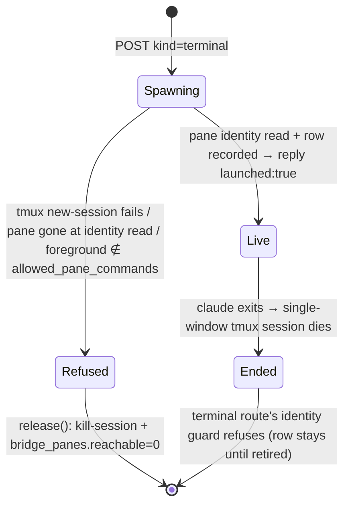

# Let New session create a terminal session

## Intent
Today "New session" (`NewSessionButton` → `LiveLaunchSheet` → `POST /api/agent-runs`) always
starts an **SDK-spawned** run (`lib/agent_sdk/supervisor.launch`). An interactive `claude`
TUI can do things the SDK run cannot (slash commands, `/` menus, TUI-only flows, native
permission prompts). This feature adds a second **kind** to the same form: launch an
interactive `claude` in a tmux pane regin owns, and land the operator on that session's detail
page (`/trace/sessions/:id`); the browser terminal (`/terminal/:id`, `SessionTerminalPane`)
attaches to the pane from there.

Built entirely from parts that already exist: regin's own tmux server
(`settings.agent_bridge.attach_socket`, as `lib/agent_bridge/attach.py` uses), the
`bridge_panes` row shape `attach._record` writes, and the admin-gated PTY terminal
(`lib/agent_bridge/terminal.py`, `web/blueprints/terminal.py`).

## Non-goals
- One-shot (`-p`) — meaningless for an interactive TUI.
- A regin "stop" control for terminal sessions: the operator exits `claude` in the terminal.
- Origin/tagging of terminal-launched sessions (`REGIN_LLM_SURFACE`-style); follow-up.
- Any change to the SDK launch path's behaviour.

## Shape
```ts
type LaunchKind = "sdk" | "terminal"            // default "sdk" — existing clients unchanged

// POST /api/agent-runs  (body gains one optional key)
interface LaunchBody {
  kind?: LaunchKind
  prompt?: string; cwd?: string; model?: string; effort?: string
  permission_mode?: string; worktree?: { branch: string; base: string }
  one_shot?: boolean                            // refused when kind == "terminal"
  resume?: string                               // terminal: `--resume <cli id>`, see Resume
}
type LaunchReply =
  | { launched: true;  trace_id: string; kind?: "terminal"; worktree?: string; warning?: string }  // kind only on terminal replies (I4)
  | { launched: false; detail: string; worktree?: string }
  | { error: string }                            // 400: bad field / refused combination

// GET /api/agent-runs/launch-options  (gains)
interface LaunchOptions { /* existing … */ terminal_available: boolean; terminal_detail: string }
```
Server side: `lib/agent_bridge/launch.py` — `unavailable_reason(role) -> str` (one function feeds
launch-options and the POST) and `launch_terminal(...) -> TerminalLaunch | raises TerminalLaunchRefused`,
reusing `attach._tmux`/`_pane_identity`/`_record(cwd=)`/`release_session(name, trace_id)`.
The POST branches on `kind` before the `agent_sdk.enabled` check (`_launch_terminal` / `_launch_sdk`).

Command run in the pane (argv, never a shell string):
`<abs path of claude> (--session-id <uuid4> | --resume <cli id>) [--model M] [--effort E] [--permission-mode P] [-- prompt]`
in `tmux -L <attach_socket> new-session -d -s term-<uuid[:8]> -c <cwd> -x 200 -y 50 -e PATH=<server PATH> -e REGIN_BRIDGE=1 …`.
The `--` is load-bearing: without it a prompt opening with `-` (`--dangerously-skip-permissions`, a markdown bullet) is parsed as a flag.

## Rules

### Availability (decision table, evaluated at launch-options AND at POST)
| agent_bridge.enabled | agent_bridge.terminal_enabled | caller role | `tmux` + `claude` on server | terminal kind |
|---|---|---|---|---|
| false | – | – | – | unavailable: "bridge disabled" |
| true | false | – | – | unavailable: "terminal disabled" |
| true | true | not admin | – | unavailable: "admin role required" |
| true | true | admin | either missing | unavailable: names the missing binary |
| true | true | admin | both | available |

`agent_sdk.enabled` gates **only** SDK kind; terminal kind does not require it (and vice versa).
The form hides nothing: the kind toggle is always shown; an unavailable kind is disabled with `terminal_detail` as its reason.

### Field applicability for kind = terminal
| field | handling |
|---|---|
| cwd, worktree | same resolution as SDK (`_worktree_cwd`), passed as tmux `-c`; blank = `settings.project_root`; a non-directory → `launched:false` "no such directory: …" before spawning (tmux would silently fall back to `$HOME`) |
| model, effort, permission_mode | CLI flags; blank = omit flag |
| prompt | optional; non-blank → `-- <prompt>` at the end of argv (first turn typed for you) |
| resume | resolved like SDK kind (`_resume_target`), then `--resume <cli id>` replaces `--session-id` — see Resume |
| one_shot | 400 "one_shot is not supported for terminal sessions" |
| gating warning (`shadowed_gating`) | never emitted — no SDK permission callback exists |

### Identity (no polling, no timeouts)
- The trace id is **chosen by regin** (uuid4) and passed as `--session-id`; the hook's `session.start` for that process carries the same id. No discovery step, no waiting.
- The launch writes the `bridge_panes` row itself (same upsert as `attach._record`, `tmux_socket` = the attach socket's absolute path) **before replying**, so `/terminal/<trace_id>` can attach the instant the client navigates. The SessionStart hook's later upsert of the same `(trace_id, pane)` is idempotent.
- `claude` argv[0] is resolved to an absolute path (`shutil.which` in the server's env) — the tmux server does not inherit the spawner's PATH (lesson 71c757cb).
- Pane env: `-e PATH=<server PATH>` (an nvm `claude` needs its `node`; an already-running tmux server has its own stale global env) and `-e REGIN_BRIDGE=1`. Deliberately **not** `child_env`'s `REGIN_BRIDGE=0`: that guard exists because a spawned child inherits the *server's* `TMUX_PANE`; inside this pane tmux sets `TMUX_PANE` to the pane regin just created, so the SessionStart hook registering it is correct, and keeps `/clear` succession working like any bridged session.

### Resume (terminal kind)
| `resume` names | resolves to | reply `trace_id` |
|---|---|---|
| a stopped regin run (`sdk-…` or any of its ids) | the run's CLI child (`_resumed_child`) | that child id — the run's `sdk-…` trace does not grow |
| an id regin has no run for | itself | itself — the session keeps its trace |
| a run still live / starting in the SDK | 400 | – |
| a CLI id live in a terminal pane (either path above) | 400 "live in a terminal" | – |
| anything that is not a uuid | `launched:false` "not a CLI session id" | – (it would reach argv and the tmux target name) |
- `--resume` without `--fork-session` keeps the CLI's id, so the pane session is `term-<cli id[:8]>` and the `bridge_panes` upsert lands on the existing trace.
- resume + worktree is 400, as for SDK kind (the CLI resolves the id against the cwd it ran in).
- The run-row liveness check applies to SDK kind too: a run's child reopened in a pane is no longer idle just because its run stopped.

### Pane lifecycle


### Invariants
- I1 — Each terminal launch owns exactly one tmux session `term-<id8>` on `attach_socket`; never a pane on the operator's tmux server.
- I2 — `launched:true` ⇒ a reachable `bridge_panes` row with `trace_id == reply.trace_id` exists and its pane's foreground command ∈ `allowed_pane_commands`.
- I3 — `launched:false` or 400 ⇒ no tmux session and no reachable row left behind (worktree, if created, is still reported as today).
- I4 — Body without `kind` behaves byte-identically to today's SDK launch.
- I5 — The launch draft (`useLaunchDraft`) persists `kind` like every other field.

### Client
- `LiveLaunchSheet` gains `LaunchKindField` (radio: SDK run / Terminal); picking Terminal disables the one-shot box (with a note saying it is an SDK-run option) and suppresses the gating warning; the resume picker stays, sends `resume` for both kinds, and labels rows per kind (`resumeKindLabel(kind, launchKind)`: terminal kind reads "terminal session · keeps its trace" / "regin run · reopens its conversation in a pane"). A draft kind the install cannot serve settles to the other kind when that one is available; the "tier is off" panel shows only when neither is.
- Hosts route through `utils/launchTarget.js::terminalLaunchRoute`.
- On `launched` with `kind == "terminal"`, hosts navigate to the session detail page `/trace/sessions/<trace_id>` (not `/live/<trace_id>`, not `/terminal/<trace_id>`). Applies to every host of the form: `SessionsView`, `SessionTraceView` (via `NewSessionButton`), and the `/live` sheet.
- Dialog description no longer says only "a claude session regin owns" — it names both kinds.

## Acceptance
```gherkin
Feature: New session can create a terminal session

  Scenario: terminal launch starts an interactive claude on regin's tmux server
    Given agent_bridge.enabled and terminal_enabled are true and the caller is admin
    When POST /api/agent-runs {"kind":"terminal","cwd":"<repo>"}
    Then the reply is launched:true with a uuid trace_id and kind "terminal"
    And `tmux -L <attach_socket> has-session -t term-<trace_id[:8]>` succeeds
    And the pane's foreground command is in allowed_pane_commands
    And bridge_panes has a reachable row for trace_id before the reply returned

  Scenario: the browser terminal attaches with no wait
    Given a terminal launch just returned trace_id T
    When the client opens the WebSocket /api/sessions/T/terminal immediately
    Then it is not refused with "no reachable pane"

  Scenario: the session in the trace is the one regin named
    Given a terminal launch returned trace_id T
    When claude's SessionStart hook fires
    Then the session row / session.start span has trace id T (no second id for the same process)

  Scenario Outline: availability is refused with a reason, before anything is spawned
    Given <condition>
    When POST /api/agent-runs {"kind":"terminal"}
    Then the reply is launched:false with detail "<detail>" and no tmux session exists
    Examples:
      | condition                         | detail               |
      | agent_bridge.enabled is false     | bridge disabled      |
      | terminal_enabled is false         | terminal disabled    |
      | caller role is editor, not admin  | admin role required  |

  Scenario: one_shot is rejected for terminal kind
    When POST /api/agent-runs {"kind":"terminal","one_shot":true}
    Then the status is 400 and no tmux session is created

  Scenario: terminal kind resumes a session under its own id
    When POST {"kind":"terminal","resume":"<cli uuid U>","prompt":"carry on"}
    Then the reply is launched:true with trace_id U and the pane argv is claude --resume U -- "carry on"

  Scenario: terminal kind resumes a stopped regin run as its CLI child
    Given run sdk-R stopped with CLI child C
    When POST {"kind":"terminal","resume":"sdk-R"}
    Then the reply trace_id is C and the argv has --resume C

  Scenario Outline: a resume that cannot be reopened spawns nothing
    Given <state>
    When POST {"kind":"terminal","resume":<id>}
    Then the launch is refused and no tmux session is created
    Examples:
      | state                                 | id                                |
      | run sdk-R is live in the SDK          | "sdk-R"                           |
      | CLI id C is live in a terminal pane   | "C" or "sdk-R" (whose child is C) |
      | –                                     | "--dangerously-skip-permissions"  |
      | – (with a worktree in the body)       | "<uuid>"                          |

  Scenario: UI continues a picked session in the terminal
    Given the New session dialog with kind Terminal and a session picked from "Pick a session to continue…"
    When the operator clicks Launch
    Then the body carries resume and the browser lands on /trace/sessions/<that id>

  Scenario: launch options tell the form whether terminal is offered
    Given terminal_enabled is false
    When GET /api/agent-runs/launch-options
    Then terminal_available is false and terminal_detail is "terminal disabled"
    And the Terminal kind option in the New session dialog is disabled showing that reason

  Scenario: model, effort, mode, prompt and worktree reach the CLI
    When POST {"kind":"terminal","model":"opus","permission_mode":"plan","prompt":"hi","worktree":{...}}
    Then the pane's process argv contains --model opus, --permission-mode plan, --session-id T and ends with "hi"
    And the pane's cwd is the created worktree

  Scenario: a pane that is not claude is torn down
    Given the pane is gone, or its foreground command is not in allowed_pane_commands, when its identity is read
    When POST {"kind":"terminal"}
    Then the reply is launched:false and neither the tmux session nor a reachable bridge_panes row remains
    # A claude that exits AFTER the identity read is not caught at launch (no polling/waiting by
    # project rule); it is the Ended path — the terminal route's identity guard refuses it.

  Scenario: a prompt that looks like a flag is a first turn
    When POST {"kind":"terminal","prompt":"--dangerously-skip-permissions"}
    Then the pane argv ends with "--", "--dangerously-skip-permissions"

  Scenario: a missing working directory is refused before spawning
    When POST {"kind":"terminal","cwd":"/does/not/exist"}
    Then the reply is launched:false with detail "no such directory: /does/not/exist" and no tmux session exists

  Scenario: omitted kind is today's SDK launch
    When POST /api/agent-runs without "kind"
    Then supervisor.launch is called exactly as before and no tmux session is created

  Scenario: UI lands on the session detail page
    Given the New session dialog on /sessions with kind Terminal selected
    When the operator clicks Launch
    Then the browser navigates to /trace/sessions/<trace_id>
```


