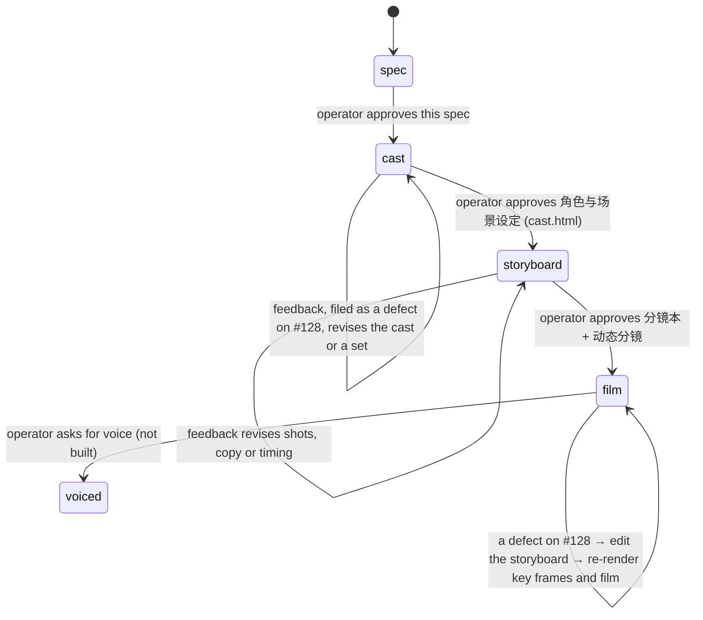
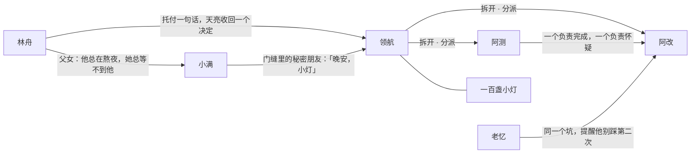

# Feature #128 — regin 未来 AI 工作台宣传电影：《天亮以前》(v1, kept) · 《晚安，小灯》(v2, the character film)

## Intent
Two 2–3 minute concept films about how people will work with AI, with regin as the workbench, rendered by one code stage. Both carry one promise: you leave a sentence at night, AIs work through it, and at dawn you make one decision, which you can make because every step was visible. Both end on 「看得见，才放得下。」 and 「今晚，睡个好觉。」
- **v1 《天亮以前》** tells the story in abstract light: a plain of agent lights, title cards and code. It was rendered on 2026-10-01 (27 shots, 166.2 s) and is kept exactly as rendered.
- **v2 《晚安，小灯》** tells it through characters who are bound to each other. 林舟 is a father who works nights. 小满 is his daughter, who waits for him. The little lights come out of his laptop and work his desk. The film retells 《小精灵和鞋匠》: the shoemaker hid to watch the elves, but 林舟 doesn't have to, because every step leaves a thread he can see. v2 has to be 精致 down to the frame, designed shot by shot (分镜) and cinematic.

The operator gates v2 three times, in order: the cast and sets, then the 分镜本 with an animatic, then the film. Nothing downstream renders until the gate above it is approved. Voice and music come last, and only if asked.

Non-goals:
- Voice-over, music and sound design. Both films are silent with subtitles. v2's 分镜 carries a 声音 plan for later.
- Photoreal people and generative-model imagery. Every frame is rendered by code, so a re-cut is a re-render.
- Real regin UI footage. That is #127. Screens in the films show designed pictures of regin's ideas.
- Any change to v1. A v1 change is its own defect on #128, and it re-renders v1.
- Publishing or uploading. That is the operator's act.

## Decisions

### The shared stage (built for v1; v2 inherits it)

| # | Decision | Rejected alternative | Why |
|---|---|---|---|
| D1 | **Rendered by code.** `frontend/film/stage/` is a deterministic WebGL2 stage, run in headless Chromium on the GPU (`--use-angle=metal --enable-gpu`). A frame is a pure function of (storyboard, shot, t). v1's twelve worlds draw its scenes: `plain` (the night/dawn plain of agent lights), `card`, `mark`, `sentence`, `bloom`, `code`, `weave`, `trace`, `verify`, `source`, `memory` and `decide`. | (a) Generative image/video models. (b) three.js / Remotion. (c) Screen-recorded product UI. | (a) needs network access and keys, is not reproducible, and cannot re-cut one line. (b) adds a dependency for what is fullscreen shaders plus Canvas2D. (c) is #127. |
| D2 | **One storyboard per film** holds every shot: its world, duration, 画面 description, camera, transition (as text and as a machine field), subtitle lines with in/out times, and world params. v2's also holds the cast, the relations, the sets and each shot's 分镜. Key frames, the review sheet and the film all derive from it. | A script document plus a separate render config | Two sources drift. The 画面 and 转场 text have to be true of what is rendered. |
| D3 | **Look.** A 3840×2160 master with a 2.39:1 letterbox inside 16:9. The pipeline runs HDR scene → bloom (Jimenez 13-tap chain) + anamorphic streak → ACES → per-shot grade → grain, vignette and slight chromatic aberration. Two temperatures carry the story: cold cyan for the AIs, warm amber for the person. The grades are `night`, `warm`, `code`, `alarm` (the doubt cards), `dawn` and `card`. v2 keeps the pipeline and the letterbox; a shot picks a grade and can override it with `look`. | Flat 16:9 motion graphics | Trailer grammar. The warm/cold split tells the whole story in one glance. |
| D4 | **Subtitles sit in the lower letterbox bar.** PingFang SC 300, no end punctuation, a pause shown as a wide space (Chinese film convention), 0.3 s fades. **Title cards (字卡)** are in-picture typography in Songti SC. Text that belongs to the picture (a typed sentence, a card's rows, a screen) is 画面字. | Subtitles burned over the picture | The picture stays clean, and the bar can carry the VO transcript once voice is added. |
| D5 | **Review before production.** There is one key frame per subtitle line, taken 60% into the line (or at its `still`), plus the hero moment of each shot without lines. Each is snapped to the frame grid, so every key frame is a frame of the film. The review sheet puts 文案全文 first, then shows each shot as frames with its 画面, 镜头, 字卡/画面字, 字幕 and 转场 (the text, plus the cut as rendered). v2's sheet is the 分镜本 (R5). | One frame per shot | Each line has to be judged over the picture it plays on. |
| D6 | **2D depth of field.** Canvas2D layers draw into shared depth buckets (blur 0–96 px, the wide ones at reduced resolution), and each bucket is blurred once. `Depth.at()` resets text state (align, baseline, letter-spacing) on every call, because the buckets are shared by every world. | Per-element `ctx.filter` blur | Cost at 4K. And a centred card had shifted another world's left-aligned labels. |
| D7 | **Transitions are machine fields on the shot.** `enter` is `fade` from black or `dissolve` from the previous shot, with an optional `push`. `exit` is `fade` to black. A shot without them cuts. A dissolve is centred on the cut, so the runtime stays the sum of the durations: the outgoing shot plays past its end and the incoming one starts before its start. The stage composites the dissolve on the GPU from two pure frames (the outgoing one pushed in by `push`, eased with the mix weight). Fades scale the picture under the subtitle bar. | (a) ffmpeg `xfade` between per-shot segments. (b) Overlapping dissolves that shorten the runtime. | (a) needs handles rendered for each segment and a second encode generation, while the stage already has both frames. (b) moves every later subtitle. |
| D8 | **Film render.** `film.mjs` renders every frame of the cut on the frame grid (shot boundaries on whole frames) and uploads each raw (RGBA, bottom row first) as a `Blob` POST to the local stage server. The server streams it into one ffmpeg: vflip → BT.709 limited range → libx264 `slow`/`film`, producing a 2160p master (CRF 16) and a 1080p cut (CRF 18) in the same pass. Each spent Blob is collected with `gc()` (Chromium runs with `--js-flags=--expose-gc`). Outputs are written as `.part` and renamed only after ffmpeg exits clean. `<slug>.json` records the frame table and a digest of the storyboard plus every source under the stage directories its page loads from. | (a) PNG frames on disk. (b) `ArrayBuffer` POST bodies. (c) WebCodecs in the page. | (a) ~15 MB per 4K frame, ~75 GB in all. (b) ~950 ms per 4K frame, against ~20 ms for a Blob. (c) no x264 rate control, and the master needs a second encode. Without the `gc()`, the browser's blob store fills at ~2 GB and refuses frame 65. |
| D9 | **Motion blur is opt-in per shot** (`motionBlur: n`). The stage composites n instants across a 180° shutter centred on t and averages them in linear HDR, then runs bloom, grade and grain once. Subtitles and fades belong to the frame. | (a) Blur on every shot. (b) Averaging finished frames. | (a) costs n× on the shots that need it least. (b) averages the grain away and blurs after the tone curve. |

### v2

| # | Decision | Rejected alternative | Why |
|---|---|---|---|
| V1 | **Characters and sets are SDF geometry, raymarched on the shared stage.** New worlds draw v2's sets. A rig in JS turns each character's pose, expression and gaze into joint transforms, passed to the shader as uniforms. The shader writes HDR colour and linear depth into the stage's scene, and the shared post (bloom, ACES, grade, grain, letterbox, subtitles) finishes the frame. Screens and paper (the laptop, the phone, the card, the drawing) are Canvas2D textures the shader samples, so their type stays crisp. Budget: a 4K frame in ≤ 3 s on this Mac (v1 averaged 0.18 s), so the 4176-frame cut renders in under 3.5 h. The crowd of a hundred lights must not multiply the per-pixel cost. | (a) 2D vector puppets. (b) three.js with glTF/VRM characters. (c) Blender. (d) Generative image/video models. (e) Local diffusion models. | (a) is flat, and every angle has to be redrawn by hand. (b) has no licensed character of this quality on hand, gives a game-asset look, and puts a second renderer beside the post. (c) is not installed, is a second pipeline, and takes minutes per frame. (d) needs an account and the network at render time (none is configured here), is not reproducible, lets faces drift between shots, and cannot re-render one line of a re-cut. (e) needs tens of GB of weights and per-character training for consistency, and its motion is limited to parallax. SDF keeps D1: a frame is a pure function, and a character is the same in every shot by construction. |
| V2 | **Look: 微缩定格 (miniature stop-motion).** The figures are about three heads tall. Clay faces have bead eyes that hold catchlights, and the hair is sculpted. Clothes are felt and knit, props are wood and paper, and surfaces carry a faint fingerprint texture. The AIs are thumb-sized glowing beings. Every light is motivated: the laptop and phone screens, the desk lamp, the night light, the moon, the dawn sun and the AIs' own glow. People are lit warm and the lights glow cold; 领航 carries a warm core, which is the sentence. Depth of field is as shallow as on a puppet set. | A smooth CG-cartoon (Pixar-like) human | A handmade figure reads as intentional, where an imperfect CG face reads as cheap. Puppets are 卡通 and 实体 at once. The miniature scale turns the desk into a world, which is the workbench. |
| V3 | **Story: 《小精灵和鞋匠》 retold.** In the tale, the shoemaker left leather out at night and found shoes at dawn, and because he could not see how, he hid to watch. In the film, 林舟 leaves one sentence, the little lights work his desk, and every step unspools a thread. At 3 a.m. he does not open the door; he opens the trace. v1's copy carries over: the hook, 读·改·测·再来, 痕迹, 源头, 同一个坑, 怀疑, the decision, the tagline and the callback. The picture book on his knee in the bedroom is that tale. | A new story | The tale supplies the relationships (people and their helpers), the doubt (he wants to watch) and the dawn reveal (the finished work on the bench). The father–daughter pair supplies the stakes. The copy the operator approved for v1 stays. |
| V4 | **The trace is literal, and it is data.** One graph of stations and steps drives the threads on the desk, the trace map on the phone and the counts on the dawn card. | Drawing each of them separately | What he sees on the phone has to be what happened on the desk. That is the film's whole claim, and the s25 → s26 graphic match depends on it. |
| V5 | **24 fps.** v1 stays at 30. | 30 fps | Cinema cadence, and a fifth fewer frames to render. |
| V6 | **Depth of field comes from real depth.** A gather bokeh pass inside v2's worlds runs before the shared post. It uses thin-lens CoC from the shot's focus and aperture, keeps the near and far fields apart so a sharp subject never bleeds onto a blurred background, and draws 2:1 oval bokeh for the anamorphic look. Canvas2D overlays keep D6. | v1's depth buckets | Buckets need discrete layers, and a set has continuous depth. |
| V7 | **The 分镜 is machine fields on the shot**, checked against the camera and the rig: 焦段 against the fov, 运镜 against the camera's moves, and 景别 against where the frame cuts the focus subject. | A 分镜 document beside the storyboard | D2: two sources drift. A 分镜 that says 特写 over a 中景 is false. |
| V8 | **Every cut names its motivation** (`link`): 动作, 视线, 物件, 图形, 光, 同轴, 对比 or 时间. | Unannotated cuts | Shots that follow from each other are what 有关联关系 means on the timeline. A cut nobody can give a reason for is the first thing that reads as unpolished. |
| V9 | **A character is defined once, in the cast**: proportions, palette, materials, wardrobe and its expression set. A shot sets only placement, facing, pose, expression, gaze and the states the cast declares (眼镜 off, holding the phone). | Per-shot character params | Consistency across shots is the first thing 精致 means for a character. |
| V10 | **Three gates**: 角色与场景设定 → 分镜本 + 动态分镜 (animatic) → 成片. | v1's single storyboard gate | The characters carry the risk: a face rejected after 41 shots means 41 shots wasted. The animatic lets the operator judge timing and performance before the 4K render. |
| V11 | **v1 is frozen beside v2.** v2 adds an engine next to v1's stage: its own page and worlds, importing v1's libs and the `card`/`mark` worlds read-only. It edits nothing v1's digest covers. Each film writes only under `out/<slug>/`, and v1's outputs move there once. | (a) Generalise v1's stage in place. (b) Fork a copy of it. | (a) Any edit to v1's stage makes v1 a different render of the same storyboard. Unchanged sources are the cheapest proof that the kept film is the one the operator saw. (b) Two post pipelines drift, and the post is the look. |
| V12 | **The words are 旁白 in v1's second person, plus two lines of dialogue, both 小满's.** Each line names its speaker (`who`) or is 旁白. A speaker is on screen in the shot or the line is marked 画外音 (`os`). | Letting the characters carry the story in dialogue subtitles | Mouths moving without sound under a bar of conversation read as a muted soap. The approved copy is narration, and a later voice pass needs speakers. |

## Model

```ts
// One file per film: the only place its copy, cast, shots and cuts live (I1).
//   v1: frontend/film/storyboard.zh.json (frozen, I6) · v2: frontend/film/goodnight-little-lights.zh.json
interface Storyboard {
  title: string; title_en: string; brand: string; logline: string    // slug(title_en) names out/<slug>/
  fps: number                                       // v1 30 · v2 24
  stage?: string                                    // the page that renders it; absent = v1's stage
  acts: { id: string; name: string }[]              // both: 序·今夜 / 一·长夜 / 二·疑问 / 三·看见 / 四·天亮
  cast?: Character[]; relations?: Relation[]; sets?: SetDef[]        // v2; a cast puts the film under R10–R16
  shots: Shot[]
}
interface Character {
  id: string; name: string; kind: 'human' | 'ai'
  bio: string; look: string; arc: string            // 人物小传 / 外形 / 弧光, one line each
  expressions: string[]                             // the cast sheet renders every one
  states?: string[]                                 // variants a shot may switch on, e.g. 'glasses-off', 'phone'
  design: Record<string, unknown>                   // proportions, palette, materials, wardrobe: set here only (V9)
}
interface Relation { from: string; to: string; label: string; shots: string[] }   // the shots that act it
interface SetDef { id: string; name: string; props: string[]; light: string }
interface Shot {
  // v1's fields, unchanged: id act name world grade look dur motionBlur picture camera
  //   transition enter exit lines hero stills params (D2, D7, D9)
  board?: {                                         // 分镜; required on a v2 set shot (R12)
    size: '大远景' | '远景' | '全景' | '中景' | '中近景' | '近景' | '特写' | '大特写'
    angle: '平视' | '俯拍' | '仰拍' | '顶拍' | '过肩' | '主观'
    move: '固定' | '推' | '拉' | '摇' | '移' | '跟' | '升' | '降' | '甩'
    lens: number                                    // mm, full-frame equivalent across the frame's width
    focus: string                                   // a cast id or a prop id: what is sharp, and what 景别 measures
    blocking: string; performance: string           // 调度 / 表演
    sound?: string                                  // a plan for the voice/music pass; nothing is produced (I5)
  }
  actors?: Record<string, {                         // keyed by cast id; the only per-shot character keys (V9)
    at: Move<Vec3>; facing?: Move<number>; pose: Move<string>
    expression?: Move<string>; gaze?: Move<Vec3 | string>; states?: string[]
  }>
  link?: { type: '动作' | '视线' | '物件' | '图形' | '光' | '同轴' | '对比' | '时间'; note: string }
  lines?: { id: string; text: string; in: number; out: number; still?: number
            who?: string; os?: boolean }[]          // who absent = 旁白
}
type Move<T> = T | { from: T; to: T; t0: number; t1: number; ease?: 'inOut' | 'in' | 'out' | 'linear' }
```

A character is **on screen** in a shot when its rig's landmarks project inside the active area at one of the shot's key frames. This is computed, never declared, and R10, R12 and the `who` rule all read it.

```
frontend/film/out/<slug>/                  gitignored; v1 = before-dawn, v2 = goodnight-little-lights
  cast/ · cast.html                        v2 gate 1: turnarounds, expressions, crowd, lineup, set frames, relationship map
  stills/ · review/ · stills.json · storyboard.html      key frames + review sheet (v2: the 分镜本)
  film/<slug>.draft.1080p.mp4 · film/<slug>.draft.json  v2 gate 2: the animatic
  film/<slug>.2160p.mp4 · film/<slug>.1080p.mp4 · film/<slug>.json · film/preview.*
```

Commands, run from `frontend/`. Every command takes `--storyboard` (default: v1's) and writes under `out/<slug>/`:
```
node film/cast.mjs   --storyboard film/goodnight-little-lights.zh.json      # 角色与场景设定 → cast.html
node film/render.mjs --storyboard … [--shots id,id] [--size 4k|1080] [--at t]   # key frames + storyboard.html
node film/film.mjs   --storyboard … --draft                                 # 动态分镜: whole cut, 1080p, draft shading
node film/film.mjs   --storyboard … [--shots id,id | --frames a-b] [--size 4k|1080]
node film/check.mjs  --storyboard … [check-name …]                          # PASS/FAIL per check, exit 1 on any FAIL
```

**Production, v2.** Each gate's deliverable lands in the primary checkout's `frontend/film/out/<slug>/`, whichever worktree rendered it. v1 sits at `film`: rendered 2026-10-01, digest `b22a0fa41261cc92`, 27 shots, 4986 frames, 35 key frames.



### v2 cast

| id | 人物 | 设定 | 外形 | 弧光 |
|---|---|---|---|---|
| `linzhou` | 林舟 | 36 岁，独立开发者，一个人撑着一个支付产品；小满的爸爸 | 灰色连帽卫衣、圆框眼镜、乱发、黑眼圈；暖光里的人 | 不敢睡 → 托付一句话 → 半夜想推门 → 打开过程 → 放下手机 → 天亮只做一个决定 |
| `xiaoman` | 小满 | 6 岁，林舟的女儿，总等不到爸爸 | 黄色星星睡衣、一根小辫、抱着一只旧兔子 | 失望 → 门缝里发现小灯 → 叫它们「小灯」 → 画下「爸爸的小灯」 |
| `pilot` | 领航 | 接下那句话、带队的那一盏 | 拇指高的纸灯笼，木骨架，胸口一团暖光（那句话）；走到哪儿，身后放出一根发光的线 | 被一句话唤醒 → 拆开分派 → 沿红线追到源头 → 向门缝里的小满举灯 → 天亮把决定卡留在键盘上 |
| `builder` | 阿改 | 负责完成，手快 | 圆滚滚的毛毡身子，一根发光的针 | 冒进 → 被拦下、泄气 → 听老忆的 → 重新缝好 |
| `checker` | 阿测 | 负责怀疑，较真 | 方正的木壳，一只独眼灯（绿＝过，红＝拦），一枚印章 | 盖章 → 拦下一个错误 → 复核放行，和阿改碰灯 |
| `keeper` | 老忆 | 记性最好的老小灯 | 长毡帽、拄杖，抱一本发光的旧书；光偏暗偏暖 | 慢吞吞地在关键时刻出现，翻到上个月那一页 |
| `lights` | 小灯 | 另外九十多盏 | 拇指大的毛毡身子、玻璃灯泡脑袋、两颗珠子眼，冷蓝；高矮胖瘦与色温在一个范围里随机（按镜头 id 播种） | — |



| relation | acted in |
|---|---|
| 林舟 → 小满 父女 | s05 s08 s19 s30 s33 s36 s38 |
| 林舟 → 领航 托付 / 收回 | s08 s41 |
| 领航 → 阿改、阿测 分派 | s09 s12 |
| 阿测 → 阿改 完成与怀疑 | s18 s29 |
| 老忆 → 阿改 旧坑 | s28 |
| 小满 → 领航 秘密朋友 | s32 (paid off by her drawing in s38) |

### v2 sets

| id | 场景 | 光 |
|---|---|---|
| `window` | 窗外：深夜的微缩城市，一扇亮着的窗；天亮时同一机位 | 夜：月光 + 窗里的屏幕冷光 · 晨：低角度暖阳 |
| `study` | 书房，两种尺度。人的尺度：书桌、台灯、笔记本、三只咖啡杯、便签、闹钟、书架、窗。小灯的尺度：键盘、纸条、工位、发光的线 | 台灯暖（关灯后熄）、屏幕冷、月光、小灯自发光 · 晨：窗口的暖阳扫过桌面 |
| `hall` | 走廊与书房门，门缝透出冷光 | 走廊夜灯暖、门缝冷、手机冷 |
| `bedroom` | 小满的卧室：床、兔子、星星挂饰、小夜灯、床头柜、童话书《小精灵和鞋匠》 | 小夜灯暖、手机冷 |

### v2 分镜初稿 (the brief the storyboard is cut from)

41 shots, 174.0 s, 4176 frames at 24 fps. 分镜 is written 景别·角度·运镜·焦段 (mm). A shot with no 转场 noted is a cut.

| 镜 | 秒 | 分镜 | 画面 | 人物 | 字幕 / 字卡 | 剪辑点 · 转场 |
|---|---|---|---|---|---|---|
| **序 · 今夜** |||||||
| s01 窗 | 4.5 | 大远景·平视·推·35 | 深夜的微缩城市，只剩一扇窗亮着冷蓝的光；镜头慢慢推向它 | — | — | 黑场淡入 1.5 |
| s02 书房 | 4.5 | 全景·平视·固定·35 | 窗里：林舟弓着背对着笔记本，台灯暖、屏幕冷，三只空咖啡杯，闹钟 1:07 | 林舟 | — | 图形：窗的亮块 → 同一位置的屏幕 |
| s03 眼 | 3.5 | 特写·平视·固定·85 | 屏幕照亮他的脸，镜片上滚过一行行红色的失败；他摘下眼镜，捏了捏鼻梁 | 林舟 | — | 同轴 |
| s04 门缝 | 4.5 | 中近景·平视·固定·50 | 机位在孩子的高度：门开了一条缝，走廊夜灯的暖光里，小满抱着旧兔子探进半个身子 | 小满 | 小满「爸爸，你又不睡吗？」 | 视线：他抬眼看向画左 |
| s05 回头 | 3.0 | 中景·过肩·固定·50 | 越过小满的肩：林舟转过身，满脸愧疚；身后屏幕一排红色 | 林舟 小满 | — | 视线：正反打 |
| s06 一句话 | 6.5 | 大特写·俯拍·推·100 | regin 的输入框里，他打下「查清支付失败的原因，修好它，明早给我看。」，按下回车 | 林舟 | 「睡前，你只留下一句话。」 | 动作：转回身 → 手落在键盘上 |
| s07 醒 | 4.0 | 特写·平视·固定·100 | 键盘和屏幕之间的缝里，一盏拇指高的纸灯笼亮了：领航醒来，胸口一团暖光；它揉揉眼睛，抬头 | 领航 | — | 光：那句话的暖光 → 领航胸口的暖光 |
| s08 走 | 5.5 | 全景·仰拍·固定·24 | 领航的视角：前景是它虚焦的背影；远处巨人一样的林舟关掉台灯，牵起小满走出去；门合上，只剩门缝一道暖线 | 领航 林舟 小满 | — | 视线：领航抬头 → 它看见的 |
| s09 一百盏 | 6.5 | 远景·平视·移·35 | 桌面高度横移：笔记本边缘爬出一盏、十盏、一百盏冷蓝的小灯，铺满桌面；阿改、阿测在前，老忆拄着杖落在后头 | 领航 阿改 阿测 老忆 小灯 | 「一百个 AI，正在替你写代码。」 | 光：门缝的暖线熄灭 → 桌上亮起冷光 |
| s10 字卡 | 3.0 | — | 黑场字卡「你敢睡吗？」 | — | 字卡 | 硬切入，硬切出 |
| s11 片名 | 4.5 | — | 《晚安，小灯》 GOODNIGHT, LITTLE LIGHTS；一排小灯连成地平线 | — | 字卡 | 淡入 0.8；溶到下一镜 |
| **一 · 长夜** |||||||
| s12 分派 | 7.5 | 大远景·顶拍·降·50 | 领航站在桌子中央打开灯笼，暖光拆成十几缕，飞向一组组小灯；每盏灯身后拖出一根发光的线 | 领航 阿改 阿测 小灯 | 「它被拆开，」「被分派，」「被一件一件做完。」 | 时间 · 溶入 1.0 |
| s13 读 | 2.0 | 近景·平视·移·85 | 小灯们展开一卷卷发光的纸条，玻璃脑袋随着字一行行亮起 | 小灯 | 「读。」 | 同轴：顶拍 → 贴近桌面 |
| s14 改 | 2.0 | 特写·俯拍·固定·100 | 阿改用发光的针把两段纸条缝在一起，迸出细小的火星 | 阿改 | 「改。」 | 动作：纸条末端 → 针 |
| s15 测 | 2.0 | 特写·平视·推·100 | 阿测举起印章盖下，独眼灯变绿 | 阿测 | 「测。」 | 动作：针抽出 → 印章落下 |
| s16 再来 | 2.5 | 大远景·俯拍·甩·24 | 一百盏灯在工位之间跳跃，线交织成网（运动模糊） | 小灯 | 「再来。」 | 图形：绿灯 → 网中的一点 |
| s17 不知疲倦 | 6.5 | 全景·平视·移·35 | 沿桌沿横移：一排排小灯在干活；笔记本屏幕像一轮巨大的月亮，窗外的城市一盏盏熄灯 | 领航 小灯 | 「它们不知疲倦，」「也从不犹豫。」 | 动作：甩的方向接横移 |
| **二 · 疑问** |||||||
| s18 红 | 3.0 | 特写·平视·固定·100 | 阿测的独眼突然变红，纸条上一行字亮成红色；四周的小灯全停了，阿改的光一下暗了 | 阿测 阿改 | — | 对比：满桌的动 → 骤停 |
| s19 醒 | 4.0 | 近景·俯拍·固定·50 | 卧室小夜灯下，小满抱着兔子睡着；林舟靠着床沿睡着了，膝上摊着《小精灵和鞋匠》；3:12，他猛地睁开眼 | 林舟 小满 | — | 光：红 → 卧室的暗 |
| s20–s22 | 1.5 ×3 | — | 三张字卡（alarm）：「它做了什么？」「做对了吗？」「花了多少？」 | — | 字卡 | 硬切 |
| s23 门外 | 5.5 | 中景·平视·跟·35 | 走廊里，林舟光着脚走到书房门前，门缝下的冷光在晃；他握住门把，停住 | 林舟 | 「这一切发生时，你不在场。」 | 动作：起身 → 走 |
| s24 松手 | 3.0 | 特写·平视·固定·85 | 门把上的手慢慢松开，从口袋里摸出手机 | 林舟 | — | 同轴 |
| **三 · 看见** |||||||
| s25 手机 | 5.0 | 大特写·主观·固定·100 | 手机上是 regin 的过程图：每盏小灯走过的每一步连成线，一个红点在闪；拇指点开——「已拦下：测试失败，原因已定位」 | 林舟 | 「每一步，都留下痕迹。」 | 物件：手机 |
| s26 穿过屏幕 | 3.5 | 大远景·顶拍·推·50 | 镜头推进屏幕上的线图，它溶成桌面上真实的线——同一张图（V4） | 领航 小灯 | — | 图形：线图 = 桌上的线 · 推进溶入 1.0 |
| s27 追 | 5.5 | 近景·平视·跟·35 | 领航提着灯笼沿那根红线往回走，走到线的起点：一个打错的结 | 领航 | 「每一个错误，都能追到源头。」 | 动作：线 → 沿线走 |
| s28 老忆 | 6.5 | 中近景·平视·推·85 | 老忆拄着杖走来，翻开发光的旧书：一页上画着同一个结，写着上个月的日期；阿改看着它点点头 | 老忆 阿改 领航 | 「同一个坑，」「不会踩第二次。」 | 视线：领航回头 → 老忆走来 |
| s29 完成与怀疑 | 6.5 | 中景·平视·固定·50 | 阿改重新缝好纸条递给阿测；阿测的眼睛红、红、转绿，盖下印章；两盏灯轻轻碰了一下 | 阿改 阿测 | 「一个负责完成，」「另一个，负责怀疑。」 | 动作：阿改转身 → 递出 |
| s30 衣角 | 4.0 | 中景·平视·固定·35 | 走廊里，林舟看着手机上的红点变绿，松了口气；一只小手拉住他的衣角——小满也醒了，指着门缝 | 林舟 小满 | — | 光：桌上的绿 → 手机上的绿 |
| s31 门缝里 | 4.0 | 远景·主观·固定·50 | 小满从门缝看进去：整张桌子是一座发光的小城；领航转过身看见了她，举起灯笼晃了晃 | 领航 小灯 | — | 视线：她凑近门缝 → 她看见的 |
| s32 晚安 | 3.5 | 中近景·过肩·固定·50 | 越过领航举灯的背影：门缝里，小满半张脸被冷光照亮，她笑了，举起兔子的爪子挥了挥 | 领航 小满 | 小满「晚安，小灯。」 | 视线：反打 |
| s33 放下 | 4.5 | 近景·俯拍·固定·50 | 床头柜上，林舟把手机扣在那本童话书旁边，在小满身边躺下，闭上眼；小夜灯暗下去 | 林舟 小满 | — | 物件：手机 · 淡出到黑 1.5 |
| **四 · 天亮** |||||||
| s34 天亮 | 8.0 | 全景·平视·固定·35 | 同一张书桌，晨光扫过桌面（延时）；小灯一盏盏跳回笔记本熄灭；领航最后一个，把一张折好的小卡片放在键盘上，看了一眼门口，钻了进去 | 领航 老忆 小灯 | 「天亮了。」「一整夜的工作，摊开在你面前。」 | 时间 · 黑场淡入 1.5 |
| s35 卡片 | 3.5 | 大特写·俯拍·推·100 | 卡片「已完成 · 已验证」：过程 每一步可回放／验收 全部通过 · 独立复核／缺陷 已追到源头 · 已修复／教训 已记住；纸上还留着一点暖光 | — | — | 同轴 |
| s36 两个人 | 5.5 | 中景·平视·固定·50 | 林舟端着咖啡，小满踩在椅子上，一起看屏幕上同一张卡，下面是「合并」；他看起来睡饱了 | 林舟 小满 | 「你要做的，只剩最后一个决定。」 | 视线：卡片 → 看它的两个人 |
| s37 合并 | 3.0 | 大特写·俯拍·固定·100 | 手指按下「合并」，屏幕上的过程图收拢成一根绿色的线 | 林舟 | — | 动作：伸手 → 按下 |
| s38 画 | 4.5 | 近景·平视·推·85 | 小满举起一张蜡笔画：睡着的爸爸，周围一圈笑着的小灯，歪歪扭扭写着「爸爸的小灯」；林舟笑出了声 | 小满 林舟 | — | 动作：按下 → 转头看女儿 |
| s39 标语 | 4.5 | 大远景·平视·固定·35 | 和第一镜同一机位：城市天亮了；画面里浮出「看得见，才放得下。」 | — | 字卡 | 图形：首尾同一扇窗 · 溶入 1.0，淡出到黑 1.0 |
| s40 标识 | 4.0 | — | regin · 未来 AI 工作台 | — | — | 淡入 0.8，淡出 0.8 |
| s41 晚安 | 5.5 | 全景·平视·固定·35 | 又一个晚上，十点。林舟关掉台灯，看了一眼笔记本，走出门；笔记本边上，领航探出头冲他晃晃灯笼；他笑着点点头，带上门 | 林舟 领航 | 「今晚，睡个好觉。」 | 时间 · 黑场淡入，淡出到黑 |

## Rules

R1–R9 hold for each film. R10–R16 hold for a storyboard with a cast (v2) and report n/a on v1. R17 is v1's.

| # | Rule | Checked by |
|---|---|---|
| R1 | The runtime (the sum of shot durations) is between 120 and 180 s. | check_runtime_in_range |
| R2 | Every subtitle line has ≤ 16 characters on screen (punctuation and spaces stripped) and at least one Chinese character. Chinese characters are ≥ 80% of the letters across subtitles and card text. Every 画面 description is ≥ 30 characters. | check_copy_is_short_chinese |
| R3 | `stills.json` holds exactly `stillsOf(shot)` for every shot. Every line has a key frame inside its [in, out). The subtitle rendered on each key frame equals the storyboard's line at that t. | check_stills_cover_every_line |
| R4 | Every key frame is 3840×2160. The top bar is black (max ≤ 3). The bottom bar holds ink iff a subtitle is showing, and a shown subtitle is at full strength (max ≥ 200 at native resolution, so a frame caught mid-fade fails). The picture's mean luma is 2–170, and under 3% of it is clipped. | check_frames_letterboxed_and_exposed |
| R5 | `storyboard.html` lists every shot, every line and every key frame. v2's sheet is the 分镜本: each shot also shows its 景别, 角度, 运镜, 焦段, 焦点, 人物 (on screen), 调度, 表演, 剪辑点 and 转场, and each line shows its speaker (旁白, or 台词 with the name). The header links `cast.html` and the animatic. | check_review_sheet |
| R6 | Within a shot, lines are in order, do not overlap, and end inside the shot. Ids are unique, and every act is declared. `dur` is a whole number of frames, and `motionBlur` is an integer ≥ 1. `enter` is a fade or a dissolve and `exit` a fade, each with dur > 0; `push` is ≥ 1 and only on a dissolve. The first shot does not dissolve in, and a shot does not dissolve in after one that fades out. A shot's transitions do not overlap (head + tail ≤ dur, a dissolve counting half on each side). No subtitle line is on screen inside a dissolve. v2 adds: `board` and `link.type` values come from their enums; `actors` keys are cast ids and carry only the keys V9 allows; a line's `who` is on screen in its shot unless `os` is set; every relation's shots exist. | `loadStoryboard` (render, film and cast refuse) |
| R7 | The film is a full render whose digest equals the current storyboard plus every source under the stage directories its page loads from (v1: `stage/`). Both outputs are H.264 yuv420p, BT.709-tagged, at the storyboard's fps (v1 30/1, v2 24/1), with exactly the cut's frame count: 3840×2160 and 1920×1080. | check_film_encoded |
| R8 | Every key frame is in the film at its time. Film frame (start + t) × fps matches the key frame at 960×540 in grey with picture PSNR ≥ 35 dB (the same frame scores ~40; one frame off in a moving shot scores under 30). The subtitle bar has ink in the film iff it has ink in the key frame, and it is the same subtitle (bar PSNR ≥ 40 dB). | check_film_matches_key_frames |
| R9 | A fade in starts on black and a fade out ends on black (active-area luma ≤ 3). No frame of the film is a one-frame flash or drop (off both neighbours by > 12 while they agree within 4). | check_film_transitions |
| R10 | The cast has ≥ 2 humans and ≥ 4 named AIs. Every named character is on screen in shots of ≥ 2 acts. Every relation lists ≥ 1 shot in which both ends are on screen. | check_cast_and_relations |
| R11 | `cast.html` shows, for every named character, a turnaround (正 · 3/4 · 侧 · 背) and every declared expression. It also shows a crowd sheet of the 小灯's range, a lineup to scale, the three set frames (书房·夜, 卧室·夜, 书房·晨) and the relationship map with every relation's label. | check_cast_sheet |
| R12 | Every set shot has a full `board`, with 调度 and 表演 non-empty when anyone is on screen. Every set shot after the first names a `link` with a note. | check_board_complete |
| R13 | The 分镜 is true of the camera. `lens` equals 18 / tan(hfov/2) at the shot's first frame within 5%. 固定 iff pos, target and fov never move. 推/拉 iff the distance to the focus subject or the fov shrinks/grows. 升/降 iff the camera rises/falls. 景别 follows the framing table below. | check_board_matches_camera |
| R14 | Across set shots there are ≥ 6 distinct 景别 and ≥ 5 distinct 角度. No two adjacent set shots share 景别, 角度 and focus subject. | check_shot_variety |
| R15 | The animatic is a full render of the current digest: 1920×1080, at the storyboard's fps, with exactly the cut's frame count. | check_draft_encoded |
| R16 | Every font face the film draws with is installed. The stage refuses to render with a face that would fall back. | check_fonts_installed |
| R17 | v1 is kept: every check passes on v1 from `out/before-dawn/`, and v1's sources are unchanged (I6). | the v1 scenarios below |

**景别 from the framing** (R13). The focus subject's rig landmarks are crown, chin, shoulders, chest, hip, knee and feet, for a human or an AI alike. They are projected at the shot's hero time, and "the frame" means the active area. A shot whose focus is a prop is exempt.

| the frame | 景别 |
|---|---|
| holds the whole figure, under 10% of the frame's height | 大远景 |
| holds the whole figure, 10–35% | 远景 |
| holds the whole figure, ≥ 35% | 全景 |
| bottom edge between knee and hip | 中景 |
| bottom edge between hip and chest | 中近景 |
| bottom edge between chest and shoulders | 近景 |
| bottom edge between shoulders and chin | 特写 |
| bottom edge above the chin | 大特写 |

## Invariants
- I1 A film's copy, cast, relations, shots and cuts live only in its storyboard: subtitles, card text, the typed sentence, the card's rows, every transition and every 分镜 field. Frames, sheets and the film derive from it. The 分镜初稿 above is the brief; once the v2 storyboard exists, the storyboard is the source.
- I2 A frame is a pure function of (storyboard, shot, t), and a film frame of (storyboard, n). There is no wall clock and no network. Randomness (the rig's blinks and idle motion, the crowd, grain) is seeded by shot id, so re-running any command reproduces the same frames.
- I3 Nothing under `frontend/film/out/` is committed, the films included.
- I4 No product code changes. The feature is `frontend/film/**` plus the existing `.gitignore` line.
- I5 No voice or music is synthesized until the operator asks for it. `board.sound` is a plan only.
- I6 v1's sources (`frontend/film/storyboard.zh.json`, `frontend/film/stage/**`) are byte-identical to `84570de8`, the commit that rendered `before-dawn` (digest `b22a0fa41261cc92`). v2 work edits neither. Only a v1 defect changes them, and it re-renders v1.
- I7 A film's commands write only under `out/<its slug>/`, and no two films share a slug.
- I8 A character's identity (proportions, palette, materials, wardrobe) is set only in the cast. Shots touch only the keys V9 allows.

## Acceptance

```gherkin
Feature: v1 《天亮以前》 is kept

  Scenario: v1 passes every check from its own folder
    Given v1's key frames, review sheet and film in frontend/film/out/before-dawn/
    When node film/check.mjs --storyboard film/storyboard.zh.json runs
    Then every check passes

  Scenario: v2 work leaves v1's sources untouched
    When git diff --stat 84570de8 -- frontend/film/stage frontend/film/storyboard.zh.json runs
    Then it prints nothing

  Scenario: Rendering v2 leaves v1's files byte-identical
    Given the sha256 of every file under frontend/film/out/before-dawn/
    When cast.mjs, render.mjs, film.mjs --draft and film.mjs run on the v2 storyboard
    Then every one of those files has the same sha256

Feature: Both films pass the shared checks

  Scenario Outline: Each film's frames, sheet and film pass the shared checks
    Given <storyboard> rendered into out/<slug>/ by render.mjs and film.mjs
    When node film/check.mjs --storyboard <storyboard> runs check_runtime_in_range, check_copy_is_short_chinese, check_stills_cover_every_line, check_frames_letterboxed_and_exposed, check_review_sheet, check_film_encoded, check_film_matches_key_frames and check_film_transitions
    Then every check passes

    Examples:
      | storyboard                           | slug                    |
      | film/storyboard.zh.json              | before-dawn             |
      | film/goodnight-little-lights.zh.json | goodnight-little-lights |

  Scenario: A key frame caught inside a subtitle's fade fails
    Given a storyboard whose key frame lands inside a subtitle's fade
    When check_frames_letterboxed_and_exposed runs
    Then it fails

  Scenario: A storyboard with a subtitle inside a dissolve is refused
    Given a storyboard where s06-sentence dissolves in over 1.6 s and its first line starts at 0.6 s
    When node film/film.mjs runs on it
    Then it exits 1 naming s06-sentence and line s06-1

  Scenario: Editing a storyboard after its film makes the film stale
    Given a film rendered from the current storyboard
    When the storyboard changes and check_film_encoded runs
    Then it fails as stale

Feature: v2 gate 1 — 角色与场景设定

  Scenario: The cast sheet shows every character, expression, set and relationship
    Given node film/cast.mjs --storyboard film/goodnight-little-lights.zh.json completed
    When check_cast_sheet runs
    Then it passes

  Scenario: Every relationship is acted on screen
    When check_cast_and_relations runs on the v2 storyboard
    Then it passes
    And a storyboard in which 小满 and 领航 never share a frame fails naming 「门缝里的秘密朋友」

  Scenario: A shot cannot restyle a character
    Given a v2 shot whose actor sets a key other than at, facing, pose, expression, gaze or states
    When node film/render.mjs runs on it
    Then it exits 1 naming the shot, the character and the key

  Scenario: Operator approves the cast and sets
    Given out/goodnight-little-lights/cast.html
    Then the operator approves it or files a defect on #128 naming the character or the set

Feature: v2 gate 2 — 分镜本 and 动态分镜

  Scenario: Every set shot carries a complete 分镜 row
    When check_board_complete runs on the v2 storyboard
    Then it passes

  Scenario: The 分镜 is true of the camera
    When check_board_matches_camera runs on the v2 storyboard
    Then it passes
    And setting s03's 景别 to 全景 without moving its camera makes it fail naming s03

  Scenario: Shot sizes and angles vary
    When check_shot_variety runs on the v2 storyboard
    Then it passes

  Scenario: A spoken line needs its speaker on screen
    Given a line with who 小满, without os, in a shot where she is not on screen
    When node film/render.mjs runs on it
    Then it exits 1 naming the line

  Scenario: No font falls back
    When check_fonts_installed runs on the v2 storyboard
    Then it passes
    And a storyboard naming a face that is not installed makes render.mjs exit 1 naming the face

  Scenario: The animatic covers the whole cut
    Given node film/film.mjs --storyboard film/goodnight-little-lights.zh.json --draft completed
    When check_draft_encoded runs
    Then it passes
    And editing the storyboard afterwards makes it fail as stale

  Scenario: Operator approves the 分镜本 and the animatic
    Given out/goodnight-little-lights/storyboard.html and film/goodnight-little-lights.draft.1080p.mp4
    Then the operator approves them or files a defect on #128 naming the shot, the time or the line

Feature: v2 gate 3 — 成片

  Scenario: Operator watches the film
    Given out/goodnight-little-lights/film/goodnight-little-lights.1080p.mp4
    Then the operator accepts it or files a defect on #128 naming the shot, the time or the line
```

## Follow-ups (not built)
- **Voice and music**: VO cast per speaker (`who`), and a music bed with hits on the cuts (读 / 改 / 测 / 再来, 你敢睡吗), following each shot's 声音 plan.
- **A vertical 9:16 cut** for 抖音 / 视频号, reframing the wide shots.
- **机位图**: a top-down plan per shot in the 分镜本 (camera, frustum, actors' marks and paths), drawn from the same camera and actor data.
- **A photoreal 真人 version**, if wanted: generative video with character references. It needs a video-model account and gives up re-rendering (D1).
