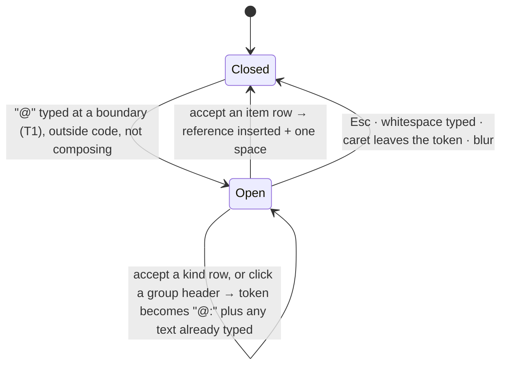
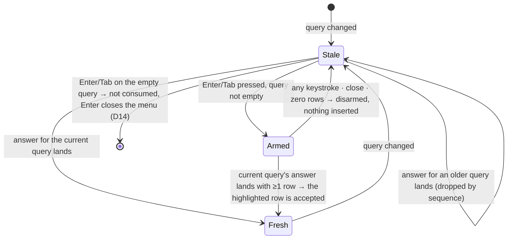

# Feature #131 — @-references in the spec and task composers (新建Feature支持多种@操作)

> 原始需求：目前新建Feature的时候，只支持纯文本操作，但是有时候可能用户想引用其他Feature, 或者Task, 或者其他东西。丰富一下目前的操作，参考其他类似产品，要可用，好用。
>
> Spec written 2026-10-04 against `f125/integration` @ `222bfa0a`. The operator asked, in task #310's body, for this spec to be transcribed, armed and run with no separate approval stop. Before it was written onto the row, a fresh-context reviewer checked it against the code; their 20 findings are folded in.

## Intent

Every place regin takes a spec, a task body or a defect's symptom is a plain `<Textarea>` — eight of them, the New Feature and New Defect dialogs' included. To say "this builds on [F125 Pipeline所有页面以及操作逻辑评估以及重新设计-二期](feature:125)", "fixes defect 228" or "the bug in session 3fd8137e", the operator looks the id up somewhere else and pastes bare text. Every reader, and above all the build agent the spec is written for, then repeats that lookup.

This feature adds the reference picker that comparable tools have. Type `@`, search across regin's entities, and pick one. You get a reference that:

1. stays readable as plain markdown;
2. renders as a live chip on the body surfaces;
3. lists its back-references on the cited feature, task, defect or session;
4. is expanded into the run prompt, so the agent gets the referenced context and the command that reads it.

Picking happens inside a place: a composer inside a feature means that feature's work first (D17), a row says whose step it is (D18), and the highlighted row is previewed beside the list (D19).

Non-goals:
- A rich-text / WYSIWYG editor (contenteditable, ProseMirror). Bodies stay markdown in a textarea.
- People mentions and mention notifications. regin has no per-user mention inbox.
- Any schema change (I11). A reference lives only in the body text it is written in (I1).
- Changes to Adopt mode, title fields, or the image flow (`` paste, drop and strip).
- Chips in conversation cards, the live view, the inbox or memory. Only the body surfaces of R6 opt in.

## Prior art — what "参考其他类似产品" keeps and drops

| Product | Trigger | References | Stored as | Kept for regin | Dropped |
|---|---|---|---|---|---|
| Linear | `@` | issues, projects, docs, people | mention node | grouped menu with status per row; id shortcut; pasting an issue URL makes a mention; backlinks | people |
| GitHub | `#`, `@` | issues/PRs, people | plain text `#123` | plain-text storage; cross-reference backlinks | `#` as trigger (it starts a markdown heading at line start) |
| Notion | `@`, `[[` | pages, people, dates | inline node | drilling into a type before searching | dates, `[[` |
| Cursor / Claude Code | `@` | files, folders, docs | context attachment | `@file`; category drill-in; **the reference becomes agent context** | web/docs sources |

The `@` mechanics mirror [frontend/src/composables/useFileMentions.js](file:frontend/src/composables/useFileMentions.js): backward token scan, debounce, sequence guard, stale list, armed accept. Two lessons apply directly: [M8866e26a A key an autocomplete consumed must stopPropagation](memory:8866e26ad9fa4f7abccd291a9a5d71af) and [M10c8bde7 A guard that silently swallows Enter needs an armed accept](memory:10c8bde7eb314842a84936a54e5049fb).

## Decisions

| # | Decision | Rejected alternative | Why |
|---|---|---|---|
| D1 | A reference is a standard markdown link whose href is `<kind>:<key>`, e.g. `[F128 regin未来AI工作台的宣传电影](feature:128)` — the idiom `` already uses | (a) a bare token such as `@feature:128`; (b) atomic mention nodes in a rich-text editor | (a) hides the title from every raw-text reader: the textarea, `regin feature spec`, a tracker mirror, the agent. (b) needs a WYSIWYG editor, which is a non-goal. A markdown link degrades to readable text anywhere regin's renderer is absent. |
| D2 | One trigger, `@`, opens one menu over six kinds. The menu supports drill-in (`@task:`), id shortcuts (`@F128`, `@T310`, `@D228`, `@128`) and path queries (`@src/…`) | `#` for features and tasks, `@` for the rest | `#` at line start is a markdown heading. Two triggers are two things to learn, and the feature is named 多种@操作. |
| D3 | The menu searches one endpoint, `GET /api/refs`, which fans out to the six kinds and returns one grouped shape. Chips resolve through `GET /api/refs/resolve` in batches | The browser calls six list endpoints | Six round-trips per pause, six ranking rules and six auth paths. The shapes do not line up: `defects?q=` matches only the symptom, and sessions page by cursor. |
| D4 | A chip shows the **live** title and status, resolved at render. The label in the link is a snapshot for raw-text readers | Render the stored label | A renamed feature would keep its old name forever, and a shipped one would still look open. |
| D5 | A run prompt gains a `<references>` block: every reference in the task body and in its feature's spec, resolved at launch, one line each, each with the command that reads it in full | Copy the referenced bodies into the spec | A copy drifts. A pointer with its read command costs one line and is current at launch. |
| D6 | One component, `RefTextarea`, replaces the plain `Textarea` at all seven body-entry sites (R5) | `@` only in the New Feature dialog | A reference you can type when declaring a feature but not when editing that spec a minute later is a trap. The image-paste logic is already copied six times (`utils/caret.js:4-5`), and seven copies of a keymap is how they drift. |
| D7 | `file` references search the selected project's repo with `git ls-files` — tracked files only, never a session tree | Reuse `/sessions/<sid>/bridge-files` | No session exists when a feature is declared. An untracked file is not in the worktree a build runs in, and `search_files` follows `../`, `/` and `~/` out of its root. |
| D8 | The feature ledger lists the features and tasks whose body cites it ("Referenced by"). The list is computed at read time inside `_ledger_body` | A `refs` table maintained on every write | A table would be a second writer of what a body says; the body is the only record (I1). Building the list in `_ledger_body` (`web/blueprints/features.py:113`) means every route that returns the ledger — GET, PATCH, ship, refresh — carries it. |
| D9 | `{{references}}` goes into the default launch envelope, declared as a `PromptVariable`. The previous default's sha256 is registered with `register_retired_default`, so `seed_builtin_skeletons` (run at app boot, `web/app.py:75`) upgrades an unedited stored envelope — the same way the spec block shipped (`lib/prompts/surfaces/tasks.py:312-314`) | Leave the stored envelope as it is | This install stores `task-run-launch` as a builtin copy (74 chars). Without the upgrade, no run here would ever carry the block. |
| D10 | Session references follow the session surface's admin-only rule (`web/app.py:333-371`). A non-admin gets no Session group, and resolve returns `restricted` for sessions. The agent block is not restricted, because it runs as the operator's agent | Show session titles to every role | A session's title is usually its first prompt. Sessions carry no owner to filter on, which is why their whole surface is admin-only. |
| D11 | Chips are opt-in: `MarkdownContent` gains a `refs` prop, and only the body surfaces in R6 set it | Chips everywhere `MarkdownContent` renders | It has about 25 consumers, including streaming conversation cards. Making chips global would add a resolve request per streamed re-render in views no verify covers. |
| D12 | Task, defect and session pages read who cites them from `GET /api/refs/backlinks?ref=` and re-read it on every pipeline frame | Thread `referenced_by` into each page's own payload, as the ledger does (D8) | Three payload routes, one of them the admin-only session map. A body starts or stops citing something only through a feature or task write, and every such write raises a pipeline frame (`lib/pipeline/live.py`), so the list stays current without polling. The ledger keeps D8, because its own writes answer with the ledger. |
| D13 | A reference in the textarea is tinted by a mirror laid **over** the field: transparent glyphs, a translucent fill under each reference, no pointer events | Behind the field, as `ComposerHighlight.vue` does for `@path` | That composer's field is chromeless. The body fields keep the opaque `.input` surface, which would hide anything behind them. |
| D14 | On the Recent screen (empty query), an Enter or Tab pressed before the first answer lands is neither consumed nor armed: Enter closes the menu and types its newline | Arm it like any other stale Enter; or consume it and do nothing | The kind rows mean the Recent screen is never empty, so an armed Enter would write a reference nobody saw. A swallowed Enter with nothing on screen is the double-keystroke trap of [M10c8bde7](memory:10c8bde7eb314842a84936a54e5049fb). |
| D15 | `marked`'s own lexer decides where a chip can stand: it reads the body with only each reference's href swapped for its slot's, labels kept, and the slots it reads as links of their own (not inside an image or another link) are the chips. Every other reference keeps its source. Rendering with placeholders is then lexed again, dropping any placeholder that is no longer a link, until none is dropped | (a) Repair the DOM after the render; (b) decide from a lex of the placeholders themselves | (a) An alt attribute holds only the placeholder's flattened text, so the reference cannot be recovered afterwards. (b) The placeholder's one-space label ends what the reference did not: an unquoted attribute, a link destination, a link definition, an angle autolink. The placeholder was then read as a link the body never had, and a space-less source put back let an autolink run on into the next placeholder. Lexing the body's own structure decides in one pass. |
| D17 | A composer inside a feature passes `feature_id`. That feature, its tasks and its defects rank above every title tier; on the Recent screen they form a "This feature" section (the feature, 4 latest tasks, 3 latest open defects) that Recent then omits. With no `project_id`, the feature's project is used | Rank them first only within a tier, as M3 does | Step titles are generic ("S14 — verify"): another feature's "verify everything" wins every text tier. |
| D18 | `RefItem.title` is one line with each reference read as its label; tasks and defects carry `feature_title` | The stored title as is | Step titles embed their feature's reference, so rows, chips and accepted labels showed escaped markdown, and a generic step title names nothing without its feature. |
| D19 | The preview pane reads `GET /api/refs/preview` for the highlighted item row once the highlight settles (120 ms), keeping answers while the menu is open; drawn only at ≥960px | A body snippet per search row; a hover card | Snippets cost every row on every keystroke to show one. The menu is keyboard-driven and never focused, so the preview follows the highlight. |
| D16 | The memory page's open memory is its URL's `?id=`, and a memory reference's `url` is `/memory?id=<id>` | A route per memory (`/memory/<id>`) | The memory page is one view with tabs and a list rail, and its tab already lives in `?tab=`. Selecting writes `?id=` with `replace`, so a click adds no history entry. Opening a memory from another tab lands on Memories in the same navigation, because two router pushes in one tick cancel each other. |

## Model

### Types

```ts
type RefKind = 'feature' | 'task' | 'defect' | 'session' | 'file' | 'memory'

interface RefItem {
  ref: string              // `${kind}:${key}` — exactly the href written into the body
  kind: RefKind
  key: string              // '128' · '3fd8137e-e0fd-…' · 'docs/a%20b.md' (encoded) · 32-hex memory id
  label: string            // what accept writes between [ ], already escaped (table below)
  title: string            // live title · symptom · session title/first prompt · decoded path · memory title, one line with references read as labels (D18); '' when restricted
  status: string | null    // feature stage · task status · defect status · null for session, file, memory
  project_id: number | null
  project: string | null   // project (repo) name
  feature_id: number | null // a task's or defect's feature; null otherwise
  feature_title: string | null // that feature's title, references read as labels (D18); null otherwise
  url: string | null       // SPA route the chip opens; null for file and restricted
  restricted?: true        // session ref resolved for a non-admin (D10)
  exists?: boolean         // file refs only: tracked in the project's repo at HEAD; absent when no project is given or its repo cannot be read (unknown is not false)
}

// GET /api/refs?q=&kind=&project_id=&feature_id=&limit=          @require_editor
interface RefSearch {
  query: string
  kind: RefKind | null
  groups: { kind: RefKind; total: number; items: RefItem[]; hint?: string }[]
  context: RefItem[]       // Recent screen with feature_id only (D17): the feature, its tasks, its open defects; [] otherwise
}
// GET /api/refs/preview?ref=task:310&project_id=26   @require_auth
interface RefPreview {
  ref: string
  item: RefItem | null     // null = not found
  body: string             // ≤ 4000 chars; references as their labels, `` as *(image)*; '' when restricted
  format: 'markdown' | 'code' | 'text'  // feature/task/defect · file at HEAD · session first prompt, memory
  truncated: boolean
}
// GET /api/refs/resolve?ref=feature:128&ref=file:docs%2Fa.md&project_id=26   @require_auth, ≤ 100 refs
interface RefResolve { refs: Record<string, RefItem | null> }  // null = not found
// GET /api/refs/backlinks?ref=task:310   @require_auth; a session ref needs an admin
interface RefBacklinks { ref: string; items: RefItem[] }        // citing features, then tasks
```

| Module | Holds |
|---|---|
| `lib/refs/grammar.py` | the grammar |
| `lib/refs/search.py` | search |
| `lib/refs/resolve.py` | `resolve_refs(refs, *, project_id=None, can_read_sessions: bool)` |
| `lib/refs/preview.py` | `preview(ref, *, project_id=None, can_read_sessions: bool)` (D19) |
| `lib/refs/backlinks.py` | `referenced_by(ref)`: who cites any item (R8) |
| `web/blueprints/refs.py` | the routes, registered in `web/app.py` |
| `frontend/src/utils/refs.js` | the JS grammar |
| `frontend/src/composables/useRefMentions.js` + `frontend/src/components/refs/` | the composer, with `RefHighlight.vue` tinting the references in its field (E7) |
| `frontend/src/composables/useRefPreview.js` + `frontend/src/components/refs/RefPreview.vue` | the menu's preview pane (M11) |
| `frontend/src/utils/refRender.js` + `frontend/src/components/refs/RefChip.vue` + `frontend/src/composables/useRefResolve.js` | the chips: placeholder links before `marked`, a `RefChip` mounted over each after it, one batched resolve |
| `frontend/src/components/refs/RefBacklinks.vue` | "Referenced by": a card under a spec, a task body or a defect; one labelled line in a session's header |

### Stored form, per kind

| kind | key (grammar) | label written on accept | chip opens | agent line ends with |
|---|---|---|---|---|
| feature | `[1-9][0-9]{0,9}` | `F<id> <title>` | `/features/<id>` | `read: <cli> feature spec <id>` |
| task | `[1-9][0-9]{0,9}` | `T<id> <title>` | `/tasks/<id>` | `read: <cli> task show <id>` |
| defect | `[1-9][0-9]{0,9}` | `D<id> <symptom>` | `/defects/<id>` | symptom, status and `feature #<feature_id>` inline (no read command exists) |
| session | `[0-9A-Za-z][0-9A-Za-z_-]{7,127}` (trace id) | `S<first 8> <title, else first prompt>` | `/trace/sessions/<id>` (admins) | `read: <cli> trace dump <id> --index` |
| file | repo-relative path; each segment percent-encoded per RFC 3986 (only `A–Z a–z 0–9 - . _ ~` bare, uppercase hex), joined by `/`; no leading `/`, no `.` or `..` segment | `<decoded path>` | — (`<span>`) | `file <path> in project <name>` |
| memory | `[0-9a-f]{32}` | `M<first 8> <title>` | `/memory?id=<id>` | `read: <cli> memory read <id>` |

Label rules:
- The title is cut to 60 characters, plus `…`.
- Newlines become spaces.
- A file label is the whole decoded path, never cut: half a path names nothing.
- Every one of `` \ [ ] < > & ` `` is backslash-escaped. These are CommonMark escapes, so `marked` renders them as literal text. Without the escape, a hostile title would become live HTML in `MarkdownContent`'s `v-html`.

`<cli>` is rendered by `run_prompt._cli_command`, the same as the `<feature>` block's spec command.

**A reference** is `[label](kind:key)` such that:
- it is not preceded by `!`;
- the label matches `(\\.|[^\\\[\]])*`;
- there is no title part;
- it sits outside fenced code (``` or ~~~ fence lines) and outside inline code spans.

Anything else is not a reference: an image, a `[` escaped with a backslash, another scheme, a malformed key, `[x](feature:1 "t")`, the autolink `<feature:1>`, or text inside code.

Code is found as CommonMark finds it: a line ends at CRLF, CR or LF, a fence closes only on its own character at least as long as the opener, a fence inside a block quote (`>` plus an optional space or tab) ends with the quote, a fence left open runs to the end of the body, and an inline span is a backtick run closed by the next run of exactly its length, never across a blank line or a fence. A match that touches code at all is not a reference.

Indented (4-space) code blocks are **not** recognised by the grammar. A reference inside one renders as code but still counts for backlinks and the agent block. Specs use fences, and the grammar does not try to replicate markdown's list-aware indentation rules. Nor does it model block boundaries other than blank lines, fences and block quotes, so a backtick left open on a heading or list-item line can pair with one on a later line and hide a reference between them. Tab-stop expansion is not modelled: a single tab directly after `>` is read as the marker's space; any other tab in a line's indentation (`> \t`, `>\t` followed by spaces or tabs, a tab before `>` or at line start) may be read differently than it renders. Where `marked` departs from CommonMark, the grammar follows CommonMark. Raw HTML is not modelled either: a reference inside an HTML block or an HTML comment counts for backlinks and the agent block, while the page shows it as source text (an HTML block) or not at all (a comment).

### Query grammar (what follows `@`)

| Typed | Searches | Example |
|---|---|---|
| nothing | **This feature** (composer inside a feature only, D17), then **Recent**: the 3 most active features, then the 3 most recently updated tasks, of the selected project (all projects when none is selected), less what This feature shows. The six kind rows follow. | `@` |
| `<text>` | all six kinds, ≤5 rows each | `@section` |
| `<kind>:<text>` or alias `f: t: d: s: m:` (`file:` has no alias; `lesson:` = `memory:`) | that kind only, ≤20 rows | `@task:nav`, `@f:` |
| text containing `/` | files only | `@src/comp` |
| `F<n>` · `T<n>` · `D<n>` (either case) | **that kind only**: id `n` first, then that kind's text matches | `@F128`, `@t310` |
| digits only | feature, task and defect, each group led by its id match | `@128` |
| `S<hex, ≥4>` (upper-case `S`) | sessions whose trace id starts with it (admins; for anyone else it is plain text) | `@S3fd8` |

### Menu lifecycle



List freshness is a separate axis:



## Rules

### R1 Trigger and token

| # | Rule |
|---|---|
| T1 | `@` opens the menu at the start of the text, or when the character before it is not one of `A–Z a–z 0–9 . _ % + -`. So `基于@F125` and `(@F1` open it, and `me@host.com` never does. |
| T2 | The token is `@` plus the query up to the caret. The query holds no whitespace and none of `@ [ ] ( )`, and is at most 64 characters. Anything else closes the menu and leaves the text as typed. |
| T3 | No trigger inside fenced code, read with the grammar's own fence rules (`codeRanges` in `utils/refs.js`, so a fence left open runs to the caret), or inside an inline code span being typed (an odd number of backticks before the caret on its line). |
| T4 | While an IME composes (`isComposing`, or keyCode 229), keys never open, move or accept. The token is re-read on `compositionend`, so `@新建` searches 新建. |

### R2 Menu content

| # | Rule |
|---|---|
| M1 | Groups appear in a fixed order: Feature · Task · Defect · Session · File · Memory. An empty group is not drawn. With all kinds searched, a group shows ≤5 rows and its header carries the total ("Task · 12"). Clicking the header drills into that kind, keeping the text typed so far (`@nav` → `@task:nav`). The Recent screen draws `context` under a "This feature" header when there is one, then its other rows under one client-side "Recent" header, followed by the six kind rows; the Session row is drawn for an admin only (D10). |
| M2 | Ranking within a kind: exact id/key → title prefix → title substring → other field (feature body, task body, any prompt of the session, memory body) → recency. Matching is case-insensitive; CJK is matched as a substring. Each kind reuses the filter its list endpoint already applies to `q` (features `lib/features/index.py`, tasks `lib/tasks/query.py`, defects `lib/defects/store.py`, sessions `lib/trace/session_search.py`, shared with `web/blueprints/trace/sessions/listing.py`, memory `lib/memory/store/reads.py`). |
| M3 | With a project selected, that project's rows rank first within each tier. A row from another project shows its project name. Above every tier, the composer's own feature, its tasks and its defects rank first (D17); an exact id still leads. |
| M4 | Abandoned features and archived tasks are found by exact id only. |
| M5 | File search runs `git ls-files` in the selected project's repo (`repos.path`) and matches the query as a subsequence of the path, basename-prefix matches first. A query with a `..` segment, or starting with `/` or `~`, yields no file rows. With no project selected, the File group is one inert hint row: "Pick a project to search its files". |
| M6 | A row shows: kind glyph, short key (`F128`, `T310`, `D228`, `S3fd8137e`, the path, `M8866e26a`), title on one line with ellipsis (its full text as the row's `title`), status chip, and the project when it is not the selected one. A task or defect of a feature other than the composer's shows a second line, `F<id> <feature title>`. |
| M7 | A stale list stays drawn, dimmed, with a spinner in its header. A fresh empty list shows `No matches for "<q>"`. A failed request shows "Search failed — keep typing to retry". Neither of these rows can be accepted. |
| M8 | The menu is teleported to `body` with `position: fixed`, anchored under the caret's line, and flipped above it when it would cross the viewport bottom. It stacks above an open dialog, is `min(28rem, 100vw − 2rem)` wide, is at most 20rem tall and scrolls internally, keeping the highlighted row in view. Below 640px it spans the textarea's width. The page never scrolls sideways (`dom-measure --overflow` clean at 390px). |
| M9 | a11y: the textarea carries `role="combobox"`, `aria-expanded`, `aria-controls` and `aria-activedescendant`; the list is `role="listbox"`; rows are `role="option"` with `aria-selected`. Every id is unique per instance, since two composers can be mounted at once. |
| M11 | At ≥960px the menu is `min(52rem, 100vw − 2rem)` wide and as tall as its room (≤20rem): a 28rem list, then the preview pane (D19) — glyph, key, status, the full title wrapped, the project when foreign, `F<id> <feature title>`, then the body (markdown without chips; a file as code; a session prompt or memory as text), "… open it to read the rest" when cut. Its links do nothing. Loading, failure, not found, restricted and empty each say so. |
| M10 | Inside a modal: reka sets `pointer-events: none` on the body and dismisses on any pointer-down or focus outside the dialog. So the menu root carries `data-ref-menu` and `pointer-events: auto`, and `ui/Dialog.vue` prevents `pointerDownOutside`, `focusOutside` and `interactOutside` dismissal when the event's target is inside `[data-ref-menu]`. |

### R3 Keys while the menu is open

The keyboard order covers item rows and kind rows only. Group headers are labels: they can be clicked, but they are not in that order. The highlight starts on the first selectable row, and returns to it whenever an answer lands: an index moved on stale rows would otherwise pick a row of the new list nobody has seen.

| Key | List | Highlight | Result |
|---|---|---|---|
| ↓ / ↑ (no modifier) | any | — | move the highlight, wrapping; consumed. With Shift/Alt/Cmd/Ctrl the key is the textarea's |
| Enter / Tab | fresh | item row | insert the reference (R4); the menu closes; consumed |
| Enter / Tab | fresh | kind row | the token becomes `@<kind>:`, the menu stays open on that kind; consumed |
| Enter / Tab | stale, query not empty | — | consumed and **armed** (see lifecycle); a stale row is never inserted |
| Enter / Tab | stale, empty query (Recent) | — | not consumed and not armed (D14): Enter closes the menu and types its newline; Tab moves focus |
| Enter | fresh, zero rows | — | not consumed (newline); the menu closes |
| Tab | fresh, zero rows | — | not consumed (focus moves) |
| Esc | any | — | the menu closes; consumed. reka's dialog listens for Escape on `window` in the bubble phase, so stopping propagation keeps the dialog and its draft |
| Cmd/Ctrl+Enter, Shift+Enter | any | — | not handled by the menu |

Every consumed key calls both `preventDefault` and `stopPropagation`.

Mouse: hovering moves the highlight. `mousedown` on a row is `preventDefault`ed so the textarea keeps focus and caret, and the click then accepts the row.

### R4 Insert, delete, undo, paste

| # | Rule |
|---|---|
| E1 | Accepting replaces `@<query>` with `[<label>](<ref>)` plus one space, and leaves the caret after the space. Text outside the token is untouched. |
| E2 | Inserts and deletes go through the browser's editing stack: `document.execCommand('insertText')`, falling back to `setRangeText` plus an `input` event. One undo (Cmd+Z on macOS, Ctrl+Z elsewhere) restores the typed `@<query>`. |
| E3 | With no selection and the caret directly after a reference's closing `)`, Backspace deletes the whole reference in one keystroke, and one undo restores it. With the caret inside a reference, Backspace deletes one character as usual. |
| E4 | When the pasted text is exactly one URL on this app's origin, with path `/features/<id>`, `/tasks/<id>`, `/defects/<id>` or `/trace/sessions/<id>`, the paste inserts the resolved reference plus one space, as E1 does. If the URL resolves to null or `restricted`, it is pasted as-is. A paste carrying image files is left to the existing image handler; any other paste is untouched. |
| E5 | The textarea's value is the only state. A reference typed or pasted by hand in the stored form is exactly a reference. |
| E6 | `RefTextarea` has a single element root, so `v-show` works on it. It sets `inheritAttrs: false`, keeps `class` and `style` on that root (a site's scoped styles such as `.fs-area` key off the scope id Vue puts there). A root given neither is a full-width inline block whose baseline is its bottom edge, holding the textarea as a block. It stands in the host's flow exactly where the bare field stood: blockified like the field in a flex column, and sitting on the baseline like the field in a block. Every root is positioned, because the tint (E7) is laid over the field inside it. It binds the rest of `$attrs` (`id`, `data-testid`, `rows`, `placeholder`, `disabled`, listeners) onto the `ui/Textarea` it wraps, and `defineExpose({ textarea })`. Its own keydown listener runs before a site's on the same element, and a key the menu consumed calls `stopImmediatePropagation`, so a host's Enter handler never also fires. `utils/caret.js` reads `area?.textarea ?? area?.$el`, so `caretTarget` still finds the textarea and images still paste at the caret. |
| E7 | Each reference in the value is tinted where it sits by `RefHighlight` (D13). "Reference" is what the grammar finds, so nothing inside code is tinted. The tint is a mirror with the field's text metrics, laid on the field's padding box less its scrollbar, with transparent glyphs and a translucent fill; it follows the field's scroll and size. It takes no pointer events, so text, caret, selection and IME stay the field's. A body with no reference shows no mirror, and typing in it reads no layout. |

### R5 Sites

| Site | Today | Project used for search |
|---|---|---|
| New Feature → Spec (`NewFeatureDialog.vue:196`) | `Textarea` | the dialog's Project select |
| Ledger → spec editor (`FeatureSpec.vue:157`) | `Textarea` | the feature's project, via a new `project` prop passed by `FeatureLedgerView.vue` |
| Ledger → step instruction (`FeatureTasks.vue:184`, `feature-step-body`) | `Textarea` | the feature's project |
| Task composer → body (`TaskComposerDialog.vue:133`) | `Textarea` | the composer's project. A fresh draft takes it from the Tasks toolbar once the project list has loaded (as `NewFeatureDialog` does); a pick made while the list loads is kept |
| Quick capture → body (`QuickCaptureBubble.vue:167`) | `Textarea` | the project it carries, else none |
| Task edit sheet → body (`TaskEditSheet.vue:113`) | `Textarea` | the task's project |
| Task detail → body editor (`TaskBodyEditor.vue:128`) | `Textarea` | the task's project |
| New defect → Symptom (`NewDefectDialog.vue`) | `Textarea` | none of its own: the chosen feature's (D17) |

`RefTextarea`'s `feature` prop (D17) is the ledger's feature, the task's (the edit sheet's as picked) or the defect dialog's pick; New Feature, the task composer and quick capture pass none.

At every site, `RefTextarea` replaces the `Textarea`. Everything else is unchanged: titles, Adopt mode, the image strip, image paste/drop at the caret, the draft kept across close, and the submit buttons.

### R6 Rendering

Rendering is done by `MarkdownContent.vue`, only when its new `refs` prop is set (D11). Each reference the grammar finds is replaced by a placeholder link before `marked` runs, and a chip is mounted over each placeholder after it, so `marked` never decides what is a reference and never sees a label. Where a chip can stand is `marked`'s call (C7). The prop is set on:
- the ledger spec view and its preview (`FeatureSpec.vue`);
- the task body view and its preview (`TaskBodyEditor.vue`).

| # | Rule |
|---|---|
| C1 | A link renders as a chip only when its source text parses as a reference under `utils/refs.js`. The chip shows a kind glyph, the short key, the live title, and a status dot when status is non-null. A reference inside code stays literal code. |
| C2 | A chip with a `url` is `<a href="<url>">`. A plain left click navigates in-app (`router.push`, no reload); Cmd/Ctrl/Shift/middle click keeps the browser default. A chip without a url is a `<span>` whose `title` holds the full path or title. |
| C3 | Until resolution lands, the chip shows the parsed (unescaped) stored label; once it lands, it shows the live title. A `null` result renders muted, struck through and not a link, keeping the label with `title="<ref> — not found"`. A `restricted` result renders the label, not a link, with `title="session — admin only"`. A file with `exists: false` renders struck through. |
| C4 | A rendered body makes one `GET /api/refs/resolve` per 100 distinct references (so one request for any body up to 100) when it is drawn, and again only when the set of references it holds changes. A re-render citing the same set, such as the ledger re-seating on a pipeline event, asks nothing. A body with no references makes no request. |
| C5 | Chip text is set as text (`textContent`), from the parsed label or the live title — never through marked's inline HTML. |
| C6 | A link whose scheme is a ref kind but that fails the grammar renders as its label in plain text, never as a dead `<a href="feature:x">`. An image in a ref scheme (``) renders as its alt text, never as a broken image. |
| C7 | A reference becomes a chip only where `marked` reads its own source as a link of its own (D15). Everywhere else it keeps its source, and that construct renders exactly as it does without chips. That covers indented code, raw HTML (a block, or an attribute, quoted or not), an image's alt text (which reads the label), a link's text or destination, a link definition, an autolink (angle or bare, glued references included). No `#regin-ref-` placeholder text reaches the page, except where the browser and `marked` read the body's raw HTML differently (Follow-ups). |

### R7 Agent context (`lib/tasks/run_prompt.py`)

| # | Rule |
|---|---|
| A1 | `_prompt()` fills `{{references}}`, which the default `_LAUNCH_BODY` carries right before `{{finish}}` and the launch surface declares as `PromptVariable("references", …, required=False)` (D9). The block is rendered through a new surface, `task-run-references`. |
| A2 | Sources: the **full** task body (read before the `PROMPT_MAX` cut), then the feature's spec when the task has a feature. References are deduplicated by `ref` in first-appearance order; references inside code are excluded. At most 20 lines, then `… and N more references`. Resolution uses `resolve_refs(…, project_id=<task's, else feature's project>, can_read_sessions=True)`. |
| A3 | Line shapes: `- F128 「<title>」 — feature, stage shipped — read: <cli> feature spec 128`. A defect line carries the symptom, status and `feature #<id>`. A file line is `- file <path> in project <name>`. An unresolvable reference is `- feature:999 — not found`. |
| A4 | With no references the block renders empty: no header and no tag. |
| A5 | The block is appended after the `PROMPT_MAX` cut, so it never consumes body budget. |

### R8 Backlinks

| # | Rule |
|---|---|
| B1 | `_ledger_body` (`web/blueprints/features.py:113`) carries `referenced_by: RefItem[]`, so GET, PATCH, ship and refresh all return it. It lists every feature and every non-archived task whose body references `feature:<id>` outside code. The feature itself is excluded, and so are its own tasks, which the page already lists. |
| B2 | `RefBacklinks` ("Referenced by" plus chips) is drawn directly under the Spec section. Features come first, then tasks, each newest-created first; at most 20, then `+N more`. Nothing is drawn when the list is empty. |
| B3 | The list is computed at read time: a `LIKE '%](<ref>)%'` prefilter with its wildcards escaped, then the grammar confirms each hit (I4). |
| B4 | A task page (under its body), a defect page (under the defect) and a session page (one labelled line in the header, under the feature attribution) draw the same list, in B2's order and cap, for `task:<id>`, `defect:<id>` and `session:<trace id>`. They read it from `GET /api/refs/backlinks` (D12) and read it again on each pipeline frame. A task's own body never counts, though its own feature's spec does. |

### R9 API

| Route | Case | Response |
|---|---|---|
| `GET /api/refs` | `q` empty, `kind` absent | the Recent screen's data: feature and task groups only, ≤3 each, most recent first, of `project_id`'s project when given, otherwise all |
| `GET /api/refs` | `q` empty, `kind` given | that kind's ≤20 most recent rows (files: the first 20 paths in alphabetical order) |
| `GET /api/refs` | `kind` neither a kind nor an alias | 400 `{error, field: "kind"}` |
| `GET /api/refs` | `project_id` unknown | 400 `{error, field: "project_id"}` |
| `GET /api/refs` | `feature_id` given | D17; `context` filled on the Recent screen |
| `GET /api/refs` | `feature_id` unknown or not an integer | 400 `{error, field: "feature_id"}` |
| `GET /api/refs` | `limit` | clamped to 1..50; default 5 per group with all kinds, 20 for one kind |
| `GET /api/refs` | viewer | 403 |
| `GET /api/refs` | editor who is not an admin | no Session group (D10) |
| `GET /api/refs/resolve` | any signed-in role | 200 `RefResolve`; sessions come back `restricted` unless the caller is an admin — answered without a lookup, so an unknown id is `restricted` too, never `null` |
| `GET /api/refs/resolve` | more than 100 refs, or one that fails the grammar | 400 `{error, field: "ref"}`, naming the first bad one |
| `GET /api/refs/preview` | any signed-in role | 200 `RefPreview`; a session is `restricted` with body `''` unless admin |
| `GET /api/refs/preview` | `ref` missing or failing the grammar | 400 `{error, field: "ref"}` |
| `GET /api/refs/backlinks` | any signed-in role, `ref` a reference | 200 `RefBacklinks` (B1's exclusions for a feature, B4's for a task) |
| `GET /api/refs/backlinks` | `ref` missing or failing the grammar | 400 `{error, field: "ref"}` |
| `GET /api/refs/backlinks` | a `session:` ref from a caller who is not an admin | 403 `{error, field: "ref"}` (D10) |

## Invariants

- I1 A reference exists only as text in the body that holds it. No table or column stores references. Chips, backlinks and the agent block are all derived from the body at read time.
- I2 A reference never blocks a save. An unknown or deleted target is stored as typed and rendered as not found.
- I3 The Python and JS grammars produce the same `[{ref, label}]` for every case in `tests/fixtures/refs_grammar_cases.json`.
- I4 Nothing inside fenced or inline code is a reference: no chip, no backlink, no agent line, no trigger.
- I5 A stale menu row is never inserted, by key or by click, and an Enter on the unanswered Recent screen inserts nothing (D14).
- I6 Titles and labels reach the DOM only as text. Labels escape `` \ [ ] < > & ` `` when written, and chips set their text with `textContent`.
- I7 A file key never escapes its project's repo root. File search lists tracked files only.
- I8 Nothing polls. The menu fetches once per debounced pause, and its preview once per item row the highlight settles on, never twice for one row while the menu stays open. Chips make one resolve request (per 100 references) when a body is drawn and when its set of references changes. A backlinks list is read when its page opens and again only on a pipeline frame.
- I9 Esc and clicks in the menu affect only the menu. The dialog, the sheet and the draft survive.
- I10 Image paste, drop and strip behave at all seven sites exactly as before.
- I11 No slice makes a schema change.
- I12 A non-admin never receives a session's title or first prompt from `/api/refs`, `/api/refs/resolve` or `/api/refs/preview`, nor who cites a session from `/api/refs/backlinks`.

## Acceptance

Each scenario creates its own project and entities. The E2E server is shared and runs fully in parallel (`playwright.config.js`), so a scenario never assumes an id or an empty database. `<A>`, `<B>`, `<G>` and `<D>` stand for the ids the seed returned.

```gherkin
Feature: Picking a reference
  Background:
    Given a fresh project P holding feature <A> "Alpha", feature <B> "Beta", task <G> "Gamma" and defect <D> "Delta broke"
    And I am an admin editor on the New feature dialog with project P selected

  Scenario: at sign lists recent work and six kinds
    When I type "@" in Spec
    Then a Recent header lists B, A and G from project P only, followed by the kind rows Feature, Task, Defect, Session, File, Memory

  Scenario: typing searches every kind
    When I type "@alp"
    Then the Feature group lists "F<A> Alpha" and no group lists "Beta"

  Scenario: enter inserts a markdown reference
    When I type "builds on @alp" and press Enter
    Then Spec reads "builds on [F<A> Alpha](feature:<A>) " with the caret at its end

  Scenario: kind row drills into one kind
    When I type "@", move the highlight to the Task kind row and press Enter
    Then Spec reads "@task:" and only Task rows are listed

  Scenario: id shortcut finds the exact item
    When I type "@T<G>"
    Then the only group is Task and its first row is "T<G> Gamma"

  Scenario: escape closes the menu not the dialog
    When I type "@alp" and press Escape
    Then the menu is closed, the dialog is open and Spec reads "@alp"

  Scenario: clicking a row inside a dialog inserts and keeps the dialog
    When I type "@alp" and click the "F<A> Alpha" row
    Then Spec reads "[F<A> Alpha](feature:<A>) " and the dialog is still open

  Scenario: enter before results land accepts the fresh row
    Given /api/refs answers after 600 ms
    When I type "@alp" and press Enter at once
    Then once the answer lands Spec reads "[F<A> Alpha](feature:<A>) " and nothing else was inserted

  Scenario: trigger after cjk but not in an email or code
    When I type "基于@alp" Then the menu opens
    When I type "mail me@host.com" Then no menu opens
    When I type a fence line "```", Enter, then "@app.route" Then no menu opens

  Scenario: ime composition never accepts a row
    When I type "@" then dispatch an IME composition of "新建" whose committing Enter has isComposing true
    Then no reference is inserted and the menu searches "新建"

  Scenario: undo restores the typed query
    Given I accepted A from "@alp"
    When I press ControlOrMeta+z
    Then Spec reads "@alp"

  Scenario: backspace removes a whole reference
    Given Spec reads "see [F<A> Alpha](feature:<A>)" with the caret at the end
    When I press Backspace
    Then Spec reads "see "

  Scenario: pasting a regin url inserts a reference
    When I paste "<app origin>/tasks/<G>" into Spec
    Then Spec reads "[T<G> Gamma](task:<G>) "

  Scenario: file search is scoped to the project repo
    Given project P's repo path is this checkout
    When I type "@file:usefilemen"
    Then the File group lists "frontend/src/composables/useFileMentions.js"
    When I type "@file:../"
    Then no File row is listed

  Scenario: every body editor offers references
    Then typing "@" opens the menu in each of the seven R5 sites

  Scenario: menu fits a phone viewport
    Given a 390px wide viewport
    When the menu is open
    Then it lies inside the viewport and the page does not scroll sideways

  Scenario: enter on the empty query before results land inserts nothing
    Given /api/refs has not answered "@"
    When I type "@" and press Enter
    Then Spec reads "@" and a newline, the menu is closed, and the late answer inserts nothing
    When "@" is typed again and its answer lands
    Then Enter inserts the top Recent row

  Scenario: references are tinted where they sit
    When Spec holds a reference, and the same reference inside code
    Then only the first is tinted, by a mirror on the field's own box with its metrics, wrapping and scroll
    And a click on the tint puts the caret inside that reference

  Scenario: the task composer carries its project once the list loads
    Given /api/repos has not answered
    When I open the task composer from /tasks?project=P and the list then lands
    Then its Project reads P and typing "@alp" searches project P

Feature: Picking inside a feature
  Background:
    Given feature <A> "Alpha" with task "verify everything", and feature <B> with task <M> "S14 verify" and open defect <D>, editing B's spec

  Scenario: at sign pins the current feature and its work
    When I type "@"
    Then the first section is "This feature" listing B, M and D, and M shows no feature line

  Scenario: search ranks the current feature first and names other parents
    When I type "@task:verify"
    Then M is the first row and A's task shows "F<A> Alpha" under its title

  Scenario: highlighted row is previewed
    When I type "@task:verify" at 1280px
    Then the preview shows M's title and body, and after ArrowDown, ArrowUp it shows M again with no second request
    And at 390px no preview pane is drawn and the page does not scroll sideways

  Scenario: defect symptom offers references inside its feature
    When I open New defect from defect D's page and type "@" in Symptom
    Then the search names feature B and B leads the menu

Feature: Reading a reference
  Scenario: reference renders as a live chip
    Given feature C's spec holds "[F<A> Old name](feature:<A>)" and A is titled "Alpha"
    When I open /features/<C>
    Then the Spec shows a chip "F<A> Alpha" carrying A's stage

  Scenario: chip click navigates in app
    When I click the A chip on /features/<C>
    Then the URL is /features/<A> and no full page load happened

  Scenario: dangling reference renders not found
    Given C's spec holds "[F999999 Gone](feature:999999)"
    Then its chip reads "F999999 Gone", is struck through and is not a link

  Scenario: reference inside code stays code
    Given C's spec holds "`[F<A> x](feature:<A>)`"
    Then no chip is drawn for it

  Scenario: references resolve in one request
    Given C's spec holds 5 references
    When I open /features/<C>
    Then exactly one /api/refs/resolve request is made

  Scenario: hostile title renders as text
    Given feature H is titled "" and C's spec references H through the menu
    When I open /features/<C>
    Then the chip text equals H's title literally, no img element exists inside the spec, and window.__pwned is undefined

  Scenario: referenced by lists citing features and tasks
    Given C's spec and task G's body each reference feature A
    Then /features/<A> shows "Referenced by" with C and G, and still shows them after the spec of A is saved

  Scenario: task, defect and session pages list who cites them
    Given C's spec cites task G, defect D and a session S, task H's body cites G, and cites D only inside code
    Then /tasks/<G> lists C then H, /defects/<D> lists C, and /trace/sessions/<S> lists C
    When feature P's spec starts citing G while /tasks/<G> is open
    Then the list re-reads and holds C, P and H
    And a task nobody cites draws no list

  Scenario: memory chip opens the memory
    Given C's spec references memory M
    When I click its chip on /features/<C>
    Then the URL is /memory?id=<M> and M's detail is open

  Scenario: references where no chip can go keep their source
    Given C's spec holds a reference in a quoted and an unquoted raw-HTML attribute, in an image's alt text, in a link destination, glued to a bare URL alone and in a chain, and an image ""
    Then each attribute holds the reference's source, the alt reads its label, the outer link keeps its text, no "#regin-ref-" text is anywhere on the page, and "Alt words" is plain text

Feature: The agent gets the references
  Scenario: run prompt lists references with read commands
    Given task G of feature C, whose body cites D and whose feature spec cites A
    When G's run prompt is built
    Then it holds a references block listing D then A, and A's line carries "feature spec <A>"

  Scenario: run prompt without references has no block
    Given a task whose body and feature spec cite nothing
    Then its prompt holds no references block

  Scenario: references past the body cut are still listed
    Given a body of PROMPT_MAX + 500 characters whose only reference sits after character PROMPT_MAX
    Then the body is cut at PROMPT_MAX and the references block still lists that reference

  Scenario: unedited launch envelope upgrades to carry references
    Given the stored task-run-launch body equals the previous default
    When seed_builtin_skeletons runs
    Then the stored body holds "{{references}}"
```

### Acceptance tests

Playwright tests are titled with their `test_…` name, so the slice table's Tests column greps.

| Test | Covers | Runner | Slice |
|---|---|---|---|
| test_python_grammar_parses_every_fixture_case | I3, I4, stored form | pytest | S1 |
| test_javascript_grammar_parses_every_fixture_case | I3, I4, stored form | Playwright (Node import of `utils/refs.js`) | S1 |
| test_format_ref_escapes_markup_in_labels | label rules, I6 | pytest | S1 |
| test_search_groups_by_kind_with_exact_id_first | M1, M2, R9 | pytest | S1 |
| test_search_kind_filter_and_aliases | query grammar, R9 kind 400 | pytest | S1 |
| test_search_recent_is_scoped_to_the_selected_project | R9 Recent, query grammar | pytest | S1 |
| test_search_ranks_selected_project_first | M3, M4 | pytest | S1 |
| test_search_file_kind_lists_tracked_repo_files_only | M5, D7, I7 | pytest | S1 |
| test_search_file_query_cannot_leave_repo | M5, I7 | pytest | S1 |
| test_search_requires_editor_and_sessions_need_admin | R9 auth, D10, I12 | pytest | S1 |
| test_resolve_returns_live_item_or_null | D4, R9 | pytest | S1 |
| test_resolve_restricts_sessions_to_admins | D10, I12 | pytest | S1 |
| test_resolve_refuses_malformed_or_too_many_refs | R9 | pytest | S1 |
| test_at_sign_lists_recent_work_and_six_kinds | M1, Recent | Playwright | S2 |
| test_typing_searches_every_kind | M1, M2 | Playwright | S2 |
| test_enter_inserts_a_markdown_reference | E1 | Playwright | S2 |
| test_kind_row_drills_into_one_kind | R3 | Playwright | S2 |
| test_id_shortcut_finds_the_exact_item | query grammar | Playwright | S2 |
| test_escape_closes_the_menu_not_the_dialog | R3, I9 | Playwright | S2 |
| test_clicking_a_row_inside_a_dialog_inserts_and_keeps_the_dialog | M10, I9 | Playwright | S2 |
| test_enter_before_results_land_accepts_the_fresh_row | armed accept, I5 | Playwright (route delays /api/refs) | S2 |
| test_an_older_answer_landing_after_enter_keeps_it_armed | lifecycle: an older answer is dropped by sequence and never disarms, I5 | Playwright (route holds the older query) | S2 |
| test_trigger_after_cjk_but_not_in_an_email_or_code | T1, T3, I4 | Playwright | S2 |
| test_ime_composition_never_accepts_a_row | T4 | Playwright (dispatched composition events) | S2 |
| test_undo_restores_the_typed_query | E2 | Playwright | S2 |
| test_backspace_removes_a_whole_reference | E3 | Playwright | S2 |
| test_pasting_a_regin_url_inserts_a_reference | E4 | Playwright | S2 |
| test_file_search_is_scoped_to_the_project_repo | M5 in the UI | Playwright | S2 |
| test_every_body_editor_offers_references | R5, E6 | Playwright | S2 |
| test_menu_fits_a_phone_viewport | M8 | Playwright at 390px | S2 |
| test_reference_renders_as_a_live_chip | C1, C3, D4 | Playwright | S3 |
| test_chip_click_navigates_in_app | C2 | Playwright | S3 |
| test_dangling_reference_renders_not_found | C3, I2 | Playwright | S3 |
| test_reference_inside_code_stays_code | I4, C1 | Playwright | S3 |
| test_references_resolve_in_one_request | C4, I8 | Playwright | S3 |
| test_hostile_title_renders_as_text | C5, I6 | Playwright | S3 |
| test_referenced_by_lists_citing_features_and_tasks | B1, B2 | Playwright | S3 |
| test_ledger_body_carries_referenced_by_on_every_write | B1, D8 | pytest | S3 |
| test_backlinks_ignore_code_self_and_own_tasks | B1, B3, I4 | pytest | S3 |
| test_run_prompt_lists_references_with_read_commands | A2, A3 | pytest | S4 |
| test_run_prompt_without_references_has_no_block | A4 | pytest | S4 |
| test_references_past_the_body_cut_are_still_listed | A2, A5 | pytest | S4 |
| test_unedited_launch_envelope_upgrades_to_carry_references | A1, D9 | pytest | S4 |
| test_enter_on_the_empty_query_before_results_land_inserts_nothing | D14, R3, I5 | Playwright | T316 |
| test_references_are_tinted_where_they_sit | E7, D13 | Playwright | T316 |
| test_task_composer_carries_its_project_once_the_list_loads | R5 | Playwright | T316 |
| test_task_defect_and_session_pages_list_who_cites_them | B4, D12 | Playwright | T316 |
| test_memory_chip_opens_the_memory | D16 | Playwright | T316 |
| test_references_where_no_chip_can_go_keep_their_source | C6, C7, D15 | Playwright | T316 |
| test_backlinks_list_citers_of_tasks_defects_and_sessions | B3, B4 | pytest | T316 |
| test_backlinks_route_refuses_bad_refs_and_non_admin_sessions | R9, D10, I12 | pytest | T316 |
| test_recent_screen_pins_the_composers_feature_and_its_work | D17, R9 | pytest | T364 |
| test_text_search_ranks_the_composers_feature_above_title_tiers | D17, M3 | pytest | T364 |
| test_feature_context_lends_its_project_to_file_search | D17, R9 | pytest | T364 |
| test_rows_read_references_as_labels_and_name_their_feature | D18 | pytest | T364 |
| test_preview_returns_the_body_with_references_as_text | D19, R9 | pytest | T364 |
| test_preview_hides_a_session_from_a_non_admin | D10, I12 | pytest | T364 |
| test_at_sign_pins_the_current_feature_and_its_work | D17, M1 | Playwright | T364 |
| test_search_ranks_the_current_feature_first_and_names_other_parents | D17, M3, M6 | Playwright | T364 |
| test_highlighted_row_is_previewed | M11, D19, I8 | Playwright | T364 |
| test_preview_stays_out_of_a_phone_viewport | M8, M11 | Playwright at 390px | T364 |
| test_defect_symptom_offers_references_inside_its_feature | R5, D17 | Playwright | T364 |
| test_every_slice_merged_back | Tail | S5 check | S5 |
| test_scoped_suites_pass_on_integration | Gates | S5 check | S5 |
| test_live_check_on_8321 | the whole feature, live | S5 check | S5 |

## Gates (build step)

- **Worktree prerequisites.** Before its first test run, every slice links `.venv` and `frontend/node_modules` from `/Users/taowang/regin` into its worktree. The Verify commands do this themselves with `ln -sfn`. F125 S1/S2's first attempts settled failed with exit 127 because their worktrees had neither.
- **Playwright isolation.** Playwright inside slice Sn runs on its own ports and scratch dir: `REGIN_E2E_API_PORT=835n REGIN_E2E_VITE_PORT=520n REGIN_E2E_SCRATCH=/tmp/regin-e2e-f131-sn`, as in its Verify. The defaults (8322/5174 and one shared scratch DB) collide with any other run, including the operator's.
- **Test files.** pytest files go in `tests/refs/` and are named `test_refs_<topic>.py`. The agent-prompt tests are `tests/tasks/test_run_prompt_refs.py`. Test directories have no `__init__.py` and pytest runs in its default import mode, so a basename that already exists elsewhere (`tests/prompts/test_resolve.py`, `tests/patterns/test_search.py`) fails collection for the whole suite.
- **Fixture and Playwright specs.** The grammar fixture is `tests/fixtures/refs_grammar_cases.json`. Playwright specs are `frontend/tests/refs-grammar.spec.js`, `ref-mentions.spec.js` and `ref-render.spec.js`. The fixture covers at least 18 cases:
  1. a plain reference;
  2. an escaped `[` `]` in a label;
  3. an escaped `<` `>` `&` `` ` `` in a label;
  4. an image (not a reference);
  5. inline code;
  6. fenced code;
  7. an unknown kind;
  8. a malformed or zero id;
  9. a percent-encoded file path;
  10. a file with a `..` segment;
  11. an absolute file path;
  12. a session id;
  13. a 32-hex memory id;
  14. two references on one line;
  15. a duplicate reference (both returned);
  16. CJK on both sides;
  17. a bare regin URL or the autolink `<feature:1>` (not a reference);
  18. a link with a title part (not a reference).
- **Per-slice checks.** `.venv/bin/python -m pytest -q -n auto --dist=loadfile <dirs>`; radon ≥ C on touched Python; BundleEngine clean on every touched `.vue`; `cd frontend && npx vite build`.
- **Baseline at `222bfa0a`.** pytest's `hook_manager/tests/test_handlers.py::test_trace_payload_*` and `tests/topics/test_topic_overlay.py::test_promote_all_is_noop_on_empty_overlay` predate F131 and are deselected with `-k`; `tests/agent_sdk/test_registry.py::test_a_reserved_run_is_not_reachable_yet` is order-dependent on `tests/tasks/test_task_execution.py` and is reported, not deselected.
- **Server restart.** Only the integrate slice restarts :8321, and only when no SDK-launched run is open, since an SDK run is a child of `regin serve`.

## Work slices

All slices branch from **`f125/integration`**, the main checkout's branch, where F127 and F128 also landed. Their branches are `f131/s<n>`.

- There is no migrate step (I11).
- S2 and S4 run in parallel after S1.
- S3 waits for S2 to settle, through an `after` edge. S3 does not consume S2's work; the edge exists because both edit `FeatureSpec.vue`, `TaskBodyEditor.vue` and `FeatureLedgerView.vue` and both run Playwright. Since a slice's worktree is cut when it launches, S3 starts from S2's merged result.
- S5 is the integrate + verify + live slice. It requires S2, S3 and S4.

| # | Slice | Delivers | Spec refs | Tests | Schema | Depends on | Base | Skill |
|---|---|---|---|---|---|---|---|---|
| S1 | Reference grammar and API | `lib/refs/grammar.py` (parse_refs skipping fenced and inline code, format_ref with the label escapes, file-key encode/decode, kind aliases); `lib/refs/search.py` (per-kind search reusing each list endpoint's q filter, ranking M2–M4, Recent per R9, file kind via git ls-files M5, Session group admin-only); `lib/refs/resolve.py` (resolve_refs with project_id and can_read_sessions, RefItem incl. feature_id, project_id, restricted, exists); `web/blueprints/refs.py` with GET /api/refs (@require_editor) and GET /api/refs/resolve (@require_auth, ≤100), registered in web/app.py; `frontend/src/utils/refs.js` (the same grammar, formatRef, refEndingAt for E3); `tests/fixtures/refs_grammar_cases.json` with the 18 Gates cases; no UI | D1, D3, D7, D10, Model, R2, R9, I1, I3, I4, I6, I7, I12 | test_python_grammar_parses_every_fixture_case, test_javascript_grammar_parses_every_fixture_case, test_format_ref_escapes_markup_in_labels, test_search_groups_by_kind_with_exact_id_first, test_search_kind_filter_and_aliases, test_search_recent_is_scoped_to_the_selected_project, test_search_ranks_selected_project_first, test_search_file_kind_lists_tracked_repo_files_only, test_search_file_query_cannot_leave_repo, test_search_requires_editor_and_sessions_need_admin, test_resolve_returns_live_item_or_null, test_resolve_restricts_sessions_to_admins, test_resolve_refuses_malformed_or_too_many_refs | — | — | f125/integration | goal-verified-treenav |
| S2 | The @ composer | `frontend/src/composables/useRefMentions.js` (T1–T4, query grammar, 180 ms debounce, sequence guard, stale and armed accept, mirroring useFileMentions.js); `frontend/src/components/refs/RefMenu.vue` (grouped listbox M1, M6–M10, per-instance ids, data-ref-menu); `frontend/src/components/refs/RefTextarea.vue` (keys R3, insert/undo/atomic Backspace/URL paste R4, single root with inheritAttrs false and defineExpose textarea per E6); `ui/Dialog.vue` outside-interaction guard (M10); `utils/caret.js` reads area.textarea first (E6); swapped in at the seven R5 sites, with a project prop threaded from FeatureLedgerView.vue into FeatureSpec.vue | D2, D6, R1, R2, R3, R4, R5, I5, I9, I10 | test_at_sign_lists_recent_work_and_six_kinds, test_typing_searches_every_kind, test_enter_inserts_a_markdown_reference, test_kind_row_drills_into_one_kind, test_id_shortcut_finds_the_exact_item, test_escape_closes_the_menu_not_the_dialog, test_clicking_a_row_inside_a_dialog_inserts_and_keeps_the_dialog, test_enter_before_results_land_accepts_the_fresh_row, test_trigger_after_cjk_but_not_in_an_email_or_code, test_ime_composition_never_accepts_a_row, test_undo_restores_the_typed_query, test_backspace_removes_a_whole_reference, test_pasting_a_regin_url_inserts_a_reference, test_file_search_is_scoped_to_the_project_repo, test_every_body_editor_offers_references, test_menu_fits_a_phone_viewport | — | S1 | f125/integration | goal-verified-treenav |
| S3 | Chips and backlinks | `MarkdownContent.vue` gains the opt-in refs prop (D11) and renders references as chips C1–C6, deciding chip-ness with utils/refs.js and setting chip text with textContent; a delegated in-app click handler; `frontend/src/composables/useRefResolve.js` (batched per C4); refs set on FeatureSpec.vue and TaskBodyEditor.vue views and previews; `lib/refs/backlinks.py` and referenced_by in `_ledger_body` (B1, B3); `frontend/src/components/features/FeatureBacklinks.vue` mounted under the Spec section in FeatureLedgerView.vue (B2) | D4, D8, D11, R6, R8, I2, I4, I6, I8 | test_reference_renders_as_a_live_chip, test_chip_click_navigates_in_app, test_dangling_reference_renders_not_found, test_reference_inside_code_stays_code, test_references_resolve_in_one_request, test_hostile_title_renders_as_text, test_referenced_by_lists_citing_features_and_tasks, test_ledger_body_carries_referenced_by_on_every_write, test_backlinks_ignore_code_self_and_own_tasks | — | S1, S2 (after) | f125/integration | goal-verified-treenav |
| S4 | References reach the agent | `_references_block` in lib/tasks/run_prompt.py (A2–A5), reading the full body and calling resolve_refs from S1 with can_read_sessions true; a new surface task-run-references in lib/prompts/surfaces/tasks.py; `{{references}}` added to `_LAUNCH_BODY` before `{{finish}}`, declared as a PromptVariable, with the previous default's sha256 registered with register_retired_default (A1, D9) | D5, D9, R7 | test_run_prompt_lists_references_with_read_commands, test_run_prompt_without_references_has_no_block, test_references_past_the_body_cut_are_still_listed, test_unedited_launch_envelope_upgrades_to_carry_references | — | S1 | f125/integration | goal-verified-treenav |
| S5 | integrate + verify + live check | Every slice merged back with ≥1 commit; full pytest (baseline deselected) and the F131 + regression Playwright specs on the integration branch; `npx vite build`; restart :8321 when no SDK run is open; live-check New feature "@", chips on /features/131, Referenced by on /features/125, and a references block in a freshly rendered run prompt | Work slices, Acceptance, Gates, I1–I12 | test_every_slice_merged_back, test_scoped_suites_pass_on_integration, test_live_check_on_8321 | — | S2, S3, S4 | f125/integration | goal-verified-treenav |

Each slice ran its Tests in its own worktree, `.venv` and `node_modules` linked in, on its own E2E ports.

## Follow-ups (not built)

- File chips have nowhere to go until regin has a file view, so they stay `<span>`s.
- The memory page draws no "Referenced by". `GET /api/refs/backlinks` already answers for `memory:` refs.
- Raw HTML that the browser and `marked` read differently can still show a placeholder as text. Examples: a raw-text element (`<xmp>`, or `<textarea>` inside a paragraph) holding a reference; a raw-text element spanning a blank line; an attribute quote left open across a blank line. Matching the placeholder's anchor form in `restoreSource` would cover the first.
- A placeholder's blank label `[ ]` is no link label. A reference written directly after bracketed text that names a link definition (`[1][F2 …](feature:2)`, or `![logo][F2 …](feature:2)` with `[logo]` defined) therefore turns that text into a link, or into an image, that the body without chips does not have. A non-blank label no definition can match (`[regin-ref-<tag>-<i>]`) would fix it.
- A reference whose label holds the quote that kept an enclosing quoted attribute, or a link or definition title, from closing gets no chip. It renders as its label text, with no placeholder showing.
- The grammar ignores the escape in `\`: it reads the reference as an image, so it gets no chip, though `marked` renders a literal `!` and a link. Both grammars (`refs.js`, `grammar.py`) and the fixture would change together.

