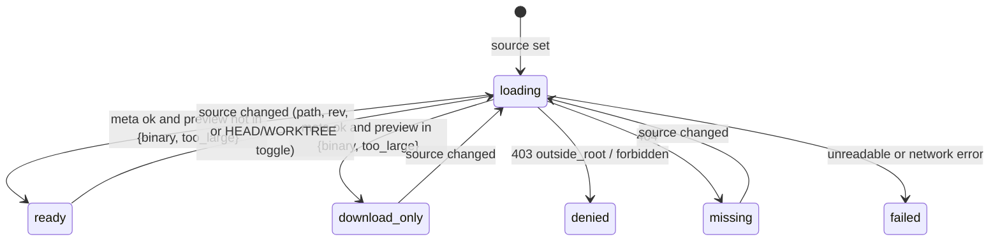
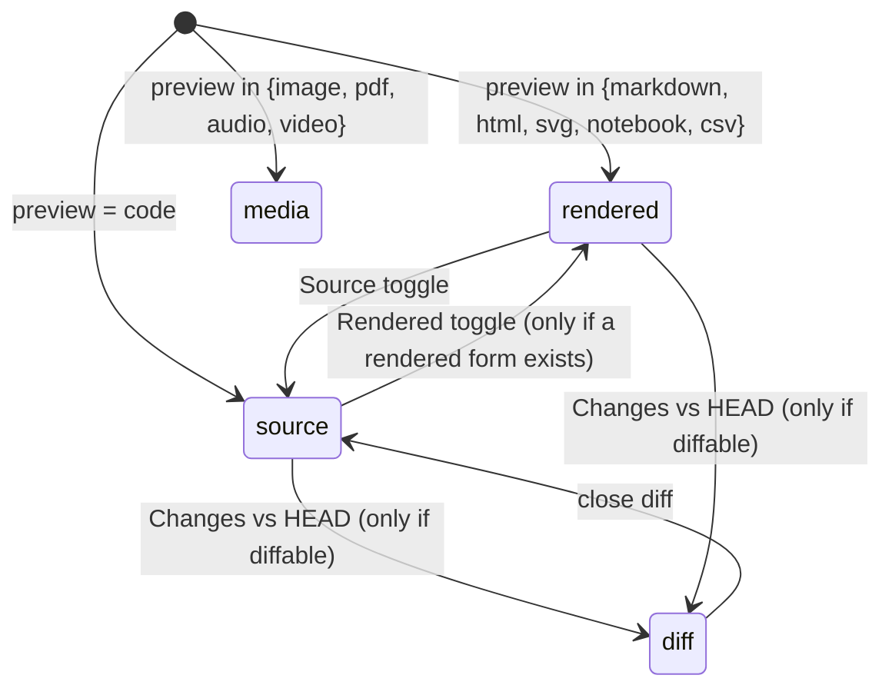

# Feature #133 — File preview and file actions (多种文件预览以及操作支持)

> 原始需求：调研一下项目中图片、原文件、HTML 等内容的渲染支持情况，类似 VS Code 等编辑器的效果。目前不想从头开发，看看有没有现成方案，或者能否集成 VS Code 相关功能。先讨论这个需求，不着急做决定。等我确定方向后，再写具体的实现方案。
>
> Spec written 2026-10-05 against `f125/integration` @ `f981bdeb`. **Status: proposal.** The operator asked to discuss before deciding. The direction below is a recommendation, and approving this spec picks it. The choices the operator may want to overturn are listed under *Open questions*, each with its default.

## Intent

regin shows what an agent did to files, but never the file itself. An agent can Read a PDF, write an HTML report, generate a chart PNG, or edit a 2,000-line module, and regin shows a one-line row, a plain `<pre>`, or a diff fragment. A path, and a `file:` reference chip, link nowhere. To look at the result, the operator leaves regin and opens the file in an editor, which is impossible from a phone or a remote browser.

This feature adds one **read-only file viewer** in the browser. It behaves like VS Code's editor area: code is highlighted with VS Code's own editor, images, PDF, audio and video play natively, markdown and HTML render with a source toggle, and a few editor actions are available (copy, download, line links, find, changes vs HEAD, open in local VS Code). It is assembled from mature components, not built from scratch.

**Non-goals**
- Editing or saving files from the browser. No new endpoint writes to disk (I3). See Q1.
- A file-tree explorer, workspace browsing, or tabs. The file browser is the **planned next feature** (operator, 2026-10-05). This feature does not build it, but it must leave the seams that let it slot in without rework (D11, I8). See *Next: file browser*.
- Language intelligence (hover, go-to-definition, diagnostics), extensions, an integrated terminal, or git operations beyond a read-only diff vs HEAD.
- Changing the existing trace renderers (`DiffBlock`, `DiffCard`, `BashCard`, `RewindCard`, `PresentProse`). They keep their output; only the file paths they name become links into the viewer (R4). The viewer is a new place you can open, not a replacement.
- Sanitizing the existing `MarkdownContent` globally. That is a follow-up (see *Follow-ups*). The viewer sanitizes its own markdown (I2).
- Hex editing. A binary file gets metadata plus download, which is also what VS Code shows without the hex-editor extension.

## Current state (surveyed at `f981bdeb`)

| Content | Where it appears today | Renderer | Gap |
|---|---|---|---|
| Edit / Write / MultiEdit diff | `conversation/cards/DiffCard.vue` | `DiffBlock.vue` (highlight.js by extension) | Only the changed hunk is shown. The filename is not clickable. |
| Read result | `InlineToolRow`, `present/PresentProse.vue` | plain `<pre>` | No highlighting. A Read image or PDF never renders as one. |
| Bash output, Rewind before/after | `BashCard.vue`, `RewindCard.vue` | plain `<pre>` | — (out of scope) |
| Prompt and attachment images | `useSpanImages.js`, `useAttachedImages.js` | `` + blob URL from DB bytes | Works. The viewer reuses its blob-fetch pattern (`api.getBlobUrl`). |
| Search file hit | `search/SearchFilePreview.vue` via `lib/fulltext/file_docs.py` | `DiffBlock` showing a window of lines | The hit links to the edit span, not to the file. |
| Markdown (plans, patterns, span detail) | `MarkdownContent.vue` | `marked` → `v-html`, **not sanitized** | No sanitizing. `package.json` has no DOMPurify. |
| `file:` reference chip | `RefChip.vue` | `<span>` | `_ROUTES` in `lib/refs/resolve.py` has no `file` entry, so `url` is null. |
| HTML, PDF, SVG, notebook, CSV, audio, video | nowhere | — | No `<iframe>`, `srcdoc` or sandbox exists anywhere in the SPA. |

## Decisions

| # | Decision | Rejected alternatives | Why |
|---|---|---|---|
| D1 | **Code and diffs use `monaco-editor`**, the editor component VS Code is built on. It runs read-only and is loaded by dynamic `import()` only when a code or diff view mounts. | (a) Embed **openvscode-server / code-server** in an iframe. (b) **`@codingame/monaco-vscode-api`** (VS Code workbench services in the browser). (c) **CodeMirror 6**. (d) **Shiki**. (e) Keep highlight.js. | (a) Full VS Code, MIT. But it is a second Node process with its own auth, a terminal and write access to the host, which bypasses regin's role model and conflicts with I3. It is still possible later as an opt-in sidecar (Q4). (b) MIT. It is worth it only for loading extensions, which is a non-goal. It is heavy and builds only on Linux/Mac. (c) Lighter, but it is not VS Code's look, keymap, find widget or diff editor, and 类似 VS Code 的效果 was the ask. (d) Gives the same TextMate highlighting as VS Code, but no find, fold, minimap, go-to-line or diff. (e) No editor behaviour at all. |
| D2 | Monaco loads only `editor.worker`. Highlighting comes from Monaco's bundled Monarch grammars (`basic-languages`). The TS, JSON, CSS and HTML language-service workers are not loaded. | Load the full language services | Read-only preview needs tokens, not diagnostics. Each language worker adds MBs to the lazy chunk for features the non-goals exclude. |
| D3 | Every other kind uses the browser's native renderer or one small, mature library (R2): ``, `<audio>`, `<video>`, the native PDF viewer in an `<iframe>` from a blob URL, `marked` + **DOMPurify** for markdown, **Papa Parse** for CSV, Monaco `colorize` for notebook code cells. | pdf.js; a home-grown CSV parser | Every target browser has a native PDF viewer, and pdf.js would add about 1 MB for no visible gain. Splitting CSV correctly (quotes, embedded newlines) is the kind of thing a mature parser exists for. |
| D4 | Untrusted HTML renders only in `<iframe sandbox srcdoc=…>`. Scripts are **off** by default. A toggle adds `allow-scripts`. `allow-same-origin` is never set. SVG renders only through ``. | Render HTML with `v-html`; run scripts by default | The files are written by agents and by repos the operator did not author. Without `allow-same-origin` the frame has an opaque origin, so even with scripts on it cannot read regin's token or DOM. An SVG in `` never runs its scripts. |
| D5 | **The server decides the kind once** (`FileMeta.preview`). The frontend dispatches on that field through one registry table and never re-sniffs. | Sniff in the browser | One decision point (I7). The server can read the first 8 KiB for a NUL byte without shipping the whole file. |
| D6 | A file is addressed by a **source**, not a bare path: `project` (repo-relative path in a registered repo, at `WORKTREE` or a git rev), `session` (an absolute path seen by that session), or `span` (the content a Read span captured, with no disk read). | One `?path=/abs/path` endpoint | A bare path cannot be confined, because there is no root to check against. A source names its root, and the root names its role rule (R1). |
| D7 | Confinement is by `realpath` against the source's root, after resolving symlinks. Session sources also accept any path that a file-touching span of **that** session names, which is the same evidence `lib/fulltext/file_docs.py` already trusts. | Confine to the session cwd only | Agents legitimately touch `~/.claude/…`, sibling worktrees and `/tmp`. "The agent in this session touched it" is an identifier-based grant. A cwd prefix is not enough evidence. |
| D8 | One `FileViewer` component, mounted two ways: the route `/files?…` (full page; a `file:` chip links here) and a side drawer opened from trace surfaces. | Separate page and drawer components | Two copies of a registry and a toolbar are how they drift. |
| D9 | "Open in VS Code" is a `vscode://file/<abs>:<line>` deep link, shown only when `location.hostname` is loopback. | Always show it; or run a server-side `code` CLI | The URI opens the path on the **browser's** machine, which is the server only when the browser is local. A server-side `code` launch would be a remote-execution surface. |
| D10 | `file:` chips become links once their project is known: `file_item` sets `url = /files?project=<id>&path=<key>`. With no project the chip stays a `<span>`. | Add `file` to `_ROUTES` | `_ROUTES` formats from the key alone, and a file key without its project names no file. |
| D11 | **Built for the file browser that comes next.** (a) A source has two parts, a **root** (`project` + `rev`, or `session`) and a **path inside it**. The R1 confinement check takes only the root and the path, so a later `GET /api/files/list?<root>&dir=` reuses it unchanged. (b) The `/files` page lays out a left pane and the viewer. In this feature the left pane stays empty and collapsed. (c) Everything the viewer shows is addressed by the URL alone (I8), so a tree only has to navigate. | Build the viewer as a single-file page and add a tree later | Retrofitting a root/path split, a page layout and URL-addressed state after the fact means reworking every entry point (R4). The seams cost almost nothing now. |

## Model

### Types

```typescript
type PreviewKind =
  | 'code' | 'markdown' | 'html' | 'svg' | 'image' | 'pdf'
  | 'audio' | 'video' | 'notebook' | 'csv'
  | 'binary' | 'too_large'

type FileSource =
  | { kind: 'project'; project_id: int; path: RepoRelPath; rev: 'WORKTREE' | GitRev }  // default rev = WORKTREE
  | { kind: 'session'; trace_id: TraceId; path: AbsPath; rev: 'WORKTREE' | GitRev }   // default rev = WORKTREE
  | { kind: 'span';    trace_id: TraceId; span_id: SpanId }   // Read content from the span store; no disk

type FileMeta = {
  source: FileSource
  name: string                 // basename
  abs_path: AbsPath | null     // null for a span source whose path is unknown
  size: int                    // bytes
  mime: string
  preview: PreviewKind         // D5: the one classification
  language: string | null      // Monaco language id for code / svg-source / html-source
  first_line: int              // 1, or the Read offset for a span source
  in_head: boolean             // the root is a git work tree and the path exists at HEAD (gates the WORKTREE ⇄ HEAD switch)
  diffable: boolean            // in_head, preview is a text kind (code, markdown, html, svg, csv, notebook), and the worktree bytes hash differently from HEAD's
}

type ViewerError = 'outside_root' | 'forbidden' | 'missing' | 'unreadable' | 'bad_source'
// status: bad_source 400 (malformed args, a NUL byte, or a rev that is not `[A-Za-z0-9._/~^@{}-]` / starts with `-` / holds `:`), forbidden 403, outside_root 403, missing 404, unreadable 422
```

API (one reader in `lib/files/`, one blueprint):

| Route | Returns |
|---|---|
| `GET /api/files/meta?<source>` | `FileMeta`, or `{error: ViewerError}` with its status |
| `GET /api/files/raw?<source>[&download=1]` | the bytes, with `Content-Type` = `mime`, `X-Content-Type-Options: nosniff`, `Content-Security-Policy: sandbox`, and `Content-Disposition: attachment` when `download=1` |
| `GET /api/files/raw?<source>&rev=HEAD` | the committed bytes (for a project or session source in a git work tree), used by the diff view |

`<source>` is `project=<id>&path=<p>[&rev=]` | `session=<trace_id>&path=<abs>[&rev=]` | `session=<trace_id>&span=<span_id>`.

The `/files` page URL carries the source's own keys plus the viewer state: `view=source|diff` (absent = the kind's default view; a view the file cannot take falls back to it), `layout=inline` (diff only), and the `#L` anchor. The drawer is not URL-addressed; its view, layout and anchor live in `useFilePreview`, and "Open page" carries them to `/files`.

Git is asked only through plumbing that runs no repo-configured command (`-c core.fsmonitor=false`, `cat-file blob <rev>:./<rel>`, `rev-parse`, `hash-object --no-filters`): `diffable` compares the HEAD object id with the worktree's unfiltered hash rather than running `git diff`, which would execute the repo's clean filters.

### Viewer lifecycle (axis A — loading)



### View mode (axis B — only while `ready`)



The HTML scripts toggle (`off` ⇄ `on`) is a third flag that applies only in `rendered` for `html`. It resets to `off` on every source change.

## Rules

### R1 — Who may read what (decided server-side before any byte is read)

| source | role | path check | → |
|---|---|---|---|
| project | < editor | — | 403 `forbidden` |
| project | editor+ | `realpath(repo.path / path)` inside `realpath(repo.path)` | serve |
| project | editor+ | outside, including through a symlink | 403 `outside_root` |
| session | not admin | — | 403 `forbidden` (the session surface is admin-only) |
| session | admin | `realpath(path)` inside `realpath(roots.session_cwd(trace_id))` | serve |
| session | admin | outside the cwd, but named (`file_path` / `notebook_path`, compared by realpath) by a `tool.Read`/`Edit`/`Write`/`MultiEdit`/`NotebookEdit` span of this trace | serve |
| session | admin | outside the cwd, but named as an absolute path in `bash_edits[].file_path` / `bash_edit_files` of a `tool.Bash` span of this trace (malformed attributes grant nothing) | serve |
| session | admin | outside the cwd and named by no span of this trace | 403 `outside_root` |
| span | not admin | — | 403 `forbidden` |
| span | admin | a `tool.Read` span of the trace carrying `content` | serve the captured content, `first_line` = its `start_line` |
| span | admin | not a Read span, or no `content` | 404 `missing` |
| any | allowed | file absent | 404 `missing` |

### R2 — Classification (`FileMeta.preview`), first matching row wins

| condition | preview | default view | renderer |
|---|---|---|---|
| size > cap for its kind (text 2 MiB for svg/markdown/html/notebook/csv/code, media / PDF 50 MiB; a binary file has no cap, so a large file with a NUL in its first 8 KiB is `binary`) | `too_large` | download only | — |
| `.png .jpg .jpeg .gif .webp .avif .bmp .ico` | `image` | media | `` blob URL; fit ⇄ 1:1 toggle |
| `.svg` | `svg` | rendered | `` blob URL; source = Monaco `xml` |
| `.pdf` | `pdf` | media | `<iframe>` blob URL (native viewer) |
| `.mp3 .wav .ogg .m4a .flac` | `audio` | media | `<audio controls>` |
| `.mp4 .webm .mov` | `video` | media | `<video controls>` |
| `.md .markdown` | `markdown` | rendered | a leading `---` frontmatter block (closed by `---` or `...`) is shown verbatim in a `<pre>` above the body; the rest goes `marked` → DOMPurify → `v-html`; source = Monaco `markdown` |
| `.html .htm` | `html` | rendered | `<iframe sandbox srcdoc>` (D4); source = Monaco `html` |
| `.ipynb` that parses as nbformat 4 JSON | `notebook` | rendered | markdown cells as markdown; code cells via `monaco.editor.colorize`; outputs: `text/plain` → `<pre>`, `image/png` / `image/jpeg` → ``, `text/html` → sandboxed iframe |
| `.csv .tsv` | `csv` | rendered | Papa Parse → table, first 1,000 rows, with a row-count notice when truncated |
| no NUL byte in the first 8 KiB and decodes as UTF-8 (BOM allowed) | `code` | source | Monaco read-only; language from filename or extension, `plaintext` fallback |
| otherwise | `binary` | download only | name, size, mime, Download |

### R3 — Actions

| action | shown when | behaviour |
|---|---|---|
| Copy path | a path is known | copies `abs_path`, or the repo-relative path for a project source |
| Copy content | preview is text-backed (code, markdown, html, svg, csv, notebook) | copies the raw text |
| Download | always | `raw?…&download=1` |
| Line link | source or diff view (diff: the worktree side) | `#L10` / `#L10-L20` in the URL reveals and highlights those lines. "Copy link" copies the `/files` URL with the anchor of the user's last selection (else the current anchor) and writes that anchor to the page URL. |
| Find, go-to-line, fold, wrap toggle | source or diff view | Monaco's own widgets and keybindings |
| Rendered ⇄ Source | preview has a rendered form | axis B |
| Run scripts | `html` in rendered view | adds `allow-scripts` and reloads the frame. Never `allow-same-origin` (I2). |
| Changes vs HEAD | `diffable` | Monaco diff editor, HEAD bytes vs WORKTREE bytes; side-by-side ⇄ inline toggle |
| WORKTREE ⇄ HEAD | project or session source with `in_head`, or already at `rev=HEAD` | switches `rev` (a new source: view and anchor reset) |
| Current on disk | span source with a known `abs_path` | re-opens as a session source for that path |
| Open in VS Code | `abs_path` known and `location.hostname` ∈ {`localhost`, `127.0.0.1`, `::1`} | `vscode://file/<abs_path>:<line>` (D9) |

### R4 — Entry points

| surface | trigger | opens | source |
|---|---|---|---|
| `RefChip` for `file:` | click (it is now a link, D10) | `/files` page | `project` = chip's `project_id`, `rev=WORKTREE` |
| `DiffCard` (Edit / Write / MultiEdit) | click the filename | drawer | `session`, the span's file path |
| Bash file changes (`BashEditDiffs` in the feed, `PresentBashEdits` in the reader) | click a changed path — diffed or listed-only (`FilePathLink`; plain text when the span has no trace) | drawer, stacked over the reader when opened from it | `session`, the path from `bash_edits` / `bash_edit_files` |
| Read row (`InlineToolRow` / reader view) | "View" action, offered only when the span carries captured `content` (most Reads capture none, and a span source without it is `missing`) | drawer, stacked over the reader when opened from it | `span` |
| Search file hit (`SearchFilePreview`) | "Open file" (the palette closes first; the footer action stays "Open edit in trace") | drawer, at the hit line | `session` of the hit's span, the hit path, carried on the file doc as `source` |
| Markdown inside the viewer | relative link to another file | the same viewer, navigated | same source kind and root, path resolved against the current file's directory |
| Markdown inside the viewer | relative `` | inline image | same source, fetched as a blob URL. A resolved path outside the root is not fetched (R1 refuses it). |
| Markdown inside the viewer | click on an `` not inside a link | the image itself | relative → the same viewer, navigated to the image file; http(s) → new tab; a refused image does nothing |

## Invariants

- **I1** For all responses from `/api/files/*`: no byte comes from a path whose `realpath` falls outside the source's root, except a session-source path named by a span of that same trace (R1).
- **I2** For all previewed content: nothing from a file executes in regin's origin. HTML only in an iframe without `allow-same-origin`. SVG only via ``. Markdown and notebook markdown always pass DOMPurify before `v-html`.
- **I3** The feature adds no route or code path that writes, moves or deletes a file on disk.
- **I4** For all routes other than a mounted `FileViewer` in code, diff or notebook mode: no Monaco chunk is requested. The entry bundle does not grow by Monaco.
- **I5** For all `raw` responses: `X-Content-Type-Options: nosniff` and `Content-Security-Policy: sandbox` are set, so opening a raw URL directly in a tab cannot run its content in regin's origin.
- **I6** For all files: `FileMeta.preview` is computed by exactly one function (`lib/files/classify.py`). The frontend maps `preview` → renderer through exactly one registry.
- **I7** The viewer never re-sniffs content. A wrong classification is fixed in R2, not patched in a renderer.
- **I8** For every viewer state on `/files` (source, rev, view mode, line anchor), loading that URL in a fresh tab reproduces the same state. No state lives only in component memory.

## Acceptance

```gherkin
Feature: File viewer — backend

  Scenario: Project path escaping the repo is refused
    Given a registered repo at <root>
    When an editor requests meta for project=<id>&path=../outside.txt
    Then the response is 403 with error "outside_root"
    And no file outside <root> is opened

  Scenario: Symlink inside the repo pointing outside is refused
    Given <root>/link.txt is a symlink to /etc/hosts
    When an editor requests raw for project=<id>&path=link.txt
    Then the response is 403 with error "outside_root"

  Scenario: Viewer role cannot read project files
    Given a user with the viewer role
    When they request meta for any project source
    Then the response is 403 with error "forbidden"

  Scenario: Session source serves a span-named path outside the cwd
    Given session S with cwd /w and a tool.Write span on /tmp/report.html
    When an admin requests meta for session=S&path=/tmp/report.html
    Then the response is 200 with preview "html"

  Scenario: Session source refuses an unnamed path outside the cwd
    Given session S with cwd /w and no span naming /etc/hosts
    When an admin requests meta for session=S&path=/etc/hosts
    Then the response is 403 with error "outside_root"

  Scenario: Non-admin cannot read session or span sources
    Given an editor who is not an admin
    When they request meta for a session source or a span source
    Then the response is 403 with error "forbidden"

  Scenario Outline: Classification follows R2
    Given a file <name> with <content>
    When its meta is requested
    Then preview is <preview>
    Examples:
      | name        | content                   | preview   |
      | a.png       | PNG bytes                 | image     |
      | a.svg       | SVG markup                | svg       |
      | a.pdf       | PDF bytes                 | pdf       |
      | README.md   | markdown                  | markdown  |
      | r.html      | HTML                      | html      |
      | n.ipynb     | nbformat 4 JSON           | notebook  |
      | d.csv       | CSV                       | csv       |
      | main.py     | UTF-8 Python              | code      |
      | Makefile    | UTF-8 text                | code      |
      | blob.dat    | NUL in first 8 KiB        | binary    |
      | old.txt     | invalid UTF-8 bytes       | binary    |
      | big.log     | 3 MiB of UTF-8 text       | too_large |

  Scenario: Raw responses carry nosniff and a sandbox CSP
    When any raw file is requested
    Then the response has X-Content-Type-Options "nosniff"
    And the response has Content-Security-Policy "sandbox"

  Scenario: HEAD rev serves committed bytes while the worktree differs
    Given tracked file f.py modified in the worktree
    When raw is requested with rev=HEAD
    Then the body equals `git show HEAD:f.py`
    And meta for rev=WORKTREE reports diffable true

  Scenario: Missing file returns missing
    When meta is requested for a path that does not exist inside the root
    Then the response is 404 with error "missing"

  Scenario: A file reference with a project resolves to a viewer URL
    Given the reference file:docs/x.md resolved with project <id>
    Then its url is "/files?project=<id>&path=docs/x.md"
    And without a project its url is null

Feature: File viewer — frontend

  Scenario: Code opens read-only in Monaco with highlighting
    When /files is opened for a .py file
    Then a read-only Monaco editor shows the file with Python tokens
    And typing into it does not change the content

  Scenario: Monaco is not loaded until a code view mounts
    Given /trace/sessions/<sid> is loaded with no viewer open
    Then no Monaco chunk has been requested
    When the drawer opens a .py file
    Then the Monaco chunk is requested

  Scenario: Line anchor reveals and highlights lines
    When /files is opened for a code file with #L10-L12
    Then lines 10 to 12 are highlighted and in view

  Scenario: HTML preview runs no script by default
    Given an .html file whose script sets document.title to "ran"
    When it is previewed
    Then the frame's title is not "ran"
    And the iframe sandbox attribute lacks allow-scripts and allow-same-origin

  Scenario: HTML scripts toggle runs scripts in an opaque origin
    Given the same .html file, which also reads window.parent.document
    When Run scripts is turned on
    Then the script runs
    And its access to window.parent.document throws a SecurityError

  Scenario: Markdown is sanitized
    Given a .md file containing 
    When it is previewed rendered
    Then window.__pwned is undefined

  Scenario: SVG scripts do not run
    Given an .svg file with an embedded <script>
    When it is previewed
    Then it renders as an  and the script has no effect

  Scenario: PDF renders in the native viewer
    When a .pdf file is previewed
    Then an iframe with a blob: URL of type application/pdf is shown

  Scenario: Binary file offers only metadata and download
    When a binary file is previewed
    Then its size and mime are shown with a Download action
    And no content is rendered

  Scenario: Changes vs HEAD shows a Monaco diff
    Given a tracked file modified in the worktree
    When Changes vs HEAD is clicked
    Then a Monaco diff editor shows HEAD on the left and the worktree on the right
    And for an unmodified or untracked file the action is absent

  Scenario: File reference chip opens the viewer
    Given a feature spec containing [x](file:docs/x.md) in a project
    When the chip is clicked
    Then /files opens docs/x.md from that project

  Scenario: DiffCard filename opens the current file in the drawer
    When the filename on an Edit span's diff card is clicked
    Then the drawer opens the session source for that path

  Scenario: Read span opens captured content at its offset
    Given a Read span with offset 120
    When View is clicked on it
    Then the drawer shows the captured content with line numbers starting at 120

  Scenario: Open in VS Code shows only on a loopback host
    When the viewer is opened at http://localhost:5173
    Then an Open in VS Code link with a vscode://file/ href is shown
    When the viewer is opened at a non-loopback host
    Then no Open in VS Code link is shown

  Scenario: Relative image in markdown loads from the same source
    Given docs/a.md containing  and docs/img/b.png exists
    When docs/a.md is previewed
    Then the image renders from a blob URL for project path docs/img/b.png

  Scenario: Notebook renders cells and image outputs
    Given an .ipynb with a markdown cell, a code cell and a PNG output
    When it is previewed
    Then the markdown is rendered, the code is colorized, and the PNG shows

  Scenario: Files page state is fully addressed by its URL
    Given /files is open on a modified tracked file in diff view at #L40
    When that URL is copied and loaded in a fresh tab
    Then the same file, rev, diff view and line 40 are shown

  Scenario: CSV renders as a truncated table with a source toggle
    Given a .csv with 1,500 rows
    When it is previewed
    Then a table of 1,000 rows and a truncation notice are shown
    And Source switches to the raw text in Monaco
```

## Work slices

All slices branch from **`f125/integration`**, the main checkout's branch. Their branches are `f133/s<n>`.

- No slice changes the database (no table, column or revision). The tail's migrate row is a no-op check.
- S1 comes first, because every other slice reads `/api/files/*`.
- S2 requires S1. S3 and S4 each require S2 and run in parallel: S3 adds renderers inside `FileViewer`, S4 edits the surfaces that open it, and they share no file.
- S5 requires S2 and waits for S3 through an `after` edge. S5 does not consume S3's work. The edge exists because both edit the `FileViewer` toolbar, so S5 starts from S3's merged result.
- S6–S8 are the standard tail (integrate → migrate → verify), rendered by `regin task tail`. S6 also lists S3, because an `after` edge waits for S3 to settle, not for it to merge.
- Each Playwright run uses its own ports and scratch dir, so parallel slices do not collide.

| # | Slice | Delivers | Spec refs | Tests | Schema | Depends on | Base | Skill | Verify |
|---|---|---|---|---|---|---|---|---|---|
| S1 | File reader and API | `lib/files/sources.py` (parse a `FileSource` from request args: project+path+rev, session+path, session+span; the root/path split of D11a); `lib/files/confine.py` (R1: realpath containment against `repos.path` or `roots.session_cwd`, the span-named grant via the trace's file-touching spans, role gates editor for project and admin for session/span); `lib/files/classify.py` (R2, the one classifier, I6: extension table, NUL sniff in the first 8 KiB, UTF-8 check, size caps of 2 MiB text and 50 MiB media); `lib/files/reader.py` (worktree bytes, `git show <rev>:<path>` for HEAD, span-captured Read content with `first_line` = the Read offset, `diffable`); `web/blueprints/files.py` with GET /api/files/meta and GET /api/files/raw (nosniff, `Content-Security-Policy: sandbox`, `download=1` attachment), registered in web/app.py; `tests/files/` covering every backend scenario; no UI, no write path (I3) | D5, D6, D7, D11, Model, R1, R2, I1, I3, I5, I6 | test_project_path_escaping_the_repo_is_refused, test_symlink_inside_the_repo_pointing_outside_is_refused, test_viewer_role_cannot_read_project_files, test_session_source_serves_a_span_named_path_outside_the_cwd, test_session_source_refuses_an_unnamed_path_outside_the_cwd, test_non_admin_cannot_read_session_or_span_sources, test_classification_follows_r2, test_raw_responses_carry_nosniff_and_a_sandbox_csp, test_head_rev_serves_committed_bytes_while_the_worktree_differs, test_missing_file_returns_missing | — | — | f125/integration | goal-verified-treenav | ln -sfn /Users/taowang/regin/.venv .venv && .venv/bin/python -m pytest -q -n auto --dist=loadfile tests/files |
| S2 | Viewer shell, Monaco and media | `monaco-editor` added to frontend/package.json; `frontend/src/components/files/FileViewer.vue` (fetches meta, then dispatches on `preview` through one registry `frontend/src/components/files/registry.js`, I6/I7; lifecycle axis A with loading, ready, download_only, denied, missing, failed); `FileCodeView.vue` (Monaco read-only via dynamic import, `editor.worker` only, D1/D2; language from meta; line numbers from `first_line`; `#L10-L20` anchors reveal and decorate); `FileMediaView.vue` (image with fit/1:1, svg via ``, pdf in an iframe from a blob URL, audio, video, all via `api.getBlobUrl`); `FileBinaryCard.vue` (name, size, mime, Download; also used for too_large); `frontend/src/views/FilesView.vue` at route `/files` with its empty, collapsed left pane (D11b) and all state read from the query and hash (I8); `FilePreviewDrawer.vue` mounting the same viewer (D8), mounted once in `AppLayout` behind `composables/useFilePreview.js` so search and trace surfaces open the same drawer; `frontend/tests/file-viewer.spec.js` | D1, D2, D5, D8, D11, Model, R2, I4, I6, I7, I8 | test_code_opens_read_only_in_monaco_with_highlighting, test_monaco_is_not_loaded_until_a_code_view_mounts, test_line_anchor_reveals_and_highlights_lines, test_svg_scripts_do_not_run, test_pdf_renders_in_the_native_viewer, test_binary_file_offers_only_metadata_and_download | — | S1 | f125/integration | goal-verified-treenav | ln -sfn /Users/taowang/regin/.venv .venv && ln -sfn /Users/taowang/regin/frontend/node_modules frontend/node_modules && cd frontend && npm install && npx vite build && REGIN_E2E_API_PORT=8362 REGIN_E2E_VITE_PORT=5212 REGIN_E2E_SCRATCH=/tmp/regin-e2e-f133-s2 ./node_modules/.bin/playwright test tests/file-viewer.spec.js |
| S3 | Rendered markdown, HTML, CSV and notebook | `dompurify` and `papaparse` added to frontend/package.json; `FileMarkdownView.vue` (`marked` then DOMPurify then `v-html`, I2; relative links navigate the viewer within the same root; relative images fetched as blob URLs through the same source, refused paths not fetched); `FileHtmlView.vue` (`<iframe sandbox srcdoc>`, scripts off by default, the Run scripts toggle adds only `allow-scripts`, never `allow-same-origin`, reset on source change, D4); `FileCsvView.vue` (Papa Parse, first 1,000 rows, truncation notice); `FileNotebookView.vue` (nbformat 4: markdown cells via the markdown view, code cells via `monaco.editor.colorize`, `text/plain`, `image/png`, `image/jpeg` and sandboxed `text/html` outputs); Rendered/Source toggle (axis B) in the toolbar; registry rows for markdown, html, csv, notebook; `frontend/tests/file-render.spec.js` | D3, D4, R2, R3, R4, I2, I7 | test_html_preview_runs_no_script_by_default, test_html_scripts_toggle_runs_scripts_in_an_opaque_origin, test_markdown_is_sanitized, test_relative_image_in_markdown_loads_from_the_same_source, test_notebook_renders_cells_and_image_outputs, test_csv_renders_as_a_truncated_table_with_a_source_toggle | — | S2 | f125/integration | goal-verified-treenav | ln -sfn /Users/taowang/regin/.venv .venv && ln -sfn /Users/taowang/regin/frontend/node_modules frontend/node_modules && cd frontend && npm install && npx vite build && REGIN_E2E_API_PORT=8363 REGIN_E2E_VITE_PORT=5213 REGIN_E2E_SCRATCH=/tmp/regin-e2e-f133-s3 ./node_modules/.bin/playwright test tests/file-render.spec.js tests/file-viewer.spec.js |
| S4 | Entry points | `lib/refs/resolve.py` `file_item` sets `url = /files?project=<id>&path=<key>` when the project is known, null otherwise (D10), so `RefChip.vue` renders a link; `DiffCard.vue` filename opens `FilePreviewDrawer` with a session source; the Read row (`InlineToolRow` and the reader view) gains a View action opening a span source; `SearchFilePreview.vue` gains Open file, opening a session source at the hit line; the drawer is already mounted once, app-wide and lazily, in `AppLayout` (S2), so each entry point only calls `openFilePreview(source, anchor)` from `composables/useFilePreview.js`; `tests/refs/` case for the file url; `frontend/tests/file-entry.spec.js` | D8, D10, R4 | test_a_file_reference_with_a_project_resolves_to_a_viewer_url, test_file_reference_chip_opens_the_viewer, test_diffcard_filename_opens_the_current_file_in_the_drawer, test_read_span_opens_captured_content_at_its_offset | — | S2 | f125/integration | goal-verified-treenav | ln -sfn /Users/taowang/regin/.venv .venv && ln -sfn /Users/taowang/regin/frontend/node_modules frontend/node_modules && .venv/bin/python -m pytest -q -n auto --dist=loadfile tests/refs tests/files && cd frontend && npm install && npx vite build && REGIN_E2E_API_PORT=8364 REGIN_E2E_VITE_PORT=5214 REGIN_E2E_SCRATCH=/tmp/regin-e2e-f133-s4 ./node_modules/.bin/playwright test tests/file-entry.spec.js tests/ref-render.spec.js |
| S5 | Viewer actions | Toolbar actions per R3: Copy path, Copy content, Download, Copy link for the current selection; Changes vs HEAD shown only when `diffable`, opening the Monaco diff editor (HEAD raw vs WORKTREE raw) with side-by-side/inline toggle; WORKTREE/HEAD switch for git roots; Current on disk for span sources; Open in VS Code (`vscode://file/<abs>:<line>`) shown only on a loopback hostname (D9); view mode, rev and anchor written to the URL so a reload reproduces the state (I8); `frontend/tests/file-actions.spec.js` | D9, D11, R3, I3, I8 | test_changes_vs_head_shows_a_monaco_diff, test_open_in_vs_code_shows_only_on_a_loopback_host, test_files_page_state_is_fully_addressed_by_its_url | — | S2, S3 (after) | f125/integration | goal-verified-treenav | ln -sfn /Users/taowang/regin/.venv .venv && ln -sfn /Users/taowang/regin/frontend/node_modules frontend/node_modules && cd frontend && npm install && npx vite build && REGIN_E2E_API_PORT=8365 REGIN_E2E_VITE_PORT=5215 REGIN_E2E_SCRATCH=/tmp/regin-e2e-f133-s5 ./node_modules/.bin/playwright test tests/file-actions.spec.js tests/file-viewer.spec.js |
| S6 | integrate | 检查每一片都已合回 `f125/integration`，无人落零 commit | Work slices | test_every_slice_merged_back | — | S3, S4, S5 | f125/integration | goal-verified-treenav | — |
| S7 | migrate + doctor | 跑 `.venv/bin/python cli/regin.py migrate`，确认这个安装没落后 | Work slices | test_migrate_leaves_no_schema_finding | — | S6 | f125/integration | goal-verified-treenav | .venv/bin/python cli/regin.py migrate |
| S8 | verify | 全量 `.venv/bin/python -m pytest -q -n auto --dist=loadfile`、`cd frontend && ./node_modules/.bin/playwright test` | Acceptance | test_full_suite_passes | — | S7 | f125/integration | goal-verified-treenav | .venv/bin/python -m pytest -q -n auto --dist=loadfile && cd frontend && ./node_modules/.bin/playwright test |

## Open questions — defaults apply unless the operator overrides at approval

| # | Question | Default |
|---|---|---|
| Q1 | Should 操作支持 include **editing and saving** files? | No. Read-only (I3). Writing to disk from a browser makes editor accounts write-capable on the host. This is a separate feature with its own security review. |
| Q2 | Monaco (about 2–4 MB lazy chunk, real VS Code feel) vs CodeMirror 6 (lighter, not VS Code)? | Monaco (D1). The weight is paid only when the viewer opens (I4). |
| Q3 | A file-tree explorer for a repo or worktree? | **Answered (operator, 2026-10-05): it is the planned next feature.** Not built here. D11 and I8 keep its seams open. See *Next: file browser*. |
| Q4 | A full VS Code (openvscode-server) as an opt-in sidecar for local installs? | Follow-up, off by default, behind a setting. It never replaces the built-in viewer, because it cannot honour regin's roles. |

## Next: file browser (separate feature, outline only)

What #133 hands to the next feature, and what that feature still has to decide:

| Piece | Provided by #133 | Left to the browser feature |
|---|---|---|
| Root model and confinement | `project`+`rev` and `session` roots; R1 realpath check (D11a) | `GET /api/files/list?<root>&dir=` built on the same check; lazy per-directory listing |
| What a listing hides | — | Which filter applies: git-tracked plus untracked-not-ignored (`git ls-files -co --exclude-standard`) vs the `lib/agent_bridge/files.py` walk filter. That module deliberately lets a typed path leave its root, which R1 must not inherit. |
| Page layout | `/files` left pane, empty and collapsed (D11b) | the tree, keyboard navigation, filter-by-name, reveal-current-file |
| Navigation | URL-addressed viewer (I8) | selecting a tree node only rewrites the URL |
| Entry | `file:` chips, trace and search entry points | a root picker (repo, or a session's worktree) and a nav entry |
| Session span grant (R1 row 6) | single files named by spans | whether the tree shows a virtual "touched by this session" group for paths outside the cwd |

## Follow-ups (not built here)

- Sanitize `MarkdownContent` everywhere. Today raw HTML in any rendered markdown (plans, patterns, span detail) reaches `v-html` unsanitized.
- `_resolve_pattern_file` (`web/blueprints/patterns/listing.py`) joins a `<path:slug>` with no realpath guard.
- A span grant is checked against the realpath the span's path resolves to *now*; a span-named file later replaced by a symlink grants its new target (admin-only). Compare against the span's literal path and refuse a retargeted link.
- Render Read results of images and PDFs inline in the trace, once it is confirmed whether the transcript stores the image bytes.
- A diff card for NotebookEdit.


