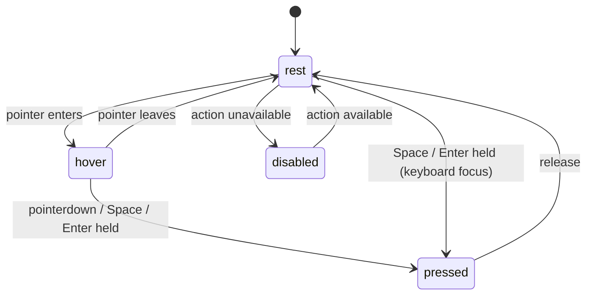
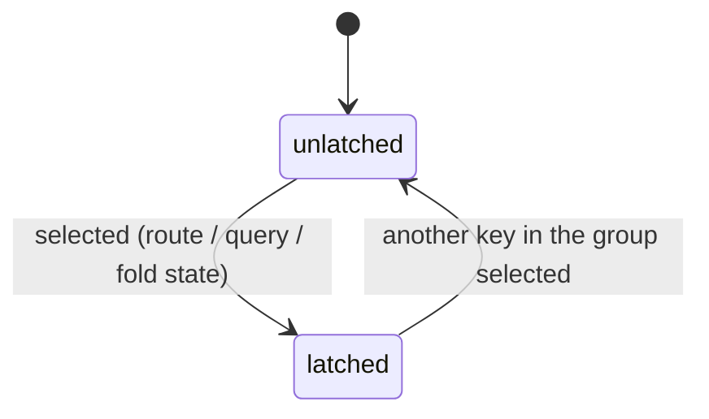
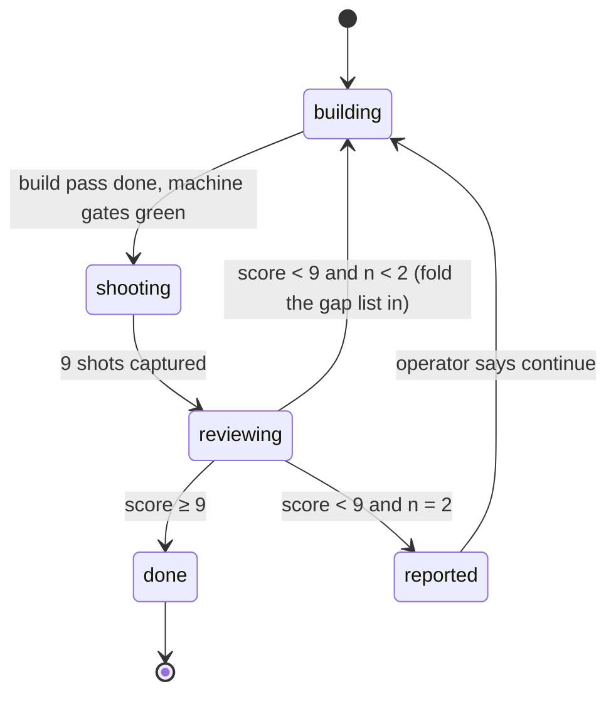

# Feature #138 — Pipeline console redesign (重新设计Pipeline操作界面)

> 原始需求：重新构建Feature, Task, Overview页面
> 【设计方向】工业控制面板：实体按键质感、单一信号色、刻度与编号。
> 【我想象的感觉】界面清晰，易于操作，顶级体验
> 【明确避免】避免过度使用突出色块，颜色
> 【功能约束】无论多大胆，它都必须仍然能作为落地页工作：清晰的主行动、可读的功能说明。
> 【评审回路】每轮截图，只把截图交给全新上下文的设计评审子代理：说明美学意图、想象顶级工作室如何执行、列出最大差距并打分（满分 10）。评审独立给出 9 分及以上才算完成；不要把这个阈值写进评审提示，每轮使用同一份评审提示。先跑两轮并报告是否收敛。
> 【真实素材】用图像生成补充视觉，不要用渐变、色块或基础几何图形代替图像；在浏览器中逐帧验证效果。
> 保持克制：每个保留下来的元素都必须有明确的作用。
>
> Spec written 2026-10-06 against `f125/integration` @ `25395a8e`; revised against the first prototype. **Status: building** — the prototype lives on its own branch **`f138/console-proto`** (`fc040157` + `bf15d911`, based on `25395a8e`), not on `f125/integration`, which keeps the old look (the two commits were rebased out of it). The review bar (R7, an independent ≥ 9) is not met. The defaults under *Open questions* apply.

## Intent

The Pipeline shell (`/pipeline` → `/overview`, `/tasks`, `/features`) is where the operator decides what runs next and what needs a decision. Today it uses the app's general look: blue primary, five status hues (danger, warning, success, info, agent), flat buttons and underline tabs. The screen does not say which single act matters now, and every status competes for attention in its own colour.

This feature restyles the three tab pages and the shell header as an **industrial control panel**. Controls are physical keys. One signal colour lights only what needs the operator. Gauges carry scales. Numbers state order and shortcuts. The Overview still works as a landing page: one primary key, and a one-line plain description on every panel. Visual quality is judged by a fresh-context design reviewer that sees only screenshots. Done is that reviewer's independent score of 9/10 or higher.

**Non-goals**
- No backend change: no new endpoint, no payload change, no new query parameter. Every panel reads what it reads today (`/api/pipeline/overview`, `/api/pipeline/counts`, `/api/tasks`, `/api/features`, the triage queue).
- No URL change. Routes, `?project= ?view= ?group= ?stage= ?sort= ?q= ?triage= ?page=` and their meanings are fixed.
- Detail bodies are not redesigned: `/features/:id` (FeatureLedgerView), `/defects`, `/defects/:id`, `/tasks/:id`. They render inside, or next to, the restyled shell header and are otherwise unchanged (Q2).
- No change to the rest of the app. Existing `:root` tokens and `components/ui/*` defaults stay as they are; the console look lives in a scope (D2).
- No information-architecture rework. The panels, columns and views that exist today stay. Only how they look changes, apart from the additions in R2–R5.

## Current state (surveyed at `25395a8e`)

| Surface | Files | What it looks like today |
|---|---|---|
| Shell header | `views/PipelineView.vue` | `Pipeline` h1, project chip, subline, "Updated n m ago", teleported create button. Underline tabs with grey count pills. On a phone: a segmented control and a floating round "+". |
| Overview | `views/OverviewView.vue`, `components/pipeline/{OverviewLoop,SegmentBar,RunNextPanel,RunningNow,NeedsDecisionPanel,ProjectsPanel,ProjectScopePanel}.vue` | Loop strip (Tasks/Features/Defects, multi-hue SegmentBar, fact links with `is-danger` / `is-warn` tones). Run next and Needs-a-decision side by side. Projects panel below. No page-level description, and no single primary action: the header's create button is "New task", and each Run next row has its own Run. |
| Tasks | `views/TasksView.vue`, `components/tasks/*` (TaskToolbar, TaskBoard, NextStepList, TaskListPanel, TaskLaneGraph …) | Board / List / Graph on `?view=`. Status and kind chips in several hues. Graph "blocking" edge is `--color-warning` dashed. |
| Features | `views/FeaturesView.vue`, `components/pipeline/{FeatureStageTabs,FeatureTrackTable,FeatureCard,TriageRail,TriageSheet}.vue` | Stage tabs with counts, track table, triage rail (amber card on a phone). |
| Colour usage | the files above | Semantic tokens are used throughout (`--color-fg*`, `--color-surface*`, `--color-border*`, plus `--color-danger` ×22, `--color-primary` ×15, `--color-warning*` ×25, `--color-info*` ×21, `--color-agent*` ×17, `--color-success` ×8). There are also a few raw palette refs (`--color-amber-300/400`, `--color-red-700`, `--color-blue-500`) and literal `focus-visible:outline-blue-500` classes. |
| Images | — | None anywhere in the shell. |
| Tests | `frontend/tests/*.spec.js` | 46 specs navigate to `/overview`, `/tasks` or `/features`. They select by `data-testid`. |
| Image generation | build environment | **Not available** (checked 2026-10-06). Claude Code has no native image tool, and the image API keys (`OPENAI_API_KEY`, `GEMINI_API_KEY`, `GOOGLE_API_KEY`, `REPLICATE_API_TOKEN`, `FAL_KEY`, `STABILITY_API_KEY`) are unset. Codex 0.147 has `image_generation` enabled, but `~/.codex/auth.json` holds a placeholder key (`401 Incorrect API key`). Ollama 0.32.6 pulls `x/z-image-turbo` but answers `image generation models are not currently supported`. See P1. |

## Decisions

| # | Decision | Rejected | Why |
|---|---|---|---|
| D1 | **One signal colour with one meaning: press this next.** Amber fills the lit key (R2) and draws the keyboard focus ring, nothing else. Status keeps colour as a control panel does, **on indicators, not surfaces**: two indicator hues from IEC 60073, live green (running) and fault red (fault, needs a decision), on lamps, glyphs, thin gauge parts, rules and short words (R1). | Keep the five status hues as fills; or signal lamps on every alert; or collapse all status to black and grey | 单一信号色 and 避免过度使用突出色块: the restriction is on colour *blocks*, not on colour. Amber on alerts as well as on the action gave one colour two meanings, and a blind reviewer read it exactly that way. All-grey was the opposite error: the operator rejected it (减少色块不意味着全是黑白灰, defect #247). |
| D2 | **The look is a token scope.** A `.pl-console` class on the shell header and on each tab root remaps the semantic tokens (`--color-primary`, `--color-danger*`, `--color-warning*`, `--color-success*`, `--color-info*`, `--color-agent*`, `--color-ring`) and adds new `--pl-*` tokens (signal, key edge, plate, ink ramp). Components keep using semantic tokens. Raw palette refs the components still name (`--color-slate-*`, `--color-blue-*`, `--color-amber-*`, …) are remapped in the same scope. `ui/Button.vue` gains only a `data-variant` attribute, so the scope can tell a key from a ghost. While a Pipeline tab route shows, `html[data-pl-console]` drops the app chrome's accents (sidebar active item, brand mark, badges, avatar, floating capture key). | Restyle `components/ui/Button.vue` and `:root` globally; or fork each component; or leave the chrome blue | A global restyle changes every other page (non-goal). Forking duplicates TaskRow, TaskBoardCard and the rest, and the copies drift. A blue nav pill is the largest colour block on every Pipeline screen, so leaving it breaks 单一信号色 in every screenshot. |
| D3 | **Exactly one signal-filled key per screen, always at the right end of the shell header** (R2). Everything else that needs the operator is marked in ink. | Signal fill on every alert | 避免过度使用突出色块. A screen with three orange blocks has no primary action. |
| D4 | **The lit key is the shell header's `Run next #id` on every tab** whenever the scope's queue has a runnable head. Otherwise it is that tab's create key. The head row of Run next shows a `Next` mark instead of its own Run, so the action exists once. | Light the head row's Run on the Overview and the create key on the other tabs | The lit key would then move, and change meaning, between tabs. The Overview's own copy ("the lit key runs the head of the queue") was broken by the next tab. |
| D5 | **Numbers must do something** (R4). Tab keys carry 1/2/3, and those digits are new keyboard shortcuts. Loop stages and feature stages carry their lifecycle order. Run next rows carry queue position. | Decorative serial numbers | Restraint. A number that maps to nothing is decoration. |
| D6 | **Images are generated raster assets in exactly two roles**: an Overview masthead, and one shared "idle console" image for empty states (R5). Each has a light and a dark variant. | Hero images on every tab; CSS-drawn panels | 用图像生成补充视觉，不要用渐变、色块或基础几何图形代替图像. Each image is kept only where it has a job (landing identity; "nothing queued"). |
| D7 | **The review loop is part of the build, with a fixed prompt and a fixed shot list** (*Review loop* below). The prompt lives in this spec, so every round uses the same bytes. | The build writes its own reviewer prompt per round | 每轮使用同一份评审提示, and the threshold must never leak into the prompt. A per-round prompt drifts, and drift lets the score climb without the screens changing. |

## Preconditions

| # | Precondition | State at spec time | If unmet |
|---|---|---|---|
| P1 | The build session can generate images (Codex `image_gen` with a real key, or an image API key the operator provides), **or** the operator places the four assets from R5 in `frontend/src/assets/pipeline/`. `utils/consoleImages.js` globs that directory, so assets dropped there are picked up with no code change. | Unmet: see *Current state* | Build everything else. Report the image scenarios as **UNPROVEN: no image generator**. Never substitute a gradient, a colour block or CSS shapes (I6). Run the review loop with the image slots empty, and the report says so. |
| P2 | Dev server on :5173 against the live `db/regin.db`, with a real login token | Available | — |

## Model

```typescript
type SignalUse = 'primary-key' | 'focus-ring'
// The only two ways the amber signal may appear (D1, I1, I2).
//   primary-key: the one lit key per screen (R2)
//   focus-ring:  2 px outline on keyboard focus

type Indicator = 'live' | 'fault'
// IEC 60073 indicator hues, on marks only (I1, I2):
//   live:  green — running agents, live runs, in-flight gauge parts, done ✓
//   fault: red   — failed, escaped, triage > 0, open defects, blocking edges

type Mark = 'lamp' | 'glyph' | 'gauge-part' | 'rule' | 'word'
// Where an indicator hue may sit. A lamp is ≤ 10 px; a gauge part ≤ 10 px
// tall; a word is a short status label or count. Never a card, chip or pill fill.

type KeyRole = 'primary' | 'neutral' | 'latching'
// primary:  the screen's one signal key
// neutral:  every other command (raised); row actions are flat (R3)
// latching: tabs, stage tabs, Board/List/Graph, the rail fold

type ShotId =
  | `${'overview' | 'tasks' | 'features'}-${'light' | 'dark'}-desktop`  // 1440×900
  | `${'overview' | 'tasks' | 'features'}-light-phone`                  // 390×844
// 9 shots per round. Scope = All projects; Tasks on ?view=list (default grouping).

type ReviewRound = {
  n: number                  // 1, 2, …
  shots: ShotId[]            // always all 9
  prompt_sha256: string      // identical in every round (I12)
  score: number              // 0–10, parsed from the reviewer's last line `SCORE: n/10`
  gaps: string[]             // the reviewer's ranked gap list, verbatim
  reviewer: TraceId          // a fresh session/subagent per round
}
```

A key has two orthogonal axes, so it gets two diagrams.

**Axis A: interaction.** All keys.



`rest` is raised, with a visible lower edge and a top highlight. `pressed` sinks by the edge height, using `transform` only. `disabled` is flat, with no edge.

**Axis B: latch.** Only `latching` keys.



`latched` renders as pressed-in for as long as it holds, and is announced with `aria-current="page"` or `aria-selected="true"`, as the control already does.

**Review loop**



`reported` posts the convergence report (R7) and stops the build session. It does not loop on its own.

## Rules

**R1 — Colour roles inside `.pl-console`**

| Role | Today | In the console |
|---|---|---|
| The screen's primary action (R2) | `--color-primary` fill | signal fill, ink label |
| Any other button | mixed | neutral key (Axis A) |
| Active tab, active stage, active view, fold toggle | primary text + underline | latched key, ink label; no signal |
| Link | primary blue | ink, underlined on hover/focus |
| Keyboard focus | `outline-blue-500` / `--color-ring` | signal focus ring |
| Needs the operator: failed task, escaped feature, triage queue > 0, open defects, refused run, blocked edge, load error | danger / warning tones and fills | fault red on a `Mark`: a lamp beside the label, the status glyph, the gauge part, the dashed edge, or the short word itself; the surface behind it stays a neutral plate |
| Running | info blue / agent violet | live green lamp, pulsing (static under `prefers-reduced-motion`); live text in green |
| Done, shipped, success | success green | live green ✓ glyph |
| Agent marker | `--color-agent` violet | live green |
| Gauge (SegmentBar) parts | one hue per part | not started light grey; in flight dim green; open defects pending grey (in flight but not healthy); settled grey; needs the operator fault red. Each part's fact carries a matching swatch or lamp |
| Soft-tinted cards (`*-soft` backgrounds, e.g. the mobile triage card) | tinted fill | plate (neutral surface) |
| App chrome while a Pipeline tab shows | blue pill, blue mark, tinted badges, gradient avatar, blue floating key | neutral, under `html[data-pl-console]` (D2) |

**R2 — The lit key per screen** (exactly one signal key, or none)

| Screen | `canWrite` | Condition | Lit key |
|---|---|---|---|
| Overview, Tasks, Features | no | — | none |
| Overview, Tasks, Features | yes | the scope's Run next has a runnable head | the header's `Run next #id` (`data-testid=pipeline-run-next`), at the right end of the header |
| Overview, Tasks, Features | yes | nothing runnable | that tab's create key: "New task" (`task-new`) or "New feature" (`declare-feature`) |
| `/defects`, detail pages | — | — | none; their create key is quiet |

The header and every tab read the queue head from one shared read (`usePipelineHead`, `GET /api/pipeline/overview`), so they cannot disagree about which key is lit. The head row of Run next shows `Next` (`run-next-next-<id>`) in place of its Run key. Below 768 px the same keys sit inline in the header, and nothing floats over the rows.

**R3 — Which controls are keys**

| Control | Key role |
|---|---|
| Pipeline tabs (Overview, Tasks, Features) | latching |
| Feature stage tabs, Board/List/Graph switch, triage rail fold | latching |
| Header create / "New ▾" / Run next, toolbar commands, dialog actions | raised neutral key, or lit by R2 |
| Row actions (Run, Watch, Stop, Retry, Attribute inside a row) | flat: a rim, no travel |
| Rows, cards, links, inputs, selects | not keys |

**R4 — Numbering and scales.** Every number has a function.

| Element | Mark | Function |
|---|---|---|
| Pipeline tab keys | `1` Overview · `2` Tasks · `3` Features, the numeral leading the label | Keyboard shortcut. Keys `1` `2` `3` switch tabs, carrying scope the way `tabTo()` does. Same guards as `useTaskShortcuts`: no modifier, not while typing, not over an open overlay. |
| Loop stages | `01` Tasks → `02` Features → `03` Defects | the order work flows |
| Run next rows | `01`…`06` | queue position: the order they will run |
| Feature stage tabs | All · `01` Spec · `02` Building · `03` Shipped · `04` Escaped | lifecycle order, one order at every width (the bank scrolls on a phone) |
| Every loop gauge | reads **open** work: settled parts (done, shipped, closed) are not drawn but stay in the bar's accessible name. The scale ends on the first round step at or above the open count, with ≤ 5 labelled majors. The big figure is the open count, beside "open of N" (`loop-total` = N) | reading magnitude; a bar always full of history reads nothing |
| Every count (tab counts, loop totals, stage counts, Run next count) | tabular numerals | columns of digits align |
| Ids (`#352`) | unchanged text, mono | identity; text kept, because specs match it |

**R5 — Images**

| Asset | Path | Where | Size | Alt |
|---|---|---|---|---|
| Masthead | `frontend/src/assets/pipeline/masthead-{light,dark}.webp` | Overview, beside the page description; ≥ 768 px only | ≤ 200 KB each; rendered height ≤ 160 px | `alt=""`, `aria-hidden` (decorative; the description beside it carries the meaning) |
| Idle console | `frontend/src/assets/pipeline/idle-{light,dark}.webp` | empty state of Run next, of the Tasks list/board, and of the Features list | ≤ 120 KB each | `alt=""`; the empty-state sentence and action carry the meaning |

The variant follows `data-theme`, not `prefers-color-scheme`. Generation prompt, which the build reuses for both variants: *"Photographic close-up of a matte graphite industrial control panel: engraved numbered scales, physical square keys, a single lit {signal-hue} indicator lamp, everything else neutral grey; soft studio light, shallow depth of field; no text, no logos; {light: pale warm-grey panel | dark: near-black panel}."* The idle variant uses the same prompt with "every lamp unlit".

**R6 — Landing-page duty (Overview)**

| Breakpoint | Must be inside the first viewport without scrolling |
|---|---|
| 1440×900 | Page description (one sentence: what the Pipeline is and that work flows Tasks → Features → Defects); the primary key from R2; all three loop gauges |
| 390×844 | the primary key from R2 |

Every Overview panel (Run next, Needs a decision, Projects / project scope) and the Tasks and Features toolbars carry a one-line visible description of what the panel lists (`data-testid="<panel>-desc"`). It is visible at ≥ 768 px and is not tooltip-only. The masthead sentence sits on the page grid, not in a box.

Empty states give their space back:

| Surface | At zero |
|---|---|
| Needs a decision (Overview) | not rendered; the loop's Defects stage prints `0 to triage`; Run next takes the full width |
| Triage rail (Features, ≥ 768 px) | folds to its strip, judged by the rail's own queue count |
| Triage card (Features, phone) | not rendered |

Running now follows the Run next rows inside the Run next card, so the queue's head stays in the first viewport.

**R7 — The convergence report** (posted at `reported` or `done`)

| Field | Content |
|---|---|
| Scores | per round, and the delta |
| Gap overlap | which round-1 gaps are absent from round 2's list; which persist |
| Verdict | `converging` if round 2's score > round 1's and at least one top-3 gap cleared; otherwise `not converging` |
| Evidence | the 9 shot paths per round, `prompt_sha256`, reviewer session ids |

## Invariants

- **I1 — Three hues, one signal.** For every element in `.pl-console` except ``, in light and in dark: every computed `color`, `background-color`, `border-*-color`, `outline-color`, `fill` and `stroke` is neutral, or within ±10° (OKLCH hue) of `--pl-signal`, `--pl-live` or `--pl-fault`.
- **I2 — Colour on marks, not blocks.** Per screen, at most one element has a signal `background-color` and an area > 400 px²: R2's lit key, or none when R2 says none. Any other element with a chromatic `background-color` is ≤ 10 px on its short side (a lamp, a gauge part).
- **I3 — Signal never carries text.** No text has signal as its computed `color`. Signal is the lit key's fill (with an ink label) or the focus ring.
- **I4 — Contrast**, light and dark: text ≥ 4.5:1 against its background; key edges, lamps and focus rings ≥ 3:1 against the adjacent surface.
- **I5 — Behaviour is unchanged.** Routes, query parameters, endpoints, and the shortcuts `c` `/` `p` `]` are unchanged. The set of `data-testid` literals in `views/{PipelineView,OverviewView,TasksView,FeaturesView}.vue` and `components/{pipeline,tasks}/*.vue` after the change is a superset of the set before.
- **I6 — No substitute imagery.** Lines the diff adds contain no `linear-gradient`, `radial-gradient` or `conic-gradient`, and no pseudo-element drawn as decoration. The lane graph's existing dot-grid background is untouched. Visual matter that is not a control or data is a raster asset from R5.
- **I7 — A press moves only the key.** Between the `rest` and `pressed` frames of any key, every other element's bounding rect is identical.
- **I8 — Counts use `font-variant-numeric: tabular-nums`.**
- **I9 — Restraint.** Every element the diff adds is named by a row in R1–R6. Verified in review, not by a machine.
- **I10 — No horizontal overflow** at 390 px on `/overview`, `/tasks` or `/features` (`scripts/dom-measure.mjs --overflow`).
- **I11 — Nothing outside the console changes.** The diff edits no existing declaration in `:root` / `[data-theme="dark"]` in `assets/style.css`. New tokens appear only under `.pl-console` (or as new `--pl-*` names). Detail bodies (Non-goals) carry no `.pl-console`. The one exception is D2's chrome: rules under `html[data-pl-console]`, an attribute set only while `/overview`, `/tasks` or `/features` shows and removed when the shell leaves those routes.
- **I12 — The review is blind and fixed.** Every round's reviewer is a fresh context that receives exactly the 9 shots plus the prompt below, byte-identical across rounds (same `prompt_sha256`). It receives no code, no diff, no earlier score and no earlier gap list. The prompt contains no threshold.

## Review loop

**Shots.** Take the 9 `ShotId`s with Playwright against the live DB, with the scope set to All projects. Wait for network idle, and capture the full viewport rather than the full page. Store each round under the build session's scratchpad as `round-<n>/<ShotId>.png`.

**Reviewer prompt** (fixed; use verbatim every round):

```text
You are a senior product designer. Attached are screenshots of the "Pipeline" area of a developer tool: three screens — Overview (the landing screen), Tasks, and Features — each in light and dark theme at desktop width, and in light theme at phone width.

The operator's aesthetic intent, verbatim:
【设计方向】工业控制面板：实体按键质感、单一信号色、刻度与编号。
【我想象的感觉】界面清晰，易于操作，顶级体验
【明确避免】避免过度使用突出色块，颜色
【功能约束】无论多大胆，它都必须仍然能作为落地页工作：清晰的主行动、可读的功能说明。
保持克制：每个保留下来的元素都必须有明确的作用。

1. In two or three sentences, describe how a top-tier design studio would execute this intent on these three screens.
2. List the largest gaps between that execution and what the screenshots show, most severe first, at most seven. For each: which screen(s), what is wrong, and what the studio version would do instead.
3. Name any element that has no clear purpose.
4. Score the screenshots against the intent, out of 10. Put the integer score alone on the last line as: SCORE: n/10
```

**Frames.** Motion is verified frame by frame in the browser, not judged from stills. For a key press, a tab latch, the rail fold and the running lamp, record ≥ 3 frames (rest, mid, end) with Playwright and assert I7. Under `prefers-reduced-motion: reduce`, the mid frame equals the end frame.

## Acceptance

```gherkin
Feature: Pipeline console

  Scenario: The lit key is the header's Run next on every tab when work can run
    Given a writer and a scope whose Run next has a runnable head
    When /overview, /tasks and /features each settle
    Then [data-testid=pipeline-run-next] has the signal background on each
    And the tab's create key has no signal background
    And exactly one element on each screen satisfies the I2 fill test
    And the head row of [data-testid=run-next] shows Next instead of a Run key

  Scenario: The lit key falls back to the tab's create key when nothing can run
    Given a writer and a scope with no runnable head
    Then there is no [data-testid=pipeline-run-next]
    And [data-testid=task-new] (Overview, Tasks) or [data-testid=declare-feature] (Features) has the signal background

  Scenario: Viewer sees no signal fill
    Given a viewer on /overview, /tasks and /features
    Then no element satisfies the I2 fill test on any of them
    And /defects shows no lit key for anyone

  Scenario: Every console colour is neutral, the signal, or an indicator hue on a mark
    Given /overview, /tasks (list, board, graph) and /features in light and in dark
    When every element under .pl-console except img is measured
    Then each computed colour property is chroma < 0.03 or within ±10° of --pl-signal

  Scenario: Signal text never carries body copy
    Given the same screens
    Then no element under 18.66px bold or 24px has the signal as its computed color

  Scenario: Contrast holds in both themes
    Given the same screens in light and in dark
    Then all text is at least 4.5:1 and key edges, lamps and focus rings are at least 3:1

  Scenario: Pressing a key moves nothing else
    Given any pipeline tab key, a stage tab and the create key at rest
    When it is pressed and held and frames are captured at rest, mid and end
    Then every other element's bounding rect is identical across the frames
    And the key's own transform differs between rest and pressed

  Scenario: Latched tab reads as pressed and is announced
    Given /tasks
    Then [data-testid=pipeline-tab-tasks] renders in the latched style and has aria-current=page
    And the other two tab keys render unlatched

  Scenario: Digit keys switch pipeline tabs
    Given /overview?project=3 with no field focused and no overlay open
    When the operator presses 2
    Then the route is /tasks with project=3 kept
    And pressing 3 while the Features search box has focus types "3" and does not navigate

  Scenario: Overview works as a landing page at desktop width
    Given /overview at 1440x900
    Then the page description, the R2 primary key and all three loop gauges are inside the first viewport

  Scenario: Primary key is reachable on a phone
    Given /overview, /tasks and /features at 390x844 as a writer
    Then the R2 primary key is inside the first viewport
    And dom-measure --overflow reports no horizontal overflow

  Scenario: Empty states give their space back
    Given /overview with needs_decision.waiting = 0
    Then [data-testid=needs-decision] is absent and loop-fact-triage reads "0 to triage"
    Given /features at 1440x900 with an empty triage queue
    Then the triage rail is folded to its strip

  Scenario: Every panel says what it lists
    Given /overview, /tasks and /features at 1440x900
    Then each panel and toolbar named in R6 has a visible non-empty <panel>-desc element

  Scenario: Gauges carry a scale and numbers carry meaning
    Given /overview with non-zero loop totals
    Then each loop gauge draws only open parts, its accessible name still lists every part, and loop-total shows the stage total
    And its scale shows labelled major ticks from 0 to a round end at or above the open count
    And loop stages read 01 Tasks, 02 Features, 03 Defects
    And Run next rows are numbered 01 upward in their served order
    And every count element uses tabular-nums

  Scenario: Images are generated assets with no substitute
    Given /overview at 1440x900 in light then dark
    Then the masthead img src is masthead-light.webp then masthead-dark.webp and each file is at most 200KB
    And an empty Run next shows the idle image for the current theme
    And the diff's added lines contain no gradient

  Scenario: Existing selectors and behaviour survive
    Given the data-testid set before and after the change in the I5 files
    Then the after set is a superset of the before set
    And the Playwright specs that open /overview, /tasks or /features pass, plus responsive.spec.js

  Scenario: Nothing outside the console changes
    Given the diff of frontend/src/assets/style.css
    Then no existing declaration under :root or [data-theme="dark"] is edited
    And /trace/sessions renders with no .pl-console ancestor anywhere

  Scenario: The review loop runs blind and reports convergence
    Given the first build pass has green machine gates
    When two review rounds have run
    Then each round's reviewer was a fresh context given exactly the 9 shots and the fixed prompt
    And both rounds have the same prompt_sha256
    And the convergence report (R7) lists both scores, the gap overlap and a verdict

  Scenario: Done means an independent score of 9 or more
    Given a review round whose reviewer's last line is SCORE: n/10
    Then the feature is reported done only if n ≥ 9
    And otherwise the build stops at reported after round 2
```

## Gates (build step)

| Gate | Command |
|---|---|
| Build | `cd frontend && npx vite build` |
| Vue complexity / style bundle | PostToolUse BundleEngine on each touched `.vue` (read `vue-complexity` / `frontend-style-convention` only on a violation) |
| E2E | a new `frontend/tests/pipeline-console.spec.js` (the scenarios above, except the review loop), plus the specs that open `/overview`, `/tasks` or `/features`, plus `responsive.spec.js` |
| Overflow | `node scripts/dom-measure.mjs --route /overview --overflow` (repeat for `/tasks` and `/features`) |
| Design manifest | `node scripts/gen-design-manifest.mjs` if `--pl-*` tokens were added |
| Review | the review loop above; the score is reported, never self-assessed |

A Playwright assertion that pinned the old look (a hue, an underline) may be rewritten in the same change. An assertion that pinned behaviour (a route, a count, a testid's presence) may not.

## Open questions (defaults apply on approval)

| # | Question | Default |
|---|---|---|
| Q1 | Signal hue | Safety amber-orange: about `oklch(0.70 0.17 50)` light and `oklch(0.76 0.15 55)` dark. The build may tune the value. I1 and I2 fix that there is one hue, not which one. |
| Q2 | Do "Feature" and "Task" mean the tab pages or the detail pages (`/features/:id`, `/tasks/:id`)? | The tab pages. Detail bodies are a follow-up feature. |
| Q3 | Image source while P1 is unmet | The build ships everything else and reports the image scenarios as UNPROVEN. The operator supplies the four R5 assets, gives Codex a real key, or runs a local generator; the slots render nothing until then. |
| Q4 | Digit shortcuts `1` `2` `3` | Yes. They are the function that justifies the tab numbering (D5). |
| Q5 | After round 2 below 9 | Stop at `reported` and let the operator decide. No automatic third round. |


