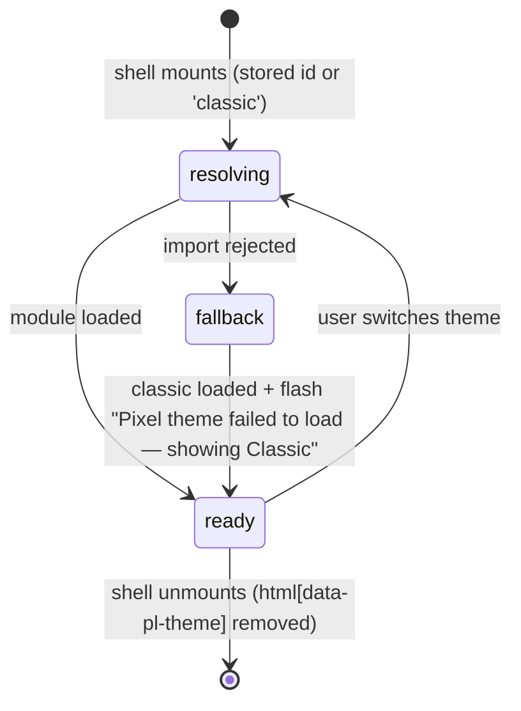

# Pipeline themes: a theme seam + the pixel-game theme

## Intent

The Pipeline shell (`/overview`, `/tasks`, `/features`) becomes **themeable**. The look that ships today is
the `classic` theme. The game-pixel design ("Pipeline Level") is the second theme, `pixel`. A theme changes
how the shell looks and nothing about what it does: same routes, same data, same keys, same test ids.
The build has two parts. First the seam, so that a third theme later (for example the industrial-console
prototype on `f138/console-proto`) is a new folder, not another 26-file edit. Then the pixel theme on top of it.

Design source: claude.ai/design project `f065435e-2488-4182-996d-ebdb07063fdb`, file
`Pipeline Level.dc.html` (+ `support.js`, `image-slot.js`). The images attached to this feature were
rendered from that file at 1440 px:

| # | Screen | Image |
|---|---|---|
| 1 | Overview (all projects): loop scene, meters, Run next, Needs a decision |  |
| 14 | Overview scoped to one project: loop + project panel with its feature table |  |
| 2 | Tasks: Quest log, list view |  |
| 16 | Tasks: A board view, B graph view |  |
| 5 | Features: level select + triage rail, row #131 expanded |  |
| 13 | All defects (from the triage rail's ALL DEFECTS →), row #97 expanded |  |
| 11 | Dialogs: A new feature ("New level"), B new task ("New quest"), C secret stage |  |
| 10 | Arm-task dialog (worktree on, one skill picked) |  |
| 17 | **Dark** (`Pipeline Level Dark.dc.html`): A overview, B tasks, C features + triage, D all defects |  |
| 15 | Menus: A project picker, B tasks + FILTER, C tasks GROUP, D features SORT, E defects status, F defect row ⋯ |  |

Image ids are not contiguous; the ones listed are the complete set, with images 3, 4 and 6–9 retired.

The design's sample numbers and titles are placeholders. Every number on a pixel screen comes from the
same API field the classic screen reads.

## Non-goals

- New API fields or endpoints. The design shows nothing the current payloads lack. The loop's
  "loop back" line is `loop.fix_tasks`, the Features subline is the attribution subline that already exists,
  and "SAVED 2M AGO" is `usePipelineUpdatedAt`.
- Theming anything outside the shell's tabs and the All-defects list. Excluded: sidebar/app chrome, `/tasks/:id`
  (routed outside the shell), `/features/:id`, `/defects/:id`. They stay classic in either theme.
- Porting the F138 console prototype. It is only the proof that the seam fits a third theme.
- A per-project or server-side theme. This is a viewer preference, like light/dark.
- The design's phone layout. At 400 px it stacks the tabs vertically and clips the loop scene (verified by
  rendering it). Phones keep classic's mobile mechanics; see R9.

## Shape

### Two orthogonal axes

`data-theme` (light | dark, owned by `useTheme`) and `data-pl-theme` (classic | pixel, owned by
`usePipelineTheme`) are independent. Every pixel token is defined for both light and dark.

```
appearance axis:  light ⇄ dark            (existing, html[data-theme])
pipeline axis:    classic ⇄ pixel         (new, html[data-pl-theme], only while a shell tab is mounted)
```

### Types

```ts
type ThemeId = 'classic' | 'pixel'                 // closed list in registry.js

interface PipelineTheme {
  id: ThemeId
  label: string                                    // shown in the switch
  load(): Promise<ThemeModule>                     // dynamic import; classic resolves synchronously-cheap
}

interface ThemeModule {
  slots: Partial<Record<SlotName, Component>>      // missing slot ⇒ classic's component
  glyphs: Partial<Record<GlyphKind, Component>>    // missing glyph ⇒ classic's glyph ⇒ the call site's own icon
  // CSS is imported by the module itself (side effect), so it ships only in that theme's chunk
}

// Whole-component slots: only components that are already presentational
// (props in, events out, no fetching). The CLASSIC component's props + emits ARE the contract.
type SlotName =
  | 'OverviewLoop'        // props: loop, ready, compact         → pixel: scene strip + 24-cell meters + fact keys + loop-back
  | 'StageTrack'          // props: stage, compact, showLabel     → pixel: SPEC·BUILD·SHIP level track with sprite
                          //   pixel adds optional live (row.next_step.kind === 'watch') and openDefects; the desktop
                          //   table's classic cell is StageSegments, passed as PlSlot's default slot
  | 'FeatureStageTabs'    // props: counts, stage, compact; emits select → pixel: sprite tabs; triple-click ALL ⇒ secret stage
  | 'ProjectsPanel'       // props: panel, compact; emits pick, all → pixel: save-slot cards
  | 'ProjectScopePanel'   // props: head, features, featuresTo; emits all → pixel: breadcrumb head, shipped % + stage cells, OPEN TASKS / OPEN DEFECTS / SPENT keys, feature table
  | 'MenuField'           // props: modelValue, options[{value,label,short?}], field ('GROUP'|'SORT'|''), head, ariaLabel, testid; emits update:modelValue
                          //   classic = MenuSelect (the existing ui/Select, extra attrs such as `bare` pass through); pixel = a key showing
                          //   FIELD + current label ▼ that opens a listbox popover (head line, ▶ cursor on the highlighted option, which
                          //   is the current pick on opening). Both are a Reka combobox + listbox, so the keyboard and specs are shared.
                          //   An option's `short` is the pixel label where classic's carries the field ("Group: Next step" → "Next step").
                          //   Both triggers carry data-value = the current pick. Used by: tasks GROUP + SORT (TasksView), features SORT
                          //   (FeaturesView), PipelineListToolbar's facets + SORT (defects status / triage / SORT)
  | 'SecretStage'         // pixel-only; classic = null (renders nothing). props: open (v-model), loop, scopeLabel, error.
                          //   pixel FeatureStageTabs emits `secret` on ALL when click detail >= 3; FeaturesView reads
                          //   GET /api/pipeline/overview's `loop` on open (newest open wins) and hosts the slot
  | 'ChoiceField'         // props: modelValue, options[{value,label,hint?,glyph?}], ariaLabel, testid; emits update:modelValue
                          //   classic = ChoiceSelect (ui/Select; an option's hint is folded into its label, "tmux — survives a
                          //   server restart", so classic's menu text is unchanged); pixel = role="radiogroup" of keys
                          //   (one aria-checked, roving tabindex, arrows move the pick). Every option carries data-value.
                          //   used by: New-task PRIORITY, Arm LAUNCH
  | 'DefectsHead'         // pixel-only; classic = null. props: total (the server's match count, null until loaded), backTo.
                          //   pixel = the All-defects panel head (◀ FEATURES link, title, meta, "n DEFECTS");
                          //   classic keeps its count in the toolbar, so the toolbar count is hidden under pixel only
  | 'FeatureTableHead'    // pixel-only; classic = null (the call site's Stage/Tasks/Rounds/Defects/Active headers are the default slot).
                          //   pixel = LEVEL · SPEC → BUILD → SHIP and STATS headers
  | 'FeatureStats'        // pixel-only; classic = null (the call site's four cells). props: row. pixel = one STATS cell:
                          //   ◎ done/n TASKS · ↻ n ROUNDS · <ago> · ✱ defect tally (warn when open), same links + testids.
                          //   Pixel table grid: one grid, head/rows/row-line as subgrids (hooks table, rows, row, row-line,
                          //   row-expansion): feature minmax(0, max-content), level minmax(5rem, 15rem), stats minmax(9.5rem, 1fr)

// Small icons inside components that own fetching (TaskListPanel, TaskBoard, TaskLaneGraph,
// NextStepList, TriageCard, dialogs). These are themed by glyph + hooks, never forked.
// A call site writes <PlGlyph kind="…"><today's icon/></PlGlyph>: classic's glyph map is empty,
// so classic renders the slot, i.e. exactly what the site drew before themes.
// Each slice wires PlGlyph at its own screen's sites (S1: the picker chip and All row).
type GlyphKind =
  | 'task.ready' | 'task.running' | 'task.blocked' | 'task.failed' | 'task.idea' | 'task.done'
  | 'feature.all' | 'feature.spec' | 'feature.building' | 'feature.shipped' | 'feature.escaped'
  | 'defect.wild' | 'defect.closed' | 'project' | 'project.none' | 'portfolio' | 'dialog.feature' | 'dialog.task' | 'dialog.arm'
  | 'priority.urgent' | 'priority.high' | 'priority.medium' | 'priority.low' | 'priority.none'   // filter toggles' bar glyphs

// Styling hooks: the ONLY selectors a theme stylesheet may target.
// data-pl-part="<name>" on elements of shell + tab components, e.g.
//   panel, panel-head, panel-meta, key, key--primary, tab, chip, row, row-id,
//   meta-label, input, dialog, dialog-head, toast, picker, picker-row, count
// In place after S1: shell (the shell root; pixel paints the page ground on it), head, title, meta-label, tabs, tab,
//   count, theme-switch (shell header);
//   panel, panel-head, panel-title, panel-meta, panel-link, panel-empty, panel-foot (pl-panel
//   chrome, Features main + triage rail, Tasks main + toolbar); chip, picker, picker-row,
//   picker-group, input (ProjectPicker; on Features the boxed search label); key (the header
//   create button and its ▾ — not a primary key, R7); toast (FlashMessage, with data-tone).
// Panel titles (R10): data-pl-title on a toolbar that is also its panel-head; pixel draws it with
//   ::before, classic draws nothing.
// Features hooks (S5): table, table-head, rows, row[data-expanded], row-toggle, row-id, stat[data-warn],
//   meter, meter-fill, pips, pip, section-label, sub-row[data-status], state[data-status|data-tone],
//   note, alert, card[aria-current], card-head, card-meta, verbs, badge; slot parts stage-tabs,
//   stage-tab, stage-label, level, level-track, level-station[data-reached|data-current], level-actors,
//   level-bot, level-agent, level-tick, level-name, level-word; triage strip (folded rail): strip > strip-key, strip-label, strip-caption,
//   strip-kbd, and the head's fold key is key[data-pl-fold].
// Overview hooks (S3): row[data-pl-hero] (the first dependency-clear Run next row; its Run is the panel's one
//   key--primary), row-id, row-title, live, wait, key[data-tone=danger|warn], panel-meta[data-pl-label] (pixel
//   appends the unit word: "2 ready", "1 waiting") and [data-tone=warn]; meter-bar + meter-cell[data-tone] on
//   SegmentBar and the scope panel's task fill, so every stage bar repaints in --pl-* tones (the only fills R7
//   lets carry a status hue besides sprites and the primary key).
// Tasks hooks (S4): group-head[data-pl-group] + group-label (list groups, status
//   groups, board columns; <PlGlyph kind="task.*"> beside the label), count, more, row, row-id, tag[data-tone=
//   fail|warn] (filter chips, FIXES D-n, waits, a card's feature), live, kbd, view-switch, column, card[data-live],
//   notice, canvas, lane-head, meta-label (graph lane prefix), meter + meter-cell (lane
//   progress as ink cells), node[data-pl-tag][data-found]. RUN ALL is the quest log's one key--primary.
// Dialog hooks (S6): ui/Dialog forwards attrs to its box, so a create dialog opts in with
//   data-pl-part="dialog"; inside: dialog-head (+ #mark slot for its PlGlyph), dialog-title[data-pl-kicker],
//   dialog-title-long/-short (Dialog's shortTitle prop; classic shows the long one), dialog-lead, dialog-body,
//   dialog-foot[data-pl-hint], dialog-close, dialog-note; fields: field, field-label[data-pl-count], field-hint,
//   input[data-pl-field], check, drop, key / key--primary[data-pl-mark]; arm sheet: dialog-section[data-pl-section]
//   (display:contents in classic), skills, skill-list, skill, skill-order; ChoiceField: choice, choice-key,
//   choice-line, choice-label, choice-hint; secret stage: menu, menu-item, score, score-scope, score-row;
//   picker[data-pl-hint]. Dialog rules all hang off [data-pl-part="dialog"], so other dialogs opened from a
//   tab stay classic.
// Menu hooks (S11): MenuField's menu-key[data-value] > menu-field, menu-value, menu-caret, and its listbox[data-pl-menu] >
//   listbox-head, listbox-item. Emitted by shared primitives only under plScope (R13): ui/Select's listbox +
//   listbox-item, DropdownMenu's menu + menu-item, Popover's popover + popover-arrow, Dialog's own dialog-* hooks (and
//   a call site's data-pl-* attrs on its box are dropped off-scope). Tasks filter: key[data-pl-on] (anything on),
//   filter > filter-head (+ count "None on" / "n on", one per toolbar chip), field, field-label, toggles > toggle
//   (priority checkbox drawn as a key, PlGlyph priority.*), checks > check, input, filter-foot[data-pl-hint], key--primary.
// All-defects hooks (S12): sheet (the page's one framed panel; R7 counts primaries per card here), toolbar >
//   input, key (sort direction), key[data-pl-quiet] (× CLEAR, disabled when nothing is set), toolbar-count, tag;
//   card[data-status][data-pl-unblamed][data-expanded] > card-head (<PlGlyph defect.wild|defect.closed>, row-id,
//   tag[data-tone=warn|ship], tag[data-pl-dashed] for REOPENED / SNOOZED / DECLINED, feature-link,
//   state[data-tone=warning] for UNATTRIBUTED, meta-label date, key DETAILS/LESS), symptom, facts, verbs > key or
//   key--primary (only an untriaged row's ATTRIBUTE), key ⋯, hint. DropdownMenu's `head` prop becomes the menu's
//   data-pl-head under plScope; pixel draws it as the listbox head line (D-97).
// Pixel tokens (pixel/tokens.css): the role tokens of *Pixel dark palette*, plus --pl-font and the sprite palette
//   --pl-px-<key> (k w s l b n a y r g v). Rules, slots and sprites name roles, never a hex (R15).
```

### Files

```
frontend/src/pipeline/themes/
  registry.js                 THEMES: Record<ThemeId, PipelineTheme>
  classic/index.js            slots/glyphs → the EXISTING components, imported in place (no file moves)
  pixel/index.js              slots/glyphs + `import './tokens.css'`
  pixel/tokens.css            --pl-* tokens, light + dark; @font-face Silkscreen; shell chrome
  pixel/<screen>.css          per-screen hook rules (features.css, tasks.css, dialogs.css, menus.css, defects.css), same R4 discipline
  pixel/fonts/silkscreen-*.woff2   self-hosted (OFL); no runtime CDN
  pixel/sprites.js            string-grid sprites ('.' = empty) with palette KEYS, not hexes
  pixel/PixelSprite.vue       <svg shape-rendering="crispEdges">, palette key → var(--pl-px-<key>)
  pixel/slots/*.vue           one per SlotName pixel overrides
frontend/src/composables/usePipelineTheme.js   usePipelineTheme (switch) · useShellTheme (shell) · useAppliedTheme (slots)
frontend/src/components/pipeline/PlSlot.vue    <PlSlot name="OverviewLoop" v-bind="…"/>  resolve + fallback; a default slot is the
                                               call site's classic look, drawn unless a non-classic theme overrides
frontend/src/components/pipeline/PlGlyph.vue   <PlGlyph kind="project"><Icon name="folder"/></PlGlyph>
frontend/src/components/pipeline/PipelineThemeSwitch.vue   header switch (ui/Select)
frontend/src/components/pipeline/ChoiceSelect.vue   classic ChoiceField
frontend/src/components/pipeline/MenuSelect.vue     classic MenuField
frontend/tests/helpers/choice.js   pickChoice(page, testid, value) — select, MenuField listbox (via the trigger's aria-controls) or
                                   radiogroup, by data-value; menuValue(page, testid) — a MenuField's shown label in either theme
frontend/tests/fixtures/pipeline-theme-classic.har   recorded API traffic the classic baseline replays
```

### Theme load lifecycle



The shell does not paint tab content while it is `resolving` (a `v-show` on a `display:contents` wrapper,
never a `v-if` on KeepAlive's child), so a theme never flashes in after classic. The previously applied
theme stays on `<html>` until the next one is in. The stored preference is not overwritten by a fallback;
the switch names the theme on screen (classic after a fallback). A failed chunk is retried on the next
page load, not in-page (the browser caches a failed module fetch).
Slots and glyphs resolve against the *applied* theme, so a slot component reused off the tabs
(`/features/:id`) renders classic.

## Rules

| # | Rule |
|---|---|
| R1 | The preference is stored in `localStorage['regin_pipeline_theme']`. A missing or unknown value means `classic`. Same singleton pattern as `useTheme`. |
| R2 | The switch is a control in the shell header (`data-testid="pipeline-theme-switch"`), listing `registry.js` entries. Switching takes effect without a reload and keeps the route, the query (scope, filters) and the KeepAlive'd tab state. |
| R3 | `html[data-pl-theme]` is set while the route is one of the three tabs (`/overview` with or without `?project=`, `/tasks`, `/features`) or the All-defects list `/defects`, and removed otherwise — including the shell's detail routes `/features/:id`, `/defects/:id` — and on unmount. It sits on `<html>` because the create dialogs, picker and toasts are teleported to `<body>`, where a shell-scoped attribute would not reach. The theme switch shows wherever the attribute is set, `/defects` included. |
| R4 | A theme stylesheet declares only `--pl-*` custom properties and styles only `[data-pl-part]` / `[data-pl-glyph]` elements, every selector prefixed `html[data-pl-theme="<id>"]`. It never targets a component's internal class names or `:deep()`, and never redefines global `--color-*`/`--radius-*` tokens. That keeps the sidebar and detail pages untouched, and component refactors cannot silently break a theme. |
| R5 | A slot override has the same props and emits as the classic component it replaces, and it fetches nothing (no `api` import under `pipeline/themes/**`). |
| R6 | Data-owning components (TaskListPanel, TaskBoard, TaskLaneGraph, NextStepList, TriageRail/Card, the three create dialogs, TaskArmSheet + TaskArmSkills, ProjectPicker, TaskFilterMenu, PipelineListToolbar, DefectsView + DefectRow and the defect row's ⋯ menu) are not forked. They gain `data-pl-part` hooks and `<PlGlyph>` in place of their status icons. In classic, every hook and glyph renders exactly what renders today. |
| R7 | Pixel colour budget: one action colour (`--pl-action`, blue) fills only primary keys. Run all, Run #N (up-next hero), Accept, Declare, Capture idea and Arm task are the primary keys, at most one per panel. On All defects the unit is the card: an untriaged row's ATTRIBUTE is its one primary key, and none sits outside a card. Status hues (running violet, failed red, human-attention amber, shipped green) appear only on marks: sprites, meter cells, 1–2 px outlines, short status words. Every other surface is ink outline on paper. |
| R8 | Pixel typography: Silkscreen for labels, keys, tab names, ids, counts and meta lines. Titles, symptoms and body prose stay in the UI sans. Hit targets are unchanged from classic. |
| R9 | Below 768 px, pixel keeps classic's mobile mechanics: segmented tabs, floating create button and compact rows, restyled by tokens. The loop scene strip scrolls inside its own `overflow-x:auto` box. The page never scrolls sideways. |
| R10 | No prototype codes. The design's chapter numbers (`1-1`, `2-01`, `3-3`, `L.01`), the loop's stage indexes (`01`) and the `SLOT 01` labels are annotations for referring to regions of the mockup; the implementation draws none of them. A panel is named by its title alone, a group by its sprite and label, a lane by its `#feature`. |
| R11 | Motion (dialog clip-open, key press, secret-stage run/hop/coins) is `steps()`-based and disabled under `prefers-reduced-motion`. A key press moves only the key, never its neighbours. |
| R13 | Shared UI primitives that teleport (ui/Select's listbox, DropdownMenu, Dialog) emit `data-pl-part` hooks only when rendered inside the shell. The shell `provide`s a `plScope` that teleported children still `inject`. A primitive used elsewhere renders without hooks, so a pixel stylesheet cannot reach it even while `html[data-pl-theme]` is set. |
| R14 | Pixel menus close on Esc, outside click and selection; ↑↓ moves the ▶ cursor and Enter picks. A filter popover's toggles (priority keys, SHOW checks) apply immediately, while its text fields (TAG, SOURCE, FEATURE #, ASSIGNEE) apply on APPLY or Enter, matching classic TaskFilterMenu's apply semantics. Every applied filter shows as a removable chip beside the search box. |
| R15 | Pixel colours come only from the role tokens in *Pixel dark palette*. No pixel stylesheet, slot or sprite hard-codes a hex, and none reads the app's `--color-*`. The pixel dark ground is the design's `#0b0e16` / `#151b27`, not the app's dark surface, deliberately: the theme owns its paper. The frame and text roles are separate tokens even though they are equal in light. |
| R12 | The secret stage opens on a triple click of the ALL stage tab, detected with the click event's `detail >= 3` (the browser's own click count, no timer). It is a modal menu (CONTINUE / HIGH SCORE / CREDITS) with ↑↓ / Enter / Esc. HIGH SCORE shows the loop payload's shipped-feature, done-task and closed-defect totals for the current scope, labelled with that scope, not "this week". Classic has no secret stage. |

### Pixel dark palette

Source: `Pipeline Level Dark.dc.html`. It is the light file with every colour swapped and nothing else changed (checked with a line diff, which found one structural difference: the `body` colour-scheme). The swap is **by role, not by hex**. Light ink becomes three different dark colours (text, frame, hard shadow), and a light hairline becomes two (hairline, key bevel). So the pixel stylesheet styles by role tokens. One token per light hex is not enough, because it cannot express the dark theme.

The **Light** column is the light theme as it shipped before the split, and it stays pixel-identical. It differs slightly from the design file's light hexes (ink `#10131a` not `#0f172a`, action `#1d4ed8` not `#2563eb`); the split was not the place to move light. The **Dark** column is the design file's. Where light gives two roles one value, they are still two tokens.

| Role | Token | Light | Dark |
|---|---|---|---|
| page ground (painted on the `shell` hook; its box-shadow spread fills the scroller, clipped by `--pl-page-clip` at the shell's top edge unless the shell is the scroller's first child, so the unpositioned blocker strip above it keeps its box) | `--pl-page` / `--pl-page-top` / `--pl-page-clip` | transparent / transparent / none (the app's ground shows) | `#0b0e16` (gradient from `#0d111a`) / `inset(0 -100vmax -100vmax)` |
| panel / card / key face | `--pl-paper` | `#ffffff` | `#151b27` |
| panel head, row hover, expanded row | `--pl-paper-2` | `#f1f3f7` | `#1a2231` |
| selected / latched key, selected menu row | `--pl-paper-3` | `#f1f3f7` | `#222b3c` |
| sunken field (input) | `--pl-sunk` | `#ffffff` | `#171d2a` |
| primary text, titles, big numbers | `--pl-text` | `#10131a` | `#e6ecf5` |
| secondary text, secondary key labels | `--pl-text-2` | `#10131a` | `#cdd6e4` |
| body / sub lines | `--pl-text-3` | `#475569` | `#b3bfd2` |
| meta labels (Silkscreen) | `--pl-muted` | `#4f586a` | `#97a4ba` |
| faint (inert, locked) | `--pl-faint` | `#aeb6c4` | `#808ea6` |
| frame of panels, keys, dialogs; ink marks | `--pl-frame` | `#10131a` | `#6f7f9c` |
| 1 px hairline | `--pl-hair` | `#d5dae3` | `#2b3548` |
| rule between rows, dashed rule, quiet outline | `--pl-rule` | `#aeb6c4` | `#3a4760` |
| level-track dashed line and unreached station ticks | `--pl-track` | `#94a3b8` | `#5b6781` |
| key / field bevel (inset 2 px shadow) | `--pl-bevel` | `#d5dae3` | `#0b0f18` |
| pressed-key bevel | `--pl-bevel-in` | `#cbd5e1` | `#080b12` |
| hard pixel drop shadow (keys, dialogs, menus) | `--pl-drop` | `#10131a` | `#03050a` |
| soft shadow | `--pl-soft` | `rgba(15,23,42,.1)` | `rgba(0,0,0,.4)` |
| modal scrim | `--pl-scrim` | `rgba(15,23,42,.45)` | `rgba(2,4,8,.72)` |
| focus ring | `--pl-focus` | `#1d4ed8` | `#2c4a85` |
| primary key fill / hover / bevel / text | `--pl-action` / `-hover` / `-bevel` / `-ink` | `#1d4ed8` / `#1e40af` / `#1e40af` / `#fff` | `#2563eb` / `#1e40af` / `#1e40af` / `#fff` |
| action as text (links, ▶ cursor, OPENS) | `--pl-action-text` (`-hover`) | `#1d4ed8` (`#1d4ed8`) | `#7aa9ff` (`#a3c3ff`) |
| action tint (filter on, current chip) | `--pl-action-tint` / `-tint-2` | `#eff6ff` / `#dbeafe` | `#17253f` / `#1c2c4a` |
| running: text / outline / tint / solid mark (LIVE square) | `--pl-run` / `-line` / `-tint` / `-fill` | `#6d28d9` / `#6d28d9` / `#ede9fe` / `#6d28d9` | `#b8a2fc` / `#9b7bf5` / `#2b2448` / `#7c3aed` |
| failed: text / outline / tint | `--pl-fail` / `-line` / `-tint` | `#c81e1e` / `#c81e1e` / `#fef2f2` | `#ff8080` / `#ef6b6b` / `#2d1719` |
| human attention: text / outline / tint | `--pl-warn` / `-line` / `-tint` | `#b45309` / `#b45309` / `#fffbeb` | `#f7b84a` / `#d99a2b` / `#2b2414` |
| shipped: text and outline / tint | `--pl-ship` / `-tint` | `#15803d` / `#a7f3d0` | `#3ed9a0` / `#226e52` |
| meter cell: unstarted / in flight / settled | `--pl-cell-off` / `-flight` / `-settled` | `#d5dae3` / `#aeb6c4` / `#4f586a` | `#2a3448` / `#8593ab` / `#38445c` |
| meter cell: human / danger | `--pl-cell-human` / `-danger` | `#b45309` / `#c81e1e` | `#d97706` / `#dc2626` |
| lane progress cell: done (graph lanes) | `--pl-cell-done` | `#10131a` | `#8593ab` |

Sprite palette keys (`sprites.js` palettes name keys; `PixelSprite` → `--pl-px-<key>`). Fills that carry status meaning keep their hue in both modes.

| key | role | light | dark |
|---|---|---|---|
| `k` | outline | `#10131a` | `#d3dbe8` |
| `w` | face / screen | `#ffffff` | `#1c2433` |
| `s` | steel | `#8b95a7` | `#7d8aa3` |
| `l` | light steel | `#cbd5e1` | `#3d4a63` |
| `b` | bot body blue | `#2563eb` | `#4f86f7` |
| `n` | wood / brown | `#92400e` | `#d18b2c` |
| `a` `y` `r` `g` `v` | amber, yellow, red, green, violet | `#d97706` `#facc15` `#dc2626` `#16a34a` `#7c3aed` | `#d97706` `#fbbf24` `#dc2626` `#059669` `#7c3aed` |

Solid status fills keep their hue in dark: the LIVE square, primary keys, meter human/danger cells and sprite status colours. Only their text, outline and tint variants lighten. That keeps one meaning per hue across modes (R7).

A design flaw not to copy: in the dark file, the focused triage card's secondary verb keys (DUP / DECLINE / SNOOZE / ACCEPT ONLY) render as near-white faces with pale labels, which fails contrast. They use `--pl-paper` faces with `--pl-text-2` labels like every other secondary key.

### What the pixel theme renders, per screen

| Screen | Pixel shape (see image) | Mechanism |
|---|---|---|
| Header + tabs | `Pipeline` sans title; picker chip with portfolio/project glyph; `SAVED nM AGO`; create key with `c` kbd; tabs in Silkscreen with a ▶ cursor on the active tab; counts beside the labels | hooks + glyph |
| Overview loop (img 1) | Scene strip with three zones: TASK BOARD (running/failed bots), WORKSHOP (escaped flags), BUG DEN (to-triage/open bugs). At most 4 actors per group, each drawn actor standing for a real count, with the count in the group label. Below: three stage cards, each with its label, a big pixel total, a 24-cell meter (unstarted / in-flight / settled / human / danger) and fact keys linking to the filtered lists. Footer: ↺ LOOP BACK `loop.fix_tasks` | slot `OverviewLoop` |
| Overview run next | LIVE rows (watch/stop), the UP NEXT hero with a primary RUN #N key, the queue with RUN keys or LOCKED · WAITS ON #N | hooks |
| Overview needs a decision | D-n rows with ATTRIBUTE keys | hooks |
| Overview projects | Save-slot cards (last-seen line, no slot number): glyph, name, ⚑ shipped/features · ◎ tasks, attention count | slot `ProjectsPanel` |
| Overview scoped to a project (img 14) | The picker chip shows the project's glyph + name and a × clear key. The loop stays first; the projects panel is now the project. Its head has an `ALL PROJECTS / <NAME>` breadcrumb and `n FEATURES`. Body: shipped % in Silkscreen, stage cells coloured by stage (spec outline, building blue, shipped green, escaped amber) with a legend, and three stat keys OPEN TASKS / OPEN DEFECTS (amber outline when > 0) / SPENT that link like classic's. Table columns: FEATURES IN THIS PROJECT (#id + title link), STAGE (square mark + word), TASKS (done cells + `d / n`), DEFECTS (`open / total`, amber when open > 0), ACTIVE. Footer: `SHOWING n OF m`, `ALL m IN FEATURES →`. Empty: "No feature is filed under this project yet." Fields: `head.*` / `features.rows` from `/api/pipeline/overview?project=` | slot `ProjectScopePanel` |
| Tasks filter (img 15B) | `+ FILTER` key (an action-colour outline when anything is on: a mark, not a fill, R7) opens a FILTER popover headed `NONE ON` / `n ON`. PRIORITY: five toggle keys with priority-bar glyphs (Urgent, High, Medium, Low, No priority). SHOW: square checks Feature steps, and Open chains only in graph view. TAG / SOURCE / FEATURE # / ASSIGNEE fields. Footer `TOGGLES APPLY NOW` + APPLY key. See R14 | hooks + glyph |
| Tasks group / sort (img 15C) | List view: `GROUP · NEXT STEP ▼` menu headed `GROUP TASKS BY` (NEXT STEP, NO GROUPING, STATUS, PRIORITY, PROJECT). Flat list: `SORT` menu headed `SORT TASKS BY` (CREATED, UPDATED, PRIORITY) plus a direction key. The keys sit in the quest-log panel head's right meta, so the head reads the choice. Phone keeps classic's DropdownMenu | slot `MenuField` |
| Tasks quest log (img 2, 16) | Group headers with a sprite, an uppercase status word and a count. RUN ALL is the primary key. Row priority bars, ids in Silkscreen, FIXES D-n outline tags, LIVE mark. The image draws GROUP · NEXT STEP only; every other grouping reads the same: STATUS / PRIORITY / PROJECT heads are bare chapter heads with a status sprite, priority bars or project bot/tray, rows hang from the head's rule, and NO GROUPING is the same rows under a Silkscreen CREATED/UPDATED head. Rows sit on the shell's ground with no paper of their own, as next-step rows do; their chips (kind, attempts, live, project, tags, images) are bare Silkscreen words, not outlined boxes; the date closes the row. Board columns get sprite heads; graph lanes are `L.0n · #feature` | hooks + glyph |
| Features level select (img 5) | Stage tabs with sprites. Each row's level track (SPEC → BUILD → SHIP) puts a bot at the current stage, an AGENT tag while a run is live, and a bug beside a stage with open defects. Expansion lists active tasks and blamed defects with sprites | slots `FeatureStageTabs`, `StageTrack` + hooks |
| Features triage (img 5) | WILD BUG cards. The focused card shows BLAME + verb keys with kbd hints (A / ⇧A / D / X / S). Footer `J / K MOVE · A ACCEPT · X DECLINE` + `ALL DEFECTS →` | hooks + glyph |
| Features sort (img 15D) | `SORT · LAST ACTIVITY ↓` key in the Features panel head opens a `SORT FEATURES BY` listbox: LAST ACTIVITY, ROUNDS, OPEN DEFECTS, ESCAPES, COST, NEWEST (the classic sort options, labelled with ↓) | slot `MenuField` |
| All defects (img 13) | Head: `◀ FEATURES` back key, `ALL DEFECTS`, `OPEN OR CLOSED, TRIAGED OR NOT`, `n DEFECTS`. Toolbar: Search symptoms, then status (ANY STATUS / OPEN / CLOSED), triage (ANY TRIAGE / IN THE QUEUE / SNOOZED / DECLINED) and SORT (OPENED / UPDATED / ROUND / STATUS / FEATURE) menus, a ↓/↑ direction key and × CLEAR (inert when no filter is set). Each card has a bug glyph (amber when open, grey when closed), `#id`, a status outline tag (OPEN amber, CLOSED green), `REOPENED n×` / SNOOZED / DECLINED dashed tags, the blamed feature as a link or `UNATTRIBUTED` in amber, the date, and a ▸ DETAILS / ▾ LESS key. Below: the symptom in sans; expanded, the facts table (suspect paths in mono …); then the row's one primary verb (ATTRIBUTE filled blue on unattributed open rows; CLOSE / REOPEN / UNSNOOZE / RESTORE outlined otherwise), a ⋯ key and the hint line. Unattributed open cards have a 2 px ink frame. Empty / no match: classic ListStatus's own lines. | hooks + glyph + slots `DefectsHead`, `MenuField` |
| Defect row ⋯ (img 15F) | Menu headed `D-<id>` (DropdownMenu `head` → `data-pl-head`, drawn by pixel): the classic row menu's items for the row's state, same order | hooks |
| New-feature dialog (img 11A) | Flag glyph, `NEW LEVEL · LANDS IN SPEC` kicker (not `3-<next id>`: the browser cannot know the next id without guessing), `DECLARE A FEATURE` / adopt heading; DECLARE NEW / ADOPT A TRACKER ISSUE mode keys; square inputs with an inset shadow; images drop zone; CANCEL + primary ⚑ DECLARE | hooks + glyph |
| New-task dialog (img 11B) | Bulb glyph, `NEW QUEST · LANDS IN IDEAS` kicker, `NEW TASK` heading; one-line lead "Capture an idea. Nothing runs until someone arms it."; TITLE with `n/200` counter; DETAILS; PRIORITY as five keys (URGENT · HIGH · MEDIUM · LOW · NONE, each with its priority-bar glyph); TAGS + PROJECT side by side; images drop zone; footer `ENTER CAPTURE · ESC CLOSE`, CANCEL + primary ✦ CAPTURE IDEA (disabled look until a title exists) | hooks + glyph + slot `ChoiceField` |
| Arm-task dialog (img 10) | Opened by ARM on an idea (list, board, graph). Bot glyph, `IDEA → QUEUE · #<id>` kicker, `ARM TASK` heading (Dialog `shortTitle`; classic keeps "Arm this task"), task title as lead; the "filled in from your last arm" status with RESET when prefilled. Three ruled sections: **WHERE** (working directory; "run in a new git worktree" square check, revealing BRANCH + BASE BRANCH), **AGENT** (MODEL + EFFORT side by side, custom model id when "custom…", PERMISSION MODE, SKILLS list where the first row is tagged OPENS and later ones +1, +2…, add-skill select, arguments for the first skill), **FINISH** (VERIFY COMMAND in mono with the "gate: exit 0 marks the task done" hint, LAUNCH as two keys SDK (DEFAULT) / TMUX with their one-line hints, "end the session once the agent reports finished" check). The SDK-off note and the tmux-refused note keep their current conditions. Footer `ESC CLOSE`, CANCEL + primary ✦ ARM TASK | hooks + glyph + slot `ChoiceField` |
| New-defect dialog | Bug glyph, `WILD BUG · LANDS IN TRIAGE` kicker, the same field and key chrome as the other create dialogs | hooks + glyph |
| Picker (img 15A) | ▶ cursor row, NEEDS ATTENTION / RECENT groups, bug glyph on projects with open defects (bot / tray otherwise), `↑↓ MOVE · ENTER PICK · ESC CLOSE` footer | hooks + glyph |
| Secret stage (img 11C) | See R12 | slot `SecretStage` |

## Invariants

- I1: Switching the theme makes no network request beyond loading the theme chunk. It changes no route,
  no query param and no `data-testid`.
- I2: With `classic` active, the shell renders pixel-identical to the pre-change build at 1440 and 400 px
  on all three tabs, except the theme switch itself, which occupies space that was empty before (right
  end of the tab row ≥ 768 px; right end of the header row below). The baseline test hides it.
- I3: With `pixel` active, no element outside the shell's tab content, its header and its teleported
  dialogs/picker/toasts changes computed style.
- I4: `classic` ships no pixel bytes: no Silkscreen, sprites or `pixel/*` modules in the initial or
  classic chunks.

## Acceptance

```gherkin
Feature: Pipeline theme seam

  Scenario: default is pixel
    Given localStorage has no "regin_pipeline_theme"
    When I open /overview
    Then html has data-pl-theme="pixel"
    And nothing is written to "regin_pipeline_theme"

  Scenario: classic is unchanged
    Given the classic theme
    When /overview, /tasks and /features are screenshotted at 1440x900 and 400x860
    Then each screenshot matches the pre-change baseline captured from the same recorded API traffic
      (fixtures/pipeline-theme-classic.har, replayed on the run's own port, clock fixed at record time)

  Scenario: switching keeps place
    Given I am on /features?project=2&stage=building with row #131 expanded
    When I pick "Pixel" in pipeline-theme-switch
    Then the URL is unchanged, row #131 is still expanded, and html has data-pl-theme="pixel"
    And reloading the page keeps the pixel theme

  Scenario: unknown stored value
    Given localStorage "regin_pipeline_theme" is "neon"
    When I open /overview
    Then the default (pixel) theme renders

  Scenario: theme attribute is scoped to the shell
    Given the pixel theme on /overview
    When I navigate to /tasks/421
    Then html has no data-pl-theme attribute

  Scenario: a theme chunk that fails to load
    Given the pixel chunk request is aborted
    When I open /overview with the pixel preference stored
    Then the classic theme renders, a flash names the failure, and the stored preference is still "pixel"

  Scenario: behaviour is theme-independent
    Given the pixel theme is stored
    When the existing pipeline-*.spec.js, tasks-*.spec.js and responsive.spec.js suites run
    Then they pass, excluding only assertions that pin classic pixels (listed by name in the spec file)
    # Mechanism: the `pixel` Playwright project (playwright.config.js) re-runs those suites with the
    # auth fixture's `pipelineTheme: 'pixel'` option. Excluded under pixel (pipeline-redesign-shell):
    # the stage-segments assertions in test_features_stage_tabs_expand_and_triage_keys;
    # test_overview_colour_budget whole (classic palette — pixel's is pipeline-theme-overview);
    # the text-transform, token-colour, bar-fill, note-colour and button-look assertions in
    # test_overview_quiet_loop_facts_and_links; the `ol--compact` class in
    # test_pipeline_mobile_overview_features_triage.

Feature: Pixel theme

  Scenario: stylesheet stays inside its hooks
    When every selector in frontend/src/pipeline/themes/pixel/**/*.css is parsed
    Then each starts with html[data-pl-theme="pixel"] and targets only [data-pl-part], [data-pl-glyph] or elements under them
    And no rule sets a custom property that does not start with --pl-

  Scenario: slots honour the classic contract
    For each slot in pixel/index.js
    Then its props and emits are a superset of the classic component's
    And no module under frontend/src/pipeline/themes/ imports the api client

  Scenario: the loop scene counts are real
    Given the overview payload has 1 running, 2 failed, 2 escaped, 4 to triage, 6 open
    Then the scene labels read "1 RUNNING", "2 FAILED", "2 ESCAPED", "4 TO TRIAGE", "6 OPEN"
    And the scene's aria-label states the same five numbers
    And a group with 7 items draws 4 actors and is labelled 7

  Scenario: loop at zero
    Given every loop count is 0
    Then the scene shows the three stations with no actors and the meters are all unstarted cells

  Scenario: colour budget
    On each of the three tabs in pixel light and dark
    Then every element with a chromatic background fill is either a primary key (at most one per panel), a meter cell, or a sprite pixel

  Scenario: dark mode
    Given the pixel theme and data-theme="dark"
    Then sprite outlines, ink borders and Silkscreen labels meet 3:1 (marks) / 4.5:1 (text) contrast against their background

  Scenario: dark palette matches the design by role
    Given the pixel theme and data-theme="dark" on /overview, /tasks, /features and /defects
    Then the shell's ground computes to #0b0e16, and each screen's framed surface (an overview panel, a quest-log
      row key, the features table, the defects sheet) to #151b27 with a #6f7f9c frame
    And a panel title computes to #e6ecf5, a meta label to #97a4ba, and a link to #7aa9ff
    And a primary key is #2563eb with #ffffff text
    And the LIVE mark is #7c3aed and a failed meter cell #dc2626
    And a focused triage card's DUP / DECLINE / SNOOZE keys have #151b27 faces with #cdd6e4 labels at 4.5:1 or better

  Scenario: splitting the roles leaves light untouched
    Given the pixel theme in light
    When /overview, /tasks, /features and /defects are screenshotted at 1440x900
    Then each matches the pre-S15 baseline

  Scenario: no hard-coded colours in the pixel theme
    When frontend/src/pipeline/themes/pixel/** is scanned
    Then no hex, rgb() or var(--color-*) appears outside tokens.css's two palette blocks

  Scenario: phone
    Given the pixel theme at 400x860
    Then the tabs are the segmented control, create is the floating button, and .content-scroll does not scroll sideways

  Scenario: secret stage
    Given the pixel theme on /features
    When I click the ALL stage tab three times in one gesture
    Then a dialog labelled "Secret stage" opens with CONTINUE focused
    And Esc closes it, and the stage filter is still ALL
    And with prefers-reduced-motion the menu is visible without animation frames
    And under the classic theme the same triple click opens nothing

  Scenario: new-task dialog
    Given the pixel theme on /tasks
    When I press "c"
    Then a dialog with heading "NEW TASK" opens with TITLE focused
    And PRIORITY is a radiogroup of five keys with "none" checked
    And CAPTURE IDEA is inert until TITLE has a non-blank value, then Enter captures and the task appears under IDEAS

  Scenario: arm dialog keeps every field of the classic sheet
    Given the pixel theme on /tasks and an idea #N
    When I press ARM on #N
    Then a dialog with heading "ARM TASK" and kicker "IDEA → QUEUE · #N" opens
    And it offers the same fields, options and prefill as the classic TaskArmSheet (same data-testids)
    And checking "run in a new git worktree" reveals BRANCH and BASE BRANCH
    And LAUNCH is a radiogroup of SDK (DEFAULT) and TMUX
    And ARM TASK posts the same request body as the classic sheet for the same inputs

  Scenario: scoped overview shows the project panel
    Given the pixel theme and project 2 with 10 features, 4 building, 3 shipped, 1 escaped
    When I open /overview?project=2
    Then the loop renders first and the projects panel reads "ALL PROJECTS / <name>" and "10 FEATURES"
    And the stage cells, OPEN TASKS, OPEN DEFECTS and SPENT equal the overview payload's head fields
    And the table lists the payload's feature rows with "SHOWING 5 OF 10" when 5 are returned
    And ALL PROJECTS clears the scope exactly as classic's breadcrumb does

  Scenario: scoped overview with no features
    Given a project with no features
    Then the panel says "No feature is filed under this project yet." and the table has no rows

  Scenario: all defects is themed, a defect detail is not
    Given the pixel theme
    When I press ALL DEFECTS → in the triage rail
    Then the URL is /defects, html has data-pl-theme="pixel", and the head reads "ALL DEFECTS" with no code before it
    When I open #97
    Then html has no data-pl-theme attribute

  Scenario: defect filters equal the API
    Given the pixel theme on /defects
    When I pick status Closed, triage Declined and sort Round ascending
    Then the request carries status=closed, triage=declined, sort=round:asc
    And the "n DEFECTS" count equals the response total
    And × CLEAR resets all three and is inert again

  Scenario: task filter popover
    Given the pixel theme on /tasks in list view
    When I open + FILTER, toggle Urgent and type tag "release" without pressing APPLY
    Then the list is already filtered by priority urgent and not yet by the tag
    When I press APPLY
    Then chips PRIORITY: Urgent and TAG: release show and the popover closes
    And the SHOW · Open chains check appears only in graph view

  Scenario: menus are keyboard-complete
    Given the pixel theme
    For each of tasks GROUP, tasks SORT, features SORT and defects status / triage / SORT
    When I open it with Enter, move with ↓ and press Enter
    Then the value changes as the classic Select would, and Esc closes it without changing anything

  Scenario: primitives outside the shell stay unhooked
    Given the pixel theme on /tasks
    When a ui/Select or DropdownMenu renders outside the shell (e.g. the sidebar quick capture)
    Then it has no data-pl-part attribute

  Scenario: choice fields under both themes
    Given a Playwright spec picks a value in task-composer-priority, task-arm-launch or any MenuField testid through the pickChoice(page, testid, value) helper
    Then it passes under classic (a select) and under pixel (a radiogroup)
```

## Work slices

Base: `f139/integration`

Each slice merges its branch into `f139/integration` before it reports finished, so a dependent slice's
worktree starts from its dependencies' code. S3, S4 and S5 run in parallel after S2 and touch shared files
(`pixel/index.js`, `pixel/sprites.js`, `pixel/tokens.css`): each adds its own entries and resolves the merge,
never rewrites another slice's entries. Every slice's Playwright run uses its own `REGIN_E2E_*_PORT` pair so
parallel verifies do not collide — and its own `REGIN_E2E_SCRATCH` dir, because the scratch DB defaults to one
shared `/tmp/regin-e2e` that concurrent runs wipe under each other.

| # | Slice | Delivers | Spec refs | Tests | Schema | Depends on | Base | Skill | Verify |
|---|---|---|---|---|---|---|---|---|---|
| S1 | Seam | `registry.js`, `usePipelineTheme`, `PlSlot`/`PlGlyph`, `data-pl-part` hooks on shell + tab components, `html[data-pl-theme]` lifecycle, header switch, classic module = existing components, pixel module stubbed empty; e2e `pipeline-theme-seam.spec.js` | R1, R2, R3, R5, R6, I1, I2, I4 | test_default_is_pixel, test_classic_is_unchanged, test_switching_keeps_place, test_unknown_stored_value, test_theme_attribute_is_scoped_to_the_shell, test_a_theme_chunk_that_fails_to_load, test_behaviour_is_theme_independent |  | — | `f139/integration` | goal-verified-treenav | cd frontend && npx vite build && REGIN_E2E_API_PORT=8341 REGIN_E2E_VITE_PORT=5181 ./node_modules/.bin/playwright test pipeline-theme responsive |
| S2 | Pixel foundation | `pixel/tokens.css` (light + dark), self-hosted Silkscreen, `PixelSprite` + sprite sheet, pixel chrome for header/tabs/panels/keys/inputs/picker/toasts; e2e `pipeline-theme-pixel.spec.js` | R4, R7, R8, R11, I3 | test_stylesheet_stays_inside_its_hooks, test_dark_mode |  | S1 | `f139/integration` | goal-verified-treenav | cd frontend && npx vite build && REGIN_E2E_API_PORT=8342 REGIN_E2E_VITE_PORT=5182 ./node_modules/.bin/playwright test pipeline-theme responsive |
| S3 | Overview | `OverviewLoop` + `ProjectsPanel` pixel slots, run-next / needs-decision hooks; e2e `pipeline-theme-overview.spec.js` | R5, R7, R10, Overview rows of the per-screen table | test_the_loop_scene_counts_are_real, test_loop_at_zero, test_slots_honour_the_classic_contract, test_colour_budget |  | S2 | `f139/integration` | goal-verified-treenav | cd frontend && npx vite build && REGIN_E2E_API_PORT=8343 REGIN_E2E_VITE_PORT=5183 ./node_modules/.bin/playwright test pipeline-theme-overview pipeline-theme-seam |
| S4 | Tasks | quest-log glyphs + hooks across list / board / graph, group heads without codes; e2e `pipeline-theme-tasks.spec.js` | R6, R7, R9, R10, Tasks row of the per-screen table | test_behaviour_is_theme_independent, test_colour_budget, test_phone |  | S2 | `f139/integration` | goal-verified-treenav | cd frontend && npx vite build && REGIN_E2E_API_PORT=8344 REGIN_E2E_VITE_PORT=5184 ./node_modules/.bin/playwright test pipeline-theme-tasks tasks- |
| S5 | Features | `FeatureStageTabs` + `StageTrack` pixel slots, expansion + triage-rail hooks and glyphs; e2e `pipeline-theme-features.spec.js` | R5, R6, R7, R9, R10, Features rows of the per-screen table | test_colour_budget, test_phone, test_slots_honour_the_classic_contract |  | S2 | `f139/integration` | goal-verified-treenav | cd frontend && npx vite build && REGIN_E2E_API_PORT=8345 REGIN_E2E_VITE_PORT=5185 ./node_modules/.bin/playwright test pipeline-theme-features pipeline- |
| S6 | Dialogs + secret stage | dialog chrome + glyphs for the three create dialogs, the arm sheet (TaskArmSheet + TaskArmSkills) and the picker; `ChoiceField` slot (classic select / pixel radio keys) for priority + launch, plus the `pickChoice` test helper with existing specs switched to it; `SecretStage` slot (triple click on ALL via `detail >= 3`); e2e `pipeline-theme-secret.spec.js`, `pipeline-theme-dialogs.spec.js` | R6, R7, R11, R12, New-feature / New-task / Arm-task / Picker / Secret stage rows of the per-screen table | test_secret_stage, test_new_task_dialog, test_arm_dialog_keeps_every_field_of_the_classic_sheet, test_choice_fields_under_both_themes |  | S5 | `f139/integration` | goal-verified-treenav | cd frontend && npx vite build && REGIN_E2E_API_PORT=8346 REGIN_E2E_VITE_PORT=5186 ./node_modules/.bin/playwright test pipeline-theme |
| S7 | integrate | 检查每一片都已合回 `f139/integration`，无人落零 commit | Invariant 1 | test_every_slice_merged_back | — | S3, S4, S6 | f139/integration | goal-verified-treenav | — |
| S8 | migrate + doctor | 跑 `.venv/bin/python cli/regin.py migrate`，确认这个安装没落后 | R1 | test_migrate_leaves_no_schema_finding | — | S7 | f139/integration | goal-verified-treenav | .venv/bin/python cli/regin.py migrate |
| S9 | verify | 全量 `.venv/bin/python -m pytest -q -n auto --dist=loadfile`、`cd frontend && ./node_modules/.bin/playwright test` | Acceptance | test_full_suite_passes | — | S8 | f139/integration | goal-verified-treenav | .venv/bin/python -m pytest -q -n auto --dist=loadfile && cd frontend && ./node_modules/.bin/playwright test |
| S10 | Scoped overview | `ProjectScopePanel` pixel slot (breadcrumb head, stage cells + legend, stat keys, feature table, footer); e2e `pipeline-theme-scope.spec.js` | R5, R7, R10, "Overview scoped to a project" row | test_scoped_overview_shows_the_project_panel, test_scoped_overview_with_no_features, test_slots_honour_the_classic_contract |  | S9 | `f139/integration` | goal-verified-treenav | cd frontend && npx vite build && REGIN_E2E_API_PORT=8347 REGIN_E2E_VITE_PORT=5187 REGIN_E2E_SCRATCH=/tmp/regin-e2e-s10 ./node_modules/.bin/playwright test pipeline-theme-scope pipeline-theme-overview |
| S11 | Menus + task filter | `MenuField` slot (classic Select / pixel key + listbox) wired into TasksView (GROUP + SORT), FeaturesView (SORT) and PipelineListToolbar (facets + SORT, themed once S12 widens R3); `plScope` provide/inject so teleported primitives hook only inside the shell; TaskFilterMenu hooks + glyphs with R14 apply semantics; `pickChoice` extended to MenuField; e2e `pipeline-theme-menus.spec.js` | R6, R13, R14, "Tasks filter", "Tasks group / sort", "Features sort" rows | test_task_filter_popover, test_menus_are_keyboard_complete, test_primitives_outside_the_shell_stay_unhooked, test_choice_fields_under_both_themes |  | S9 | `f139/integration` | goal-verified-treenav | cd frontend && npx vite build && REGIN_E2E_API_PORT=8348 REGIN_E2E_VITE_PORT=5188 REGIN_E2E_SCRATCH=/tmp/regin-e2e-s11 ./node_modules/.bin/playwright test pipeline-theme-menus tasks- pipeline-list |
| S12 | All defects | R3 scope widened to `/defects`; DefectsView + DefectRow hooks and glyphs (cards, tags, primary verb, DETAILS/LESS, facts), status / triage / SORT via `MenuField`, row ⋯ menu hooks, ALL DEFECTS head with ◀ FEATURES; e2e `pipeline-theme-defects.spec.js` | R3, R6, R7, R10, "All defects" and "Defect row ⋯" rows | test_all_defects_is_themed_a_defect_detail_is_not, test_defect_filters_equal_the_api, test_colour_budget |  | S11 | `f139/integration` | goal-verified-treenav | cd frontend && npx vite build && REGIN_E2E_API_PORT=8349 REGIN_E2E_VITE_PORT=5189 REGIN_E2E_SCRATCH=/tmp/regin-e2e-s12 ./node_modules/.bin/playwright test pipeline-theme-defects defects |
| S13 | integrate | 检查 S10–S12、S15 都已合回 `f139/integration`，无人落零 commit | Invariant 1 | test_every_slice_merged_back | — | S10, S15 | f139/integration | goal-verified-treenav | — |
| S14 | verify | 全量 `.venv/bin/python -m pytest -q -n auto --dist=loadfile`、`cd frontend && ./node_modules/.bin/playwright test` | Acceptance | test_full_suite_passes | — | S13 | f139/integration | goal-verified-treenav | .venv/bin/python -m pytest -q -n auto --dist=loadfile && cd frontend && ./node_modules/.bin/playwright test |
| S15 | Dark palette | Split `--pl-ink` into the role tokens of *Pixel dark palette* (text / frame / drop / bevel / paper tiers / sunk / tints / cells), with light values unchanged; set every dark value from the table; move sprite keys to `--pl-px-<key>` per the sprite table; re-point every pixel rule, slot and sprite at roles (no hex outside the palette blocks); fix the triage secondary-key contrast; e2e `pipeline-theme-dark.spec.js` | R7, R15, "Pixel dark palette", I3 | test_dark_palette_matches_the_design_by_role, test_splitting_the_roles_leaves_light_untouched, test_no_hard_coded_colours_in_the_pixel_theme, test_dark_mode |  | S12 | `f139/integration` | goal-verified-treenav | cd frontend && npx vite build && REGIN_E2E_API_PORT=8350 REGIN_E2E_VITE_PORT=5190 REGIN_E2E_SCRATCH=/tmp/regin-e2e-s15 ./node_modules/.bin/playwright test pipeline-theme |


