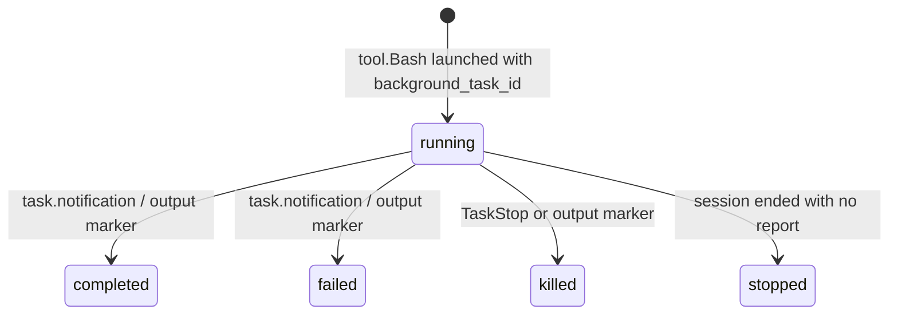

# Feature #141: Kimi session support fixes

## Intent

Make Kimi Code CLI sessions first-class in regin's trace UI: the same session
surface (context meter, composer, queued prompts, background shells, skill
prompts) that works for Claude must work for Kimi, without drift between what
Kimi's wire protocol reports and what regin stores or renders.

**Non-goals**
- Reimplementing Kimi's lifecycle hooks (the `hook_manager` adapter already
  normalises them).
- Changing how Claude sessions compute context; Kimi uses the same
  `context_used = input + cache_read + cache_creation` contract as Claude.
- Supporting non-Kimi providers.

## Model

Full schemas live in `lib/trace/payload_schemas/kimi/`.

```typescript
type KimiUsage = {
  inputOther: number
  output: number
  inputCacheRead: number
  inputCacheCreation: number
}

type KimiPromptPart =
  | { type: 'text', text: string }
  | { type: 'image_url', imageUrl: { url: string } }
```

State machine for a background shell entry in the session roster:



## Rules

| # | Condition | Action |
|---|---|---|
| 1 | Kimi wire carries a payload field not in the schema | Add the field to the schema under `lib/trace/payload_schemas/kimi/` and pin a sample in `tests/trace/test_kimi_schema_parity.py` |
| 2 | A background shell has no `task.notification` but its output file ends with `[exited with code N]` or `[killed]` | Serve-time roster falls back to the file marker; backfill paths keep the shell `running` so they can publish the notification |
| 3 | Session model is `kimi-code/kimi-for-coding` or `kimi-code/k3` | Resolve pricing and window through the `kimi-k2.7-code` / `kimi-k3` catalogue aliases |
| 4 | ACP channel run holds `trace_id` | `lib.agent_sdk.registry.is_sdk_owned` answers true, so the session page shows the composer |
| 5 | User queues a prompt while a Kimi turn is in flight | `AcpRunHandle` holds the queue; `_queued_prompts()` surfaces it on `/map` |
| 6 | Skill invocation is armed for a Kimi run | `KimiProvider.skill_invocation()` emits `/skill:<name>`; the transcript parser treats untracked skill inputs as non-prompt |
| 7 | A 1.5 `turn.prompt` has `origin.kind=skill_activation`, `trigger=user-slash` | It is the turn's prompt anchor, text = literal `/skill:<skillName> <skillArgs>` (not the expanded body); any other non-`user` kind is not a prompt |

## Invariants

- `context_used_tokens` for a Kimi turn equals `inputOther + inputCacheRead +
  inputCacheCreation` (same prompt-size contract as Claude).
- `context_window_tokens` for a Kimi session never falls back to the observed
  peak when the model is known in the pricing catalogue.
- A shell counted as `running` by the notification backfill has no readable
  end-of-file marker.
- A queued prompt surfaced by `_queued_prompts()` has a stable `id` iff it came
  from regin's own SDK/ACP queue.

## Acceptance

```gherkin
Scenario: Kimi payload schemas stay in parity with native payloads
  Given a native Kimi hook/tool payload sample
  When `_normalize_payload` runs
  Then no schema drift is recorded

Scenario: Lost notification is recovered by output file marker at serve time
  Given a background shell launched and its output file ends with `[exited with code 0]`
  And no `task.notification` arrived
  When `/api/sessions/<id>/map` is polled
  Then the shell status is `completed`

Scenario: Notification backfill still publishes a settled shell
  Given the same shell as above
  When `repair.backfill_killed_shell_notifications` runs
  Then it posts one `task.notification` span

Scenario: Kimi session context window resolves from the catalogue
  Given a session whose model is `kimi-code/kimi-for-coding`
  When session aggregates are refreshed
  Then `context_window_tokens` is 262144

Scenario: ACP run is steerable
  Given a Kimi run launched over ACP
  When `agent_sdk.is_sdk_owned` is asked
  Then it returns true

Scenario: Queued prompts appear for a Kimi run
  Given a Kimi ACP run with a turn in flight
  When a follow-up prompt is enqueued
  Then `/map` returns the queued prompt

Scenario: Skill invocation renders in Kimi syntax
  Given `KimiProvider.skill_invocation("foo", "bar", ["baz"])`
  Then the result starts with `/skill:foo bar`

Scenario: A skill-launched Kimi run has a turn anchor
  Given a Kimi run launched as `/skill:goal-verified <args>`
  And its wire logs only a `skill_activation` / `user-slash` turn.prompt
  When the session is opened at `/trace/sessions/<id>`
  Then TURNS is 1 and the prompt card reads `/skill:goal-verified <args>` with its spans beneath
```
