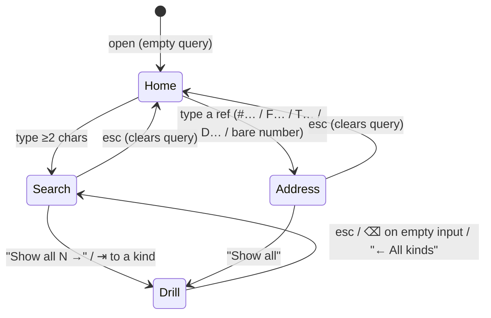
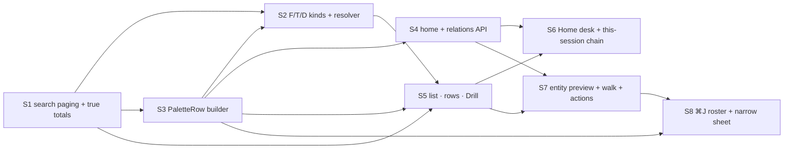

# Search Palette 弹窗优化（⌘K / ⌘J）

## Intent

The Search Palette (⌘K, `FullTextSearch.vue`) is currently organised by **corpus**: spans, patterns, sessions and files. The user's work is organised by **process**: Feature → Task → Session → Defect. Three gaps follow from that:

1. **Sessions are cut off.** Each group shows only `OTHER_ROW_CAP = 6` rows, and the server is also asked with `limit=6`. The "+N more" under a group is a plain `<p>`, so the remaining rows cannot be reached (`SearchResultList.vue:176`, `useFullTextSearch.js:187`).
2. **A session cannot be told apart from its row.** A session-kind row carries only `title` (falling back to `trace_id[:12]`) and "N matching spans · day" (`lib/fulltext/session_docs.py:104`). The roster (⌘J) row has title, repo and status, but no Feature, Task or latest prompt. Those links already exist in the DB: `session_features`, `agent_task_runs.trace_id`, and `defects.reported_by_trace`.
3. **There is no Feature, Task or Defect entry point.** The process entities the user works around are not searchable, and there is no way to walk the chain from one to the next.

The goal is to make the palette a **process navigator**. In one glance, the user should see which Feature and Task each thing belongs to and what state it is in, and get from there to the next step in one keystroke.

**Non-goals**
- Span and file search inside a session (the session scope's Spans/Files) keep their UI. The span group stays a fixed 14-row window and ignores `offset`.
- No new search engine or index. SQL LIKE plus the existing ranking is enough.
- The palette changes no state. It navigates, plus Copy id. Triage (accept / snooze / decline), approving or denying a permission request, and answering an agent question all happen on the defect page or in the trace. The palette may show that something is waiting and what it asks, as read-only text, and ↵ takes you there. Because nothing is changed, it needs no undo.
- The rest of the app's information architecture is unchanged. The palette's own type scale and tokens (`--sp-t-*`) stay as they are.

## Model

Design of record: Claude Design project `a544cf7e-a867-4a18-949c-f9574e4ff377`, file `Search Palette v2.dc.html` (pulled 2026-10-08; the session ↵ reads **Attach** in every state). Every state below has a preset there; the screenshots under **Screens** are its renders, attached as feature images. A run fetches one with `regin feature image 146 <N>`.

```ts
type Kind = 'feature' | 'task' | 'defect' | 'session'      // process entities, new and first-class
          | 'span' | 'file' | 'pattern'                    // existing document kinds

interface PaletteRow {
  kind: Kind
  id: string | number           // the entity's own key — a session's full trace id, which `ref` only abbreviates; routes without a lookup
  ref: string                   // shown first on every row: F146 / T419 / D276 / #a1b2c3d4
  title: string                 // never empty; R3
  status: StatusChip            // R4; leads line 2. { word: string, bucket: 'needs_you' | 'active' | 'quiet' | 'done' } — S5 tones by bucket
  owners: RefChip[]             // right side of line 1, refs only (title in tooltip). session → [F, (+N), T]; task → [F]; defect → [F | "no feature"]
  aside?: string                // defect: "fix T430" / "no fix"; awaiting session: "approval · 18m" / "question · 6m"
  context?: string              // line 2 after status: session = latest prompt, or "asks: …" when awaiting; task = "run N · result"; defect = detail; feature = "1/5 done · 2 open defects"
  here?: boolean                // the session the palette was opened from — solid HERE badge, not an owner chip
}

interface Relation {            // preview, under the title
  rel: 'Belongs to' | 'Also in' | 'Runs task' | 'Reported in' | 'Fixed by'
  target: RefChip | { none: string }   // "No feature yet", "No fix task yet", "Not linked to a feature or task"
}
```

Two orthogonal axes, so two diagrams.

**Axis 1: query state** (decides what the list shows)



**Axis 2: preview focus** (decides what the right pane shows; independent of axis 1)

```mermaid
stateDiagram-v2
  [*] --> Row: cursor lands on a row
  Row --> Pivot: ⌥→ on the picked relation / click it
  Pivot --> Pivot: keep walking
  Pivot --> Row: ⌥← / esc pops one step; moving the list cursor resets
```



While pivoted, the origin row gets a dashed outline and a line above the action bar reads "↵ acts on <ref> · not the highlighted row".

## Screens

| # | State(s) | Image | What to check against it |
|---|---|---|---|
| 1 | Home · Needs me; Home · nothing waiting |  | Group order R1; "Show all 6 waiting →"; HERE badge; waiting card red when destructive; "Needs me" collapses to one calm line when empty |
| 2 | Search "palette" |  | Kind order F → T → D → S → P → File; caps 3 / sessions 4; "Show all N →" rows; facet counts = `group.total` |
| 3 | Drill · sessions |  | "← All kinds" header; 12 per page; "Load 12 more · N left"; no filters or sort |
| 4 | D276 · Bare 146 · T999 miss · `#a1` too short |  | R7 rows; "Resolves to" group; miss note without neighbour ids; `#`+<4 characters shows the keep-typing state |
| 5 | F146 feature preview |  | Progress in header meta; Tasks / Open defects / Recent sessions lists, ≤5 + "All N →" |
| 6 | Walk D276 › T430 › session |  | Breadcrumb; origin row dashed; "↵ acts on <ref> · not the highlighted row" |
| 7 | Defect in triage |  | Relations Belongs to / Reported in / Fixed by ("No fix task yet"); actions Open defect / Reporter / Copy id only |
| 8 | ⌘J roster |  | No left rail; same row shape as search; ↵ attach |
| 9 | This session (chain, document preview), No current session, Narrow · 760px |  | Chain group; document preview ⌥↑↓ / ⌥L; ⌃S no-op notice; narrow: horizontal scope+kind strip, preview opens as a sheet |
| 10 | Loading, No matches, Group errors, Offline, Drill page fails |  | `…` / `!` / `—` counts and `N+`; per-group retry; offline keeps the query; nothing preselected while loading |

## Today's server, measured

| Fact | Where | Consequence |
|---|---|---|
| Session, pattern and file rank their whole candidate set; `_group` slices `[offset:offset+limit]` after taking `total` | `lib/fulltext/__init__.py` `_group` | `total` is exact over the candidate set (S1). Ties on match count are broken by path (pattern) / edit recency (file), so pages never repeat or skip a row |
| `/api/search` takes `offset` ≥ 0 (bad values read as 0); `limit` stays ≤ 25 per page | `web/blueprints/search.py` | Drill pages by `offset` (S1) |
| The candidate set itself is bounded: sessions and files scan the newest `MAX_SCANNED_ROWS = 600` matching spans; pattern and file greps keep at most `MAX_MATCHED_FILES = 200` files; `truncated` is always `false` | `session_docs.py`, `grep.py` | A total that hit a bound reads as exact. Follow-up, not in any slice |
| Session docs match on span text only; title falls back to `trace_id[:12]` | `session_docs.py:74–120` | No owner, no prompt, uuid titles. S3 |
| No feature / task / defect kinds in `KIND_ORDER` | `lib/fulltext/docs.py` | No F/T/D entry point. S2 |
| `/api/session-switcher` limit 12 (max 24); `_PRIORITY` ranks `retrying` right after the waiting phases (a rank, mirrored by the client's `STATE_RANK`) | `web/blueprints/trace/switcher.py:42,76` | S3's `row.status` buckets `retrying` as `active` (word `reconnecting`); the rank order is left alone. S8 buckets the client side |

## API contract (additions; existing fields stay)

```ts
// GET /api/search?q&kinds&scope&session&limit&offset
interface SearchGroup { kind: Kind; total: number /* exact over the candidate set; see Today's server for its scan bounds */; offset: number; items: SearchItem[] }
interface SearchItem extends ExistingDoc { row?: PaletteRow }         // row present for feature/task/defect/session

// GET /api/palette/resolve?ref=F146|T419|D276|146|#a1b2   → { ref, address: 'feature'|'task'|'defect'|'number'|'session'|null,
//     hits: (PaletteRow & { match: 'id'|'prefix' })[], text: { kind, total, items: (PaletteRow & { match: 'text' })[] }[],
//     miss?: string, pending?: 'Keep typing the session id' }      // address null = not an address; search it as text
// GET /api/palette/home?session=<trace>                   → { needs_me: Group, active_now: Group, active_features: Group, sessions: Group, totals: Record<'feature'|'task'|'defect'|'session', number> } | { chain: PaletteRow[] }
//   Group = { label, total, offset, items: PaletteRow[] }   (total is uncapped)
// GET /api/palette/list/<key>?offset&limit                 → { key, ...Group }   key = feature | task | defect | session | needs_me | active_now | active_features; limit ≤ 25
//   every entry behind a Home group or a kind, in the group's own order (kinds: newest first, closed last); unknown key → 404
// GET /api/palette/relations/<kind>/<id>                  → { kind, id, row: PaletteRow, relations: Relation[], lists: { label, total, items: PaletteRow[] }[], body, waiting?: { kind: 'approval'|'question', text, destructive, since } }
//   feature adds progress: { done, tasks, open_defects }; defect adds missing_check; session adds prompts: { span_id, ts, text }[] (newest first) and its body is "" — the tail comes from /api/session-switcher?id=<prefix>&tail=1. `prompts` are read through the trace view's serve-time merge (`merge_spans`), so a live `promptlive-` placeholder never lists beside its anchor and a slash command shows once with its expansion; subagent prompts are left out
// GET /api/session-switcher  rows gain `row: PaletteRow`
```

## Rules

**R1: What the list shows**

| Query state | Scope | Groups (in order) | Ordering inside a group |
|---|---|---|---|
| Home | Everywhere | **Needs me** (awaiting sessions, then defects in the triage queue — `lib/defects/store.in_queue()`: no feature, open, `triage_state` NULL or a broken snooze; the column never holds `queue`; cap 5 + "Show all N waiting →") → **Active now** (working sessions; a running task folds into its session and only appears alone if none of its runs' sessions — alias halves included — is in Needs me or Active now) → **Active features** (stage = building) → **Sessions** (latest not already in a group above — counted there, even past its cap, and reached through that group's "Show all" — 4 + "Show all"). Every group's "Show all" opens a Drill on `/api/palette/list/<group>`; the Sessions group's lists every session | Needs me: oldest wait first. Others: recency |
| Home | This session | "This session's chain": the session, its Feature, its Task, its Defects | Fixed |
| Search | Everywhere | Feature → Task → Defect → Session → Pattern → File; sessions cap 4, others cap 3 | Match score, then closed items last |
| Search | This session | Spans + Files | Existing |
| Address | any | R7 | Exact first |
| Drill | any | Every match of one kind, 12 per page, "Load 12 more · N left"; "end of list · all N shown" at the end | Same as Search. No status filters or sort control |
| Home Drill | Everywhere | A Feature / Task / Defect kind picked on the empty query, or a Home group's "Show all": every entry of `/api/palette/list/<key>`, paged by 12; "← Home" / esc returns to the desk | The list's own order |
| Home, kind with no list | any | Patterns or Files (or Spans inside a session) picked on the empty query: no desk and no chain — the list reads "Type 2 characters to search <Kind>." until a query is typed | — |

Left rail: Scope + Kind with counts, plus Recent searches on an empty query. An empty query asked no kind anything, so the label reads "Kind" and each chip carries that kind's total from `/api/palette/home` `totals` (kinds without one, Patterns and Files, carry none); a typed query relabels it "Kind · matches". Kinds whose count is 0 are disabled, and ⇥ skips them. The ⌘J roster (reached by ⌘J, or the Sessions kind on an empty query) has **no** left rail and shows its own key legend instead; a `#` address, or the Sessions kind picked in ⌘K, is a search state and keeps the rail. ⌘K over the roster drops ⌘J's forcing and returns to search.

**R2: Overflow is never a dead end**

| Where | Control | Keyboard |
|---|---|---|
| List group with `total > shown` | "Show all N {kind} →" row | ↓ reaches it, ↵ opens Drill |
| Preview relation list with > 5 | "All N {kind} →" node | ⌥↑↓ picks it, ⌥→ opens the page that lists them all: a feature's Tasks → `/tasks?feature_id=id`, its Open defects → `/defects?feature_id=id`, any other list → the owning entity's page. `/api/search` has no feature filter, so a Drill cannot be scoped to one |
| Drill | "Load 12 more" row; on failure "Couldn't load the next page · retry" | ↓ onto it loads |
| Facet and header counts | server `group.total` | — |

**R3: Title fallback**

| Kind | Title source, in priority order |
|---|---|
| session | `sessions.title` → the owning Task's title → first prompt line → `untitled · no prompts` (never the id, which is already shown as `ref`). A title ingest derived from the first prompt (`title_source = first_prompt`) ranks as the first-prompt tier, below the Task title. Owners and the Task are read through the run's alias halves (`agent_runs` / `agent_run_sessions`): a run records its `sdk-` id while the roster shows the child's |
| task / feature | `title` |
| defect | first line of `symptom` (≤80 characters) |

**R4: Status vocabulary — one word per state**

| Kind | Values |
|---|---|
| session | working / needs you / idle / reconnecting / inactive / ended (`retrying` → reconnecting; `starting` / `stopping` → working) |
| task | idea / armed / queued / running / **needs you** (running and an open run's session — or its alias child — is awaiting) / done / failed / archived |
| feature | spec / building · round N / shipped / escaped / abandoned |
| defect | triage / open · accepted / snoozed / closed / declined |

Bucketing: "needs you" is `awaiting` only; `retrying` counts as active everywhere (Home and roster agree). Feature progress = done / non-archived tasks · open defects; archived tasks are excluded from both the count and the Tasks list.

**R5: Preview content**

| Selected | Relations | Lists (≤5 + "All N →") | Body |
|---|---|---|---|
| Feature | — | Tasks (by status), Open defects, Recent sessions | Summary; progress in the header meta |
| Task | Belongs to F | Runs: `#id · run N · result`, Defects it fixes | Body |
| Defect | Belongs to F · Reported in #S · Fixed by T (or "No …") | — | Detail, Missing check |
| Session | Belongs to / Also in F · Runs task T | Defects reported here | **Waiting card** if awaiting (read-only question text; red border when destructive; "Read-only here. ↵ opens the trace…"), Latest prompts (each jumps to its turn), Tail |
| Span / File / Pattern | — | — | Document lines with hits; ⌥↑↓ walks hits, ⌥L toggles the hit list |

Empty lists collapse into one muted line ("No defects reported here").

**R6: Actions — navigation only (see Non-goals)**

| Kind | ↵ | ⌘↵ | Third |
|---|---|---|---|
| session | attach (opens the trace; same label whether or not it is waiting) | new tab | Copy id |
| task | `/tasks/:id` | pivot to latest run | Copy id |
| feature | `/features/:id` | `/tasks?feature_id=id` | Copy id |
| defect | `/defects/:id` | pivot to reporting session | Copy id |
| file | open the edit in the trace | open the file | — |
| span | open the span in the trace | — | — |
| pattern | open the pattern | — | — |

**R7: Address syntax**

| Input | Result |
|---|---|
| `#` + 0–3 characters | "Keep typing the session id" state, no search |
| `#a1b2` (≥4) | sessions with that prefix — same answer as `/api/session-switcher?id=`: any characters (an `sdk-` id is pasteable), `is_test` out, alias pairs folded, cap 12 |
| `F146` / `f:146`, `T…`, `D…` | that entity and nothing else — text quoting the ref is not shown on a hit; on miss: "No task T999", then text mentioning the number. Never "nearest ids" |
| bare `146` | "Id 146 resolves to" (one row per kind that has it), then text matches labelled "· text" |

**R8: Keys**

| Key | List / entity preview | Document preview | ⌘J roster |
|---|---|---|---|
| ↑↓ | move | move | move |
| ⇥ / ⇧⇥ | next kind (skips empty) | same | leaves the roster for the next kind |
| ↵ / ⌘↵ | R6 | R6 | attach / new tab |
| ⌥↑↓ | pick relation | walk hits | pick relation |
| ⌥→ / ⌥← | follow / back | — | follow / back |
| ⌥L | — | hit list | — |
| ⌃S | toggle scope (no-op with a notice when no session is open) | same | — |
| esc | one layer: sheet → pivot → Drill → query → close | same | close |
| narrow (≤900px): ↵ or → | opens the preview sheet first | same | same |

## Invariants

- The palette performs no write. Every ↵ / ⌘↵ / click is a route change, a pivot inside the preview, or a clipboard copy.
- Every row shows its `ref`; a session's title never repeats its id.
- For every session row, links in `session_features` / `agent_task_runs` appear as owner chips.
- Every one of a group's `total` matches is reachable by keyboard alone.
- Facet count == header count == `group.total`; failed or loading kinds show `!` / `…` and All shows `N+`; offline shows `—` everywhere.
- Rows are at most two lines.
- Nothing is preselected while any group is loading, so the cursor never jumps.

## Acceptance

```gherkin
Scenario: Sessions are no longer silently cut off
  Given 19 sessions match "palette"
  When I search "palette" under Everywhere
  Then the Sessions group ends in "Show all 19 sessions →"
  And ↵ on it lists all 19 (paged by 12), each reachable with ↓

Scenario: A session row names its owners
  Given session S is linked to F146 via session_features and to T419 via agent_task_runs
  Then S's row reads "#<id> <title>" with chips F146 and T419
  And line 2 is "<status> <latest prompt>"

Scenario: An untitled session gets a readable name
  Given session S has no title and runs task 419 "Write the palette spec"
  Then S's title is "Write the palette spec"
  Given session U has no title, no task and no prompts
  Then U's title is "untitled · no prompts"

Scenario: The empty query is a work desk
  Given one session awaits approval and one defect is in the triage queue
  When I press ⌘K and type nothing
  Then "Needs me" is the first group and holds both, the session first

Scenario: Waiting work is shown, not handled
  Given the highlighted session awaits approval for a destructive command
  Then the preview shows the request read-only with a red border
  And ↵ attaches the session; nothing is approved, denied or answered
  And a defect in triage offers Open defect / Reporter / Copy id, no triage buttons

Scenario: Walk the chain
  Given the cursor is on D276
  When I pick "Fixed by T430" and press ⌥→
  Then the preview shows T430, the breadcrumb reads D276 › T430
  And "↵ acts on T430 · not the highlighted row" is shown
  And ⌥← returns to D276 with the list cursor unmoved

Scenario: Address miss
  When I type "T999" and no task 999 exists
  Then the note says "No task T999" and lists text mentioning "999", not neighbouring ids

## Slices



Shared rules:
- No schema change. Every link read here (`session_features`, `agent_task_runs.trace_id`, `defects.reported_by_trace` / `feature_id` / `fix_task_id` / `triage_state`) already exists. No slice adds an alembic revision.
- **Two checks, no overlap.** Inside the session the skill (`goal-verified-treenav`) runs this slice's scoped pytest, `vite build`, scoped Playwright and its own verifier. Those are its job, and the full suite runs only in S11. The Verify column runs after the session ends, in its worktree, and checks only what the session cannot grade itself on: the tree is clean, the branch is merged back into `f146/integration`, and every name in the Tests column exists on `f146/integration`. It never re-runs a test.
- Tests-column names appear verbatim: as a pytest function name, or as a Playwright `test('…')` title.
- In a worktree, link `ln -sfn /Users/taowang/regin/.venv .venv` and, for frontend work, `frontend/node_modules`. Frontend slices run Playwright in-task on their own ports, `REGIN_E2E_API_PORT=837N REGIN_E2E_VITE_PORT=521N REGIN_E2E_SCRATCH=/tmp/regin-e2e-f146sN` (N = slice number), because S6 and S7 run in parallel.
- Every slice is armed with `launch: tmux`. A session that has to be restarted is relaunched in tmux, never as an SDK child.
- Backend slices own `lib/` + `web/`, and frontend slices own `frontend/`. A frontend slice that needs a payload field missing from the contract above reports it; it does not patch the backend.

| # | Slice | Delivers | Spec refs | Tests | Schema | Depends on | Base | Skill | Verify |
|---|---|---|---|---|---|---|---|---|---|
| S1 | search paging + true totals | `lib/fulltext/__init__.py` + `session_docs.py` + `file_docs.py`: each kind ranks its full candidate set, and `_group` returns the exact `total` plus an `offset` slice. `web/blueprints/search.py` accepts `offset` (≥0) and keeps `MAX_LIMIT` per page. Span search inside a session is unchanged and ignores `offset`; session-scope files now rank every file the session touched. Tests go in `tests/fulltext/test_search_paging.py` | R2, Invariants, Today's server | test_session_total_is_not_capped_at_twice_the_limit, test_offset_pages_without_overlap, test_last_page_reports_end, test_span_scope_unchanged |  | — | `f146/integration` | goal-verified-treenav | test -z "$(git status --porcelain)" && git merge-base --is-ancestor HEAD f146/integration && for t in test_session_total_is_not_capped_at_twice_the_limit test_offset_pages_without_overlap test_last_page_reports_end test_span_scope_unchanged; do git grep -q -w "$t" f146/integration -- tests frontend/tests && continue; echo "missing $t"; exit 1; done |
| S2 | F/T/D kinds + address resolver | New `lib/fulltext/entity_docs.py`: feature / task / defect docs (LIKE over title, spec or body, symptom; closed items rank last). `KIND_ORDER` becomes feature, task, defect, session, pattern, file, span, and the global search fans out to the new kinds with caps of 3. New `lib/palette/resolve.py` + `GET /api/palette/resolve` implement R7: `F146` / `f:146` / `T…` / `D…` exact, bare number one row per kind plus text matches labelled `text`, miss note `No task T999` with no neighbour ids, `#`+<4 characters rejected. Under This session the default fan-out leaves the entity kinds out; a single-kind request (Drill) pages by its own `limit`. Tests go in `tests/fulltext/test_entity_docs.py` and `tests/palette/test_palette_resolve.py` (a unique basename: `tests/prompts/test_resolve.py` already exists and neither directory is a package) | R1, R3, R7 | test_feature_task_defect_are_searchable, test_closed_entities_rank_last, test_bare_number_resolves_every_kind, test_miss_lists_text_not_neighbours, test_short_hash_is_not_searched |  | S1, S3 | `f146/integration` | goal-verified-treenav | test -z "$(git status --porcelain)" && git merge-base --is-ancestor HEAD f146/integration && for t in test_feature_task_defect_are_searchable test_closed_entities_rank_last test_bare_number_resolves_every_kind test_miss_lists_text_not_neighbours test_short_hash_is_not_searched; do git grep -q -w "$t" f146/integration -- tests frontend/tests && continue; echo "missing $t"; exit 1; done |
| S3 | PaletteRow builder | New `lib/palette/rows.py`: one batched builder per kind that fills `PaletteRow`. It covers `ref`; title by R3 (session: title → owning task title → first prompt line → `untitled · no prompts`); one-word status by R4 (`awaiting` → needs you, `retrying` → active, task needs you when a run session awaits); owners from `session_features` + `agent_task_runs`; `aside` and `context` (latest prompt, or `asks: …`). Session search items and `/api/session-switcher` rows carry `row`. It makes one query per kind per page, never one per row. Tests go in `tests/palette/test_rows.py` | Model, R3, R4, Invariants | test_session_row_names_its_owners, test_untitled_session_takes_task_title, test_untitled_no_prompts, test_retrying_is_active_not_needs_you, test_task_needs_you_when_run_awaits, test_rows_batch_queries |  | S1 | `f146/integration` | goal-verified-treenav | test -z "$(git status --porcelain)" && git merge-base --is-ancestor HEAD f146/integration && for t in test_session_row_names_its_owners test_untitled_session_takes_task_title test_untitled_no_prompts test_retrying_is_active_not_needs_you test_task_needs_you_when_run_awaits test_rows_batch_queries; do git grep -q -w "$t" f146/integration -- tests frontend/tests && continue; echo "missing $t"; exit 1; done |
| S4 | home + relations API | New `lib/palette/home.py` + `GET /api/palette/home`: Needs me (awaiting sessions, then defects in the triage queue via `in_queue()`, oldest wait first, cap 5 + total); Active now (working sessions, with a running task folded into its session); Active features (stage building); Sessions (latest not already shown, 4 + total). With `session=` it returns the chain instead. New `lib/palette/relations.py` + `GET /api/palette/relations/<kind>/<id>`: R5 relations, lists ≤5 with total (archived tasks excluded), body, and a read-only `waiting` block. Nothing written. Tests go in `tests/palette/test_home.py` and `test_relations.py` | R1, R4, R5, Non-goals | test_needs_me_orders_oldest_wait_first, test_running_task_folds_into_its_session, test_this_session_chain, test_defect_relations_name_reporter_and_fix, test_feature_progress_excludes_archived, test_waiting_block_is_read_only |  | S3 | `f146/integration` | goal-verified-treenav | test -z "$(git status --porcelain)" && git merge-base --is-ancestor HEAD f146/integration && for t in test_needs_me_orders_oldest_wait_first test_running_task_folds_into_its_session test_this_session_chain test_defect_relations_name_reporter_and_fix test_feature_progress_excludes_archived test_waiting_block_is_read_only; do git grep -q -w "$t" f146/integration -- tests frontend/tests && continue; echo "missing $t"; exit 1; done |
| S5 | list · rows · Drill | `frontend/src/components/search/SearchResultList.vue` + `FullTextSearch.vue` + `SearchFacetRail.vue` + `useFullTextSearch.js` + `utils/searchDocs.js`: a two-line `PaletteRow` (ref, title, owner chips, status, context, aside) cut off at 2 lines. The "+N more" `<p>` becomes a focusable "Show all N {kind} →" row that opens Drill, which pages by 12 with `offset` (load more, retry on failure, end of list). New kinds and group order. Empty kinds are disabled and ⇥ skips them. Facet count = `group.total`, with `…` / `!` / `—` / `N+`. Address states from `/api/palette/resolve`. Nothing is preselected while loading. Matches images 2, 3, 4 and 10. New e2e `frontend/tests/search-palette-drill.spec.js` | R1, R2, R7, R8, Invariants, Screens 2–4, 10 | test_show_all_reaches_every_session, test_drill_pages_by_twelve, test_drill_page_failure_retries, test_facet_count_equals_total, test_tab_skips_empty_kinds, test_address_miss_note |  | S1, S2, S3 | `f146/integration` | goal-verified-treenav | test -z "$(git status --porcelain)" && git merge-base --is-ancestor HEAD f146/integration && for t in test_show_all_reaches_every_session test_drill_pages_by_twelve test_drill_page_failure_retries test_facet_count_equals_total test_tab_skips_empty_kinds test_address_miss_note; do git grep -q -w "$t" f146/integration -- tests frontend/tests && continue; echo "missing $t"; exit 1; done |
| S6 | Home desk + this-session chain | Empty query renders `/api/palette/home`: Needs me (tinted, "Show all N waiting →"), Active now, Active features, Sessions, plus recent searches in the rail. With This session, "This session's chain". With no current session, the scope chip is disabled and ⌃S shows a notice. Matches images 1 and 9. New e2e `frontend/tests/search-palette-home.spec.js` | R1, R8, Screens 1, 9 | test_needs_me_is_first, test_calm_home_collapses_needs_me, test_this_session_shows_chain, test_ctrl_s_without_session_is_noop |  | S4, S5 | `f146/integration` | goal-verified-treenav | test -z "$(git status --porcelain)" && git merge-base --is-ancestor HEAD f146/integration && for t in test_needs_me_is_first test_calm_home_collapses_needs_me test_this_session_shows_chain test_ctrl_s_without_session_is_noop; do git grep -q -w "$t" f146/integration -- tests frontend/tests && continue; echo "missing $t"; exit 1; done |
| S7 | entity preview + walk + actions | New `frontend/src/components/search/SearchEntityPreview.vue`, plus `SearchPreview.vue` dispatch. It shows the head (ref, status, meta), relations, ≤5 lists + "All N →", the read-only waiting card (red when destructive), latest prompts and tail. Preview-focus state machine: ⌥↑↓ picks, ⌥→ follows, ⌥← / esc pops, breadcrumb, dashed origin row, "↵ acts on <ref>". The R6 action bar is navigation plus Copy id only, with no write call anywhere. esc unwinds one layer at a time. Matches images 5, 6 and 7. New e2e `frontend/tests/search-palette-walk.spec.js` | R5, R6, R8, Non-goals, Screens 5–7 | test_walk_defect_to_task_to_session, test_alt_left_restores_origin, test_enter_acts_on_pivot, test_waiting_card_has_no_approve, test_defect_actions_have_no_triage, test_palette_makes_no_write_request |  | S4, S5 | `f146/integration` | goal-verified-treenav | test -z "$(git status --porcelain)" && git merge-base --is-ancestor HEAD f146/integration && for t in test_walk_defect_to_task_to_session test_alt_left_restores_origin test_enter_acts_on_pivot test_waiting_card_has_no_approve test_defect_actions_have_no_triage test_palette_makes_no_write_request; do git grep -q -w "$t" f146/integration -- tests frontend/tests && continue; echo "missing $t"; exit 1; done |
| S8 | ⌘J roster + narrow sheet | `SessionSwitcherList.vue` + `SessionSwitcherPreview.vue` + `utils/sessionSwitcher.js`: roster rows use `row` (same shape as search, no left rail). The `#` lookup is kept; the 1–9 number attach is removed so digits can be typed into the query. `retrying` is bucketed active. The roster preview reuses `SearchEntityPreview`. At ≤900px the rail becomes a horizontal scope + kind strip and ↵ / → opens the preview as a sheet. Matches images 8 and 9. Update `frontend/tests/session-switcher.spec.js` and add the narrow case | R4, R8, Screens 8, 9 | test_roster_row_names_owners, test_roster_number_does_not_attach, test_retrying_counts_active, test_narrow_opens_sheet_first |  | S3, S7 | `f146/integration` | goal-verified-treenav | test -z "$(git status --porcelain)" && git merge-base --is-ancestor HEAD f146/integration && for t in test_roster_row_names_owners test_roster_number_does_not_attach test_retrying_counts_active test_narrow_opens_sheet_first; do git grep -q -w "$t" f146/integration -- tests frontend/tests && continue; echo "missing $t"; exit 1; done |
| S9 | integrate | 检查每一片都已合回 `f146/integration`，无人落零 commit | Invariants | test_every_slice_merged_back | — | S6, S8 | f146/integration | resolving-merge-conflicts | git merge-base --is-ancestor f146/s1 f146/integration && git merge-base --is-ancestor f146/s2 f146/integration && git merge-base --is-ancestor f146/s3 f146/integration && git merge-base --is-ancestor f146/s4 f146/integration && git merge-base --is-ancestor f146/s5 f146/integration && git merge-base --is-ancestor f146/s6 f146/integration && git merge-base --is-ancestor f146/s7 f146/integration && git merge-base --is-ancestor f146/s8 f146/integration |
| S10 | migrate + doctor | No schema change in this feature. Run `.venv/bin/python cli/regin.py migrate` and `doctor` on a **copy** of the live DB (`sqlite3 .backup`, pointed at via `REGIN_TRACE_DB_PATH`), and confirm there is no schema finding | Shared rules | test_migrate_leaves_no_schema_finding | — | S9 | f146/integration | goal-verified-treenav | git diff --quiet master...HEAD -- alembic db/schema.sql lib/orm/models |
| S11 | verify | The only full run for the whole feature: `.venv/bin/python -m pytest -q -n auto --dist=loadfile`, `cd frontend && npx vite build && ./node_modules/.bin/playwright test`. Fix failures in place. Then **product check**: start the integrated app (`regin serve` on a spare port + vite), open ⌘K and ⌘J in a real browser against real data, and screenshot each state in Screens 1–10 into `/tmp/f146-product/NN-<state>.png`. Compare every image with its design image, fix any difference in place, and post the comparison via `send_to_user` | Acceptance | test_full_suite_passes, test_product_matches_screens | — | S10 | f146/integration | goal-verified-treenav | test -z "$(git status --porcelain)" && git merge-base --is-ancestor HEAD f146/integration && set -- /tmp/f146-product/*.png && test -e "$1" && test $# -ge 10 |


