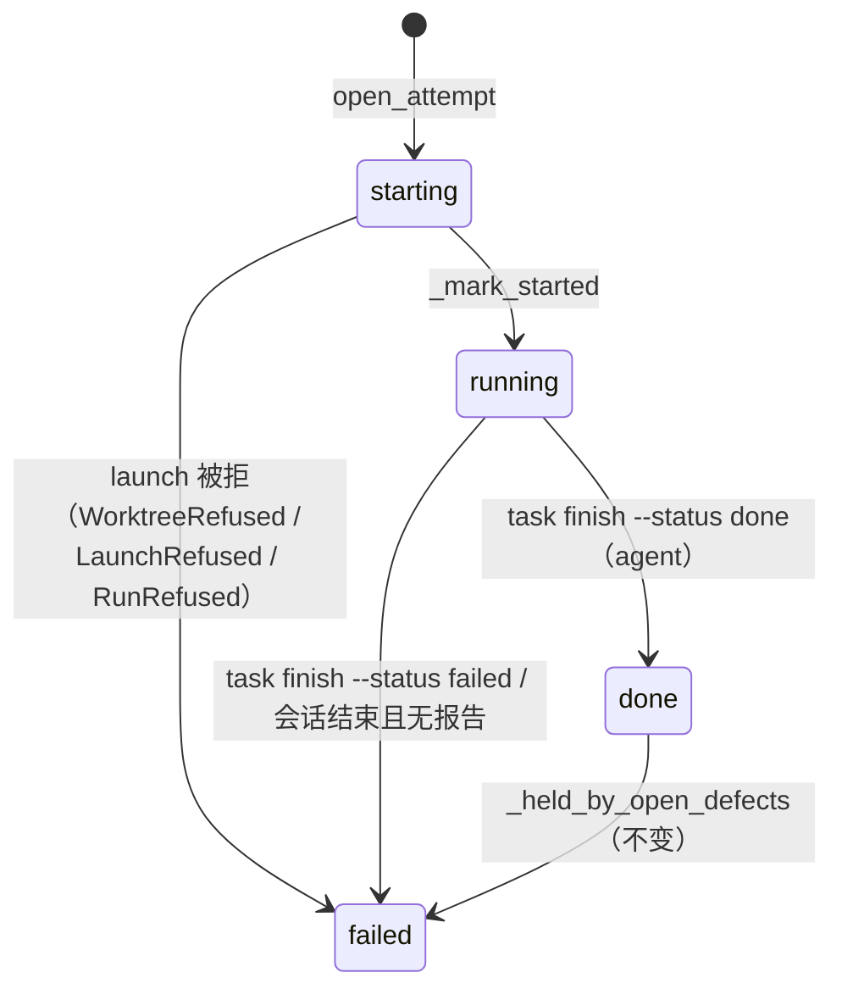

# F155 Pipeline 操作逻辑优化（七期）

## 意图

六期之后，Pipeline 在四个地方仍需要人手兜底：

1. **从 Feature 跳到 Tasks 后，首屏没有下一步。** 从 Feature 页点「Open in Tasks」到 `/tasks?feature_id=N`，页面只有一行「Scoped to the steps of feature #N」，看不出接下来该做什么。另外，此处的「New task」不会把新 Task 挂到这个 Feature 下。
2. **`verify_cmd` 被滥用，代价也高。** 实测库中 471 个 attempt 里有 122 个带 verify，其中 35 个以非 0 退出：
   - 17 个是误用：11 个在 worktree 中找不到 `.venv/bin/python`，6 个把 `/goal` 当成 shell 命令。
   - 其余多是全量测试中与本片无关的失败。

   verify 失败就把 Task 判为 failed，`requires` 依赖链随之停住，只能由人点 Retry 或 Mark done 放行。它没有 CLI，也不做任何预检。**结论：去掉这个参数。** 完成与否以 agent 的 `task finish` 报告为准；feature 级正确性由 done-claim → defects 链路负责。
3. **arm 不校验 git。** slice 表 `Base` 列写了一个不存在的分支（例如从未创建的 `f{id}/integration`），arm 照样成功，等依赖放行、真正 launch 时才失败。失败时还会留下一条 `starting` 状态的孤儿 attempt。同时没有命令行的 arm 入口。
4. **Feature 列表难找，彼此有关系的 Feature 没有关联。**
   - 列表前端默认按 `activity:desc` 排序，后端默认是 `created`，两者不一致。新建的行会被正在跑的老 Feature 挤到下面。新建 Task 后也不会定位到新行。
   - 「Pipeline 操作逻辑优化」本身就是一串分期：#119 → #125 → #142 → #143 → #144/#147 → #148 → #155。schema 中没有任何 feature 之间的关系，只有正文 `](feature:N)` 反链。

**不做的事**

- 不改 Feature 生命周期（spec/building/shipped/escaped/abandoned）、它的 verb 和 Ship 规则。
- 不让 regin 自动创建或删除 git 分支。`lib/features/branches.py` 的「never creates」不变，arm 只负责拒绝并告诉人怎么建。
- 不做 Feature 的父子树或 epic 层级，只做两种平级关联。
- 不处理 `autorun` 字段。它已存而无人读，列为后续事项。
- 不给 verify 留兼容层：不保留旧列，不做「旧 attempt 仍显示 verify exit」之类的读取。

## 模型

### 去掉 verify_cmd 之后的 attempt 结算

```ts
// agent_task_runs：删除 verify_cmd、verify_exit_code 两列，其余不变
type AgentTaskRun = { id; task_id; attempt; status; exit_reason?: string;
                      settled_by?: 'agent' | 'session'; params_json; autorun; … }
```



当前「无 verify_cmd」这条结算路径成为唯一路径。`lib/tasks/verify.py`、`_claim_verify`、`_spawn_verify`、`_resume_orphaned_verify`、`settings.tasks.verify_timeout_seconds` 一起删除。

### Feature 关联

```ts
// 新表 feature_links（alembic 0040 + db/schema.sql + lib/orm/models/features.py）
type FeatureLink = {
  feature_id: number          // follows：后一期；related：较小的 id
  other_id:   number          // follows：前一期；related：较大的 id
  kind: 'follows' | 'related' // 类别列，以后可扩展，不用布尔
  created_at: string
}
// UNIQUE (feature_id, other_id, kind)

// GET /api/features/<id> 的 ledger body 增加：
type Links = { follows: Ref[]; followed_by: Ref[]; related: Ref[] }
type Ref = { id: number; title: string; stage: Stage }
```

### Feature 作用域下的 Tasks 首屏

```ts
// GET /api/features/<id>/next-step —— 不建整本 ledger
type ScopeHead = { id: number; title: string; stage: Stage; project_id: number | null;
                   task_count: number;   // 未归档 Task 数；0 时首屏显示空状态
                   next_step: NextStep }
// NextStep 即 lib/features/next_step.py::for_feature(id).to_dict()
```

## 规则

### R1 Feature 作用域下 Tasks 首屏的主按钮

`TasksScopeBanner` 改为一个头部，显示 `#N 标题 · stage`，并带一个**主按钮**（实心，页面上最显眼的控件）和一个次按钮「New task in #N」。主按钮按 `next_step.kind` 决定：

| next_step.kind | 主按钮文案 | 点击后 |
|---|---|---|
| `write_spec` | Write the spec | 跳到 `/features/N#feature-spec` |
| `slice` | `next_step.label` | 跳到 `/features/N#slices` |
| `arm_slices` | Arm N slices | 跳到 `/features/N?arm=1#slices`，Slices 卡片据此打开 `SliceArmSheet` 并去掉 `arm` 参数 |
| `run` | Run the next task | 若 `target` 是 `/tasks/<id>`，对该 Task 调 `POST /run`；否则跳到 target |
| `watch` | Watch the running task | 跳到 target |
| `resolve_defects` | `next_step.label` | 跳到 `/features/N#feature-defects` |
| `ship` | Ship | 跳到 `/features/N`（Ship 只在 Feature 页做） |
| `reopen` | `next_step.label` | 跳到 `/features/N` |
| `none` | （不渲染主按钮） | — |

- 只要 URL 带 `feature_id`，「New task」按钮、`c` 快捷键和「New task in #N」都会预填 `feature_id=N`。
- 作用域内没有任何 Task 时，空状态文案要说明下一步，并放同一个主按钮，不再只写「Press c」。

### R2 arm 的 git 校验

arm 和 launch 共用同一个函数 `worktree.check_target(root, branch, base) -> None | raise WorktreeRefused(field, msg)`，这样两处不会漂移。arm 时调用的入口有三个：`POST /api/tasks/<id>/arm`、`POST /api/features/<id>/arm-slices` 的每一行、`regin task arm`。

| 条件 | arm 结果 | field | 提示（原样包含） |
|---|---|---|---|
| 未请求 worktree，`cwd` 未给 | 通过（不碰 git） | — | — |
| `cwd` 给了但目录不存在 | 拒绝 | `cwd` | `no such directory: <cwd>` |
| 请求了 worktree，根目录不是 git checkout | 拒绝 | `worktree` | `not a git checkout: <root>` |
| `branch` 已存在 | 通过 | — | — |
| `branch` 不存在，`base` 存在 | 通过（launch 时 `-b branch base`） | — | — |
| `branch` 不存在，`base` 不存在 | 拒绝 | `worktree.base` | `unknown base ref '<base>' — create it first: git branch <base> <ref>` |
| `branch` 不存在，`base` 为空，且仓库默认分支可解析 | 通过 | — | — |

- arm-slices 仍然逐行处理：被拒的行以 `{task_id, field, reason}` 出现在 `refused` 中，其余行照常 arm。
- launch 时同一个检查失败（例如 arm 之后分支被删），走 `_refuse_launch`：attempt 结算为 `failed`，`exit_reason` 记拒绝原因，Task 保持 `armed`。**不得留下 `starting` 孤儿行。** tmux 与 channel 两条 launch 路径同样适用。

### R3 `regin task arm`

```
regin task arm <id> [--cwd P] [--branch B] [--base R] [--provider X] [--model M]
                    [--launch sdk|tmux] [--skill S] [--permission-mode …] [--effort …]
```

- 服务在线时 POST 到 `/api/tasks/<id>/arm`。不在线时在本进程内走 `parse_arm` → `check_target` → `store.arm_task`。两条路径的校验相同。
- 被拒时 exit 1，stderr 输出 `field: reason`。

### R4 Feature 关联

| 操作 | 结果 |
|---|---|
| `link(a, b, follows)` | 写入 `(a, b, follows)`，表示 a 是 b 的后一期 |
| `link(a, b, related)` | 写入 `(min, max, related)`；与参数顺序无关 |
| `a == b` | 拒绝：`a feature cannot link to itself` |
| 任一 id 不存在 | 拒绝：`no feature #x` |
| `follows` 会成环（b 沿 follows 链可走到 a） | 拒绝：`would make a follows cycle` |
| 重复写入同一条 | 幂等，返回已有行 |
| `unlink(a, b, kind)` | 删除这一行；行不存在时视为成功 |

- API：`POST /api/features/<id>/links {other_id, kind}`、`DELETE /api/features/<id>/links/<other_id>?kind=`。viewer 调这两个接口返回 403。
- CLI：`regin feature link <id> <other> --kind follows|related`、`regin feature unlink …`、`regin feature new --follows <id>`。
- Feature 页新增 **Related** 区块，在 `FeatureSectionNav` 中有锚点。区块内依次列出：Follows（前一期）、Followed by（后一期）、Related，然后是现有的 `referenced_by` 反链。可以添加和删除关联，添加时按 id 或标题搜索。
- Feature 页增加「New follow-up」按钮：打开 NewFeatureDialog，预填 `follows=<当前 id>`。创建与写 link 在同一事务中完成。
- Features 列表中，有 follows 的行显示一个「follows #b」chip，点击跳到 #b。

### R5 列表排序与新行定位

| 规则 | 内容 |
|---|---|
| R5.1 | Features 列表默认排序为 `created:desc`（Newest），与 `lib/features/index.py::DEFAULT_SORT_KEY` 一致。有测试断言前端 `SORT_OPTIONS` 的值集合等于后端 `SORT_KEYS` 的键 |
| R5.2 | `SORT_OPTIONS` 补上 `stage`（Lifecycle） |
| R5.3 | 用户选过的排序记在 `localStorage`（每个列表各一个 key）。URL 中显式的 `sort` 优先 |
| R5.4 | 在 Tasks 或 Features 列表中新建一行后，如果它在当前筛选下可见，就滚到该行并加 `data-just-created` 高亮。高亮保留到下一次用户触发的筛选、排序或路由变化为止。**不用计时器。** 新行不可见（被筛选、分组折叠或分页挡住）时，flash 写「hidden by current filters or paging」，并附「Show」链接：点击后清除筛选，Tasks 切到不分组、最新在前的平铺列表，Features 用 `created:desc`，再定位到该行；Show 不写入任何记住的偏好。在 /features 上声明的 feature 留在列表中定位，从其他页面声明的仍跳到 feature 页 |

## 不变式

- I1 代码、schema、UI、文档中不再出现 `verify_cmd`、`verify_exit_code`、`run_verify`、`verify_timeout_seconds`。`git grep -E "verify_cmd|verify_exit_code|run_verify|verify_timeout"` 只允许命中 `alembic/versions/` 的历史 revision，以及验收测试 `tests/tasks/test_verify_removed.py` 自身（它的测试名带有这个标识符）。
- I2 slice 表中旧的 `Verify` 列被忽略，不报错：`_header_columns` 本来就会跳过未知表头，去掉它的别名即可。
- I3 一个 attempt 不会在 launch 失败后停留在 `starting`。
- I4 `feature_links` 中没有自环；`related` 行满足 `feature_id < other_id`；`follows` 图无环。
- I5 `regin init` 建出的库与 `regin migrate` 迁移后的库结构一致。

## 验收

```gherkin
Feature: Pipeline 操作逻辑优化（七期）

  Scenario: 作用域首屏有主按钮 — test_scoped_tasks_head_shows_next_step_button
    Given feature #N 处于 spec 阶段，spec 中有一张未 transcribe 的 slice 表
    When 打开 /tasks?feature_id=N
    Then 头部显示 "#N <title>" 和 stage
    And 首屏可见一个主按钮，文字等于 next_step.label

  Scenario: 主按钮按 next_step 分派 — test_scope_head_action_follows_decision_table
    Given 依次构造 next_step 为 write_spec / arm_slices / run / none 的 feature
    Then 主按钮的行为与 R1 表中对应行一致，none 时不渲染

  Scenario: 作用域内新建 Task 自动挂到 Feature — test_scoped_new_task_prefills_feature
    Given 打开 /tasks?feature_id=N
    When 按 c 创建一个 Task
    Then 新 Task 的 feature_id = N

  Scenario: next-step 接口轻量 — test_feature_next_step_endpoint
    When GET /api/features/N/next-step
    Then 返回 {id, title, stage, next_step}，且 next_step 与 ledger 中的一致

  Scenario: verify_cmd 被彻底移除 — test_verify_cmd_is_gone
    Then git grep 只在 alembic/versions/ 与该测试文件自身中命中 verify 相关标识
    And POST /api/tasks/<id>/arm 带 verify_cmd 字段时返回 400 field=verify_cmd（未知字段）

  Scenario: finish 直接结算 — test_finish_settles_without_verify
    Given 一个 running 的 attempt
    When agent 执行 regin task finish --status done
    Then attempt 与 Task 都变为 done，不起任何子进程，requires 依赖随之放行

  Scenario: 旧 slice 表的 Verify 列被忽略 — test_slice_table_ignores_verify_column
    Given 一张带 Verify 列的 slice 表
    Then parse 成功，SliceRow 上没有 verify 字段

  Scenario: 迁移删除 verify 列并建 feature_links — test_migration_0040_drops_verify_adds_links
    Given 一个停在 0039 的库，其中有带 verify_cmd 的 attempt
    When regin migrate
    Then agent_task_runs 不再有 verify_cmd 与 verify_exit_code 两列，原有行保留
    And feature_links 表存在，结构与 db/schema.sql 一致

  Scenario: arm 拒绝不存在的 base — test_arm_refuses_unknown_base_ref
    Given 仓库中没有 f999/integration
    When arm 一个 Task，worktree={branch: f999/s1, base: f999/integration}
    Then 返回 400 field=worktree.base，消息中包含 "git branch f999/integration"
    And Task 状态不变

  Scenario: arm 接受已存在的分支 — test_arm_accepts_existing_branch_without_base
    Given 分支 f999/s1 已存在
    When arm，worktree={branch: f999/s1, base: f999/missing}
    Then arm 成功

  Scenario: arm 拒绝不存在的 cwd — test_arm_refuses_missing_cwd
    When arm，cwd=/no/such/dir
    Then 返回 400 field=cwd

  Scenario: arm-slices 逐行拒绝 — test_arm_slices_refuses_bad_base_per_row
    Given 两个 idea slice，一个 base 存在，一个 base 不存在
    When POST /api/features/N/arm-slices
    Then armed 中只有前者，refused 中有后者，且带 field=worktree.base

  Scenario: launch 拒绝不留孤儿 — test_launch_refusal_leaves_no_starting_row
    Given 一个已 arm 的 Task，它的 base 在 arm 之后被删除
    When 依赖放行或手动 Run
    Then 该 attempt 的 status=failed，exit_reason 中包含 "unknown base ref"
    And 没有 status=starting 的行，Task 仍为 armed

  Scenario: 命令行 arm — test_cli_task_arm
    When regin task arm <id> --branch f999/s1 --base master
    Then exit 0，Task 变为 armed，params.worktree = {branch: f999/s1, base: master}
    When regin task arm <id> --base nope
    Then exit 1，stderr 中包含 "worktree.base"

  Scenario: Feature 关联的写入规则 — test_feature_link_rules
    Then link(a,a) 被拒；related 与参数顺序无关；follows 成环被拒；重复 link 幂等

  Scenario: Feature 页 Related 区块 — test_feature_page_related_section
    Given #155 follows #148，且 #148 follows #143
    When 打开 /features/148
    Then Related 区块显示 Follows #143 与 Followed by #155
    And 能删除一条关联，也能新增一条关联

  Scenario: New follow-up — test_new_follow_up_links_feature
    When 在 /features/148 点 New follow-up 并提交
    Then 新 feature 带有 follows #148，页面跳到这个新 feature

  Scenario: Feature 列表默认最新在前 — test_features_default_sort_newest
    When 打开 /features，且 URL 中没有 sort
    Then 排序选择框为 Newest，第一行是 id 最大的未 abandoned feature
    And 前端 SORT_OPTIONS 的键集合等于后端 SORT_KEYS

  Scenario: 排序选择被记住 — test_features_sort_is_remembered
    Given 选择了 Rounds ↓
    When 离开后重新打开 /features
    Then 排序仍为 Rounds ↓

  Scenario: 新建后定位到新行 — test_created_task_row_is_highlighted
    Given 在 /tasks 列表中
    When 按 c 新建一个 Task
    Then 新行滚入视口，并带有 data-just-created
    When 用户切换筛选
    Then 高亮消失

  Scenario: 各片已合回 — test_every_slice_merged_back
    Then f155/s1 … f155/s5 都是 f155/integration 的祖先，且每片至少有一个 commit

  Scenario: 迁移后没有 schema finding — test_migrate_leaves_no_schema_finding
    Given 现有 DB 的副本
    When regin migrate 之后执行 regin doctor
    Then 没有 schema finding
```

## 闸门

- **片内**：每片只跑本片新增或修改的 pytest 文件、`npx vite build`，以及本片相关的 Playwright spec。
- **合回检查**：verify 列已移除。各片是否合回 `f155/integration`、Tests 列中的名字是否都已存在，由 S6 统一检查（`test_every_slice_merged_back`）。
- **汇总一次**，在 S6 进行：
  - pytest：`tests/tasks tests/features tests/pipeline tests/defects`、`tests/tasks/test_schema_parity.py`、`tests/core/test_db_migrate.py`。
  - Playwright：pipeline、task、feature 相关 spec，以及 `responsive.spec.js`。
- **迁移**：在现有 DB 的副本上执行 `regin migrate` 与 `doctor`，不出现 schema finding。

## 切片

共用规则：

- 只有 S1 改表。0040 一次完成两件事：删除 verify 两列，新建 `feature_links`。理由是删列必须和删代码同片完成，而切片规则只允许一片拥有 schema 变更。
- arm 由人执行。执行前先 `git branch f155/integration master`，R2 落地后 arm 会对缺失的 base 直接报错。
- worktree 中先执行 `ln -sfn /Users/taowang/regin/.venv .venv`；前端片再链接 `frontend/node_modules`。Playwright 使用本片端口：`REGIN_E2E_API_PORT=838N REGIN_E2E_VITE_PORT=522N REGIN_E2E_SCRATCH=/tmp/regin-e2e-f155sN`。
- S3 与 S5 都改 `TasksView.vue`，所以 S5 排在 S3 之后（after）。

**Base: `f155/integration`**

| # | Slice | Delivers | Spec refs | Tests | Schema | Depends on | Base | Skill |
|---|---|---|---|---|---|---|---|---|
| S1 | 去掉 verify_cmd + 0040 迁移 | `alembic/versions/0040_*.py`（batch：删除 `agent_task_runs.verify_cmd`、`verify_exit_code`；建 `feature_links`）+ `db/schema.sql` + `lib/orm/models/`（`AgentTaskRun` 删两个字段，新增 `FeatureLink`）。删除 `lib/tasks/verify.py`，以及 runs/arm/store/tail/transcribe/feature_slices/slice_table/slicing/tmux_runs/run_reports/migrate 中的 verify 分支。删除 `settings.tasks.verify_timeout_seconds` 及其 `settings_fields.py` 镜像。前端删除 TaskArmSheet、SliceArmSheet、useTaskArm、useArmPrefs、TaskDetailView、TaskRunHistory 中的 verify 字段。更新 `ARCHITECTURE.md`、`docs/spec-notation.md`、`docs/agent-task-capture-design.md`、`docs/feature-ledger-redesign.md`、`.regin/topics/wiki/spec-slice-to-runs.md`。改写或删除依赖 verify 的测试（`tests/tasks/test_verify_cmd.py` 删除） | 意图 2, attempt 结算, I1, I2, I5 | test_verify_cmd_is_gone, test_finish_settles_without_verify, test_slice_table_ignores_verify_column, test_migration_0040_drops_verify_adds_links | yes | — | `f155/integration` | goal-verified-treenav |
| S2 | arm 的 git 校验 + launch 拒绝 + CLI arm | `lib/agent_sdk/worktree.py::check_target`（复用 `repo_root` / `_branch_exists` / `_ref_exists`），由 `parse_arm` 之后的 arm 路径（单个与 arm-slices）调用；`WorktreeRefused` 带 `field`。`runs.start_run` 及 tmux、channel 路径把 `_launch_kwargs` 的异常交给 `_refuse_launch`。`cli/commands/tasks.py` 新增 `arm`（R3）。web 层 400 带 `field`。测试放在 `tests/tasks/test_arm_git_check.py` | R2, R3, I3 | test_arm_refuses_unknown_base_ref, test_arm_accepts_existing_branch_without_base, test_arm_refuses_missing_cwd, test_arm_slices_refuses_bad_base_per_row, test_launch_refusal_leaves_no_starting_row, test_cli_task_arm | — | S1 | `f155/integration` | goal-verified-treenav |
| S3 | Feature 作用域 Tasks 首屏 | `GET /api/features/<id>/next-step`。`TasksScopeBanner.vue` 改为带主按钮的头部（R1 表），主按钮动作复用 `useTaskVerbs` 与 `SliceArmSheet` 的打开方式。`TasksView.vue` 中的 New task、`c` 快捷键与空状态在作用域下预填 `feature_id`。新增 e2e `frontend/tests/f155-scoped-tasks.spec.js`，后端测试放在 `tests/features/test_next_step_endpoint.py` | R1 | test_scoped_tasks_head_shows_next_step_button, test_scope_head_action_follows_decision_table, test_scoped_new_task_prefills_feature, test_feature_next_step_endpoint | — | — | `f155/integration` | goal-verified-treenav |
| S4 | Feature 关联 | `lib/features/links.py`（R4 规则，含 follows 环检查）。`web/blueprints/features.py` 增加 links 的 POST/DELETE，ledger body 增加 `links`。`POST /api/features` 接受 `follows`。CLI 增加 `feature link/unlink`、`new --follows`。前端增加 `FeatureRelated.vue`（挂入 FeatureLedgerView 与 FeatureSectionNav）、「New follow-up」按钮、Features 列表的 follows chip。测试：`tests/features/test_feature_links.py`、`frontend/tests/f155-feature-links.spec.js` | R4, I4 | test_feature_link_rules, test_feature_page_related_section, test_new_follow_up_links_feature | — | S1 | `f155/integration` | goal-verified-treenav |
| S5 | 排序与新行定位 | `FeaturesView.vue` 默认改为 `created:desc`，补上 stage 选项；`useListQuery` 支持把 sort 记在 localStorage（URL 优先）。Tasks 与 Features 列表在创建事件（`TASK_CAPTURED_EVENT` 携带新 id，feature 同理）后滚动到新行并高亮，筛选、排序或路由变化时清除；新行不可见时 flash 显示 Show。测试：`frontend/tests/f155-list-order.spec.js`，以及断言前后端排序键一致的 pytest | R5 | test_features_default_sort_newest, test_features_sort_is_remembered, test_created_task_row_is_highlighted | — | S3 (after), S4 (after) | `f155/integration` | goal-verified-treenav |
| S6 | 收尾：integrate + migrate + 汇总 | 确认 S1–S5 都已合回 `f155/integration`，并且没有零 commit 的片。在 DB 副本上执行 `regin migrate` 与 `doctor`。按闸门跑一次汇总测试。用 spare port 起真实应用，走一遍 /tasks?feature_id=155、/features、/features/148，截图存到 `/tmp/f155-product/` 并通过 send_to_user 汇报 | 验收, 闸门 | test_every_slice_merged_back, test_migrate_leaves_no_schema_finding | — | S2, S5 | `f155/integration` | run |

## 后续（不在本期）

- `agent_task_runs.autorun` 已存而无人读，应删除或接上。
- Tasks 列表 next_step 分组内部的排序是否也该改为最新在前，留待 R5 上线后观察再定。


