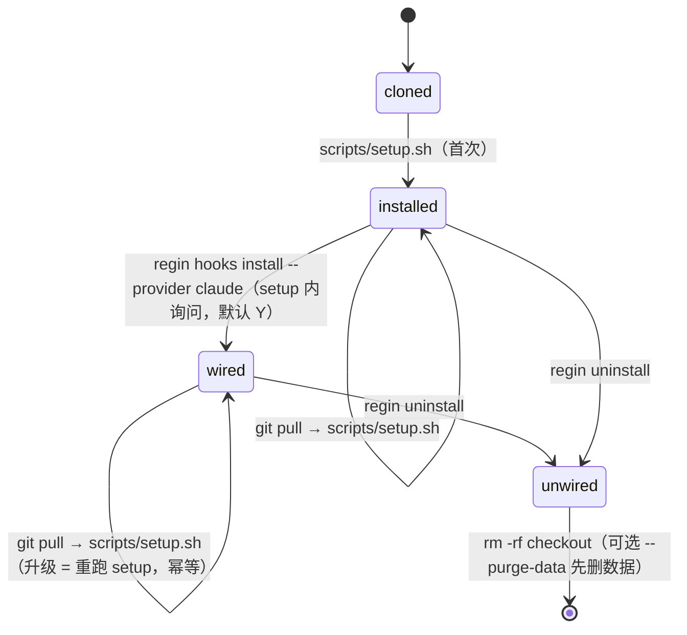
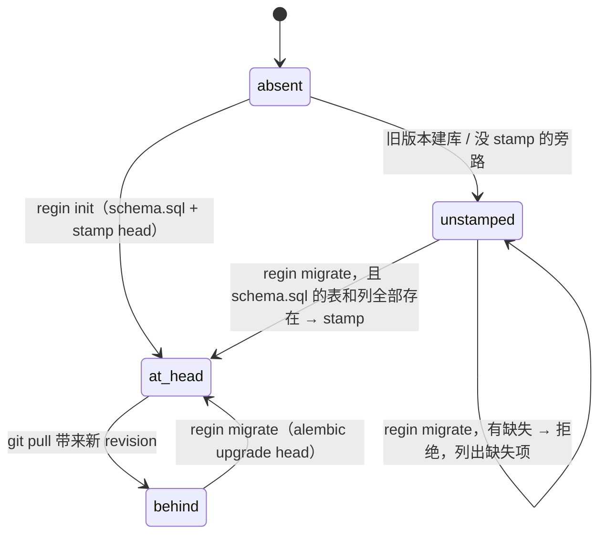

# F156 新用户接入问题排查（一期）

## 意图

新用户 clone regin 后，要经过四条路径：**安装 → 接入 agent → 升级 → 卸载**。这四条路径上都留着只为作者本机历史服务的旧代码和旧逻辑，结果是：

- **重跑安装就丢数据。** `scripts/setup.sh` 无条件执行 `regin init --force`。
- **装完不能用，也不报错。**
  - `pyproject.toml` 写的是 `>=3.10`，但代码用了 3.11 的 `tomllib` 和 `python -P`。
  - MCP server 依赖的 `mcp` 不在基础依赖里。
  - setup 从不执行 `regin hooks install`。
  - 已跟踪的 `config/settings.json` 带着作者本机的 bundle 路径和自动 spawn 开关。
- **升级会把库弄坏。**
  - `regin migrate` 遇到没有 stamp 的库，直接 stamp 到 head。
  - 文档把 `regin rebuild` 写成「从文件重建缓存」，它实际会删掉 sessions、features、tasks 等几乎所有表。
  - 经 alembic 升级出来的表缺 `AUTOINCREMENT`，和全新安装的表不一致。
- **没有卸载。** regin 往仓库外写了十几类东西，只有 hook 条目能删。
  - 部署 skill 时会先 `rmtree` 同名的用户 skill。
  - 有两处 hook 移除逻辑不按 checkout 区分归属，会误删另一个 checkout 的接线：`init --force` 自带的 stripper，以及 Kimi managed block。

一期要把这四条路径收敛成一个可重入的安装入口、一条有文档的升级路径和一个卸载命令，并删掉只服务作者历史数据的兼容代码。

**不做的事**

- 不为 v0.3.0 之前（没有 alembic stamp）的库做追赶迁移。README 已声明 early beta、不留兼容层；这类库由 `migrate` 拒绝，并给出明确指引。
- 不改 Claude Code 插件的分发方式（marketplace、版本化缓存），只去掉插件里写死的作者路径。
- 不做非 editable 的 `pip install .` / pipx 安装支持。git clone + `setup.sh` 是唯一受支持的安装方式。
- 不碰 trace、memory、feature 等业务逻辑，只处理它们在启动和 schema 上的遗留部分。
- 「后续事项」里列出的 P2 问题一期不做。

## 模型

### 生命周期（新用户视角）



DB 的 schema 状态是另一条独立的轴，单独画：



### regin 写到仓库外的东西（卸载清单）

```ts
type Artifact = {
  path: string            // 实际路径来自 settings / provider，下面只是示例
  writer: string          // 写入方
  ours: 'checkout-scoped' | 'recorded' | 'marker' | 'unowned'  // 卸载凭什么认定是自己写的
  removed_by_uninstall: boolean
}
```

| Artifact | 写入方 | 归属依据 | uninstall 是否删除 |
|---|---|---|---|
| agent 设置文件（`~/.claude/settings.json`、`~/.codex/hooks.json`）里的 hook 条目 | `lib/hooks_wiring.py` | 解释器前缀属于本 checkout（`is_ours`） | 是 |
| `~/.kimi-code/config.toml` 里的 managed block | `lib/providers/kimi_hooks.py` | block 内命令属于本 checkout | 是 |
| debug hook 条目 | `lib/hooks_wiring.py` | 同上 | 是 |
| `hook-manager-config.json`（按 provider） | `hook_manager/config.py` | 路径由 provider 决定，内容只属于 regin；不标明 checkout | 是，仅当无共享者（R5） |
| 已部署的 skill 目录 | `lib/skills/skill_deployer.py` | `pattern_deployments.deployed_path` 有记录且目录名等于 skill id；记录在主 checkout 的库里，worktree 共用 | 是，仅当无共享者（R5） |
| `~/.local/bin/regin` 软链 | `scripts/setup.sh` | 链接目标是本 checkout 的 `.venv/bin/regin` | 是 |
| `settings.data_dir` 下的数据（patterns、logs、grit 等） | 多处 | — | 仅 `--purge-data`，且无共享者 |
| `db/*.db`（`main_worktree/db`） | 多处 | — | 仅 `--purge-data`，且无共享者 |
| 仓库内 `.git/hooks/*`（topics） | `lib/topics/scan.py` | 无标记 | 否，只打印清单（见后续事项） |
| 插件、`statusLine.command` | 用户手工安装 | — | 否，只打印手工步骤 |

## 规则

### R1 `scripts/setup.sh` 可重入：首次安装和升级是同一个命令

| 步骤 | 首次 | 重跑（升级） |
|---|---|---|
| Python 版本检查 | 低于 3.11 退出，提示可用 `PYTHON=` 指定解释器 | 同左 |
| Node/npm 检查 | 缺失或低于 vite 要求的版本时退出，并说明原因 | 同左 |
| `pip install -e '.[agent-sdk]'` | 执行 | 执行，补齐新依赖 |
| `npm ci && vite build` | 执行 | 执行，不再以 `node_modules` 是否存在为条件 |
| DB | `regin init`（不带 `--force`） | `init` 发现库已存在就跳过，然后 `regin migrate` |
| `regin rebuild` | 不调用 | 不调用 |
| settings.local.json | 交互式生成 | 已存在就保留（现行为不变） |
| hook 接线 | 询问是否 `regin hooks install --provider claude`，默认 Y | 若已接线则 `regin hooks repair` |
| 首个用户 | 没有用户时创建 | 已有用户则跳过 |

- setup.sh 的任何分支都不得出现 `init --force`。
- 末尾打印的「下一步」必须包含升级方式（`git pull && ./scripts/setup.sh`）和卸载命令。

### R2 `regin migrate` 遇到没有 stamp 的库

| 库的状态 | 动作 | 退出码 |
|---|---|---|
| 已 stamp | `alembic upgrade head` | 0 |
| 未 stamp，且 schema.sql 的每张表、每一列都在 | stamp head | 0 |
| 未 stamp，且有缺失 | 不写库；列出缺失的表/列，提示「备份后 `regin init --force`」 | 非 0 |

### R3 `regin rebuild` 只重建缓存表

- 只 drop / 重建由文件派生的表：`pattern_docs`、`tags`、`doc_tags`，以及同一来源的 FTS / 向量表（`patterns_fts`、`pattern_embeddings`）。
- `repos`、`branches` 同属缓存，但按 `settings.repo_paths` 原地对账（`register_repos`），不 drop：`session_repos`、`topic_audits`、`graph_snapshots`、features/tasks 的 `project_id` 都引用 `repos.id`，drop 会让 id 重排。
- `rebuild` 不再有 `--clean`，也不再 stamp。
- 其他表一律不动，包括 `alembic_version`、`sessions`、`session_spans`、`features`、`agent_tasks`、`defects`、`api_keys`、`users`。
- docstring、CLI help、`docs/setup.md`（CLI 参考和 Troubleshooting）、`ARCHITECTURE.md` 里「DB 是派生缓存」「from git-tracked files」的说法要同步改正。

### R4 移除只动本 checkout 写的东西

所有删除 regin 接线的入口共用 `lib/hooks_wiring.py` 的归属判定，不再各写一套：

| 入口 | 现状 | 改为 |
|---|---|---|
| `regin init --force` | `cli/commands/db.py` 私有的 `_strip_hook_manager_entries`，按 `-m hook_manager` 子串匹配 | 调用 hooks_wiring 的移除函数，私有 stripper 删除 |
| Kimi managed block | `_block_re(label).sub("")` 删掉所有同名 block | 只删命令属于本 checkout 的 block |
| debug hook 卸载（JSON） | 不检查类型；文件不存在时会创建 `{}`；留下空数组 | 和 `_strip_entry` 一样容错；文件不存在就什么都不写；删掉空事件键 |
| `regin uninstall` | 不存在 | 新增，见 R5 |

写 JSON 设置文件一律采用 temp 文件加 `os.replace` 的原子写（沿用 `hook_manager/config.py` 的写法），先 `realpath` 解析软链并保留目标文件权限，否则 dotfiles 管理的软链会被替换成普通文件。

### R5 `regin uninstall`

```
regin uninstall [--dry-run] [--purge-data] [--yes]
```

- 默认先打印将要删除的清单（即模型一节的表中「是」的行），确认后执行；`--dry-run` 只打印；`--yes` 跳过确认。
- 要删除的条目逐项调用对应的移除函数。没有归属依据的条目不删，只打印出来，由用户手工处理。
- `--purge-data` 额外删除 `settings.data_dir` 和 `db/*.db`。
- hook 条目和 `regin` 软链自带 checkout 路径，按路径判定。skill 目录、`hook-manager-config.json` 和 `--purge-data` 的数据不带 checkout 路径，是共享条目：只有在没有共享者时才删除，否则列为保留并写明共享者。

  | 共享者 | 判定 |
  |---|---|
  | 另一个 checkout 仍接着 hook | 任一 provider 中还有 foreign 条目 |
  | 读不懂的 hook 配置 | 文件打不开，或有内容但 JSON / TOML 解析失败——无法证明没有别的 checkout |
  | 主 checkout | `project_root` 不等于 `main_worktree`，即在 worktree 里运行 |
- 删除 skill 目录时一并删掉它的 `pattern_deployments` 记录。软链所在目录由 `--bin-dir`（或 `REGIN_BIN_DIR`）指定，默认 `~/.local/bin`。
- 不删除 checkout 本身。最后打印手工步骤：`/plugin uninstall …`、`statusLine`、`rm -rf <checkout>`。

### R6 skill 部署不覆盖用户的同名目录

| 目标目录 | `pattern_deployments` 有该路径的记录 | 部署/撤销时的动作 |
|---|---|---|
| 不存在 | — | 创建，并写入记录 |
| 存在 | 有 | 覆盖 / 删除（现行为） |
| 存在 | 没有 | 拒绝，报出路径，不 `rmtree` |

内置 skill（`grit-rules`、`python-complexity`）也走同一份记录。

记录在 `skill_deployer` 内部写入，`deployed_path` 记为 skill 目录；已有记录写成 `…/SKILL.md` 形式的也算归属。拒绝时 `skill_sync` 返回 `refused: …`，web 返回 409 并带路径，`regin rules` 打印后退出 1。在记录出现之前由 regin 部署的目录（例如老安装上的 `~/.claude/skills/grit-rules`）同样会被拒绝：恢复方法是用户自己删掉该目录后重新部署，不做自动补记。

### R7 删除或改正的遗留项

| 位置 | 问题 | 动作 |
|---|---|---|
| `regin-plugin/plugins/regin-band/hooks/register.tsx`、`regin-bridge/hooks/register.ts`、`regin-plugin/README.md` | 写死 `/Users/taowang/regin` | 改为经 `$.env.get('REGIN_HOME')` 解析，默认 `$HOME/regin`，与 `regin-mcp.sh` 一致 |
| `hook_manager/settings.example.json`、`hook_manager/migration_preview.py` | 作者一次性迁移遗留下来的样例，裸 `python`，会让用户替换掉自己的 hooks 块 | 删除 |
| `hook_manager/README.md`「Wiring into Claude」一节 | 指向上面两个文件 | 改为指向 `regin hooks install` |
| `config/settings.json`（已跟踪） | 作者本机调优：bundle 路径、`topic_evolution.*` 自动 spawn、`bundle_autoload:false`、`experimental_conceal` 等 | 改为 `{}`（模型默认值）；作者的值深合并进作者自己的 `settings.local.json`；E2E 与 promo 改用自带的 `frontend/e2e-settings.json`；`save_settings` 在 shared/auto 作用域下，凡 local 文件已设置的键整值写入 local（否则写进 shared 会被 local 遮蔽、保存无效），块 PUT 以 shared+local 的有效块为合并基 |
| `pyproject.toml` | `requires-python >=3.10`；`mcp` 不在基础依赖 | 改为 `>=3.11`；`mcp` 加入基础依赖 |
| `lib/auth.py` `_SECRET_PATH` | 写死 `<checkout>/config/`，不认 `REGIN_CONFIG_DIR` | 从 settings 的 config 目录解析 |
| `lib/hooks_wiring.py` 的命令构造 | 解释器和脚本路径没有加引号，路径含空格时所有 hook 都失效 | 加 `shlex.quote`；归属判定同时认加引号的前缀和旧的裸前缀（后者让 install 能改写坏掉的条目）；`checkout_root` 用 `shlex.split` 解析，含空格或撇号的路径都能读回 |
| `regin hooks repair` | checkout 移动后旧条目被判为 foreign，repair 却输出「up to date」 | 存在 foreign 条目时打印 `regin hooks adopt` 提示（注明仅当该 checkout 是搬走的；若是另一个在用的 checkout 则不要 adopt），退出码非 0 |
| `lib/doctor.py` | bundle 路径的 `~` 没展开，导致恒为 ✗；写死 `~/.claude/settings.json`；检查 checkout 自己的 `config/` 和 `db/` 而不是 settings 路径 | 展开 `~`；改走 provider 和 settings 的路径 |
| `regin serve` / `web/app.py` | 前端没构建时直接返回裸 404；库落后 head 时页面 500，却没有任何提示 | 404 页提示执行 `./scripts/setup.sh`；启动时 stamp 不等于 head 就打 warning，提示 `regin migrate` |
| alembic 0011–0040 用 `op.create_table` 建出的整数主键表 | 升级出来的库缺 `AUTOINCREMENT`，删除后 id 会被重用 | 新增一个 revision，用 `sqlite_autoincrement=True` 重建这些表；在 `alembic/README` 里写明这条规则 |
| `alembic/README`、`0001_baseline.py` docstring | 教人「已有库就 `alembic stamp head`」，链说明也已过时 | 重写：init 自带 stamp，升级用 `regin migrate` |
| `lib/mysql_db.py` | 绕过 Settings 直接读 JSON 和 `db_host` 等键；不认 `mysql+pymysql://` | 改读 `settings.database_url`，同时接受两种前缀；删掉 `db_*` 键 |
| `cli/commands/users.py` `users init-db` | 调 `init_db()` 建主库却不 stamp | 只建 auth 引擎上的表：shared 模式在 MySQL 上建；standalone 模式 auth 表属于主库（schema.sql + alembic），不建，只检查存在，缺失则提示 `regin init` / `regin migrate` 并以非 0 退出；setup.sh 的 standalone 分支不再调用它 |
| 启动/运行时的 DDL：`lib/grader/store.py` 建 `session_grades`、`hook_manager/handlers/bridge_registry.py` 建 `bridge_panes`、`lib/topics/wiki_backfill.py` 加列 | 与 alembic 重复，或只为 v0.3.0 之前的库服务 | 删除，表/列以 schema.sql 和 alembic 为准 |
| `lib/memory/engine.py` 中 `topic_negatives → topic_exemplars` 的改名和 6 月的补列 ALTER；`lib/memory/models.py` 的 `TopicNegative` 别名 | 只服务 6 月前的 memory 库 | 删除，测试改用 `TopicExemplar` |
| `lib/hook_plugin.py` 的 `REGIN_RULE_TRACE_URL` 回退、`lib/providers/kimi_hooks.py` 的 `_BEGIN/_END/_BLOCK_RE` 别名、`lib/patterns/pattern_deployments.py` 的 `backfill_null_providers` | 已无调用方，或只服务作者旧环境 | 删除 |
| `scripts/create_distribution_zip.sh` | 打包时会带进本机文件，且不是受支持的安装方式 | 删除 |
| `docs/setup.md` | 没有升级小节；Troubleshooting 让人跑 `rebuild`；CLI 参考过期（`gen_cli_reference.py --check` 退出 1） | 加「升级」「卸载」小节；修正 Troubleshooting；重新生成 CLI 参考 |
| README Quick start | 不提 hook 接线、升级和卸载 | 各补一行 |

保留、不在删除之列（核实后仍在用）：`/api/hooks/<name>/install|uninstall`（`SettingsHookInstallers.vue` 在调用，只需改掉注释里过时的「legacy / debug only」标签）、`retractable_events`、Kimi 的 `strip_entries`、statusline 对旧 token 键的兼容、`lib/features/migrate.py`（被 revision 0027 导入）。

## 不变量

- 对任意已安装状态，重跑 `scripts/setup.sh` 后 `db/regin.db` 中所有非缓存表的行数不变，JWT secret 不变。
- 对任意库，`regin rebuild` 前后，R3 名单之外各表的行数不变，`alembic_version` 不变。
- 全新 `regin init` 的库，与从固定的 0008 时代 schema 经 `regin migrate` 升级上来的库，`sqlite_master` 规范化后相同：表、列、索引、AUTOINCREMENT 都一致。
- 对任意两个 checkout A、B，在 B 中执行 install / remove / repair / `init --force` / uninstall，都不会改变 A 写下的任何 hook 条目或 Kimi block。
- regin 删除的任何目录或条目，都能从模型一节表格的「归属依据」列推出确属自己。
- 已跟踪文件（`lib/`、`cli/`、`web/`、`hook_manager/`、`scripts/`、`regin-plugin/`、`config/settings.json`）中，运行时代码不出现 `/Users/taowang`。注释和测试固定数据不计。

## 验收

```gherkin
Feature: 新用户安装、升级、卸载

  Scenario: Rerunning setup keeps the database
    Given an install with 3 features, 5 sessions and 1 user
    When scripts/setup.sh runs again non-interactively
    Then the feature, session and user counts are unchanged
    And config/jwt_secret.txt is unchanged

  Scenario: Setup refuses python older than 3.11
    Given PYTHON points at a 3.10 interpreter
    When scripts/setup.sh runs
    Then it exits non-zero before creating .venv
    And the message names 3.11

  Scenario: Base install provides mcp
    Given a venv built with pip install -e .
    When lib/memory/mcp_server.py is imported
    Then no ModuleNotFoundError is raised

  Scenario: Migrate refuses an unstamped incomplete database
    Given a database without alembic_version that lacks the features table
    When regin migrate runs
    Then it exits non-zero
    And the output names the features table
    And alembic_version still does not exist

  Scenario: Migrate stamps an unstamped complete database
    Given a database built from db/schema.sql with alembic_version dropped
    When regin migrate runs
    Then alembic_version is at head

  Scenario: Rebuild keeps non-cache tables
    Given a database with rows in sessions, features, agent_tasks and api_keys
    When regin rebuild runs
    Then those row counts are unchanged
    And alembic_version is unchanged

  Scenario: Upgraded schema matches fresh schema
    Given a database built from the frozen 0008-era schema fixture and stamped 0008
    When regin migrate runs
    Then its normalized sqlite_master equals that of a fresh regin init including AUTOINCREMENT

  Scenario: Init force spares another checkout's hooks
    Given settings.json holds hook_manager entries from checkout A and checkout B
    When regin init --force runs in checkout B
    Then every entry from checkout A remains

  Scenario: Kimi install spares another checkout's block
    Given config.toml holds a regin managed block written by checkout A
    When regin hooks install --provider kimi runs in checkout B
    Then checkout A's block remains byte for byte

  Scenario: Hook commands survive a path with spaces
    Given project_root is "/tmp/Jane Doe/regin"
    When the hook_manager command for PreToolUse is built
    Then shlex.split yields the interpreter path as a single token
    And is_ours recognizes the command

  Scenario: Repair points at adopt after a checkout move
    Given settings.json holds hook entries whose interpreter is another checkout's path
    And no entries from this checkout
    When regin hooks repair runs
    Then it exits non-zero
    And the output contains "regin hooks adopt"

  Scenario: Uninstall dry run lists only owned artifacts
    Given hooks are installed, 2 skills are deployed and recorded, and 1 unrecorded user skill exists
    When regin uninstall --dry-run runs
    Then the listing names the hook entries, the 2 recorded skill dirs and the regin symlink
    And it does not name the unrecorded user skill
    And no file is changed

  Scenario: Uninstall removes owned artifacts and keeps data
    Given the same state
    When regin uninstall --yes runs
    Then regin hooks status reports nothing installed for every provider
    And the 2 recorded skill dirs are gone and the user skill remains
    And db/regin.db still exists

  Scenario: Uninstall keeps shared artifacts while another checkout is wired
    Given the same state plus a hook entry written by checkout A
    When regin uninstall --yes --purge-data runs in checkout B
    Then checkout A's entry, the recorded skill dirs, the hook-manager configs and the data remain

  Scenario: Skill deploy refuses an unrecorded directory
    Given ~/.claude/skills/tdd exists and has no pattern_deployments record
    When a pattern with id tdd is deployed
    Then the deploy is refused naming that path
    And the directory content is unchanged

  Scenario: Doctor expands home in bundle paths
    Given a bundle engine with bundle_root "~/x" and that directory exists
    When regin doctor runs
    Then the bundle_root item is present

  Scenario: Jwt secret follows the config dir
    Given REGIN_CONFIG_DIR points at a temp dir
    When regin init --force runs
    Then <checkout>/config/jwt_secret.txt is untouched

  Scenario: Shipped plugins carry no author path
    When the tracked runtime files are searched for "/Users/taowang"
    Then there are no matches outside comments and test fixtures

  Scenario: Cli reference is current
    When scripts/gen_cli_reference.py --check runs
    Then it exits 0
```

## 切片

**Base: `f156/integration`**

| # | Slice | Delivers | Spec refs | Tests | Schema | Depends on | Base | Skill |
|---|---|---|---|---|---|---|---|---|
| S1 | hook 归属统一 | `lib/hooks_wiring.py` 提供按 checkout 归属的移除函数，供所有入口共用。`cli/commands/db.py` 删掉私有的 `_strip_hook_manager_entries`，`init --force` 改为调用它。`lib/providers/kimi_hooks.py` 只删命令属于本 checkout 的 managed block，并删掉 `_BEGIN/_END/_BLOCK_RE` 别名。debug hook 的 JSON 移除容错：文件不存在就不写，删除空事件键。JSON 设置一律用 temp 文件加 `os.replace` 原子写。命令构造加 `shlex.quote`，归属判定和 `checkout_root` 能识别加引号的形式。`regin hooks repair` 发现 foreign 条目时提示 `regin hooks adopt` 并以非 0 退出。测试放在 `tests/hooks/` | R4, R7 hooks_wiring 命令构造, R7 hooks repair, 不变量 4 | test_init_force_spares_another_checkout_s_hooks, test_kimi_install_spares_another_checkout_s_block, test_hook_commands_survive_a_path_with_spaces, test_repair_points_at_adopt_after_a_checkout_move | — | — | `f156/integration` | goal-verified-treenav |
| S2 | migrate / rebuild / AUTOINCREMENT | `regin migrate` 按 R2 表处理没有 stamp 的库：schema.sql 的表和列全在就 stamp，有缺失就拒绝并列出缺失项。`regin rebuild` 只 drop / 重建 R3 名单里的缓存表及同源 FTS / 向量表，同时改正 docstring 和 CLI help。新增 alembic revision 0041，用 `sqlite_autoincrement=True` 重建 0011–0040 用 `op.create_table` 建出的整数主键表；`db/schema.sql` 和 `lib/orm/models/` 与之对齐。新增冻结的 0008 时代 schema 测试数据。重写 `alembic/README` 和 `0001_baseline.py` 的 docstring：init 自带 stamp，升级用 `regin migrate`，新表要带 AUTOINCREMENT | R2, R3, R7 alembic AUTOINCREMENT, R7 alembic README, 不变量 2, 不变量 3 | test_migrate_refuses_an_unstamped_incomplete_database, test_migrate_stamps_an_unstamped_complete_database, test_rebuild_keeps_non_cache_tables, test_upgraded_schema_matches_fresh_schema | yes | — | `f156/integration` | goal-verified-treenav |
| S3 | 删除启动期 DDL 与旧库兼容代码 | 删除 `lib/grader/store.py` 建 `session_grades`、`hook_manager/handlers/bridge_registry.py` 建 `bridge_panes`、`lib/topics/wiki_backfill.py` 补列的运行时 DDL，表和列以基线与迁移链为准（若链上缺失，回报给 S2 的 owner，不在本片补）。删除 `lib/memory/engine.py` 中 `topic_negatives → topic_exemplars` 的改名和 6 月的补列 ALTER，以及 `lib/memory/models.py` 的 `TopicNegative` 别名，测试改用 `TopicExemplar`。`lib/mysql_db.py` 改读 `settings.database_url`，接受 `mysql://` 和 `mysql+pymysql://`，删掉 `db_*` 键。`cli/commands/users.py` 的 `users init-db` 只建 auth 引擎上的表。删除 `lib/hook_plugin.py` 的 `REGIN_RULE_TRACE_URL` 回退和 `lib/patterns/pattern_deployments.py` 的 `backfill_null_providers` | R7 启动期 DDL, R7 memory engine, R7 mysql_db, R7 users init-db, R7 死代码 | test_upgraded_schema_matches_fresh_schema | — | S2 | `f156/integration` | goal-verified-treenav |
| S4 | skill 部署不覆盖用户目录 | `lib/skills/skill_deployer.py` 部署和撤销前先查 `pattern_deployments.deployed_path`：目标目录存在但没有记录就拒绝并报出路径，不 `rmtree`。内置 skill（`grit-rules`、`python-complexity`）也写入同一份记录。测试放在 `tests/skills/` | R6, 不变量 5 | test_skill_deploy_refuses_an_unrecorded_directory | — | — | `f156/integration` | goal-verified-treenav |
| S5 | regin uninstall | 新增 `regin uninstall [--dry-run] [--purge-data] [--yes]`。清单就是模型一节表中「是」的行；逐项调用 S1 的 hook 移除函数、按 S4 的记录删 skill 目录、删除 `hook-manager-config.json`，以及指向本 checkout `.venv/bin/regin` 的 `~/.local/bin/regin` 软链。没有归属依据的条目只打印。`--purge-data` 额外删 `settings.data_dir` 和 `db/*.db`。最后打印手工步骤：插件、statusLine、`rm -rf <checkout>` | R5, 模型 卸载清单, 不变量 4, 不变量 5 | test_uninstall_dry_run_lists_only_owned_artifacts, test_uninstall_removes_owned_artifacts_and_keeps_data | — | S1, S4 | `f156/integration` | goal-verified-treenav |
| S6 | setup.sh 可重入 + 依赖下限 | 按 R1 表重写 `scripts/setup.sh`：Python 低于 3.11 或 Node/npm 不满足就退出并说明原因；每次都执行 `pip install -e` 和 `npm ci && vite build`；DB 改为 `regin init`（不带 `--force`）加 `regin migrate`；不调用 `rebuild`；询问是否 `regin hooks install --provider claude`（默认 Y），已接线则 `regin hooks repair`；已有用户就不再创建；standalone 分支不再调用 `users init-db`。末尾打印升级和卸载命令。`pyproject.toml` 改为 `requires-python >=3.11`，`mcp` 加入基础依赖。测试用临时 checkout 非交互地跑 setup.sh | R1, R7 pyproject, R7 users init-db, 不变量 1 | test_rerunning_setup_keeps_the_database, test_setup_refuses_python_older_than_3_11, test_base_install_provides_mcp | — | — | `f156/integration` | goal-verified-treenav |
| S7 | 去作者痕迹与运行时提示 | 插件 `register.tsx` / `register.ts` / `regin-plugin/README.md` 改用 `$REGIN_HOME`（默认 `~/regin`）。删除 `hook_manager/settings.example.json`、`hook_manager/migration_preview.py` 和 `scripts/create_distribution_zip.sh`；`hook_manager/README.md` 的接线一节改为指向 `regin hooks install`。`config/settings.json` 精简为中性默认，作者的值移到主 checkout 不入库的 `config/settings.local.json`。`lib/auth.py` 的 secret 路径改从 settings 的 config 目录解析。`lib/doctor.py` 展开 `~`，改走 provider 和 settings 的路径。前端没构建时 404 页提示执行 `./scripts/setup.sh`；启动时库落后 head 就打 warning，提示 `regin migrate`。`/api/hooks` 安装路由的注释去掉「legacy / debug only」 | R7 插件路径, R7 样例文件, R7 config/settings.json, R7 auth, R7 doctor, R7 serve, 不变量 6 | test_doctor_expands_home_in_bundle_paths, test_jwt_secret_follows_the_config_dir, test_shipped_plugins_carry_no_author_path | — | — | `f156/integration` | goal-verified-treenav |
| S8 | 文档：安装、升级、卸载 | `docs/setup.md` 新增「升级」「卸载」小节，Troubleshooting 不再让人跑 `rebuild`。`docs/setup.md`、`ARCHITECTURE.md` 中「DB 是派生缓存」「from git-tracked files」的说法按 R3 改正。README Quick start 补上 hook 接线、升级和卸载各一行。用 `scripts/gen_cli_reference.py` 重新生成 CLI 参考（含 `uninstall`） | R3 文档, R7 docs/setup.md, R7 README | test_cli_reference_is_current | — | S3, S5, S6, S7 | `f156/integration` | goal-verified-treenav |
| S9 | 收尾：integrate + migrate + verify | 确认 S1–S8 都已合回 `f156/integration`，没有零 commit 的片。在 DB 副本上跑 `.venv/bin/python cli/regin.py migrate` 和 `doctor`，确认这个安装没落后。全量跑 `.venv/bin/python -m pytest -q -n auto --dist=loadfile`。在临时目录里 clone `f156/integration`，按新用户路径走一遍 `scripts/setup.sh` → 重跑 → `regin uninstall --dry-run`，通过 send_to_user 汇报输出 | 验收, 不变量 1, 不变量 6 | test_every_slice_merged_back, test_migrate_leaves_no_schema_finding, test_full_suite_passes | — | S8 | `f156/integration` | run |

## 后续事项（P2，一期不做）

- topics 安装的 git hooks（`lib/topics/scan.py`）：会覆盖用户已有的 hook，不认 `core.hooksPath`，在 worktree 中失败，也没有卸载。
- debug hook 与 `trace_payload` 往同一个 `hook-payloads.jsonl` 写两份，且不轮转。
- `agent_memory.inject_server_url`、`agent_messages.base_url`、`scripts/regin-statusline` 写死端口 8321，不跟随 `web_port`。
- doctor 只在 `experimental_providers` 打开时才检查 torch/transformers，但 dense memory 默认开启。
- ORM 元数据与 schema.sql 的索引命名（`idx_*` / `ix_*`）不一致，`--autogenerate` 不可用。
- `/settings` UI 把 local 文件未设置的非 local 键写进已跟踪的 `config/settings.json`，是作者调优会再次漏进仓库的机制。
- 插件 `plugin.json` 版本不随内容递增，安装缓存会一直停在旧快照。
- 不附带起始的 `tags.yaml`；`settings.example.json` 里的 `GRIT_BIN` 应为 `HOOK_MANAGER_GRIT_BIN`。


