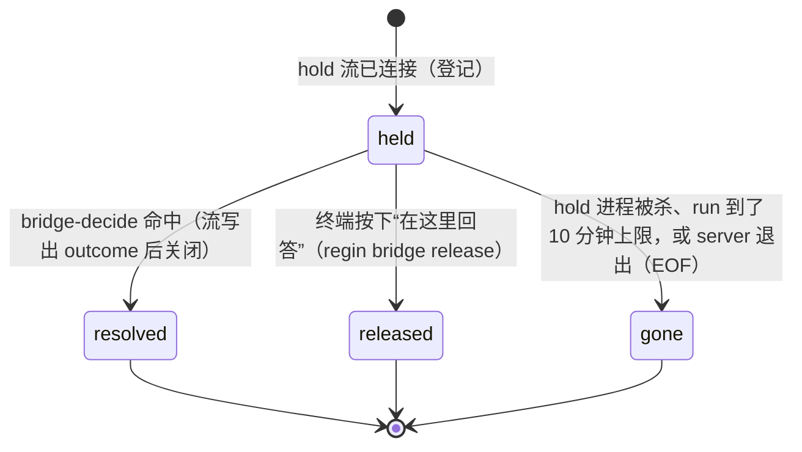

# F158 Claude Code Mod 调研（二期）

## Intent
[F134](feature:134) 一期已经上线（S1–S12 都在 master 上）：bridge 走 Mod 通道、“立即发送”、署名守卫、收件箱 Pane。二期要解决剩下的一个硬伤：**网页上回答权限请求，仍然靠往 tmux 里敲键**。`lib/agent_bridge/answer_delivery.py` 里是 Down×i、Enter 的组合，还得重读屏幕来猜对话框，屏幕一变就会失败。二期把权限请求改成在 Mod 的 `tool.check` 钩子里**挂起**，等 regin 给出结构化的 allow/deny。AskUserQuestion 不在其中：P0 探针 Q2 证实，在真实会话里 mod 改写 `answers` 或返回 allow 都跳不过对话框，所以它留在 tmux 路径。另外顺手做两件 Mod 才能做到的事：限流越线时主动告警（`session.measure`）、压缩时保住 feature/task 上下文（`session.compact`）。一期标为“后续”的其余各行，在本 spec 里逐行给出结论。

## Non-goals
- 不改 SDK tier（`agent_sdk.is_sdk_owned` 为真的会话）：它已经有类型化通道。
- 不删 tmux 应答路径：没装 Mod 或 Mod 没挂起请求的会话，行为逐字节不变（J3）。
- 不挂起 AskUserQuestion（P0 Q2）：`bridge-answer` 本轮完全不动，仍走 tmux。
- 不做“始终允许 / don't ask again”：Mod 挂起的权限请求只回答 allow/deny 一次，不写 settings 规则。
- 不做没有 `resetsAt` 的限流窗口的告警（例如 gateway 的 `spend_limit`）：没有它就没法按窗口去重（J6）。
- 不替换 turn_trace 的 usage 回填（见“一期遗留各行的结论”）。
- 不处理 F134 的遗留缺陷 #241，它属于 F134。

## Mod 能力补充（CC 2.1.290–2.1.295 changelog）
| 变化 | 对本 feature 的影响 |
|---|---|
| `$.ui.notify`：按用户自己的通知设置发系统通知 | 请求被挂起时用它提醒终端前的人。tmux 里没有通知通道时返回 `{isSent:false, reason:'no-channel'}`（P0 实测），不影响挂起 |
| `Button` 可以带 children（字符串、`Text`） | 挂起横条的“在这里回答”按钮 |
| 修复：`prompt.submit` 改写或丢弃的 prompt，仍按原样写进历史和 queued-prompt 记录 | 一期的“mod 接管队列”方案少了一个障碍（仍是后续） |
| 修复：钩子拿到的深层嵌套 tool input 被静默截断 | tool.call / tool.check 读 `input` 时可信 |
| 类型文件只生成在正在开发的 mod 目录里 | 建造时用 `--plugin-dir` 加载一次 mod，引擎把 `types/` 写进 `<mod>/.claude-plugin/types/`（P0 debug 日志：`type root of f158-probe at …/.claude-plugin/types: … wrote …`）；`~/.claude/dev-mods/…/types` 是 2.1.289 时的旧文件 |

## Model

```ts
// mod 与 regin 之间的唯一接口：regin CLI 子进程（J1）
// `regin bridge hold --session <sid> --tool-use-id <id>`，请求体从 stdin 读入
type HoldRequest = { tool: string; input: unknown; reason?: string }

// hold 只在 stdout 打印一行结果然后退出；退出码区分结果
type HoldOutcome = { op: 'decide'; behavior: 'allow' | 'deny'; reason?: string }
// exit 0 = 已得到结果；exit 3 = 被 release（终端接手）；其它非零 = 连不上或流断了 → mod 退回原生对话框

// `regin usage measure --session <sid>`，从 stdin 读入 session.measure 的 e
type Measure = { rateLimits: { kind: string; percentUsed: number; resetsAt?: string }[];
                 changed: ('context' | 'rateLimits' | 'cost')[] }

// `regin session context --session <sid>`：有内容就打印要保留的文本，没有就什么都不打印
```

服务端：`GET /api/bridge/hold?session_id&tool_use_id`（bridge token，NDJSON）。只要这条流还开着，`(session_id, tool_use_id)` 就登记为一个挂起的权限请求。断流的发现方式沿用 `mod_channel` 的做法：select 等 EOF，不用心跳。
`live-state` 新增 `mod_held: { tool_use_id }[]`。
`$.process.run` 的 `timeoutMs` 上限是 10 分钟（类型文档 `ProcessRunInit.timeoutMs`）。mod 调 hold 时传 `timeoutMs: 600_000`；到点 run 会 reject，按“其它非零”处理，退回原生对话框。这是平台的上限，regin 自己不设超时。

### 挂起请求的生命周期

离开 `held` 的那一刻就注销，同一时刻只可能有一种结局（J4）。

### mod 侧钩子
| 钩子 | 条件 | 动作 |
|---|---|---|
| `tool.check`（新 mod regin-permit） | `r = await next(e)`，`r.decision !== 'ask'` 或没有 `e.tool_use_id`（只是查询） | 返回 `r` |
| 同上 | `e.tool` 是必须由人回答的工具（`AskUserQuestion`、`ExitPlanMode`） | 返回 `r`，不挂起：引擎会忽略插件对它们的 allow（P0 Q2） |
| 同上 | 其余 `r.decision === 'ask'` | 显示挂起横条，调 `$.ui.notify`，`await $.process.run(hold …)`，按“hold 结果 → mod 怎么返回”表返回 |
| `session.measure`（新 mod regin-meter） | `changed` 不含 `rateLimits` | `next(e)`，不起进程 |
| 同上 | 含 `rateLimits` | `$.process.run(usage measure)`，然后 `next(e)` |
| `session.compact`（新 mod regin-compact） | `e.agentId` 有值（子 agent 或 fork） | `next(e)` |
| 同上 | 主会话 | `session context` 有输出就 `next({...e, instructions: join(e.instructions, ctx)})`，否则 `next(e)` |

## Rules

### hold 结果 → mod 怎么返回
| hold 结果 | mod 返回 |
|---|---|
| exit 0，`decide allow` | `{decision: 'allow', reason}` |
| exit 0，`decide deny` | `{decision: 'deny', reason}`（reason 是模型读到的错误） |
| exit 3，其它非零，或 run reject | 返回 `r`（core 的 `ask`），之后 classic `PermissionRequest` 触发，原生对话框弹出 |

### 网页上的应答走哪条路
| 会话 | 有匹配的挂起请求？ | `bridge-decide` |
|---|---|---|
| SDK-owned | — | SDK 路径，不变 |
| 其它 | 有：`tool_use_id` 相等；没给 `tool_use_id` 时，该会话恰好只有一个 | 写到挂起流里，审计 `channel=mod`，不碰 tmux |
| 其它 | 没给 `tool_use_id`，且该会话有 ≥2 个挂起请求 | 409 `ambiguous held request`，不碰 tmux |
| 其它 | 没有 | 原来的 tmux 路径，逐字节不变（J3） |

`bridge-answer` 不参与路由，始终走原来的路径。
permission 的载荷：挂起时接受 `{behavior, reason}`（和 SDK 路径同一个解析器 `_parse_decision`）。前端：hold 写的那行 PENDING `pending-<tool_use_id>` 工具行带 `mod_held`，/live 把它当权限卡片（`liveRows.isHeldToolSpan`）；`LiveQaDecision` 打开时查一次 `live-state.mod_held`，命中就只显示 Allow / Deny，不显示 tmux 选项列表；没命中（已 release 或断流）就退回 tmux 分支，没有 pane 时提示到终端回答。

### 卡片从哪来
挂起期间，网页上必须有一张对应 `tool_use_id` 的待答卡片。P0 Q3 实测，classic `PermissionRequest` **晚于** mod 的 `tool.check` 触发，而且只在 `tool.check` 的最终结论是 `ask` 时才触发：挂起后由网页 allow/deny 的请求，根本没有 `PermissionRequest`。所以卡片由 hold 登记时写：一条 PENDING span，id 为 `tool_pending_id(tool_use_id)`，并带上 `gate_key(tool, input)`（都在 `lib/trace/pending_spans.py`）。classic `PermissionRequest` 的负载里**没有** `tool_use_id`（P0 日志里四条 `classic.PermissionRequest` 都没有这个字段，而 `PreToolUse` 有；另见 `payload_schemas/claude/_hooks/PermissionRequest.schema.json`）。所以被 release 或断流之后才到的 `PermissionRequest`，照现有做法按 `gate_key` 去配仍未结束的 PENDING 行，配上了就并进同一张卡；候选多于一个时不配。HoldRequest 的 `input` 必须原样取 tool.check 的 `e.input`，和 `PreToolUse` 的 `tool_input` 算出来的 `gate_key` 要一致。探针没有比对过这一点，S2 要用测试钉住。

### 限流告警
| 条件 | 动作 |
|---|---|
| 某个窗口 `percentUsed ≥ t`，t ∈ `settings.agent_messages.rate_limit_alert_at`（默认 `[80, 95]`），且 `resetsAt` 有值，`(kind, resetsAt, t)` 之前没告警过 | 发一条 agent message：`type=warning`，标题 `"<kind> at <p>% · resets <resetsAt>"`，按已有的 push 通道门限分发 |
| 已告警过（任何会话发的都算） | 什么都不做 |
| 没有 `resetsAt` | 什么都不做（见 Non-goals） |
| 同一次测量越过多个阈值 | 只为其中最高的那个发一条，较低的阈值同时记为已告警 |

去重靠持久化的 `(kind, resetsAt, threshold)` 标识，不用时间窗：表 `rate_limit_alerts` 的 UNIQUE 约束，插入成功即占到这个阈值（`lib/agent_messages/rate_limits.py`）。越过的阈值都要占；只有本次新占到了最高的那个，才发消息（最高的已被别的会话占了就不发）。新增设置项出现在 SettingsView 的 Agent Messages 块（“Rate-limit alerts” 组，list 字段声明 `"item": "int"`，保存为整数）。

### 压缩保留的上下文
`regin session context` 输出的内容：该会话主 feature 的 id 和标题（`lib/features/attribution.features_for_session`）；如果会话是某个 task run，再加上 task id、标题，以及这次 run 的 finish 命令原文（与 `lib/prompts/surfaces/tasks.py` 渲染的 `<finish>` 同源）。finish 命令由 `lib/tasks/run_prompt._finish_command` 生成，它也是 `<finish>` 的 `{{finish_cmd}}`。task run 按会话 id 找：`agent_task_runs.trace_id` 记的是 regin 的 run trace（SDK 启动的是 `sdk-…`），所以 Claude Code 的会话 id 先经 `agent_run_sessions`（`sdk_trace_for_cli_session`）映射回去。主 feature 取 `is_primary` 的声明；没有声明时取 task 的 feature。整段以“Keep verbatim in the summary:”开头。两样都没有时输出为空。

## 不变式
- J1 mod 调 regin 只走 `regin` CLI（`$.process.run` / `$.process.spawn`），mod 配置里不放 URL 或 JWT。
- J2 挂起请求是否存在，完全等于它那条 hold 流的生命周期：regin 不用心跳、超时或轮询。server 不可达或流断开时，mod 一律退回原生对话框。
- J3 没有匹配挂起请求的会话，`bridge-decide` 与本轮之前逐字节一致（tmux 路径、守卫、审计）；`bridge-answer` 对所有会话都与本轮之前逐字节一致。
- J4 一个挂起请求最多被结束一次，而且只有 `(session_id, tool_use_id)` 都对上的应答才能结束它。
- J5 终端前的人随时可以把请求拿回来：按下 release，请求结束为 released，原生对话框弹出。
- J6 每个 `(kind, resetsAt, threshold)` 在所有会话里最多告警一次。
- J7 子 agent 的压缩不动；没有上下文时，`instructions` 逐字节不变。
- J8（沿用 F134 I1）每个 `regin-plugin/plugins/*` 目录在 `marketplace.json` 里恰有一条，反之亦然。

## P0 探针（已完成，结论如下）
环境：CC **2.1.295**（transcript 每行 `"version":"2.1.295"`，debug 日志 `cc_version=2.1.295.222`；探针中途 npm 在磁盘上自动更新到了 2.1.296，但所有探针都跑在 2.1.295 进程里）。标了“屏幕”的引文是 tmux `capture-pane` 的读数，没有存档；其余引文都出自 `/tmp/f158/probe/events.log`、`debug.log` 或 transcript。tmux 会话里的交互式 claude，cwd `/tmp/f158/probe/work`：
`claude --plugin-dir /tmp/f158/probe/f158-probe --settings /tmp/f158/probe/settings.json --debug-file /tmp/f158/probe/debug.log --model sonnet`。
探针 mod `f158-probe` 放在 `/tmp` 下：`tool.call` 与 `tool.check` 各打一行带时间戳的日志，按 `/tmp/f158/probe/mode` 决定挂起、注入 `answers`、`{deny}` 还是 allow。挂起用 `$.process.run(python3 hold.py N)`，到时 exit 0；见到 release 文件时 exit 3。AbovePrompt 横条上有一个 `hotkey="r"` 按钮，按下后 `$.process.run(touch release)`。`--settings` 再加三个 classic 钩子 `PreToolUse` / `PermissionRequest` / `PostToolUse`，写进同一个日志。
干扰项：探针期间有一个外部调用者（`user=None`）三次 `POST /api/sessions/9bff55bc…/bridge-answer {option_index:0}`，通过 tmux 选中了对话框第 1 项（regin 日志 `bridge_answer_outcome … selected option 1 in %11`，时间 16:48:15、16:50:24、16:51:06）。它命中的是 Q1 和两次 answer-all 加 tool.check allow 的复跑。另外，探针的 answer-all 注入的是第 1 个选项，正好是对话框光标的默认位置，也是 `option_index:0` 会选中的那一项；所以凡是最后落在第 1 项的 answer-all 运行，都分不清结果来自注入还是来自一次 Enter（包括人工按 Enter 作答的那次 `Pick a pet?` → `Cat`）。Q2 的定论只依据两次答案与注入值不同的运行：Q2a（注入 Apple，人工选 Pear）和 Q2b（注入 Iron，人工答 Gold / Opal）。

| # | 问题 | 结论 | 证据 | 对本 spec 的影响 |
|---|---|---|---|---|
| Q1 | 钩子在 `await $.process.run` 上挂起超过 10s，会不会触发钩子预算 | **成立：不会触发** | tool.call 挂起 15s：`hold-done … "ms":15096,"budgetLeft":9999`，debug `f158-probe@inline tool.call settled in 33983.8ms`，之后对话框照常弹出。tool.check 挂起 12s 后 allow：debug `tool.check settled in 12245.0ms`、`ask -> allow by plugin f158-probe: probe held then allowed`，Bash 执行，文件 `perm-b` 已建出。全程没有 skip 或 budget 日志。挂起最长只测到 15s，没有超过 `$.process.run` 默认的 30s 超时；超过 30s 时必须传 `timeoutMs`，这一条依据类型文档，没有实测。不触发预算的原因与类型文档一致：`HookBudget` 只计钩子自己的时间，`$` 调用期间时钟停走 | 挂起方案可行。`$.process.run` 另有 10 分钟上限，已写进 Model |
| Q2 | 真实的 AskUserQuestion，input 带 `answers` 时会不会跳过对话框；只答部分问题时，其余的会不会弹框 | **不成立** | 全答：tool.call 里 `next({...e, answers:{"Pick a fruit?":"Apple"}})`，对话框照样弹出（屏幕：`☐ Fruit / Pick a fruit? / ❯ 1. Apple … Enter to select`）；人工选 Pear 之后，结果是 `"answers":{"Pick a fruit?":"Pear"}`，注入的答案被丢掉。部分答：注入 `{"Pick a metal?":"Iron"}`，对话框是 `☐ Metal  ☐ Gem  ✔ Submit`（屏幕），两题都没有预填；人工答完，结果 `{"Pick a metal?":"Gold","Pick a gem?":"Opal"}`。再在 tool.check 返回 allow：debug `tool.check AskUserQuestion …: the tool requires the person, so the plugins' allow is ignored; continuing with the engine's own decision (ask)` | ask 留在 tmux 路径，只做 permission；regin-permit 不挂起 AskUserQuestion / ExitPlanMode。已写进 F134 映射表第 3 行 |
| Q3 | classic `PreToolUse` 与 `tool.call`、`PermissionRequest` 与 `tool.check` 的先后 | **mod 钩子先于 classic 钩子** | AskUserQuestion 的顺序：`mod.tool.call:enter` → （在 `next` 里）`classic.PreToolUse` → `mod.tool.check`（core 返回 `ask`，reason `Answer questions?`）→ `classic.PermissionRequest` → 对话框。Bash 的顺序：`mod.tool.call` → `classic.PreToolUse` → `mod.tool.check` → 只有最终结论是 ask 时才有 `classic.PermissionRequest`。挂起后 allow 的那次没有 `PermissionRequest`；release 的那次，hold 结束 53ms 后 `PermissionRequest` 才到（`1791809633.278 hold-done` → `.331 classic.PermissionRequest`） | “卡片从哪来”只保留“晚于”分支：卡片由 hold 写 |
| Q4 | 对 AskUserQuestion，tool.call 返回 `{deny}` 时模型读到的是什么 | **成立** | `Pick a planet?` 那次（`toolu_01B95HNk55xPAipCoxvhfmh7`）的 transcript：`{"type":"tool_result","content":"<tool_use_error>The user chose to discuss instead of answering: let's talk PROBE4</tool_use_error>","is_error":true}`；屏幕上是 `⎿ Error: The user chose to discuss …` | 因为 Q2 不成立，ask 不挂起，这条结论本轮用不上。留作日后 ask 方案的依据 |
| Q5 | 钩子挂起时，同一 mod 的按钮 handler 能否 `$.process.run(release)` | **成立** | tool.check 挂起 Bash 权限期间，`C-x Tab` 把焦点移到横条，按 `r`：`mod.button:pressed` → `mod.button:touched {"exitCode":0}` → `hold-done {"exitCode":3,"stdout":"released after 13.5s"}` → 返回 `r` → `classic.PermissionRequest` → 原生对话框（屏幕：`Bash command … Do you want to proceed?`） | J5 照原样保留，横条带“在这里回答”按钮 |

## Acceptance

```gherkin
Scenario: held permission is allowed from the web over the mod channel
  Given session A 的 regin-permit 已为 tool_use_id T 挂起一个 Bash 权限请求
  When POST /api/sessions/A/bridge-decide {tool_use_id: "T", behavior: "allow"}
  Then hold 进程输出 {"op":"decide","behavior":"allow"} 并以 exit 0 退出，审计 channel=mod，没有发生 tmux send-keys

Scenario: permission ask is held and allowed from the web
  Given regin-permit 的 tool.check 里 next(e) 返回 {decision: "ask"}，tool_use_id 为 T
  When hold 输出 decide allow，exit 0
  Then regin-permit 返回 {decision: "allow"}

Scenario: permission deny carries the reason to the model
  When POST bridge-decide {tool_use_id: "T", behavior: "deny", reason: "not on main"}
  Then regin-permit 返回 {decision: "deny", reason: "not on main"}

Scenario: settled permissions are not held
  Given next(e) 返回 allow 或 deny，或者 e 没有 tool_use_id
  Then regin-permit 原样返回 r，不起 hold 进程

Scenario: person-required tools are not held
  Given e.tool 是 AskUserQuestion 或 ExitPlanMode，next(e) 返回 {decision: "ask"}
  Then regin-permit 原样返回 r，不起 hold 进程

Scenario: released permission falls back to the native dialog
  Given T 处于挂起状态
  When 终端按下“在这里回答”
  Then 运行 regin bridge release，hold 以 exit 3 退出，regin-permit 返回 r，live-state.mod_held 里不再有 T

Scenario: unreachable regin falls back to the native dialog
  Given regin server 没在运行
  When 模型调用一个需要批准的工具
  Then hold 以非零、非 3 的码退出，regin-permit 返回 r

Scenario: held stream ends when the hold process dies
  Given T 处于挂起状态
  When hold 进程被杀
  Then live-state.mod_held 里不再有 T，之后对 A 的 bridge-decide 走 tmux 路径

Scenario: decisions without a held request keep the tmux path
  Given session A 没有挂起请求
  When POST bridge-decide {behavior: "allow"}
  Then 走原来的 tmux 路径，响应与本轮之前一致

Scenario: bridge-answer never uses the mod channel
  Given session A 挂起了 T
  When POST bridge-answer {option_index: 0}
  Then 调用 delivery.deliver_answer，T 仍处于挂起状态

Scenario: a decision only reaches its own held request
  Given A 挂起 T1，B 挂起 T2
  When POST /api/sessions/A/bridge-decide {tool_use_id: "T2", behavior: "allow"}
  Then T1 和 T2 都没有被结束，也没有写进任何挂起流；请求走 J3 的 tmux 路径

Scenario: two held permissions without a tool_use_id are refused
  Given A 挂起了 T1 和 T2
  When POST bridge-decide {behavior: "allow"}（不带 tool_use_id）
  Then 返回 409，不碰 tmux

Scenario: a held request resolves at most once
  Given T 已经被 bridge-decide 结束
  When 再次 POST bridge-decide {tool_use_id: "T", behavior: "allow"}
  Then T 不会被第二次写入；请求走 J3 路径

Scenario: live state lists held requests
  Given A 挂起了 T
  When GET /api/sessions/A/live-state
  Then mod_held == [{tool_use_id: "T"}]

Scenario: held permission card offers allow and deny
  Given live-state.mod_held 里有该卡片的 tool_use_id
  Then 卡片显示 Allow / Deny 按钮，点击后 POST bridge-decide {tool_use_id, behavior}；不显示 tmux 选项列表

Scenario: a held request has exactly one pending card
  Given T 被挂起，hold 登记时写了 PENDING span；随后 T 被 release，classic PermissionRequest 也为 T 写了 span
  Then trace 里 T 只有一张待答卡片

Scenario: rate limit crossing raises one warning
  Given rate_limit_alert_at = [80, 95]
  When usage measure 收到 five_hour percentUsed=82, resetsAt=R
  Then 生成一条 type=warning 的 agent message，标题以 "five_hour at 82%" 开头

Scenario: the same window and threshold alerts once across sessions
  Given 已经为 (five_hour, R, 80) 告过警
  When 另一个会话的 usage measure 收到 five_hour percentUsed=85, resetsAt=R
  Then 不生成新消息

Scenario: a new reset window alerts again
  Given 已经为 (five_hour, R, 80) 告过警
  When 收到 five_hour percentUsed=81, resetsAt=R2
  Then 生成一条新消息

Scenario: jumping past two thresholds alerts once
  When 首次测量就是 five_hour percentUsed=96, resetsAt=R
  Then 只生成一条（95 的），(five_hour, R, 80) 也记为已告警

Scenario: windows without a reset time never alert
  When 收到 spend_limit percentUsed=120，且没有 resetsAt
  Then 不生成消息

Scenario: meter skips measurements without rate limit changes
  Given session.measure 的 changed == ["context"]
  Then regin-meter 不起进程，直接 next(e)

Scenario: compaction keeps the feature, task and finish command
  Given 会话是 task 506 的 run 497，归属 feature 158
  When 主会话触发 session.compact，instructions 为 "focus on tests"
  Then next 收到的 instructions 以 "focus on tests" 开头，并包含 "F158"、"task 506" 和 finish 命令原文

Scenario: compaction without context is untouched
  Given regin session context 没有输出
  Then next(e) 收到的 instructions 与 e.instructions 逐字节相同

Scenario: subagent compaction is untouched
  Given e.agentId 有值
  Then regin-compact 不起进程，直接 next(e)

Scenario: marketplace lists every plugin dir
  Given regin-plugin/plugins 下的每个目录（包括新的 regin-permit、regin-meter、regin-compact）
  Then marketplace.json 恰有一条同名记录，且目录里有 .claude-plugin/plugin.json

Scenario: probe findings are written back
  Given P0 探针已经跑完
  Then 本 spec 的 P0 表每行都有结论、CC 版本和证据，F134 映射表第 3 行的“已验证”列已更新
```

## 一期遗留各行的结论
| F134 行 | 结论 | 原因 |
|---|---|---|
| 映射表第 2 行：usage 回填改用 `turn.complete` | **不替代** | `turn.complete.usage` 是整个 turn 的合计，不带 transcript 的 assistant uuid，没法合并进按 uuid 记的每次请求行；而且这次回填（`turn_trace/entry._post_transcript_usage`）还顺带产出 attachment、system event、local command、permission denial、prompt anchor、rewind 等 span，回填本身删不掉。实时性需求由 `session.measure` 告警覆盖 |
| 映射表第 3 行：regin-ask 用 `tool.call` 改写 `answers` | **实时会话证伪**（P0 Q2） | 真实 AskUserQuestion 不理会 input 里的 `answers`，插件的 allow 也被引擎忽略，对话框照样弹出。ask 本轮留在 tmux 路径；regin-ask 本轮不改，删不删归 F134。后续可探：classic `PermissionRequest` 的 `updatedInput` 带 `answers`（SDK 的 `updated_input` 已经证明这条能走通）|
| 映射表第 4 行：27 个事件改为转发给常驻进程 | 后续 | 先量 `hook_manager` 冷启动在 session 时长里占多少，再决定值不值得做 |
| 映射表第 6 行：违规直接拼进工具结果 | 后续（P3） | 现有的晚一轮重放能用 |
| 映射表第 7 行：send_to_user 改用 `$.tool.register` | 后续（P3） | 2.1.295 加了 `isDeferred:false`，可以常驻；现有方案能用 |
| 第二轮 #4：`skill.prompt` | 后续 | 要和三条 hook 来源的 span 共用一个去重 id；slash 展开路径没有 tool_use_id |
| 第二轮 #8：排队感知 PoC | 后续 | 2.1.295 修了 `prompt.submit` 改写不落盘的问题，接管队列的障碍少了一个 |
| 后台 shell：`tool.call{Bash}` 结构化结果、`agent.list` sweep、唤醒来源 `origin` | 后续 | 本轮聚焦应答通道 |


## Slices

**Base: `f158/integration`**

| # | Slice | Delivers | Spec refs | Tests | Schema | Depends on | Base | Skill |
|---|---|---|---|---|---|---|---|---|
| S1 | P0 探针 | 按“P0 探针”一节回答 Q1–Q5：在 tmux 里跑交互式 claude，探针 mod 放在 `/tmp` 下用 `--plugin-dir` 加载（不进 `~/.claude/dev-mods/`），记下 CC 版本。每行的结论和证据（命令、日志片段）写回本 spec 的 P0 表；Q2 的结论同时写进 F134 映射表第 3 行的“已验证”列（`regin feature spec 134 --file …`）。按 Q3 的结论把“卡片从哪来”一节删到只剩成立的那个分支。Q1 不成立时停下，改写本 spec，以 `--status failed` 结束本片，后面的片不建。本片只写 spec，不改代码 | P0 探针, 卡片从哪来, J2 | test_probe_findings_are_written_back | — | — | f158/integration | goal-verified-treenav |
| S2 | 挂起通道（regin 侧） | 新模块 `lib/agent_bridge/mod_hold.py`：按 `(session_id, tool_use_id)` 登记挂起的权限请求，状态机 held → resolved / released / gone，离开 held 即注销，同一时刻只有一种结局（J4）；断流用 select 等 EOF，做法同 `mod_channel.py`（J2）。`GET /api/bridge/hold`（bridge token，NDJSON）。CLI：`regin bridge hold`（stdin 读 HoldRequest，stdout 打一行 HoldOutcome；exit 0 得到结果，exit 3 被 release，连不上或断流用其它非零码）和 `regin bridge release`。`bridge-decide` 按“网页上的应答走哪条路”表路由：命中就写进挂起流并审计 `channel=mod`；没带 `tool_use_id` 又有多个挂起时返回 409；没命中时 tmux 路径逐字节不变（J3）。`bridge-answer` 不动。载荷复用 `_parse_decision`。`live-state` 加 `mod_held`。hold 登记时写 PENDING 卡片 span，id 为 `tool_pending_id(tool_use_id)`，带 `gate_key(tool, input)`；后到的 classic `PermissionRequest` 没有 `tool_use_id`，按 `gate_key` 配到这张卡，同一个 `tool_use_id` 只有一张卡。要有测试证明 tool.check 的 `e.input` 和 PreToolUse 的 `tool_input` 得出同一个 `gate_key`。测试放在 `tests/agent_bridge/` 和 `tests/web/` | Model, 挂起请求的生命周期, 网页上的应答走哪条路, 卡片从哪来, J2, J3, J4 | test_held_permission_is_allowed_from_the_web_over_the_mod_channel, test_held_stream_ends_when_the_hold_process_dies, test_decisions_without_a_held_request_keep_the_tmux_path, test_bridge_answer_never_uses_the_mod_channel, test_a_decision_only_reaches_its_own_held_request, test_two_held_permissions_without_a_tool_use_id_are_refused, test_a_held_request_resolves_at_most_once, test_live_state_lists_held_requests, test_a_held_request_has_exactly_one_pending_card | — | S1 | f158/integration | goal-verified-treenav |
| S3 | 挂起 mod 与网页卡片 | 新 mod `regin-permit`：在 `tool.check` 里先 `r = await next(e)`。`r.decision === 'ask'`、有 `tool_use_id`、而且工具不是 AskUserQuestion / ExitPlanMode 时，显示挂起横条，调 `$.ui.notify`，然后 `await $.process.run`（`timeoutMs: 600_000`）调 `regin bridge hold`，按“hold 结果 → mod 怎么返回”表返回；其余情况原样返回 `r`。横条上的“在这里回答”按钮调 `regin bridge release`（P0 Q5 已证实可行）。`types/index.d.ts` 是它 `$.state`（`held`）的契约；类型检查用 CC 2.1.295+ 引擎写出的 `claude-code.d.ts`（`tsc` 通过），带 `*.test.tsx`，并登记进 `marketplace.json`（J8）。regin-ask 不动。前端：`LiveQaDecision.vue` 在 `live-state.mod_held` 含该卡片的 `tool_use_id` 时只显示 Allow / Deny，点击后 POST `bridge-decide {tool_use_id, behavior}`；新增 Playwright spec `frontend/tests/live-mod-held-permission.spec.js` | mod 侧钩子, hold 结果 → mod 怎么返回, J1, J5, J8 | test_permission_ask_is_held_and_allowed_from_the_web, test_permission_deny_carries_the_reason_to_the_model, test_settled_permissions_are_not_held, test_person_required_tools_are_not_held, test_released_permission_falls_back_to_the_native_dialog, test_unreachable_regin_falls_back_to_the_native_dialog, test_held_permission_card_offers_allow_and_deny, test_marketplace_lists_every_plugin_dir | — | S2 | f158/integration | goal-verified-treenav |
| S4 | 限流告警与压缩上下文 | 限流告警：`regin usage measure --session <sid>` 从 stdin 读入 Measure，按“限流告警”表处理。已告警的 `(kind, resets_at, threshold)` 存进新表，唯一约束加插入即占位，保证跨会话只告警一次（J6），不用时间窗。这是一次 schema change：新增一个 alembic revision，同时改 `db/schema.sql` 和 `lib/orm/models/`。新增设置 `settings.agent_messages.rate_limit_alert_at`（默认 `[80, 95]`），并同步加进 SettingsView。告警通过已有的 agent message 加 push 通道发出。压缩上下文：`regin session context --session <sid>` 按“压缩保留的上下文”一节输出，finish 命令与 `lib/prompts/surfaces/tasks.py` 共用同一个渲染函数。新 mod `regin-meter`（`session.measure`）和 `regin-compact`（`session.compact`）按“mod 侧钩子”表实现。两者都不用 `$.state`，所以没有自己的 `types/` 契约；类型检查用 CC 2.1.295 引擎写出的 `claude-code.d.ts`（`tsc` 通过）。带 `*.test.ts`，并登记进 `marketplace.json`（J8） | 限流告警, 压缩保留的上下文, mod 侧钩子, J6, J7, J8 | test_rate_limit_crossing_raises_one_warning, test_the_same_window_and_threshold_alerts_once_across_sessions, test_a_new_reset_window_alerts_again, test_jumping_past_two_thresholds_alerts_once, test_windows_without_a_reset_time_never_alert, test_meter_skips_measurements_without_rate_limit_changes, test_compaction_keeps_the_feature_task_and_finish_command, test_compaction_without_context_is_untouched, test_subagent_compaction_is_untouched, test_marketplace_lists_every_plugin_dir | yes | — | f158/integration | goal-verified-treenav |
| S5 | 收尾：integrate + migrate + verify | 确认 S1–S4 都已合回 `f158/integration`，没有零 commit 的片，`marketplace.json` 的合并冲突已解决。在 DB 副本上跑 `.venv/bin/python cli/regin.py migrate` 和 `doctor`。全量跑 `.venv/bin/python -m pytest -q -n auto --dist=loadfile`。对 `regin-plugin/plugins/` 下的每个 mod 跑 `claude plugin validate` 和 `claude plugin test`。跑 Playwright：`live-approve-permission.spec.js`、`live-mod-held-permission.spec.js`、`trace-queued-send-now.spec.js`。在基线上也能复现的失败只报告，不修。通过 send_to_user 汇报输出 | Acceptance, J1–J8 | test_every_slice_merged_back, test_migrate_leaves_no_schema_finding, test_full_suite_passes | — | S3, S4 | f158/integration | run |


