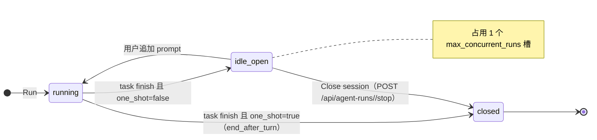

# F167 Pipeline项目管理优化

## Intent

新用户进了 Pipeline 不会操作。卡住的地方有三处，都已在代码里确认：

1. **找不到配置 Repo 的入口。** Pipeline 的 "project" 就是一个注册过的 `Repo`（`lib/pipeline/projects.py`），但只有 Library → Repos（`ReposView.vue`，`/repos`）能添加。ProjectPicker、Overview 的 ProjectsPanel、NewFeature/TaskComposer 的 Project 下拉、TaskArmSheet 的 cwd 下拉都没有添加入口。仓库为空时它们只显示 "No project" 或 "All 0 projects quiet"，不告诉用户去哪里加。
2. **没勾 Auto Close，并发槽被占满。** Auto Close 在代码里叫 `one_shot`，默认 `false`（`lib/tasks/arm.py` `_flag`）。`SliceArmSheet.vue` 没有这个勾选框，所以从 feature 批量 arm 的切片**全部**不会自动关闭。不勾的话，agent `task finish` 以后 SDK runner 停在 `idle`，继续占着 `max_concurrent_runs` 的一个槽，直到有人手动停掉。槽满以后 Run 返回 409，`TaskRefusal.vue` 只显示原始字符串 `launch refused: max_concurrent_runs reached`。没有任何 UI 列出是谁占着槽，而 `done` 任务也没有停止它的动作。
3. **没有 Workspace（多 Repo）。** 一个 run 只有一个 `cwd`。`add_repo` 要求路径必须是 git 工作树，所以装着多个 repo 的父目录注册不了。arm 时也选不到这样的根目录，想在一个 session 里同时处理多个项目也就无从配置。

**调研结论（第 3 条）：** 采用"Workspace = 一个根目录，成员是根目录下已注册的 repo"，run 的 `cwd` 直接设为根目录。理由如下：

- `kimi acp` 没有 `--add-dir`，ACP 的 `session/new` 只接受 `cwd`。只有 `cwd = 父目录` 这条路两个 provider 都能用。
- Claude 的 `add_dirs` 只有 Claude 支持，用了就会让 provider 行为分叉。
- 一个 session 碰过哪些 repo，已经由 `SessionRepo`（`is_multi_repo`）在事后归因，trace 不需要改。

**Non-goals**

- 不做启动排队。`queued` 状态仍然不写，槽满时 Run 照旧拒绝，但拒绝信息要能操作（见 Rules B）。排队是另一个 feature。
- 不加基于时间的回收。`idle_timeout_sec` 默认值不变（Root-cause discipline）。
- 不把 Kimi ACP handle 计入 `max_concurrent_runs`，也不给 tmux run 加并发上限。这两项列为 follow-up。
- 不改 `/live` 临时会话（`LiveLaunchSheet` 的 "end after the first turn"）的默认值，它是对话场景，不属于 pipeline 任务。
- Feature 和 task 仍然只归档到**一个 repo**（`project_id`），不能归档到 workspace。跨 repo 的 feature 归到它的主 repo。
- 不做服务端目录浏览器，路径仍然手动输入绝对路径。
- 不支持根目录之外的成员 repo，也不给单个 run 传 `add_dirs`。
- 不迁移已记住的 arm 偏好。`useArmPrefs` 里已存的 `one_shot=false` 照常生效，新默认值只作用于没有记住偏好的用户和服务端缺省。

## Model

字段全集以 `lib/orm/models/` 为准，这里只列承重字段。

```typescript
// 新表 workspaces（alembic revision + db/schema.sql + SQLModel 三处同改）
type Workspace = {
  id: number
  name: string        // UNIQUE，默认取 basename(root_path)
  root_path: string   // UNIQUE，绝对路径并规范化；本身不必是 git 仓库
  created_at: string
}
// 成员关系不存储，读取时推导：
//   members(w) = { r ∈ Repo | norm(r.path) == w.root_path
//                             || norm(r.path).startsWith(w.root_path + sep) }

type PipelineScope = 'all' | 'none' | `${RepoId}` | `ws:${WorkspaceId}`   // ?project=

type PathProbe = {               // GET /api/repos/probe?path=（editor）
  exists: boolean
  is_git: boolean                // 路径本身是 git 工作树根（有 .git），不是“位于某仓库内部”
  child_repos: { name: string, path: string, registered: boolean }[]  // 根目录的直接子目录中的 git 工作树
  workspace_id: number | null    // 该路径已经是某个 workspace 的根目录
}

type SlotHolder = {
  trace_id: string               // reservation 阶段也已有 id；此时 phase=starting、cwd=null
  phase: 'starting' | 'working' | 'idle' | 'waiting-input'
       | 'waiting-permission' | 'stopping' | 'retrying'
  task_id: number | null         // 来自 agent_task_runs.trace_id；/live 会话为 null
  task_title: string | null
  task_status: TaskStatus | null
  cwd: string | null
}
type RunSlots = { limit: number, used: number, holders: SlotHolder[] }  // GET /api/agent-runs/slots
// POST /api/tasks/<id>/run 返回 409 max_concurrent_runs 时，body 附带 slots: RunSlots
```

Arm 参数 `one_shot` 的位置不变（`AgentTaskRun.params_json`），变的只是缺省值。



## Rules

### A. 添加项目的入口

同一个 `AddProjectDialog.vue` 从 `ReposView` 的现有 modal 抽出，所有入口共用这一个组件。

| 位置 | 条件 | 呈现 |
|---|---|---|
| `ProjectPicker` 下拉底部 | editor | 固定一行 "+ Add project…"，点击打开 AddProjectDialog |
| `ProjectPicker` 下拉底部 | viewer | 不显示 |
| Overview `ProjectsPanel` | repos = 0，editor | 替换 "All 0 projects quiet"，显示首次使用卡片："No projects yet — add a repo or a workspace" 和打开 dialog 的按钮 |
| Overview `ProjectsPanel` | repos = 0，viewer | 显示 "No projects yet — an editor can add one under Repos"，不放按钮 |
| `NewFeatureDialog` / `TaskComposerDialog` / `TaskEditSheet` 的 Project 下拉 | repos = 0，editor | 下拉旁显示 "Add project" 链接，打开 dialog |
| `TaskArmSheet` / `SliceArmSheet` 的 working directory | 任意，editor | 选项末尾加 "+ Add project…" |
| AddProjectDialog 提交成功 | — | `useProjects` 缓存刷新。发起入口如果是下拉，自动选中新项目；如果是 ProjectPicker，scope 切到新项目 |

### AddProjectDialog 按路径类型分支（先调 probe）

| `exists` | `workspace_id` | `is_git` | `child_repos` 数 | 默认模式 | 提交动作 |
|---|---|---|---|---|---|
| false | — | — | — | — | 内联报错 "Path does not exist"，不可提交 |
| true | 非空 | — | — | — | 内联提示 "Already workspace <name>"，不可重复创建 |
| true | null | true | 0 | Repository | `POST /api/repos {path}`（现有接口） |
| true | null | true | ≥ 1 | Repository | 同上，可手动切换到 Workspace，切换后走下一行 |
| true | null | false | ≥ 1 | Workspace | `POST /api/workspaces {path, name?}`，列出将要注册的子 repo |
| true | null | false | 0 | — | 内联报错 "Not a git repo, and holds no git repos"，不可提交 |

### UI 文案与 pixel 主题

| 面 | 规则 |
|---|---|
| 本 feature 新增的 UI 文案 | 一律英文（与其余 UI 一致；pixel 字体 Silkscreen 不含 CJK 字形） |
| AddProjectDialog、RunSlotList、TaskRefusal、ProjectsFirstRun、RunningNow 的槽芯片与分组 | 带 `data-pl-part` 钩子，在 pixel 主题下用 `themes/pixel/` 的样式（dialog / key / slot / refusal / dialog-error） |

### B. Auto Close 与并发槽

| 场景 | 规则 |
|---|---|
| arm 请求体缺省 `one_shot`（task arm、slice arm、CLI `regin task arm`） | 视为 `true`（`lib/tasks/arm.py`）。显式传 `false` 照旧生效 |
| `TaskArmSheet` 勾选框 | 文案改为 "Auto close — end the session once the agent reports done"，没有记住偏好时默认勾选 |
| `SliceArmSheet` | 新增同一个勾选框，作用于全部切片，默认勾选，提交时带上 `one_shot` |
| `/live` 的 `POST /api/agent-runs` | 不变 |
| Run 遇到 `max_concurrent_runs`（409） | 响应带 `slots`。`TaskRefusal` 不再只显示原始字符串，而是 "Run slots full (used/limit)" 加占用者列表 |
| 占用者 `phase = idle` | 行内显示 "Close" 按钮，调 stop 接口，成功后从列表移除，Run 按钮恢复可点（不自动重试） |
| 占用者 `phase ∈ {waiting-input, waiting-permission}` | 显示 "Open"，链接到 `/live` 对应会话（需要先回答或停止），不提供一键关闭 |
| 占用者 `phase ∈ {working, retrying}` | 显示 "Open"，Stop 需在会话页操作 |
| 占用者 `phase ∈ {starting, stopping}` | 只显示，不给操作 |
| 占用者有 `task_id` | 行内显示任务标题，链接到 `/tasks/<id>` |
| Overview `RunningNow` 头部 | 显示 "Run slots used/limit" 芯片，点击展开同一份占用者列表 |
| Overview `RunningNow` 列表 | 除 `running` 任务外，新增分组 "Finished, session still open"：`task_status ∈ {done, failed}` 且其 trace 仍在 registry 的占用者，每行带 "Close session" |
| `TaskDetailView`：任务 `done`/`failed` 且最新 attempt 的 trace 仍在 registry | 显示横幅 "Session still open (<phase>), holding 1 run slot"，`idle` 时带 "Close session" |

### C. Workspace

| 操作 | 规则 |
|---|---|
| 创建 `POST /api/workspaces {path, name?}` / `regin workspace add <path> [--name]` | `path` 必须是已存在的绝对目录（`~` 不算）。扫描根目录本身和直接子目录中的 git 工作树（判定：目录下有 `.git`），未注册的逐个调用现有 `add_repo` 注册；`add_repo` 拒绝的（如重名）列在响应的 `skipped` 里。一个都没找到、或找到的都既未注册也注册不了，则拒绝（400，`field=path`）。需要 editor 权限 |
| 名称或根目录冲突 | 拒绝（409），说明冲突的是哪个字段 |
| 列表 `GET /api/workspaces` / `regin workspace list` | 每项带推导出的 members |
| 删除 `DELETE /api/workspaces/<id>` / `regin workspace remove <name>` | 只删 workspace 行，不注销 repo，不动 feature/task |
| 后来单独注册、路径落在根目录下的 repo | 自动成为成员（成员关系是推导出来的） |
| Pipeline scope `ws:<id>` | `/api/pipeline/{counts,overview,projects}`、Features、Tasks、Defects 列表按 `project_id ∈ members(w)` 过滤（三个 tab 计数与列表同一谓词）。workspace 不存在时退回 `all`；没有成员时结果为空，不退回 `all`。`/api/pipeline/projects/ws:<id>` 拒绝（400），单项目面板只接受 repo id 或 `none` |
| `ProjectPicker` | workspace 作为分组标题（可选中，等于 `ws:<id>` scope），成员 repo 缩进列在下面。不属于任何 workspace 的 repo 照常平铺 |
| arm 的 working directory 选项 | 每个 workspace 一项 "workspace: <name>（N repos）"，值为 `root_path`，排在 repo 路径之前 |
| arm 选中的 cwd 是非 git 的 workspace 根 | worktree 字段禁用并提示 "the workspace root is not a git repo, so it cannot use a worktree"。服务端 `check_target` 仍是最终裁决 |
| run 的 `cwd` | 等于 `root_path`，不传 `add_dirs`。一个 session 碰过哪些 repo 由现有 `SessionRepo` 记录 |
| arm 默认 cwd | 不变（上次 run 的 cwd → 项目 repo 路径） |

## Invariants

- 对任意一个列出项目供选择的界面：editor 能在原地打开 AddProjectDialog，viewer 能看到为什么没有项目。
- 对任意 task arm 路径（单任务、切片、CLI）：请求缺省 `one_shot` ⇒ 存下的 `params_json.one_shot == true`。
- 任意时刻 `GET /api/agent-runs/slots`：`used == registry.active_run_count()` 且 `len(holders) == used`。
- 对任意 workspace `w`：成员关系只按 `w.root_path` 与 `Repo.path` 推导，数据库里没有成员表。
- 删除 workspace 不会改变 `repos`、`features`、`agent_tasks` 中的任何一行。
- 对任意 feature/task：`project_id` 只能是 repo id 或 `NULL`，不会是 workspace id。
- 本 feature 不引入任何基于时间的回收或重试。

## Acceptance

```gherkin
Feature: 新用户能找到添加项目的入口

  Scenario: Project picker offers add project to editors
    Given an editor and zero registered repos
    When they open the ProjectPicker on /overview
    Then the list ends with "+ Add project…"
    And choosing it opens AddProjectDialog

  Scenario: Project picker hides add project from viewers
    Given a viewer
    When they open the ProjectPicker
    Then no "+ Add project…" row is shown

  Scenario: Overview empty state invites adding a project
    Given an editor and zero registered repos
    When /overview loads
    Then ProjectsPanel shows the first-run card with an add button instead of "All 0 projects quiet"

  Scenario: Adding a repo from the picker scopes the pipeline to it
    Given an editor with AddProjectDialog opened from ProjectPicker
    When they submit the absolute path of a git working tree
    Then POST /api/repos succeeds
    And the pipeline scope becomes that repo's id

  Scenario: Probe classifies a folder of repos as a workspace
    Given a non-git directory with two child git working trees
    When GET /api/repos/probe?path=<dir> is called
    Then is_git is false and child_repos lists both

  Scenario: Probe rejects a folder with no repos
    Given a non-git directory with no child git working tree
    When AddProjectDialog probes it
    Then submit is disabled with "Not a git repo, and holds no git repos"

Feature: Auto close 默认开启，并发槽可见、可释放

  Scenario: Arm without one_shot defaults to auto close
    Given an idea task
    When POST /api/tasks/<id>/arm is sent without one_shot
    Then the armed attempt's params_json.one_shot is true

  Scenario: Explicit one_shot false is kept
    When POST /api/tasks/<id>/arm is sent with one_shot false
    Then params_json.one_shot is false

  Scenario: Slice arm defaults to auto close
    Given a feature with idea slices
    When POST /api/features/<id>/arm-slices is sent with items lacking one_shot
    Then every armed slice attempt has params_json.one_shot true

  Scenario: Slice arm sheet exposes the auto close checkbox
    When SliceArmSheet opens with no remembered prefs
    Then an "Auto close" checkbox is shown checked
    And unchecking it submits one_shot false for every slice

  Scenario: Slots endpoint lists every holder
    Given two live SDK runners, one idle on a done task and one working on a /live session
    When GET /api/agent-runs/slots is called
    Then used is 2, limit equals max_concurrent_runs
    And holders carry the idle one's task_id and task_status done, and the /live one's task_id null

  Scenario: Refused run returns the slot holders
    Given max_concurrent_runs runners are live
    When POST /api/tasks/<id>/run is sent
    Then the response is 409 and its body includes slots with len(holders) == limit

  Scenario: Refusal lets the user close an idle holder
    Given a 409 refusal whose holders include an idle run
    When the user clicks "Close" on that holder in TaskRefusal
    Then POST /api/agent-runs/<trace>/stop is called
    And the holder disappears and the Run button is enabled again

  Scenario: Waiting input holder is opened not closed
    Given a refusal holder in phase waiting-input
    Then its row shows "Open" linking to its /live session and no "Close"

  Scenario: Done task with open session shows close banner
    Given a done task whose latest attempt's trace is still registered and idle
    When /tasks/<id> loads
    Then a banner says the session is still open and offers "Close session"

  Scenario: Overview lists finished tasks still holding a slot
    Given a done task whose session is idle and registered
    When /overview loads
    Then RunningNow shows it under "Finished, session still open" with "Close session"
    And the header chip reads "Run slots 1/<limit>"

Feature: Workspace 多 repo

  Scenario: Creating a workspace registers its child repos
    Given a non-git directory D with child git trees a and b, neither registered
    When POST /api/workspaces {path: D} is sent
    Then a workspace with root_path D exists
    And repos a and b are registered and listed as its members

  Scenario: Creating a workspace with no repos is refused
    Given a non-git directory with no child git tree
    When POST /api/workspaces is sent for it
    Then the response is 400 with field path

  Scenario: Repo registered later under the root becomes a member
    Given workspace W rooted at D
    When a git tree at D/c is added via POST /api/repos
    Then GET /api/workspaces lists c among W's members

  Scenario: Removing a workspace keeps its repos
    Given workspace W with members a and b
    When DELETE /api/workspaces/<W> is sent
    Then repos a and b are still registered and their features unchanged

  Scenario: Workspace scope filters the pipeline to member repos
    Given features filed under member repo a, and under a non-member repo x
    When GET /api/pipeline/overview?project=ws:<W> is called
    Then a's features are included and x's are not

  Scenario: Arm offers the workspace root as working directory
    Given workspace W
    When TaskArmSheet opens
    Then the working-directory options include "workspace: W" valued root_path

  Scenario: Worktree is disabled for a non-git workspace root
    Given TaskArmSheet with cwd set to a non-git workspace root
    Then the worktree fields are disabled with the reason shown

  Scenario: Run in a workspace root launches with that cwd
    Given a task armed with cwd = W.root_path
    When it runs
    Then the launched session's cwd is W.root_path and no add_dirs are passed

  Scenario: CLI workspace commands round trip
    When "regin workspace add D" then "regin workspace list" then "regin workspace remove <name>" run
    Then list shows the workspace with its members, and after remove it is gone while the repos remain
```

## 约束与落点

- Schema 改动是 `workspaces` 新表：`alembic/versions/00NN_*.py` + `db/schema.sql` + `lib/orm/models/` 三处同改。
- AddProjectDialog 只有一份。`ReposView` 改为复用它，不保留第二个 modal。
- 占用者来自 `lib/agent_sdk/registry.py` 的 `_runs ∪ _reserved` 加 `run_phase`。task 关联通过 `agent_task_runs.trace_id` 反查。
- Follow-up（不在本 feature）：Kimi ACP handle 计入并发上限；tmux run 加并发上限；槽满时排队启动（事件驱动，在 runner 移出 registry 时触发）。


## 切片

共用规则：

- 只有 S1 改表（新建 `workspaces`）。
- arm 由人执行，执行前先 `git branch f167/integration master`。
- worktree 中先执行 `ln -sfn /Users/taowang/regin/.venv .venv`；前端片再链接 `frontend/node_modules`。Playwright 使用本片端口：`REGIN_E2E_API_PORT=838N REGIN_E2E_VITE_PORT=522N REGIN_E2E_SCRATCH=/tmp/regin-e2e-f167sN`。
- S3、S4 都改 `ProjectPicker.vue`，所以 S4 排在 S3 之后（after）。S3、S5 都改 `TaskArmSheet.vue` / `SliceArmSheet.vue`，所以 S5 排在 S3 之后（after）。

**Base: `f167/integration`**

| # | Slice | Delivers | Spec refs | Tests | Schema | Depends on | Base | Skill |
|---|---|---|---|---|---|---|---|---|
| S1 | Workspace 后端 + probe + CLI | `alembic/versions/00NN_workspaces.py` + `db/schema.sql` + `lib/orm/models/`（`Workspace`）。新增 `lib/workspaces/`：create（扫描根目录本身和直接子目录，未注册的调 `lib/sync/repo_discovery.add_repo`）、list（成员按路径推导）、remove。`web/blueprints/` 新增 `GET/POST /api/workspaces`、`DELETE /api/workspaces/<id>`（editor），`web/blueprints/repos.py` 新增 `GET /api/repos/probe`。CLI `regin workspace add/list/remove`。测试 `tests/workspaces/` | Model, Rules C, AddProjectDialog 分支表, Invariants | test_creating_a_workspace_registers_its_child_repos, test_creating_a_workspace_with_no_repos_is_refused, test_repo_registered_later_under_the_root_becomes_a_member, test_removing_a_workspace_keeps_its_repos, test_cli_workspace_commands_round_trip, test_probe_classifies_a_folder_of_repos_as_a_workspace | yes | — | `f167/integration` | goal-verified-treenav |
| S2 | Auto close 默认值 + 运行槽后端 | `lib/tasks/arm.py`：缺省 `one_shot` 视为 `true`（单任务、arm-slices、CLI 同一路径）。`lib/agent_sdk/registry.py` 导出占用者快照（`_runs ∪ _reserved` + `run_phase`），由 `agent_task_runs.trace_id` 反查 task。新增 `GET /api/agent-runs/slots`；`POST /api/tasks/<id>/run` 的 409 body 带 `slots`。改写断言旧默认值的测试。测试 `tests/tasks/test_auto_close_default.py`、`tests/agent_sdk/test_run_slots.py` | Rules B, Model（RunSlots）, Invariants | test_arm_without_one_shot_defaults_to_auto_close, test_explicit_one_shot_false_is_kept, test_slice_arm_defaults_to_auto_close, test_slots_endpoint_lists_every_holder, test_refused_run_returns_the_slot_holders | — | — | `f167/integration` | goal-verified-treenav |
| S3 | AddProjectDialog 与全部入口 | 从 `ReposView.vue` 抽出 `AddProjectDialog.vue`（先 probe，按分支表选择 Repository/Workspace 模式），`ReposView` 改为复用它。入口：`ProjectPicker` 底部 "+ Add project…"（仅 editor）、`ProjectsPanel` 零项目首次使用卡片（editor/viewer 两种文案）、`NewFeatureDialog`/`TaskComposerDialog`/`TaskEditSheet` 零项目时的 "Add project" 链接、`TaskArmSheet`/`SliceArmSheet` working directory 末尾的 "+ Add project…"。提交后刷新 `useProjects`，并按 Rules A 选中新项目或切换 scope。e2e `frontend/tests/f167-add-project.spec.js` | Rules A, AddProjectDialog 分支表, Invariants | test_project_picker_offers_add_project_to_editors, test_project_picker_hides_add_project_from_viewers, test_overview_empty_state_invites_adding_a_project, test_adding_a_repo_from_the_picker_scopes_the_pipeline_to_it, test_probe_rejects_a_folder_with_no_repos | — | S1 | `f167/integration` | goal-verified-treenav |
| S4 | Workspace pipeline scope | `composables/usePipelineScope.js` 接受 `ws:<id>`。`lib/pipeline/`（counts/overview/projects）以及 Features、Tasks 列表接口按 `project_id ∈ members(w)` 过滤，workspace 不存在时退回 `all`。`ProjectPicker.vue` 把 workspace 显示为可选中的分组标题，成员缩进列在下面。测试 `tests/pipeline/test_workspace_scope.py` + e2e `frontend/tests/f167-workspace-scope.spec.js` | Rules C（scope、ProjectPicker 行）, Invariants | test_workspace_scope_filters_the_pipeline_to_member_repos | — | S1, S3 (after) | `f167/integration` | goal-verified-treenav |
| S5 | Arm 弹窗：auto close 勾选框 + workspace cwd | `TaskArmSheet.vue` 勾选框改为 "Auto close" 文案，没有记住偏好时默认勾选。`SliceArmSheet.vue` 新增同一勾选框，提交时带 `one_shot`。`GET /api/agent-runs/launch-options` 返回 workspaces，`useTaskArm.js` 把 "workspace: <name>（N repos）" 排在 repo 路径之前。cwd 是非 git 的 workspace 根时，`LaunchWorktreeFields.vue` 禁用并显示原因。测试：e2e `frontend/tests/f167-arm-sheet.spec.js`，以及 launch cwd 的 pytest | Rules B（勾选框行）, Rules C（arm 行）| test_slice_arm_sheet_exposes_the_auto_close_checkbox, test_arm_offers_the_workspace_root_as_working_directory, test_worktree_is_disabled_for_a_non_git_workspace_root, test_run_in_a_workspace_root_launches_with_that_cwd | — | S1, S2, S3 (after) | `f167/integration` | goal-verified-treenav |
| S6 | 运行槽 UI | `TaskRefusal.vue` 渲染 409 的 `slots`：显示 used/limit，按 phase 决策表给出 Close/Open/无操作，Close 成功后移除该行并恢复 Run 按钮。`RunningNow.vue` 头部加 "Run slots used/limit" 芯片（展开同一份列表），新增 "Finished, session still open" 分组。`TaskDetailView.vue` 在 done/failed 任务的会话仍开着时显示横幅。共用组件 `RunSlotList.vue`。e2e `frontend/tests/f167-run-slots.spec.js` | Rules B（refusal、RunningNow、TaskDetail 行）| test_refusal_lets_the_user_close_an_idle_holder, test_waiting_input_holder_is_opened_not_closed, test_done_task_with_open_session_shows_close_banner, test_overview_lists_finished_tasks_still_holding_a_slot | — | S2 | `f167/integration` | goal-verified-treenav |
| S7 | integrate | 检查每一片都已合回 `f167/integration`，无人落零 commit | Invariant 1 | test_every_slice_merged_back | — | S4, S5, S6 | f167/integration | goal-verified-treenav |
| S8 | migrate + doctor | 跑 `.venv/bin/python cli/regin.py migrate`，确认这个安装没落后 | R1 | test_migrate_leaves_no_schema_finding | — | S7 | f167/integration | goal-verified-treenav |
| S9 | verify | 全量 `.venv/bin/python -m pytest -q -n auto --dist=loadfile`、`cd frontend && ./node_modules/.bin/playwright test` | Acceptance | test_full_suite_passes | — | S8 | f167/integration | goal-verified-treenav |


