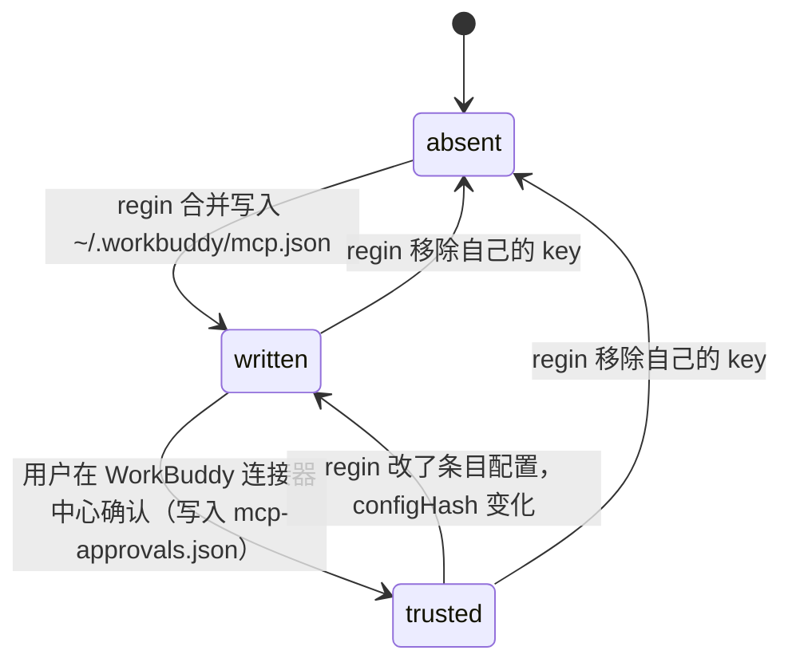

# regin 接入闭源 agent 产品（首批：WorkBuddy / CodeBuddy Code）

## Intent

regin 目前只能观测和驱动 Claude Code、Kimi（Codex 只能观测）。用户日常还用腾讯 WorkBuddy 这类闭源桌面 agent，它们的会话不进 regin 的 trace，也拿不到 regin 的 skills 和 memory。

调研结论：WorkBuddy 是 Electron 外壳，内置 CodeBuddy Code 引擎（本机 5.8.3 内置 `codebuddy` 2.161.0，入口 `app.asar.unpacked/cli/bin/codebuddy`，bundle `dist/codebuddy-lite-wb.mjs`）。每个桌面会话起一个引擎进程 `codebuddy --serve --session-id <sid>`，环境变量 `CODEBUDDY_CONFIG_DIR=WORKBUDDY_CONFIG_DIR=~/.workbuddy`。CodeBuddy Code CLI 的 hooks、skills、MCP、headless、ACP 都有官方文档，hooks 形状和 Claude Code 相同。所以接入不需要为某个产品开一套新的「开放 API」，而是沿用已有的 `AgentProvider` 缝（`lib/providers/base.py`），新增两个 provider：

- `codebuddy`：完整接入，五个接入面全开。
- `workbuddy`：hooks、skills、MCP、transcript 四个接入面，不能由 regin 启动。

两者共用一个实现和一个 transcript 解析器，只在下面 `CodeBuddyFamily` 列出的字段上不同。

**Non-goals**
- 不做 Qoder、Cursor、Trae、Kiro、Windsurf、Gemini CLI。调研结果见下面的「产品矩阵」，作为 follow-up。
- 不接 OTLP 接收端，不新增 OpenAPI 文档，不扩展 API key 的 scope。
- 不在 regin 里启动 WorkBuddy 桌面端会话：它没有公开的 headless 入口。引擎的 `--serve` 网关由桌面端独占，口令只在进程环境里，不对外。
- 不替用户批准 WorkBuddy 的 MCP 信任：regin 不写 `~/.workbuddy/mcp-approvals.json`。
- 不给 ACP `session/new` 注入 `mcpServers`（目前写死为 `[]`），保持现状。
- 不加基于时钟的 transcript 轮询或 watcher。导入只由显式命令、hook 或已有的「查看会话时触发 rescan」路径驱动。
- 不解析 `projects/<slug>/<sid>/tool-results/` 下的溢出文件。
- 不改 Claude、Kimi、Codex 现有的行为。

## 调研：产品矩阵

| 产品 | hooks | skills | MCP 配置 | headless / ACP | transcript | 来源 |
|---|---|---|---|---|---|---|
| CodeBuddy Code CLI | 27 个事件，Claude 同名、同形；写在 `~/.codebuddy/settings.json` | `~/.codebuddy/skills/<n>/SKILL.md` | `~/.codebuddy/.mcp.json`（`mcpServers`） | `codebuddy -p --output-format stream-json`；`codebuddy --acp` | `~/.codebuddy/projects/<slug>/<uuid>.jsonl`，形状同 WorkBuddy | workbuddy.ai/docs/cli/*（官方）+ 本机用内置引擎实测 |
| WorkBuddy 桌面端 | **会执行** `~/.workbuddy/settings.json` 的 hooks，热加载，和桌面端自带 hook 合并 | `~/.workbuddy/skills/`；有技能市场 | `~/.workbuddy/mcp.json`（无前导点），需用户在桌面端信任 | 无 | `~/.workbuddy/projects/<slug>/<uuid>.jsonl` | 本机探针（见下节） |
| Qoder CLI | 23 个事件，Claude 同形；写在 `~/.qoder/settings.json` | `~/.qoder/skills` | `~/.qoder/settings.json` | `-p -o stream-json`；`--acp` | 未核实 | docs.qoder.com/cli |
| Cursor `agent` CLI | camelCase 事件；会读 `.claude/settings*.json` | 读 `.cursor/skills`，兼容 `.claude/skills` | `~/.cursor/mcp.json` | `agent -p`；`agent acp` | 仅能通过 hook 拿到 `transcript_path` | cursor.com/docs |
| Trae | 6 个事件；写在 `~/.trae/hooks.json`；也读 Claude 的 hooks 配置 | `~/.trae/skills` | 路径未核实 | 未核实 | 未核实 | docs.trae.ai |

### 探针结论（WorkBuddy 5.8.3，本机，2026-10-22）

| 问题 | 结论 | 证据 |
|---|---|---|
| 桌面端执行 `~/.workbuddy/settings.json` 的 hooks 吗 | 执行。改文件后**不用重启**，正在运行的引擎就开始调用 hook | 往 settings.json 写入 7 个事件的探针 hook 后，10:03 启动的桌面引擎进程开始调用 PreToolUse/PostToolUse；`-p` 运行触发了 SessionStart/UserPromptSubmit/Stop |
| 和桌面端 `--settings` 里自带的 hook 冲突吗 | 不冲突，两者合并。setting scope 默认 `[user, project, local]`，桌面端没有传 `--setting-sources` | 同时给 `--settings` hook 和用户 hook，两个都被调用 |
| 自定义 MCP 落在哪 | `~/.workbuddy/mcp.json`，格式为 `{mcpServers:{<name>:{type?,command,args,env,cwd,url,headers,timeout}}}`。由桌面守护进程的 `UserMcpProvider` 读取，暴露为 `custom-mcp:<name>`，再经 `connector-proxy` 进入会话 | 在 app.asar 里找到 `getMcpConfigPath() = <configDir>/mcp.json` 和 `UserMcpFile` |
| 写进去就生效吗 | 不会。每个条目有 `trusted = mcp-approvals.json` 里有没有 `<configHash>::custom-mcp:<name>`，用户要在桌面端确认一次。改了条目的配置，hash 跟着变，需要重新确认 | `McpTrustStore`、`approvalKey`、`computeTrustConfigHash` |
| `~/.workbuddy/.mcp.json` 呢 | 桌面会话里不生效：引擎带 `--strict-mcp-config` 启动，会屏蔽 user/project/local/plugin 四个 scope。单独跑 CLI 时会读（`codebuddy mcp list` 显示已连接），这也证实了 codebuddy 的 `~/.codebuddy/.mcp.json` | `isStrictMcpScopeBlocked` |
| `projects/<slug>/<sid>/` 子目录是 subagent 吗 | 不是。12 个目录里都只有 `tool-results/<callId>-*.txt`，是工具输出的溢出文件 | `find` 结果 |

hook payload 和 Claude 同形，但多了几个字段：`agent_type: "cli"`（CodeBuddy 自己的 agent 类别，**不是** provider id）、`client: "WorkBuddy"`、`version`、`generation_id`、`call_id`。Bash 的 PostToolUse `tool_response` 只有 `exitCode/interrupted/...`，**不含 stdout**，所以工具输出文本要靠 transcript 导入拿到。

### transcript 条目形状（本机 17 个会话、841 条记录）

| `type` | 关键字段 |
|---|---|
| `session-meta` | `sessionId`, `meta` |
| `message` | `role ∈ {user, assistant}`, `content: [{type: input_text\|output_text, text}]`, `providerData.{startsNewUserRequest?, conversationRequestId?, usage?, messageId?}` |
| `reasoning` | `content`, `rawContent`, `parentId` |
| `function_call` | `callId`, `name`, `arguments`, `providerData.{messageId, conversationRequestId?, model, usage?}` |
| `function_call_result` | `callId`, `name`, `output`, `status`（目前只见过 `completed`） |
| `ai-title` | `aiTitle` |
| `file-history-snapshot` | 忽略 |

公共字段：`id`, `sessionId`, `parentId`, `cwd`, `timestamp`（epoch 毫秒，整数）。缺字段的情况：`file-history-snapshot` 没有 `sessionId`，有时也没有 `id`；`ai-title` 有时没有 `id`；`session-meta`、部分 `message` 没有 `parentId`。

`usage` 的形状：`{inputTokens, outputTokens, totalTokens, requests, inputTokensDetails: [{cached_tokens}], outputTokensDetails: [{reasoning_tokens}]}`。`usage` 出现在 `function_call` 和 assistant `message` 上，每个 `messageId` 最多一份。同一 `messageId` 下的并行 function_call，只有一条带 `usage`。

`startsNewUserRequest` 和 `conversationRequestId` 只在较新的版本写入：27 条 user message 里只有 2 条带 `startsNewUserRequest`，旧会话没有。`conversationRequestId` 和 hook payload 里的 `generation_id` 是同一个值。桌面端的 user message 是一大段 `<system-reminder data-role="user-context">…</system-reminder>`，用户真正输入的内容在其中的 `<user_query>…</user_query>` 里；headless 会话的 user message 是纯文本。

## Model

完整契约见 `lib/providers/base.py`。下面只列出本 feature 新增或改动的部分。

```typescript
type ProviderId = 'claude' | 'codex' | 'kimi' | 'generic'
                | 'codebuddy' | 'workbuddy'            // 新增，注册进 lib/providers/registry.py

type CodeBuddyFamily = {          // codebuddy 与 workbuddy 共用一个实现，只有这个 dataclass 的字段不同
  root_dirname: '.codebuddy' | '.workbuddy'
  config_dir_setting: 'codebuddy_config_dir' | 'workbuddy_config_dir'   // settings 上的覆盖项，不直接读 env
  mcp_config_file: '.mcp.json' | 'mcp.json'      // codebuddy 用 .mcp.json；workbuddy 用 mcp.json（UserMcpProvider）
  mcp_needs_user_trust: false | true             // workbuddy 的条目要用户在桌面端确认后才生效
}

// 两个 provider 共有的其余声明是 CodeBuddyFamilyProvider 的类属性，不在 family 里
class CodeBuddyFamilyProvider {    // config_root() 取 settings 覆盖，否则 ~/ + root_dirname
  hook_config_format = 'json'      // 写在 <root>/settings.json 的 hooks 键下
  hook_output_format = 'claude'
  transcript_format = 'codebuddy'  // 新解析器，codebuddy 和 workbuddy 共用
  capabilities = { skills: true, hooks: true, sessions: true, transcript_usage: true }
  experimental = false             // AgentProvider 默认 true；非实验 provider 不受 settings.experimental_providers 开关限制
}

// AgentProvider 新增两个方法；默认实现返回 None，旧 provider 不受影响
interface AgentProvider {
  mcp_config_path(): Path | null        // null 表示 regin 不往这个 provider 注册 MCP
  acp_argv(): string[] | null           // 替代 lib/agent_acp/client.py 里写死的 'kimi acp'
}
```

WorkBuddy 里一个 MCP 条目的生命周期（由 WorkBuddy 自己管理，regin 只负责 `absent → written`）：



## Rules

**接入面矩阵**（provider 能力声明，对应 `launch_capabilities` / `capabilities` / 新方法）

| 接入面 | codebuddy | workbuddy |
|---|---|---|
| hooks 安装（`regin hooks install/status/repair`） | 装进 `~/.codebuddy/settings.json` | 装进 `~/.workbuddy/settings.json`；不用重启桌面端就生效 |
| Settings 页（Providers / Hook Handlers / Hook Installers） | 始终列出，可在页面上安装 hook | 同左 |
| skills 部署 | `~/.codebuddy/skills`；项目级 `.codebuddy/skills` | `~/.workbuddy/skills` |
| skill 调用前缀（`skill_invocation`） | `/<name>` | 不适用（不能启动） |
| MCP 注册 | `~/.codebuddy/.mcp.json` | `~/.workbuddy/mcp.json`；状态停在 `written`，等用户确认 |
| 启动 task run | channel：ACP（`codebuddy --acp`）；pane：tmux `codebuddy`。档位与模型由操作员在 arm / 启动表单里选（见下节），不选就用该 provider 的无人值守档位。`codebuddy` 不在 PATH 上时拒绝启动，和 kimi 缺二进制时的处理一样。tool span 归 hook 所有，要在会话里看到工具调用，需先 `regin hooks install --provider codebuddy`。ACP 启动时 launcher 自己写 `sessions` 行（`agent_type`=provider id、`cwd`、`model`），不等 SessionStart hook：没装 hook 的 run 也出现在会话列表里，查看会话时的 rescan 按 codebuddy 解析器读 transcript | 不可启动（`launch_capabilities` 为空） |
| transcript | `<root>/projects/*/<sid>.jsonl`，codebuddy 解析器 | 同左 |

**模型与档位**（arm 字段 → CLI argv / ACP 线协议）

codebuddy 的 `--permission-mode` 取值与它 ACP `session/set_mode` 认的 modeId 是同一套六个（`default`、`acceptEdits`、`plan`、`dontAsk`、`auto`、`bypassPermissions`），所以 `launch_capabilities()` 直接声明共享的 `permission_mode` 字段，不另立词表；`models` 是 `codebuddy --model` 自报的当前可用 id 的快照，只是菜单而非白名单（启动路由收任何字符串，表单另有 custom 入口）。

| 位置 | 有 armed 值 | 无 armed 值 |
|---|---|---|
| ACP `session/set_mode` | 发操作员选的 modeId | 发 `provider.acp_unattended_mode`（codebuddy `bypassPermissions`，kimi 仍 `yolo`） |
| tmux `pane_argv` | `--permission-mode <值>` | `--dangerously-skip-permissions`（pane 前没有人回答提示，保持原状） |
| 两者 | `--model <值>`（`session/set_model` 的 modelId） | 不发，用 CLI 自己的默认 |

**hook 归属到哪个 provider**（`hook_manager/runner.py` + `registry._provider_id_from_tag`）

CodeBuddy 的 payload 自带 `agent_type: "cli"`。现在的 `data.setdefault('agent_type', flag)` 不会覆盖它，而 `_provider_id_from_tag` 取的是 `agent_type or provider_id`，读到 `"cli"` 就停了，结果会落到 model 嗅探或 `active_provider`，归属错误。

| `--agent-type` flag | payload `agent_type` | 结果 provider |
|---|---|---|
| 已注册的 id | 缺失或已注册 | 不变（现在的行为） |
| 已注册的 id | 存在但未注册（如 `"cli"`） | flag 的值 |
| 未给 | 未注册 | 不变：model 嗅探，再退回 `active_provider` |

实现方式：runner 把 flag 写进 `data['provider_id']`；`_provider_id_from_tag` 在 `agent_type`、`provider_id` 里取第一个已注册的 id。

**注册哪些 MCP server**

| server | 条件 | 原因 |
|---|---|---|
| `memory` | `mcp_config_path() != null` | 只读召回，不依赖 hook |
| `regin` | `mcp_config_path() != null` | 统一对外的项目管理 MCP（`lib/regin_mcp/server.py`）：`send_to_user` + `pipeline_overview`、`feature_list/get/create/set_spec`、`task_list/get/create`、`defect_open/list/close`。`capabilities.hooks` 为 false 时以 `--no-send-to-user` 启动：`send_to_user` 由 PostToolUse hook 落库（`post_tool_trace._record_agent_message`，按 `*__send_to_user` 后缀匹配），没有 hook 时工具会回 "delivered"，但消息不会落库 |
| `send-to-user` | 不再注册；regin 自己的旧 key，重新注册时删除 | 已并入 `regin` |
| `topics` | 不注册 | 不在本 feature 范围 |

MCP 写入是合并，不是覆盖：只增删 regin 自己的 key（`memory`、`regin`、`send-to-user`），其余条目原样保留。对 workbuddy，`regin hooks status`（或注册命令的输出）要提示「需在 WorkBuddy 连接器中心信任 memory / regin」。

`regin` server 不知道是哪个会话在调用它（进程环境里是拉起它的会话），所以写操作（`feature_create`、`defect_open`）由调用方显式传 `session_id`。不提供 `feature ship`（发布是操作员的动作）、`task arm/finish`（由 server 的启动循环持有）。错误输入（未知 id、项目、stage、priority，空 spec / title / symptom）以 MCP 工具错误返回。列表结果包在对象里（`{"tasks": [...]}`、`{"defects": [...]}`），空列表也会作为一个内容块返回给只读 content 的客户端。`pipeline-ran` gate 也计入 `mcp__*regin__feature_get|defect_open|defect_close`。Claude plugin 的 `.mcp.json` 同样注册 `regin`，不再注册 `send-to-user`。

**transcript 条目 → span**（解析器在 `lib/trace/`，与 `kimi_transcript.py` 并列）

| 条目 | 产出 |
|---|---|
| `message` 且 `role=user` 且 `providerData.startsNewUserRequest !== false` | 开始一个新 turn，产出 user prompt span。prompt 文本：有 `<user_query>` 就取**最后一个**开标签之后、到下一个闭标签为止的内容（automation 会话的 system-reminder 正文里会先出现一个不闭合的 `<user_query>`），否则取全部 `input_text` |
| `message` 且 `role=assistant` | assistant_response span。同一 `providerData.messageId` 下的 reasoning / 文本 / 并行 function_call 是一次推理，合成一个 regin turn（一行 turn_usage） |
| `reasoning` | thinking span |
| `function_call` + 同 `callId` 的 `function_call_result` | 一个 `tool.<name>` span（`trtool-<key>`，`attributes.transcript_source=true`，带 `tool_use_id=callId`、输出文本 Bash 记为 `stdout`、其余记为 `output`，截断到 8KB）；`status != completed` 时为 ERROR。tool span 只由显式导入（`regin trace import-transcripts`）写：hook 与 live rescan 路径上 tool span 归 hook 所有，transcript 不再写第二条（否则 ingest 时的聚合会重复计数）；导入时跳过库里已有 hook 写的、非 PENDING tool span 的 `tool_use_id`。因此 hooked 会话的 tool span 没有 Bash stdout |
| `function_call` 没有对应的 result | PENDING tool span（`pending-<key>`，聚合计数跳过）；之后到达的 result 产出 terminal span，带 `pending_span_id` 指向它；任何写入方 resolve 了同一 `tool_use_id`，merge 都会丢掉 pending（`merge_cross_source._drop_resolved_transcript_pendings`） |
| `providerData.usage` | turn_usage 行，按 `providerData.messageId` 去重；cached / reasoning token 取 `*TokensDetails[*]` 之和。`input_tokens = inputTokens − cached`、`cache_read_tokens = cached`（regin 的 Claude/Kimi 口径：input + cache_read = 提示总量），`reasoning_tokens` 写入 turn_usage 同名列 |
| `ai-title` | `session.title` span，source 复用 `claude_ai_title` 槽位（用户 rename 仍优先） |
| `session-meta`, `file-history-snapshot`, 未知 `type` | 跳过；未知 type 不报错 |
| 最后一条 turn 记录（`main_turn_open`，会话列表 working/idle 的依据） | assistant `message`（最终回答，或中断留下的 `status=incomplete`、`error.message="Interrupted by user"` 存根）→ turn 已关闭，Stop hook 写出带 `hook_event=Stop` 的 `turn` span，会话显示 idle；`reasoning` / `function_call` / `function_call_result` / 真实 user prompt → turn 仍开着；`providerData.skipRun` 的 user message（本地命令 caveat）与 `ai-title` 不改变状态 |

turn 的标识：有 `providerData.conversationRequestId` 时用它（和 hook 的 `generation_id` 对得上）；没有时，用开启这个 turn 的 user message 的 `id`。它写在 prompt span 的 `prompt_id` 和 tool span 的 `source_prompt_id` 上。

span_id 里的 `<key>` 是 `sha1(sessionId + "\0" + 条目 id)[:13]`。条目 id 是 UUIDv7，前 13 个字符是毫秒时间戳，同一毫秒写的条目直接截断会撞。

CLI 导入不依赖 `regin serve`：`lib/trace/in_process_ingest.py` 把 `hook_plugin` 的 POST 直接路由进 `trace_service`；有被拒的写入时，命令输出 `failed=N` 并以退出码 1 结束。

**导入的触发方式**（不轮询）

| 触发 | 范围 |
|---|---|
| `regin trace import-transcripts --provider <id> [--session <sid>]` | 全部会话或单个会话 |
| hook 触发的 turn_trace 重读（Stop / PostToolUse） | 当前会话 |
| 打开 `/trace/sessions/<sid>` 时，已有的 `trigger_rescan` | 当前会话（经由 `provider.find_session_transcript`） |

## Invariants

- 对任意一条有 `id` 的 transcript 条目，生成的 `span_id` 只由 `(sessionId, 条目 id)` 决定；没有 `id` 的条目不产出 span。重复导入同一文件，`session_spans` 的行数不变。
- 对任意 codebuddy-family 会话：`sessions.agent_type` 等于它的 provider id，`trace_id` 等于条目里的 `sessionId`。payload 里的 `agent_type: "cli"` 绝不会写进 `sessions.agent_type`。
- 对任意 provider P：`P.capabilities.hooks == false` 时，`regin hooks install` 不往 P 的配置里写任何东西，注册给 P 的 `regin` server 带 `--no-send-to-user`，`tools/list` 里没有 `send_to_user`。
- 对任意 MCP 或 hook 配置文件：regin 写入前后，非 regin 的条目与顶层键的值、键顺序不变，非 ASCII 原样保留（不转成 `\uXXXX`）。hook 的 settings.json 是解析后整体重写（2 空格缩进），所以用户文件原本不是 2 空格缩进时排版会变；没有改动时不重写，`repair` 对无漂移的文件逐字节不动。
- regin 从不写 `~/.workbuddy/mcp-approvals.json`。
- Claude、Kimi、Codex 的 `hook_events()`、技能目录、启动参数，在本 feature 前后完全一致。
- ACP 客户端不再写死 `kimi`：命令由 `provider.acp_argv()` 给出。Kimi 返回的 argv 等于现在的 `kimi acp` 命令；`session/set_mode` 的档位是操作员 armed 的 `permission_mode`，没有时才是 `provider.acp_unattended_mode`（Kimi 仍为 `yolo`）。

## Acceptance

```gherkin
Feature: codebuddy 与 workbuddy provider

  Scenario: providers registered
    Given regin 已初始化（codebuddy/workbuddy 不是实验 provider，不打开 settings.experimental_providers 也出现在 /api/providers）
    When 调用 GET /api/providers
    Then 结果里有 codebuddy 和 workbuddy，带各自的 capabilities

  Scenario: workbuddy transcript import builds tool spans
    Given 一个 fixture 文件 ~/.workbuddy/projects/x/<sid>.jsonl，含 1 条 user message、2 对 function_call/function_call_result、1 条 reasoning
    When 运行 regin trace import-transcripts --provider workbuddy --session <sid>
    Then 会话 <sid> 的 agent_type 为 workbuddy
    And 有 2 个 tool span，名字取自 function_call.name
    And 有 1 个 thinking span
    And turn_usage 的 input_tokens + cache_read_tokens、output_tokens 分别等于 fixture 里 inputTokens、outputTokens 之和（按 messageId 去重）

  Scenario: legacy transcript without startsNewUserRequest still splits turns
    Given fixture 里有 2 条 role=user 的 message，都没有 providerData.startsNewUserRequest
    When 导入
    Then 会话有 2 个 turn

  Scenario: desktop prompt is unwrapped
    Given 一条 user message 的 input_text 是 <system-reminder …>…</system-reminder><user_query>修一下登录</user_query>
    When 导入
    Then 该 turn 的 user prompt span 文本是 "修一下登录"

  Scenario: transcript import is idempotent
    Given 上一个 scenario 已导入一次
    When 再导入一次
    Then session_spans 和 turn_usage 的行数都不变

  Scenario: unpaired function call stays pending
    Given fixture 里有一条 function_call，但没有对应 callId 的 result
    When 导入
    Then 该 tool span 是 PENDING，并且不计入聚合

  Scenario: unknown record type is skipped
    Given fixture 里有一条 type="future-thing" 的条目
    When 导入
    Then 导入成功，其余 span 照常生成

  Scenario: hook with agent_type cli is attributed by the flag
    Given 一个 PostToolUse payload，agent_type="cli"，client="WorkBuddy"，model="fast-model"
    And settings.active_provider 为 claude
    When 运行 python -P -m hook_manager PostToolUse --agent-type workbuddy
    Then payload.resolved_provider 是 workbuddy
    And 写出的 span 的 agent_type 为 workbuddy

  Scenario Outline: codebuddy-family hooks install is claude shaped and merge safe
    Given <root>/settings.json 里已有用户自己的 hooks.PreToolUse 条目和其他键
    When 运行 regin hooks install <provider>
    Then 每个 hook 事件都有一条 `python -P -m hook_manager <Event> --agent-type <provider>` 命令
    And 用户原有的条目和其他键保持不变
    And regin hooks status 报告 <provider> 无漂移

    Examples:
      | provider  | root         |
      | codebuddy | ~/.codebuddy |
      | workbuddy | ~/.workbuddy |

  Scenario: skills deploy to codebuddy family dirs
    When 把一个 pattern 部署为 skill 到 codebuddy 和 workbuddy
    Then ~/.codebuddy/skills/<id>/SKILL.md 和 ~/.workbuddy/skills/<id>/SKILL.md 都存在，frontmatter 含 name 和 description

  Scenario: mcp registration respects hooks capability
    Given codebuddy 的 hooks 为 true
    When 运行 MCP 注册
    Then ~/.codebuddy/.mcp.json 的 mcpServers 里有 memory 和 regin，原有条目保留，没有 send-to-user
    And 任何 hooks 为 false 的 provider 的 regin 条目 args 带 --no-send-to-user

  Scenario: workbuddy mcp registration leaves trust to the user
    Given ~/.workbuddy/mcp.json 已有用户自己的 server，~/.workbuddy/mcp-approvals.json 存在
    When 运行 MCP 注册
    Then ~/.workbuddy/mcp.json 的 mcpServers 里多了 memory 和 regin，用户的 server 保持不变
    And ~/.workbuddy/.mcp.json 没有被创建
    And ~/.workbuddy/mcp-approvals.json 逐字节不变
    And 命令输出提示需要在 WorkBuddy 连接器中心信任这两个 server

  Scenario: acp command comes from provider
    When kimi 发起一次 ACP 启动
    Then 启动用的 argv 等于 KimiProvider.acp_argv()，与改动前的 kimi acp 命令相同
    When codebuddy 发起一次 ACP 启动
    Then 启动用的 argv 以 codebuddy --acp 开头

  Scenario: codebuddy task run launches over acp
    Given 一个 task 已用 provider=codebuddy 武装，且 codebuddy 在 PATH 上
    When start_run
    Then 走的是 codebuddy 的 channel launcher，run 拿到一个 trace_id
    And 会话的 tool span 经由 hooks 进入 /trace/sessions/<trace_id>

  Scenario: workbuddy cannot be launched
    When 请求 GET /api/agent-runs/launch-options
    Then workbuddy 没有任何 launch mode

  Scenario: a codebuddy run takes the armed model and tier
    Given 一个 task 用 provider=codebuddy、model=hy3、permission_mode=plan 武装
    When start_run
    Then ACP 握手里 session/set_model 的 modelId 是 hy3
    And session/set_mode 的 modeId 是 plan，不是 provider 的 bypassPermissions
    When 同一个 provider 只武装 model，不武装 permission_mode
    Then session/set_mode 的 modeId 是 bypassPermissions

  Scenario: a codebuddy tmux pane carries the armed tier
    Given 一个 task 用 provider=codebuddy、launch=tmux 武装
    When permission_mode 是 plan
    Then pane 的 argv 带 --permission-mode plan，且不带 --dangerously-skip-permissions
    When permission_mode 未武装
    Then pane 的 argv 带 --dangerously-skip-permissions

  Scenario: the arm sheet offers model and tier for codebuddy
    When 请求 GET /api/agent-runs/launch-options
    Then codebuddy 的 fields 含 model 与 permission_mode，models 非空
    And 用它 arm 一个 permission_mode=yolo 的 run 被拒（词表里没有这一档）
```

### 端到端核实状态（本机，2026-10-22）

| 事项 | 状态 | 证据 |
|---|---|---|
| hook 的 `tool_use_id` 等于 transcript 的 `callId` | 已核实相等 | 会话 `01a1629d`：hook 写的 `tool.Bash` 的 tool_use_id 与 transcript `function_call.callId` 同为 `chatcmpl-tool-83000838e9f571af`；该会话只有 hook 来源的 tool span，导入没有产生第二条 |
| standalone `codebuddy` CLI | 已安装 2.172.1（`~/.nvm/versions/node/v24.0.2/bin/codebuddy`），`regin doctor` 的 launch providers 里列出 | `codebuddy --version` |
| `codebuddy --acp` 启动 | 已实测整条握手：`initialize` → `session/new` → `session/set_mode bypassPermissions` → `session/prompt`，返回 `end_turn` | 会话 `01a162b7`，regin 侧 `sessions.agent_type=codebuddy`，hook 写出 session.start / prompt / session.title / turn |
| tmux pane 启动 | 二进制在 pane 里起得来；已在 `trustedDirectories` 里的目录（如 `~/regin`）直接进会话，未信任的目录先弹「Do you trust the files in this folder?」，`--dangerously-skip-permissions` 不跳过它 | `tmux new-session … codebuddy --session-id <sid>` |
| `~/.workbuddy/mcp.json` 用户确认后进入桌面会话 | 仍未实测：文件已写到 `written`，`mcp-approvals.json` 逐字节未动，等用户在连接器中心信任 | 只读了 app.asar 的代码 |
| WorkBuddy 桌面端 hooks 热加载 | 探针已证实改 `~/.workbuddy/settings.json` 后运行中的引擎即开始调用 hook；本次安装后尚未有新桌面会话产生 span | 见上「探针结论」表 |
| codebuddy ACP 的档位词表 | 已实测六个 modeId 全被接受（`default`/`acceptEdits`/`plan`/`dontAsk`/`auto`/`bypassPermissions`），`yolo` 报 -32603；`session/set_model` 对未知 id 也回成功，所以模型只是菜单不做校验 | 本机 `codebuddy --acp` 握手 + `codebuddy --help` 的 `--model` 清单 |

## 用法

| 目的 | 命令 |
|---|---|
| 观测 WorkBuddy 桌面会话（装 hooks） | `regin hooks install --provider workbuddy`（桌面端热加载，不用重启）；`regin hooks status --provider workbuddy` 校验 |
| 把 regin 的 MCP 给 WorkBuddy | `regin mcp register --provider workbuddy`；然后在 WorkBuddy 连接器中心信任 `memory`、`regin`；之后 WorkBuddy 会话可用 `regin` 的 feature / task / defect 工具做项目管理 |
| 部署 regin 技能到 WorkBuddy | `regin skills push --id <skill> --provider workbuddy` |
| 导入历史桌面会话 | `regin trace import-transcripts --provider workbuddy [--session <sid>]`，幂等 |
| 用 CodeBuddy 跑 task run | 在 task 上选 provider=codebuddy，launch mode 选 ACP 或 tmux；CLI 侧 `regin trace import-transcripts --provider codebuddy` 读它的 transcript |
| 换模型和档位 | arm 表单或 `/live` 启动表单里选 model（`hy4-preview`、`hy3`、`glm-5.3`… 或 custom 填任意 id）与 permission mode（`bypassPermissions`、`plan`、`acceptEdits`…）；两项都不选时，run 走该 provider 的无人值守档位（ACP `bypassPermissions`，tmux `-y`） |
| WorkBuddy 本身 | 不可由 regin 启动（无 headless 入口），只观测 |


## Slices

**Base: `f168/integration`**

| # | Slice | Delivers | Spec refs | Tests | Schema | Depends on | Base | Skill |
|---|---|---|---|---|---|---|---|---|
| S1 | Provider 骨架：CodeBuddyFamily + 两个 provider 注册 | 新增 `lib/providers/codebuddy/`：`CodeBuddyFamily` 数据类（Model 节列出的字段）+ 共用实现 `CodeBuddyFamilyProvider`，子类 `CodeBuddyProvider`（id `codebuddy`）与 `WorkBuddyProvider`（id `workbuddy`），注册进 `lib/providers/registry.py` 的 provider 表，`list_provider_ids()` 与 `GET /api/providers` 都能看到。config_root 默认 `~/.codebuddy` / `~/.workbuddy`，`CODEBUDDY_CONFIG_DIR` / `WORKBUDDY_CONFIG_DIR` 覆盖经 `lib/settings.py` 读取（不直接读 env）。实现 `hook_settings_path()`=`<root>/settings.json`、`hook_events()`=Claude 同名同形事件、`global_skills_dir()`=`<root>/skills`、codebuddy 的 `project_skills_subpath()`=`.codebuddy/skills`、`transcript_projects_dir()`=`<root>/projects`、`find_session_transcript(sid)` 按 `projects/*/<sid>.jsonl` 查找、capabilities 的 skills/hooks/sessions/transcript_usage 全为 true。`lib/providers/base.py` 新增 `mcp_config_path()` 与 `acp_argv()`，默认返回 None（Claude/Kimi/Codex/generic 行为不变）；codebuddy-family 的 `mcp_config_path()` 返回 `<root>/.mcp.json`（codebuddy）或 `<root>/mcp.json`（workbuddy）。本片两个 provider 的 `launch_capabilities()` 都返回空 launch_modes（codebuddy 的启动在 S6 打开）。前端 `frontend/src/utils/sessionRowFormat.js` 与 `frontend/src/components/sessions/SessionAgentIcon.vue` 补 codebuddy/workbuddy 的会话标签与图标配色。测试 `tests/providers/test_codebuddy_family.py`，并断言 Claude/Kimi/Codex 的 `hook_events()`、技能目录不变 | Model, Rules 接入面矩阵, Invariants | test_providers_registered, test_workbuddy_cannot_be_launched | — | — | `f168/integration` | goal-verified-treenav |
| S2 | Hook 归属：payload agent_type=cli 按 flag 落到 provider | `hook_manager/runner.py` 解析 `--agent-type` 后，除现有 `data.setdefault('agent_type', flag)` 外再把 flag 写进 `data['provider_id']`；`lib/providers/registry._provider_id_from_tag` 改为在 `agent_type`、`provider_id` 中取第一个已注册的 id，未注册值（如 `"cli"`）跳过。核对 `sessions.agent_type` 的写入路径（span 落库、session upsert）永远写 provider id，绝不写 `"cli"`。测试 `tests/hook_manager/test_codebuddy_attribution.py` 覆盖 Rules「hook 归属到哪个 provider」决策表全部三行，用 `python -P -m hook_manager PostToolUse --agent-type workbuddy` 跑一条带 `agent_type:"cli"`、`client:"WorkBuddy"`、`model:"fast-model"` 的 payload，`settings.active_provider=claude` | Rules hook 归属, Invariants | test_hook_with_agent_type_cli_is_attributed_by_the_flag | — | S1 | `f168/integration` | goal-verified-treenav |
| S3 | Hooks 安装 + skills 部署到 codebuddy-family | `lib/hooks_wiring.py` 的 json 安装路径接上 codebuddy-family：写进 `<root>/settings.json` 的 `hooks` 键，每个 `hook_events()` 事件一条 `python -P -m hook_manager <Event> --agent-type <provider>`，合并写入——用户原有 hooks 条目与其他顶层键的值不变、非 ASCII 原样写回；`cli/commands/hooks.py` 的 `install` / `status` / `repair` 认识两个新 provider（显式 `--provider` 接受任何已注册的 id，不受 `experimental_providers` 限制），status 报告无漂移；`capabilities.hooks == false` 的 provider 一律不写。`lib/skills/skill_deployer.py` / `skill_sync.py` 把 pattern 部署为 `~/.codebuddy/skills/<id>/SKILL.md` 与 `~/.workbuddy/skills/<id>/SKILL.md`，frontmatter 含 name 与 description；入口是 `skill_sync.push(id, provider_id=…)` / `regin skills push --provider <id>`，部署到非 active provider 的全局目录，ledger 记为该 provider 的 global 行。测试全部在 tmp HOME 下跑：`tests/hooks/test_codebuddy_hooks_install.py`（Scenario Outline 两个 Examples 各一条参数化用例）、`tests/skills/test_codebuddy_skill_deploy.py` | Rules 接入面矩阵（hooks、skills 行）, Invariants | test_codebuddy_family_hooks_install_is_claude_shaped_and_merge_safe, test_skills_deploy_to_codebuddy_family_dirs | — | S1 | `f168/integration` | goal-verified-treenav |
| S4 | MCP 注册：memory + regin（统一 MCP），合并写、信任留给用户 | 新增 `lib/providers/mcp_registration.py`：遍历 `mcp_config_path() != None` 的 provider，合并写入 `mcpServers`——只增删 regin 自己的 `memory`、`regin`、`send-to-user` 三个 key（写 `memory` 与 `regin`，删旧的 `send-to-user`），`capabilities.hooks` 为 false 时 `regin` 带 `--no-send-to-user`，`topics` 不注册；非 regin 条目逐字节不变；从不写 `~/.workbuddy/mcp-approvals.json`，不创建 `~/.workbuddy/.mcp.json`。CLI 新增 `regin mcp register [--provider <id>]`（`cli/commands/` 新命令组，在 `cli/regin.py` 注册）；对 workbuddy 输出「需在 WorkBuddy 连接器中心信任 memory / regin」，`regin hooks status` 对 workbuddy 给同样提示。server 的 command/args 与 regin 现有 MCP server 入口一致（`lib/regin_mcp/server.py`、memory MCP server）；`regin` server 的工具测试在 `tests/regin_mcp/test_server.py`。测试 `tests/providers/test_mcp_registration.py`（tmp HOME，含已有用户 server 与 approvals 文件的 fixture，approvals 用字节比对） | Model（MCP 条目生命周期）, Rules 注册哪些 MCP server, Invariants | test_mcp_registration_respects_hooks_capability, test_workbuddy_mcp_registration_leaves_trust_to_the_user | — | S1 | `f168/integration` | goal-verified-treenav |
| S5 | Transcript 解析器 + `regin trace import-transcripts` | 新增 `lib/trace/codebuddy_transcript.py`（与 `kimi_transcript.py` 并列，codebuddy/workbuddy 共用），按 Rules「transcript 条目 → span」表映射；`span_id` 只由 `(sessionId, 条目 id)` 决定，无 `id` 的条目不产出 span；turn 键优先 `providerData.conversationRequestId`，否则用开启该 turn 的 user message `id`；`startsNewUserRequest` 缺失视为开新 turn；有 `<user_query>` 时 prompt 文本只取其内容；usage 按 `providerData.messageId` 去重，cached / reasoning 取 `inputTokensDetails[*].cached_tokens`、`outputTokensDetails[*].reasoning_tokens` 之和，写 turn_usage；未配对 function_call 产出 PENDING tool span（append-only + `lib/trace/merge.py` serve-time merge，聚合读者排除 PENDING）；`ai-title` 写会话标题；`session-meta`、`file-history-snapshot`、未知 type 跳过不报错；不读 `tool-results/` 溢出文件。codebuddy-family provider 实现 `parse_transcript` 与 `find_session_transcript`，使 `lib/trace/live_rescan.trigger_rescan` 与 hook 触发的 turn_trace 重读走到新解析器；`sessions.agent_type` 写 provider id，`trace_id` 等于 `sessionId`。CLI `regin trace import-transcripts --provider <id> [--session <sid>]`（`cli/commands/trace.py`）。fixture 放 `tests/fixtures/codebuddy/`，从本机 `~/.workbuddy/projects` 的真实形状脱敏构造；测试 `tests/trace/test_codebuddy_transcript.py` | Rules transcript 条目 → span, Rules 导入的触发方式, 调研 transcript 条目形状, Invariants | test_workbuddy_transcript_import_builds_tool_spans, test_legacy_transcript_without_startsnewuserrequest_still_splits_turns, test_desktop_prompt_is_unwrapped, test_transcript_import_is_idempotent, test_unpaired_function_call_stays_pending, test_unknown_record_type_is_skipped | — | S1 | `f168/integration` | goal-verified-treenav |
| S6 | ACP seam + codebuddy task run 启动 | `lib/agent_acp/client.resolve_acp_command` 不再写死 `kimi`：argv 由 `provider.acp_argv()` 给出——`KimiProvider.acp_argv()` 返回与现状相同的 `[<which kimi>, "acp"]`，`CodeBuddyProvider.acp_argv()` 返回 `[<which codebuddy>, "--acp"]`；二进制不在 PATH 上时抛 `AcpLaunchRefused`，和 kimi 缺二进制一样拒绝启动。`lib/agent_acp/launcher.py` 与 `lib/agent_acp/registry.py` 按 provider 取 argv。codebuddy 的 `launch_capabilities()` 打开 channel（ACP）与 tmux 两种模式，`channel_launcher()` 复用 ACP launcher，`pane_argv()` 起 tmux `codebuddy`，`skill_invocation()` 为 `/<name>`；workbuddy 仍为空，`GET /api/agent-runs/launch-options` 里 workbuddy 没有任何 launch mode。测试 `tests/agent_acp/test_acp_argv.py`（kimi argv 与改动前逐项相同）、`tests/tasks/test_codebuddy_launch.py`（PATH 上放一个假的 `codebuddy` ACP 脚本，arm provider=codebuddy 后 `start_run` 走 channel launcher、run 拿到 trace_id、hook 进来的 tool span 出现在该 trace 下） | Rules 接入面矩阵（启动 task run 行）, Model（acp_argv）, Invariants | test_acp_command_comes_from_provider, test_codebuddy_task_run_launches_over_acp, test_workbuddy_cannot_be_launched | — | S1, S2 | `f168/integration` | goal-verified-treenav |
| S7 | integrate | 检查每一片都已合回 `f168/integration`，无人落零 commit | Invariant 1 | test_every_slice_merged_back | — | S3, S4, S5, S6 | f168/integration | goal-verified-treenav |
| S8 | migrate + doctor | 跑 `.venv/bin/python cli/regin.py migrate`，确认这个安装没落后 | R1 | test_migrate_leaves_no_schema_finding | — | S7 | f168/integration | goal-verified-treenav |
| S9 | verify | 全量 `.venv/bin/python -m pytest -q -n auto --dist=loadfile`、`cd frontend && ./node_modules/.bin/playwright test` | Acceptance | test_full_suite_passes | — | S8 | f168/integration | goal-verified-treenav |


