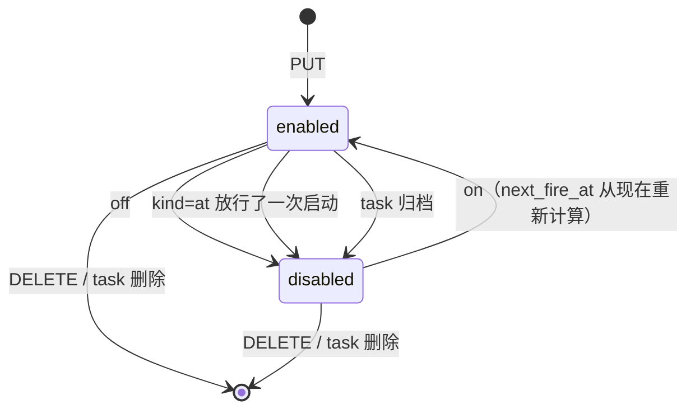
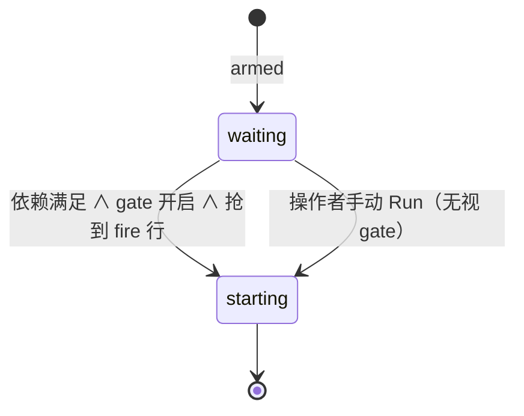

# F173 定时任务（Scheduled Task）

## 意图

目前 task 只有两种启动方式：手动点 Run，或者依赖全部完成后自动启动（依赖边本身就算授权）。
本功能加上第三个授权来源：**时间**。它要支持两类需求：

1. **延后启动 / 启动时间窗**：有些模型夜里更便宜，希望某些 task（包括 feature 的 spec/build/fix 步骤）
   只在晚上开始跑。task 照常 arm、照常挂依赖，但要等时间窗打开才会启动。
2. **周期执行**：按 cron 反复跑一段自定义提示词（比如每天早上总结前一天的提交），每次触发都开一个新的 attempt。

模型沿用"重跑就是新增一行"：**task 是模板**，`body` 就是自定义提示词，arm 参数决定在哪里、用什么跑；
**schedule 决定什么时候可以启动**。不新增执行引擎，所有启动都走现有的 `runs.start_run`。

时间条件和依赖条件是**合取（AND）**关系，不是二选一：一个 task 必须同时满足"依赖已满足"和"时间条件允许"才会自动启动。
两种条件谁后满足，就由谁那一侧的事件触发启动。

非目标：
- 一个 task 只能有一个 schedule。
- 提示词里不做模板变量替换（比如 `{{last_run_at}}`）。
- 只有 regin server 进程负责按时间触发。server 没运行时，按时间触发不会发生，没有系统级 launchd/cron 守护进程。
- 时间窗只管"什么时候能启动"，窗口关闭时不会停止或打断已经在跑的 run。
- 不按模型或 provider 的价格表自动选时间，时间窗由操作者填写。
- 不做云端执行；MCP 工具不加 schedule 读写。

## 形状

```ts
// 新表 agent_task_schedules（alembic 0046 + db/schema.sql + lib/orm/models/tasks.py 三处同步）
type TaskSchedule = {
  id: number
  task_id: number             // UNIQUE, FK agent_tasks.id ON DELETE CASCADE
  kind: "at" | "window" | "cron"   // 可扩展的类别列
  run_at: string | null       // kind=at：UTC ISO8601，"不早于"这个时刻
  window_start: string | null // kind=window："HH:MM"，按 tz 解释
  window_end: string | null   // kind=window："HH:MM"；end < start 表示跨午夜（如 22:00–06:00）
  cron_expr: string | null    // kind=cron：标准 5 段 cron
  tz: string                  // IANA 时区；默认取 server 本机时区
  enabled: 0 | 1
  next_fire_at: string | null // UTC：调度器下一次要醒来的时刻（at 的 run_at / 下一个窗口开始 / 下一个 cron 槽位）
  created_by: number | null
  created_at: string
  updated_at: string
}

// 两类 kind，语义不同（这是规则的主轴）：
//   gate      = at | window —— 管控"这个 task 已 arm 的下一次 attempt 何时可以启动"。没有 armed attempt 就什么都不做
//   recurring = cron        —— 每个槽位都主动开一个新 attempt（参数沿用上一次的）

// 新表 agent_task_schedule_fires —— 只追加，每次时间侧做出的决定写一行
type ScheduleFire = {
  id: number
  schedule_id: number         // FK ON DELETE CASCADE
  slot_at: string             // 这次决定对应的时刻：at 的 run_at / 本次窗口的开始时刻 / cron 槽位（UTC）
  fired_at: string
  outcome: "started" | "skipped_live" | "skipped_blocked" | "refused"
  via: "schedule" | "dependency" | "arm"   // 由哪一侧事件触发了这次启动
  run_id: number | null
  reason: string | null
  // UNIQUE(schedule_id, slot_at) —— 一个窗口实例 / 一个槽位最多启动一次。
  // 调度器和依赖路径争抢同一个窗口时，靠这个约束决定谁启动
}

// API（读 require_auth，写 require_editor；CLI 也走这些接口，所以 schedule 只由 server 进程写入）
// 时间统一存成 UTC "YYYY-MM-DDTHH:MM:SSZ"，next_fire_at 的最小值就是字符串 MIN
GET    /api/tasks/<id>/schedule        → 200 TaskSchedule & { upcoming: string[5], gate_open: boolean } | 404
PUT    /api/tasks/<id>/schedule        body { kind, run_at?, window_start?, window_end?, cron_expr?, tz?, enabled? }
                                       → 200 | 400 { error } | 404
                                       body 只有 { enabled } 时是开关（on 时 next_fire_at 从现在重算）
DELETE /api/tasks/<id>/schedule        → 200 { deleted: true }（fire 行一起删除，run 保留）
POST   /api/tasks/schedule/preview     body 同 PUT → 200 { upcoming: string[5] } | 400
POST   /api/tasks/schedule/bulk        body { task_ids: number[], schedule: PUT body | null } → 200 { applied: number[], refused: {id, error}[] }
GET    /api/tasks/<id>/schedule/fires?limit=50 → 200 ScheduleFire[]
GET    /api/tasks/schedules           → 200 (TaskSchedule & { task_title })[]
POST   /api/tasks/<id>/run            body { respect_schedule: true } 时，gate 关闭 → 409 { error: "waiting for schedule …", waiting_schedule: true, next_fire_at }
// task 序列化增加 schedule: { kind, enabled, next_fire_at, gate_open, summary } | null

// CLI（cli/commands/tasks.py，参照 cmd_arm 通过 inject_server_url 调 server）
regin task schedule <id>                                   // 查看
regin task schedule <id> --at 2026-10-24T01:00 [--tz …]
regin task schedule <id> --window 22:00-06:00 [--tz Asia/Shanghai]
regin task schedule <id> --cron "0 9 * * 1-5" [--tz …]
regin task schedule <id> --off | --on | --clear
regin task schedules                                       // 列出所有 schedule
```

cron 解析用成熟的库（`croniter`，由 pallets-eco 维护；不能用时换成 `cronsim`），作为新依赖加进项目，不自己写解析器。
窗口和 `at` 的时区换算用标准库 `zoneinfo`。

### 生命周期

**图一：schedule 是否启用**（由操作者控制；`at` 放行一次启动后由系统关闭）



**图二：gate 在某一时刻是否开启**（只取决于时间，和图一互相独立，图一为 disabled 时视为不受限）

| kind | 开启条件 |
|---|---|
| at | `now ≥ run_at` |
| window | `now` 在 tz 下的本地时刻落在 `[window_start, window_end)` 内（跨午夜的窗口按两段处理） |
| cron | 不适用（cron 不是 gate，也不拦截别的启动路径） |

**图三：一个 armed 的 gated task 何时启动**



### 调度器

- 一个 daemon 线程，在 `regin serve` 启动时开启，启动方式和 `_start_workflow_watcher` 一样：
  `--debug` 下只在 reloader 子进程里启动，replica 模式下不启动。
- 循环：读出所有 `enabled=1` 的 schedule 中最小的 `next_fire_at`，在一个 `threading.Event` 上 wait 到那个时刻；
  server 内任何 schedule 写入都会 `set()` 这个 Event，线程被唤醒后重新读取。没有固定轮询间隔。
- 启动时先处理一轮，处理所有 `next_fire_at < now` 的 schedule（见"错过的时刻"），然后进入循环。
- 去重靠 `UNIQUE(schedule_id, slot_at)`，不靠时间窗口。按时间触发是这个功能本身的需求，不是用时钟兜底修 bug。

## 规则

### 能否设置 schedule（PUT / bulk 中的每一项）

| 条件 | 结果 |
|---|---|
| 未知 id | 404（bulk：放进 refused） |
| `status = archived` | 400 "an archived task cannot be scheduled" |
| 表达式或时间无法解析；`tz` 不是合法的 IANA 名称；`window_start == window_end` | 400，附带原因 |
| `kind=at` 且 `run_at ≤ now` | 400 "the start time must be in the future" |
| `kind=cron` 且接下来 10 个槽位中任意相邻两个间隔 < 5 分钟 | 400 "runs must be at least 5 minutes apart" |
| `kind=cron` 且这个 task 既没有 armed attempt 也没有任何历史 attempt | 400 "choose launch settings (arm the task) before scheduling repeats"（cron 要靠参数才能主动启动） |
| `kind=at/window` 且这个 task 还没 arm | 允许，gate 先挂上，arm 之后才生效 |
| 有 `feature_id`、有依赖边（无论在哪一端）、`kind` 是 spec/build/fix | **允许**，不作为拒绝条件 |
| 其他情况 | 200，写入或替换 schedule，计算 `next_fire_at`，唤醒调度器 |

### gate（at / window）：三条触发路径都必须检查同一个条件

条件 `can_auto_start(task)` = task 是 armed ∧ `deps.blocking(task) == []` ∧ 不存在存活的 run ∧（没有启用的 gate ∨ gate 开启）。

| 事件 | 所在代码 | gate 关闭时 | gate 开启时 |
|---|---|---|---|
| 依赖完成 | `runs._fire`（经由 `fire_ready_dependents` / `fire_deferred`） | 不启动，保持 armed，**不**标记为 deferred（等调度器在 gate 开启时处理） | `can_auto_start` 成立就抢 fire 行（`via=dependency`），再 `start_run` |
| arm 写入 | `fire_if_ready`（web arm、MCP arm、feature_slices） | 不启动 | 有启用的 gate 时，gate 本身就是授权：即使没有依赖，`can_auto_start` 成立也启动（`via=arm`）。没有 gate 时保持现在的行为（无依赖的 arm 不会启动） |
| gate 开启（调度器在 `next_fire_at` 醒来） | 调度器 | — | `can_auto_start` 成立 → 抢 fire 行（`via=schedule`）并启动；依赖未满足 → 不写行，等依赖完成那一侧来触发；没有 armed attempt → 不写行。没启动时：window 推进到下一个窗口开始；at 置 `next_fire_at=NULL` 但保持启用（gate 从此一直开启，由依赖/arm 路径负责） |
| 操作者手动 Run（单个 task） | `start_run` | 无视 gate，直接启动，不写 fire 行 | 同左 |
| Run all / 批量运行 | 前端 Run all 逐个 `POST /run`，带 `respect_schedule: true` | 409，报告里写明 "Waiting for its schedule · <下次开启时刻>" | 正常启动 |

fire 行的 `slot_at`：`at` 用 `run_at`；`window` 用**本次窗口实例的开始时刻**（例如依赖在 23:40 完成，窗口是 22:00–06:00，slot_at 就是当晚 22:00）。
所以同一个窗口实例里，调度器和依赖路径最多只有一方能启动。

启动成功之后：

| kind | 之后 |
|---|---|
| at | `enabled=0`，`next_fire_at=NULL`。之后重新 arm 不会被这个旧 gate 自动启动 |
| window | 保持启用，`next_fire_at` = 下一个窗口的开始时刻。task 重新 arm 后，会在之后的窗口里启动 |

启动被拒绝（RunRefused / WorktreeRefused / LaunchRefused）：写 `outcome=refused` 和 reason，
并发一张 `warning` 级 agent message 卡片（key 为 `schedule-refused:<task_id>`，下次成功启动时撤下）。task 保持 armed。

### recurring（cron）：每个槽位

| 条件 | outcome | 是否启动 |
|---|---|---|
| fire 行 INSERT 冲突 | （不写行） | 否 |
| 存在存活的 run | `skipped_live` | 否 |
| `deps.blocking(task)` 不为空 | `skipped_blocked`，reason 写阻塞它的 task id | 否 |
| 启动被拒绝 | `refused` + 卡片（同上） | 否 |
| 其他情况 | `started`，`via=schedule` | 是，走 `start_run`，参数由 `open_attempt` 决定（优先用 armed 的那一行，否则沿用上一次 attempt 的参数） |

无论哪种结果，处理完都把 `next_fire_at` 推进到下一个槽位。cron 不是 gate，不拦截依赖路径或 arm 路径的启动。
cron task 每跑完一次，都照现有的 `fire_ready_dependents` 规则释放它的依赖方；这是已有行为，不做特殊处理。

### 错过的时刻（server 停止、机器休眠）

| 情况 | 行为 |
|---|---|
| cron：错过 1 个或多个槽位 | 只处理**最近的一个**错过的槽位（按上面的表），更早的槽位不补也不记录；然后推进到 `> now` 的第一个槽位 |
| at：`run_at` 已经过去 | gate 视为开启，启动时按 gate 规则处理 |
| window：停机期间错过了整段窗口 | 不补跑；`next_fire_at` = 下一个窗口的开始时刻（错过夜间窗口就等下一晚，不在白天补跑） |
| window：启动时正处在窗口内 | 立即按"gate 开启"处理 |

写入 window 时如果当前正处在窗口内，`next_fire_at` = 本次窗口实例的开始时刻（已到期），调度器下一轮立即按"gate 开启"处理。

**待操作者确认**：`Event.wait(timeout)` 在 CPython 里按单调时钟计时，macOS 上单调时钟在睡眠期间不走，
所以机器睡眠后唤醒，调度器会晚"睡眠时长"才醒来（未实测，推断）。实现没有加分段轮询（项目规则禁止用时钟兜底）；
是否需要监听系统唤醒事件之类的方案，由操作者决定。

## 不变量

- 对任意 (schedule_id, slot_at)，最多只有一行 fire，因此每个窗口实例 / 槽位最多自动启动一次，多个 server 进程同时运行也成立。
- 对任意启用了 gate 且 gate 关闭的 task，依赖路径、arm 路径、批量运行都不会启动它；只有操作者的单个手动 Run 可以。
- 对任意自动启动，启动时依赖都已满足，gate（如果有）都是开启的。
- 时间条件和依赖条件都满足的那一刻，一定有一个事件会去尝试启动：后满足的条件是依赖时，由依赖路径负责；后满足的条件是时间时，由调度器负责。不会出现两边都在等对方的情况。
- fire 行只由调度器和 gate 放行的依赖/arm 路径写入；手动 Run 不写 fire 行。
- 删除 schedule 或把它设为 off，不会删除或修改任何 `agent_task_runs` 行。
- 定时启动的 attempt 和手动 Run 走同一条 `start_run` → `complete_run` 路径，settle、liveness、`task finish` 都没有第二套实现。

## 界面

界面文案一律英文，和应用其余部分一致（服务端返回给界面的错误和 summary 也是英文）。

- **TaskDetailView** 的 "Schedule" 卡片，按常见日程类 App 的习惯组织，顶部一个分段控件选三种模式：

  | 模式 | kind | 表单 |
  |---|---|---|
  | Once | at | 日期 + 时间两个原生输入（浏览器本地时区，发送前转 UTC，所以不显示时区）；快捷按钮 In 1 hour / Tonight 22:00 / Tomorrow 09:00；默认一小时后 |
  | Repeat | cron | "Repeats" 下拉：Every hour（填分钟）/ Every day / Every weekday (Mon–Fri) / Every week（星期几切换按钮）+ 时间 / Custom (cron)。只有 Custom 露出 cron 原文；已保存的 cron 读回成对应频率，读不回的落到 Custom，原文不被改写 |
  | Time window | window | "Between HH:MM and HH:MM"，"Overnight" 一键填 22:00–06:00，附一句说明：每次 arm 后等窗口开启才启动，不打断在跑的 run |

  Repeat / Time window 下有 "Time zone" 下拉（`Intl.supportedValuesOf('timeZone')`，默认浏览器时区）。
  没有"启用"复选框：已保存的 schedule 用 Pause / Resume 切换，Remove 清除。
  已保存时顶部是一句人话描述（"Runs once at Oct 25, 09:00" / "Repeats every weekday at 09:00 (Asia/Shanghai)" / "Starts only between 22:00 and 06:00 (…)"）+ 下次时刻与倒计时，暂停显示 Paused。
  预览行（Starts / Next runs / Next openings）调 `/schedule/preview` 实时校验，预览与保存共用那两条不需要 task 上下文的拒绝规则（过去的 run_at、间隔小于 5 分钟的 cron）。

  schedule 只决定"何时"，启动参数来自 armed attempt，所以保存时 task 还没 arm：

  | 情况 | 行为 |
  |---|---|
  | Once / Time window，未 arm | 先保存 schedule，再自动打开 arm 面板（先挂 gate 再 arm，避免依赖已满足的 task 在无 gate 时一 arm 就启动） |
  | Repeat，未 arm 且服务端拒绝（无任何历史 attempt） | 打开 arm 面板，arm 完成后自动重试保存 |
  | gate 已保存但仍未 arm | 提示 "Not armed yet — it will start on schedule once it has launch settings." 并给 "Choose launch settings" 按钮 |
- **等待原因**：armed 且依赖已满足、只差 gate 的 task，在看板卡片、列表行、lane graph 节点上显示 "Starts in 3h"，
  和现有的"被 #N 阻塞"并列。cron task 显示时钟图标和 "Repeats · in 3h"。disabled 的 schedule 显示灰色 "Schedule off"。
  lane graph 节点定宽，chip 只放倒计时（前缀让位给倒计时，绝不截掉"还要等多久"）。
- **TaskBulkBar**："Schedule…" 下拉：Only start overnight (22:00–06:00) / Remove schedule（调 `/schedule/bulk`）。
- **TaskRunHistory**：由 schedule 启动的 attempt 标出 "Scheduled · <slot_at 本地时间>" 和 `via`；`skipped_*` / `refused` 也各占一行显示原因。

## 验收

```gherkin
Feature: 定时任务

  Scenario: window gate holds a dependency release until the window opens
    Given task B 依赖 task A，B 已 arm，B 的 schedule 为 window 22:00-06:00 tz "Asia/Shanghai"
    When A 在当地 15:00 完成
    Then B 没有启动，仍然是 armed
    When 调度器在当地 22:00 醒来
    Then B 启动了一个新 attempt，写入一行 fire，outcome=started，via=schedule，slot_at 是当晚 22:00

  Scenario: dependency completing inside an open window starts immediately
    Given B 依赖 A，B 已 arm，window 22:00-06:00
    When A 在当地 23:40 完成
    Then B 立即启动，fire 的 via=dependency，slot_at 是当晚 22:00

  Scenario: window instance launches at most once across both paths
    Given 同一个窗口实例里，调度器和依赖路径同时判定 B 可以启动
    Then 只有一行 fire，B 只有一个新 attempt

  Scenario: scheduler at window open waits for blocked dependencies
    Given B 依赖 A，A 还没完成，window 已打开
    When 调度器醒来
    Then 不写 fire 行，B 不启动
    And 窗口内 A 完成后，B 由依赖路径启动

  Scenario: missed window is not made up in daytime
    Given window 22:00-06:00 的 task，server 从 21:00 一直停到次日 08:00
    When server 启动
    Then 不启动，next_fire_at 是当晚 22:00

  Scenario: feature step can be gated
    Given 某个 feature 的 build 步骤 task，已 arm，依赖 spec 步骤
    When PUT 一个 window schedule
    Then 返回 200

  Scenario: arming under an open gate starts a task without dependencies
    Given 没有依赖的 task，schedule 为 at，run_at 已过（gate 开启）
    When arm 这个 task
    Then 它启动了，fire 的 via=arm，随后 schedule 变为 enabled=0

  Scenario: arming without a gate keeps current behaviour
    Given 没有依赖、没有 schedule 的 task
    When arm 这个 task
    Then 它不会启动

  Scenario: at gate fires once at run_at
    Given 已 arm、没有依赖的 task，schedule 为 at 2026-10-24T01:00:00Z
    When 调度器处理这个时刻
    Then 启动一个 attempt，schedule 变为 enabled=0，next_fire_at 为 NULL

  Scenario: manual run overrides a closed gate
    Given window 关闭中的 armed task
    When 操作者手动 Run
    Then 立即启动，不写 fire 行

  Scenario: run all skips a gated task
    Given 两个 armed 且就绪的 task，其中一个的 window 当前关闭
    When 执行 Run all
    Then 只启动没有 gate 的那个，报告里写明另一个 "Waiting for its schedule"

  Scenario: cron schedule fires a new attempt with the task body as prompt
    Given 已 arm 的 task，body 为 "总结昨天的提交"，schedule 为 cron "0 9 * * *" tz "Asia/Shanghai"
    When 调度器处理 2026-10-24T01:00:00Z 这个槽位
    Then 新增一个 attempt，启动提示词以 "总结昨天的提交" 开头，fire outcome=started
    And next_fire_at = 2026-10-25T01:00:00Z

  Scenario: cron slot with blocked dependencies is skipped
    Given cron task 依赖一个尚未完成的 task
    When 槽位到期
    Then fire outcome=skipped_blocked，reason 包含阻塞它的 task id，没有启动

  Scenario: live previous attempt skips the cron slot
    Given cron task 的上一个 attempt 仍然存活
    When 下一个槽位到期
    Then fire outcome=skipped_live，next_fire_at 推进到下一个槽位

  Scenario: missed cron slots catch up exactly once
    Given 每小时触发的 cron，next_fire_at 比现在早 5 小时
    When server 启动
    Then 只写入 1 行 fire，slot_at 是最近错过的那个整点

  Scenario: refused launch is recorded and announced
    Given gate 开启、即将启动的 task，worktree 参数会导致 WorktreeRefused
    When 调度器尝试启动它
    Then fire outcome=refused 并带 reason，存在 key 为 "schedule-refused:<task_id>" 的 warning 卡片，task 仍然 armed

  Scenario: schedule write wakes the sleeping scheduler
    Given 调度器正在 wait 一个 1 小时后的时刻
    When PUT 一个 1 分钟后的 at schedule
    Then 调度器在新时刻处理它

  Scenario: too frequent cron is refused
    When PUT cron "*/2 * * * *"
    Then 返回 400 "runs must be at least 5 minutes apart"

  Scenario: bulk gate applies to several tasks
    When POST /api/tasks/schedule/bulk，task_ids 为 [1,2,3]，内容为 window 22:00-06:00
    Then 三个 task 都有这个 schedule，返回 applied=[1,2,3]

  Scenario: DST is honoured by the schedule timezone
    Given cron "30 2 * * *" tz "America/New_York"
    When 计算 2026-11-01 前后的 upcoming
    Then 槽位按当地时间 02:30（DST 语义按库的定义），对应的 UTC 偏移随 DST 变化

  Scenario: deleting the schedule keeps run history
    Given 已触发过 3 次的 schedule
    When DELETE /api/tasks/<id>/schedule
    Then agent_task_runs 仍然是 3 行，fire 行被删除

  Scenario: cli schedule goes through the server
    When 运行 regin task schedule <id> --window 22:00-06:00
    Then 请求发往 PUT /api/tasks/<id>/schedule，调度器被唤醒

  Scenario: schema parity for schedule tables
    Then 新建库（schema.sql）和迁移库（alembic upgrade head）中两张新表的结构一致
```

人工核验（需要在真实路径上贴出证据）：在 `regin serve` 下，把一个依赖已完成的 armed task 设置为当前时刻 2 分钟后开始的 window。
窗口开始之前它不会启动；窗口开始后，TaskDetailView 的运行历史里出现 "Scheduled" attempt，并且能打开它的 trace。


