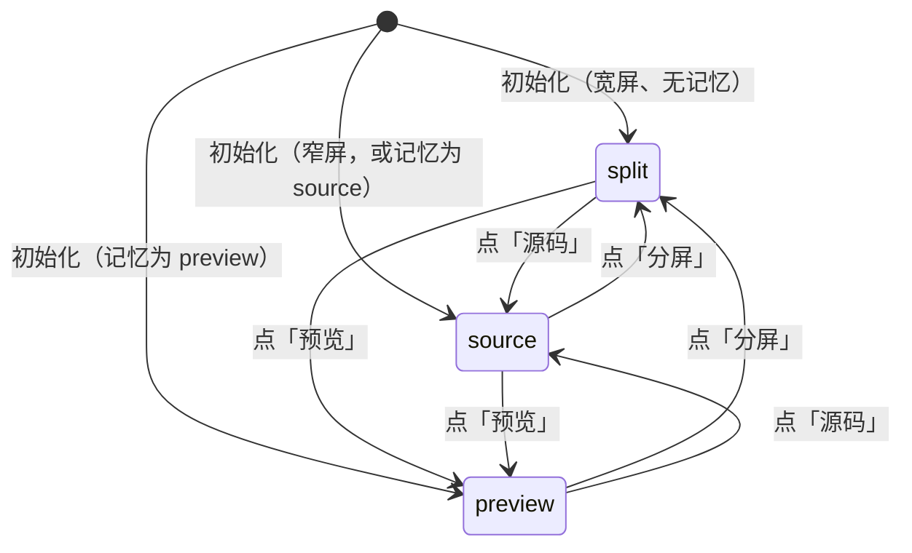
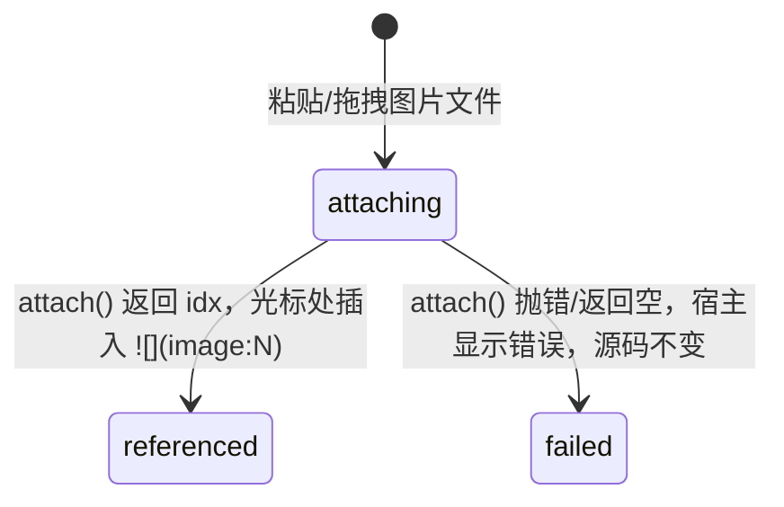

# Feature 编辑器优化

## Intent

Feature spec、Task body、Defect symptom 三处正文的编辑都是一个纯 `<textarea>`，源码与预览二选一切换：写的时候看不到渲染结果，加粗/列表/代码块要手敲标记，贴图后要切到预览才知道贴对了没有。

本功能把这三处编辑器升级为一个共享的 **源码 + 实时预览** 分屏组件，带工具栏、拖拽/粘贴图片、`@` 引用——前提是**源码优先、字节精确回写**。这个前提不是偏好而是数据：这些列由 agent 读写，spec 大量使用表格、mermaid、gherkin。本轮调研对库内 544 篇真实正文做了一次 CommonMark 格式化往返（mdformat+gfm），483 篇（89%）被改写，24,260 行中 4,822 行（19.9%）变化——3,404 行是表格重排，433 行是列表/强调符号，73 行是新增转义；与 `TaskBodyEditor.vue` 记录的早期实测（regin:67，11% 行被改写、HTML 注释被删）同向。任何经 AST 往返的编辑器都会把一次人工改一个字的保存变成一次全文重排。

### 方案选型

| 方案 | 字节精确 | 预览与保存后视图一致 | 复用 `useRefMentions`/`RefMenu` | 新增依赖 | 结论 |
|---|---|---|---|---|---|
| **A. 保留 `RefTextarea` 源码面 + 现有 `MarkdownContent` 实时预览 + 工具栏**（本 spec） | ✓ | ✓ 同一渲染器 | ✓ 原样 | 0 | **采用** |
| B. CodeMirror 6 源码面（`@codemirror/lang-markdown`），预览同 A | ✓ | ✓ | 需适配层：`menu.sync`/`editFor` 已是位置式 API，可对接 `view.dispatch`；`RefHighlight`→decorations | +CM6 7 包（体积本轮未测成功） | 作为 A 的**后续**：换掉源码面即可，组件边界不变；换 contenteditable 后 4 个 E2E 的 `fill()` 要改 |
| C. md-editor-v3 7.1（Vue 3，CM6 底层，2.6k★，MIT） | ✓（关 prettier） | ✗ markdown-it + 自带主题，`RefChip` 要重写成 markdown-it 插件 | ✗ 只能走 CM6 `completions`，丢掉分区/预览/下钻菜单 | highlight/prettier/mermaid/katex/cropper/screenfull 默认从 unpkg 加载（`packages/MdEditor/config.ts`） | 否 |
| D. Vditor 4.0 / cherry-markdown 0.11 | Vditor 经 lute 重排 ✗；cherry 源码模式 ✓ | ✗ 自带渲染引擎 | ✗ | Vditor 23MB、cherry 50MB unpacked，cherry 依赖 jsdom，许可 NOASSERTION | 否 |
| E. Tiptap 3.32 / Milkdown 7.22 WYSIWYG | ✗ AST 往返（上文实测） | — | ✗ | — | 否 |
| F. CM6 Obsidian 式 live-preview 库（codemirror-live-markdown 0.5-alpha 43★、atomic-editor 159★ React、@latentic/live-markdown 1★ React） | ✓ | — | — | 无一成熟或框架无关 | 否；若日后要单栏即时渲染，在 B 之上自建 decorations |

Linear 的编辑器是单栏 WYSIWYG（输入 Markdown 即转富文本，无源码模式，Markdown 仅作导出）。在字节精确约束下复刻不了这条路，分屏是诚实的折中。

**Non-goals**
- 不做多人实时协同编辑。
- 不做 WYSIWYG；不为了渲染好看而改写、规范化用户输入的字节。
- 不替换 `[label](kind:key)` 与 `` 两条既有语法契约。
- 不做源码面与预览面的滚动同步（长 spec 的分屏体验问题，留作后续）。
- 不渲染 mermaid（`MarkdownContent` 今天也不渲染，预览与保存后一致即可）。
- 不以移动端为首要场景。

## Model

组件：`frontend/src/components/editor/MarkdownEditor.vue`，包裹现有 `RefTextarea`（源码面）与 `MarkdownContent`（预览面）。宿主 `FeatureSpec.vue` → `TaskBodyEditor.vue` → `DefectSymptom.vue` 依次替换。

```typescript
type EditorMode = 'source' | 'split' | 'preview'
// source  = 仅源码（旧习惯）
// split   = 左源码右预览（默认）
// preview = 仅渲染预览，只读

type Props = {
  modelValue: string
  project: number | null       // `@` 搜索与 file: 引用的范围
  feature: number | null       // 领先菜单的 feature
  images: AttachedImage[]      // 宿主的附件列表，预览用 resolveImageRefs 解析 image:N
  attach: ((source: DataTransfer) => Promise<number[]>) | null
  previewTestid: string | null // 预览面的 data-testid，由宿主命名（feature-spec-preview-pane / task-body-preview-pane / defect-symptom-preview-pane）
  verbatim: boolean            // 宿主保存后视图是原样引用而非 markdown（Defect symptom 经 RefInlineText 显示）：预览改用 RefInlineText + pre-wrap，工具栏不渲染
}
// 其余属性与监听（data-testid、aria-label、rows、spellcheck、@paste、@drop、@dragover）落在源码 textarea 上；
// class/style 落在组件根。组件经 defineExpose 暴露 `textarea`，供 utils/caret.js 读光标。
// 模式切换条按钮文案为 Source / Split / Preview（与应用其余 UI 同为英文），data-testid editor-mode-<mode>，根元素带 data-mode。

type Emits = {
  'update:modelValue': string  // 源码字节，原样上抛
}

type MarkKind = 'bold' | 'italic' | 'heading' | 'bullet_list'
              | 'numbered_list' | 'checkbox' | 'code_block' | 'link'
```

### 视图状态机



### 图片生命周期



## Rules

### 编辑器模式选择

| 场景 | 模式 | 说明 |
|---|---|---|
| 宽屏（≥ 768px）、无记忆 | `split` | 三处宿主一致 |
| 用户曾手动切换 | 记忆值 | `localStorage` key `regin_editor_mode`，与 `regin_auth_*` 同前缀 |
| 窄屏（< 768px） | `source` | 分屏放不下，切换条不提供 Split；此时记忆值被忽略，窄屏下的切换只作用于本次编辑、不写回记忆 |
| 宿主 `tracked`（spec 来自外部 issue） | 不进入编辑 | 与今天一致 |

### 工具栏

工具栏只在 `source` / `split` 模式显示。每个按钮的编辑都经 `RefTextarea` 暴露的 `replaceRange(start, end, text)`——即 `execCommand('insertText')`，失败回退 `setRangeText` + 派发 `input`——而不是重写 `modelValue`：重写会清空撤销栏，而 `RefTextarea` 的 `@` 接受已经依赖这条路径。

| 按钮 | 有选区 | 无选区 |
|---|---|---|
| 粗体 | 选区两侧加 `**` | 插入 `****`，光标居中 |
| 斜体 | 选区两侧加 `_` | 插入 `__`，光标居中 |
| 标题 | 当前行首加 `## `（已有 `#` 前缀则再加一级，最多 `####`） | 同左 |
| 无序列表 | 选区每行行首加 `- ` | 当前行首加 `- ` |
| 有序列表 | 选区每行行首加 `1. `、`2. `… | 当前行首加 `1. ` |
| 复选框 | 选区每行行首加 `- [ ] ` | 当前行首加 `- [ ] ` |
| 代码块 | 选区包进 ```` ``` ```` 围栏（前后各一换行） | 插入围栏，光标在中间空行 |
| 链接 | 选区作 label，弹输入框取 url，生成 `[label](url)` | 弹输入框取 url，生成 `[](url)`，光标在 `[]` 内 |

### 预览面

| 规则 | 值 |
|---|---|
| 渲染器 | 与宿主保存后的只读视图同一个组件：默认 `MarkdownContent`（`refs` 开、`project` 透传）；`verbatim` 宿主（Defect symptom，`defect-symptom-verbatim.spec.js` 守护其「引用不渲染」）用 `RefInlineText` + `white-space: pre-wrap` |
| 输入 | `resolveImageRefs(draft, images)`，与今天的 `draftRendered` 相同 |
| 刷新时机 | 每次 `update:modelValue` 同步重算（Vue computed），不防抖、不定时 |
| 空正文 | 预览面显示占位文字，不显示空白 |

### 引用与图片语法保持

| 既有语法 | 新编辑器行为 |
|---|---|
| `[label](kind:key)` | 预览侧由 `MarkdownContent` 渲染为 `RefChip`；源码侧保持原字符串，`RefHighlight` 仍叠加高亮 |
| `` | 预览侧经 `resolveImageRefs` 解析为鉴权 object URL；源码侧保持原字符串 |
| `@` 引用菜单 | `RefTextarea` 原样：分区菜单、预览、kind 下钻、代码区静默、IME 合成处理 |
| 粘贴图片文件 | 宿主 `onPaste`/`onDrop` 原样：`attach()` 成功后经 `withCaretInsert` 写入 ``；失败不写入任何占位 |
| 粘贴内部 URL | `RefTextarea.onPaste` 原样转为引用语法 |

## Invariants

1. **字节精确回写**：`update:modelValue` 上抛的字符串与源码 textarea 的 `value` 完全一致；预览只读，不反向修改源码。
2. **预览即保存后所见**：预览面与保存后的只读视图由同一个组件类型渲染同一字符串（Feature spec / Task body 为 `MarkdownContent`，Defect symptom 为 `RefInlineText`），两者 HTML 相同。
3. **每个工具栏动作是一个撤销步**：按钮插入后 `Cmd/Ctrl+Z` 一次恢复到按下前的文本与选区。
4. **引用与图片契约不变**：`[label](kind:key)` 与 `` 在保存、读取、预览三条路径上与旧编辑器行为一致。
5. **图片上传失败不残留占位符**：失败时源码中不出现任何 `` 或临时标记。
6. **旧 E2E 继续通过**：`feature-images.spec.js`、`ref-mentions.spec.js`、`defect-symptom-verbatim.spec.js`、`task-body-markdown.spec.js` 不改输入方式即通过——源码面仍是宿主原有的 textarea（`feature-spec-input` / `task-body-area` / `defect-edit-field-<id>`）。
7. **零新增运行时依赖**：`frontend/package.json` 的 `dependencies` 不变。

## Acceptance

```gherkin
Feature: Feature spec 分屏编辑器

  Scenario: 宽屏默认以分屏模式打开 — test_split_default_on_wide_viewport
    Given 视口宽度 ≥ 768px 且 localStorage 无 regin_editor_mode
    When  用户点击 Feature spec 的 Edit
    Then  左侧为 data-testid="feature-spec-input" 的 textarea，右侧为 data-testid="feature-spec-preview-pane"
    And   工具栏显示在源码区上方

  Scenario: 分屏模式下输入即渲染 — test_typing_renders_preview
    Given 编辑器处于 split 模式
    When  用户在源码区键入 "## 目标"
    Then  预览区出现 <h2>目标</h2>
    And   源码区的 value 恰为 "## 目标"

  Scenario: 记住用户选择的模式 — test_mode_is_remembered
    Given 编辑器处于 split 模式
    When  用户切到 source 模式并刷新页面后再次 Edit
    Then  编辑器以 source 模式打开

  Scenario: 窄屏回退源码模式 — test_narrow_viewport_falls_back_to_source
    Given 视口宽度 < 768px 且 localStorage 记忆为 split
    When  用户点击 Edit
    Then  编辑器以 source 模式打开，localStorage 值仍为 split

  Scenario: 打开即保存，字节不变 — test_save_is_byte_exact
    Given 一个已有 spec 含 "[label](kind:key)"、"" 与一张对齐不齐的表格
    When  用户 Edit 后直接 Save
    Then  PATCH 的 body 与原字符串逐字节相同

  Scenario: 工具栏插入粗体并可一步撤销 — test_toolbar_bold_is_one_undo_step
    Given 编辑器处于 split 模式，源码区选中「重点」
    When  用户点击工具栏「粗体」
    Then  源码区变为 "**重点**"，预览区显示 <strong>重点</strong>
    When  用户按 Cmd/Ctrl+Z
    Then  源码区恢复为 "重点" 且选区不变

  Scenario: 工具栏行级按钮作用于选区每一行 — test_toolbar_line_marks_apply_per_line
    Given 源码区选中两行 "a\nb"
    When  用户点击「无序列表」
    Then  源码区变为 "- a\n- b"
    When  用户点击「复选框」于单行 "c"
    Then  该行变为 "- [ ] c"

  Scenario: 链接按钮询问 url — test_toolbar_link_prompts_for_url
    Given 源码区选中「文档」
    When  用户点击「链接」并输入 https://example.com
    Then  源码区变为 "[文档](https://example.com)"

  Scenario: 粘贴图片写入引用并在预览显示 — test_pasted_image_writes_reference_and_previews
    Given 编辑器处于 split 模式
    When  用户粘贴一张图片且 attach() 返回 [3]
    Then  光标处出现 ""
    And   预览区出现指向该附件 object URL 的 

  Scenario: 上传失败不污染源码 — test_failed_upload_leaves_source_untouched
    Given 编辑器处于 split 模式，源码为 "abc"
    When  用户粘贴一张图片且 attach() 抛错
    Then  源码区仍为 "abc"，宿主显示错误提示

  Scenario: @ 引用保持原有契约 — test_mention_contract_preserved
    Given 编辑器处于 split 模式
    When  用户键入 "@" 并选择 Task 42「title」
    Then  源码区插入 "[title](task:42)"
    And   预览区渲染为对应 RefChip

  Scenario: 组件复用到 Task body 与 Defect symptom — test_component_reused_in_task_and_defect_editors
    Given Feature spec 的分屏编辑器已合入
    When  TaskBodyEditor 与 DefectSymptom 切换为同一组件
    Then  两处 Edit 后默认 split，预览面 data-testid 分别为 task-body-preview-pane / defect-symptom-preview-pane
  And   Defect symptom 的预览原样显示 "**x**"（无 <strong>、保留换行），且不显示工具栏
    And   task-body-markdown.spec.js 与 defect-symptom-verbatim.spec.js 不改输入方式即通过
```

## 切片

每片在 `f174/integration` 上开自己的 worktree 分支，合回 `f174/integration`；S5–S7 是链尾。所有 E2E 放 `frontend/tests/`，沿用 `auth-fixture.js` 与既有 spec 的路由 mock 写法（参考 `feature-images.spec.js`）。

| # | Slice | Delivers | Spec refs | Tests | Schema | Depends on | Base | Skill |
|---|---|---|---|---|---|---|---|---|
| S1 | MarkdownEditor 组件 + 三模式 + 预览面 + 接入 FeatureSpec | 新增 `frontend/src/components/editor/MarkdownEditor.vue`：props `modelValue/project/feature/images/attach`，emit `update:modelValue` 原样上抛；内含 `RefTextarea`（源码面，textarea 保留宿主传入的 `data-testid`、`aria-label`、`@paste`/`@drop` 监听与 `ref`→`textarea` 暴露，供 `utils/caret.js` 读光标）与 `MarkdownContent`（预览面，`refs` 开、`project` 透传，输入 `resolveImageRefs(modelValue, images)`，每次输入同步重算，无防抖）；模式切换条「源码 / 分屏 / 预览」三个 `aria-pressed` 按钮，模式状态机按 spec：宽屏无记忆→split，记忆读写 `localStorage` key `regin_editor_mode`，窄屏（< 768px，`matchMedia`）强制 source 且不覆盖记忆；工具栏位置预留插槽但本片不实现按钮。`FeatureSpec.vue` 用它替换现有 `RefTextarea + v-show 预览` 组合，删除 `previewing` 状态与 Preview/Source 切换按钮（模式切换归组件），`fs-area`/`fs-body` 样式迁入组件或经 class 透传；预览面保留 `data-testid="feature-spec-preview-pane"`。宿主 `onPaste/onDrop/takeImages/save` 不变。E2E `frontend/tests/f174-split-editor.spec.js` 覆盖本片 5 个 Scenario；`feature-images.spec.js`、`ref-mentions.spec.js` 继续通过 | Model, Rules 编辑器模式选择, Rules 预览面, Invariants 1 2 6 7 | test_split_default_on_wide_viewport, test_typing_renders_preview, test_mode_is_remembered, test_narrow_viewport_falls_back_to_source, test_save_is_byte_exact | — | — | `f174/integration` | goal-verified-treenav |
| S2 | 工具栏：8 个按钮经 replaceRange 插入，一动作一撤销步 | `RefTextarea.vue` 经 `defineExpose` 暴露 `replaceRange(start, end, text)` 与 `setSelection(start, end)`（现有 `execCommand('insertText')` 路径，失败回退 `setRangeText` + 派发 `input`）；新增 `frontend/src/components/editor/EditorToolbar.vue`，按 Rules「工具栏」表实现粗体/斜体/标题/无序列表/有序列表/复选框/代码块/链接八个按钮：包裹类（粗体、斜体、代码块）按有/无选区分支并把光标放回正确位置；行级类（标题、三种列表）对选区覆盖的每一行行首插入，标题在已有 `#` 前缀上加一级、上限 `####`；链接按钮用 `reka-ui` Popover 内联输入 url（不用 `window.prompt`），回车生成 `[label](url)`，Esc 取消不改源码。每个按钮一次 `replaceRange` 调用，使 `Cmd/Ctrl+Z` 一次撤销到按下前的文本与选区；按钮带 `aria-label` 与 `title`，仅在 source/split 模式渲染。工具栏挂进 S1 预留的插槽，位于源码区上方。E2E `frontend/tests/f174-toolbar.spec.js` 覆盖本片 3 个 Scenario，撤销用 `page.keyboard.press('ControlOrMeta+z')` 断言 | Rules 工具栏, Invariants 1 3 | test_toolbar_bold_is_one_undo_step, test_toolbar_line_marks_apply_per_line, test_toolbar_link_prompts_for_url | — | S1 | `f174/integration` | goal-verified-treenav |
| S3 | 分屏下的图片与 @ 引用契约 | 在 S1 组件上验证并补齐：粘贴/拖拽图片走宿主 `attach()`，成功后 `withCaretInsert` 写 `` 且预览面立刻出现对应 object URL 的 ``（`images` prop 变化即重算）；`attach()` 抛错或返回空时源码字节不变、宿主 `fs-error` 显示错误（`FeatureSpec.takeImages` 补 try/catch 并写 `error`，今天抛错会无提示）；`@` 菜单在 split 模式下的 `Teleport` 定位仍以 textarea 的 caret 为锚（`RefTextarea.anchorFor` 不受左右分栏影响），接受后预览面渲染 `RefChip`；预览面不可编辑（无 `contenteditable`，点击 chip 仍导航）。E2E `frontend/tests/f174-images-refs.spec.js` 覆盖本片 3 个 Scenario，复用 `feature-images.spec.js` 的 clipboard 构造与 `ref-mentions.spec.js` 的 `/api/refs` mock | Model 图片生命周期, Rules 引用与图片语法保持, Invariants 4 5 | test_pasted_image_writes_reference_and_previews, test_failed_upload_leaves_source_untouched, test_mention_contract_preserved | — | S1 | `f174/integration` | goal-verified-treenav |
| S4 | 复用到 TaskBodyEditor 与 DefectSymptom | `frontend/src/components/tasks/TaskBodyEditor.vue` 与 `frontend/src/components/defects/DefectSymptom.vue` 改用 `MarkdownEditor`：TaskBodyEditor 删除 `previewing` 状态与 Preview/Source 按钮（`task-body-preview`），源码 textarea 保留 `data-testid="task-body-area"`、`aria-label`、paste/dragover/drop 监听，预览面 `task-body-preview-pane`；DefectSymptom（原为单个内联 `RefTextarea`，无预览切换）保留 `id=ds-<id>`、`data-testid=defect-edit-field-<id>`、Esc/⌘↵ 与粘贴附图，以 `verbatim` 模式接入，预览面 `defect-symptom-preview-pane`；`MarkdownEditor` 新增 `verbatim` prop。TaskBodyEditor 头注释与 `TaskDetailView.vue` 里「Source over a rendered preview」的理由改为指向 `editor/MarkdownEditor`，不再各写一遍。`QuickCaptureBubble` / `TaskComposerDialog` / `NewDefectDialog` 等 composer 不在本片范围。E2E `frontend/tests/f174-reuse.spec.js` 覆盖 test_component_reused_in_task_and_defect_editors；`task-body-markdown.spec.js`、`defect-symptom-verbatim.spec.js`、`defect-edit-inline.spec.js` 不改输入方式即通过 | Model（宿主替换顺序）, Invariants 2 6 | test_component_reused_in_task_and_defect_editors | — | S1, S2, S3 | `f174/integration` | goal-verified-treenav |
| S5 | integrate | 检查 S1–S4 每一片都已合回 `f174/integration`，无人落零 commit；`cd frontend && npx vite build` 通过 | Invariants 7 | test_every_slice_merged_back | — | S4 | `f174/integration` | goal-verified-treenav |
| S6 | migrate + doctor | 跑 `.venv/bin/python cli/regin.py migrate` 与 `regin doctor`，确认本功能没有引入 schema 变更、这个安装没落后 | Non-goals | test_migrate_leaves_no_schema_finding | — | S5 | `f174/integration` | goal-verified-treenav |
| S7 | verify | 全量 `.venv/bin/python -m pytest -q -n auto --dist=loadfile` 与 `cd frontend && ./node_modules/.bin/playwright test`；核对 Acceptance 的每个 Scenario 都有同名 E2E 用例 | Acceptance | test_full_suite_passes | — | S6 | `f174/integration` | goal-verified-treenav |


