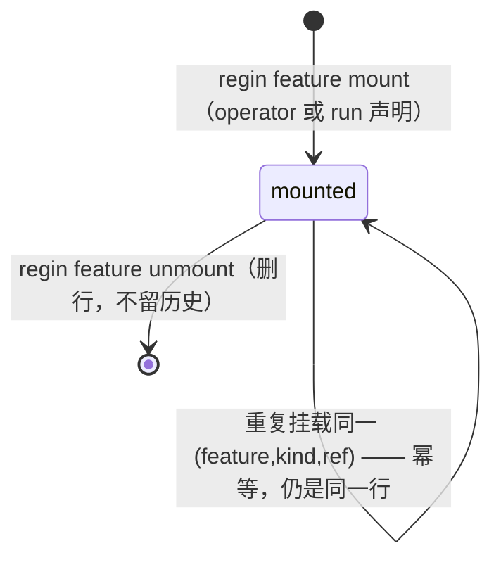
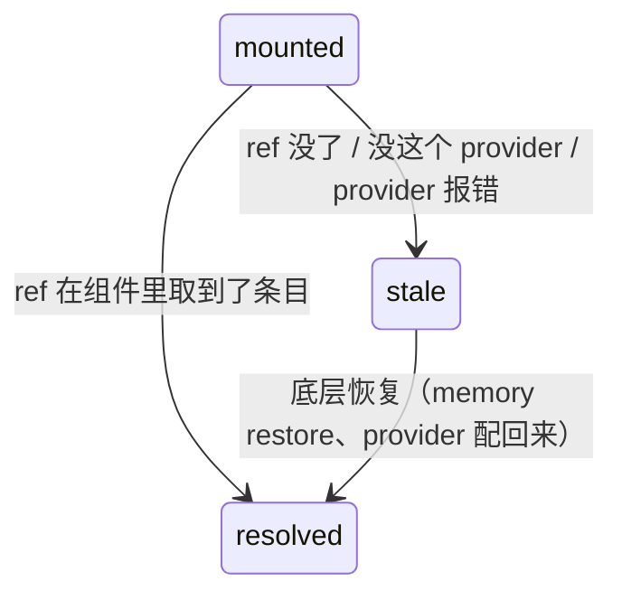
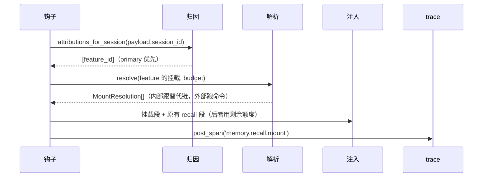

# Feature 支持 memory 挂载

## Intent

一个 feature 的经验教训今天只有一个去处：写进 regin 自己的 memory 库
（`db/regin_memory.db`），按一个单值 `scope`（`global` / `repo:<name>`）归类。结果就是
**feature 认领不到它的教训** —— 第二轮重做、换个 slice 的 run、别人接手的那一轮，全都拿
不回来：`recall` 只按提示词相似度找，只按 scope 过滤，feature 不在任何一条轴上。而且这条
路只通我们自己的 memory：别人想挂进来的组件没有落点，`MemorySink` 那个 Port 至今零实现。

本 feature 让**挂载成为 feature 的一个声明属性**：操作者（或一个 run）把一条经验挂到
feature 下面，之后凡是跑到这个 feature 的会话，注入块里第一段就是这些挂载。谁来、挂什么，
由同一个面收：`internal` 是我们自己的 memory，其它组件走同一个 Provider 注册表 —— 配置为
空时和 `rule_engines` 一样，不长任何 chrome。

判据只有一个：**一个 feature 第二轮开工时，人需要几句话把上一轮的教训重新讲一遍。**

**Non-goals**

- **不动 memory 子系统的数据模型。**`Memory.scope` 的取值域一行不改，memory 侧不新增列、
  不改写路径。挂载住在主库，跨库只按 id 引用 —— 同 `session_features` 的形状。
- **不给挂载做版本。**没有"我批准的是哪一版挂载"的记录：挂卸就是行的增删，spec 修订史不
  在这里重演。
- **不做 round 级挂载。**一条挂载对整个 feature 有效，不按轮次打标点。
- **不自动归因。**没有 cwd 推断、没有"最近碰过的 memory"排序：挂什么是显式声明，跑到哪
  个 feature 由 `session_features` 与 run lane 的既有事实决定。
- **不接具体的第三方产品。**v1 只给一种通用外接适配器（外部命令），接哪家是配置，不在本
  feature 范围内。
- **不做写入方向。**不把我们的经验导出到外部组件 —— `MemorySink` 那个方向不动。

## Model

完整字段在 `lib/orm/models/features.py`；解析产物在 `lib/memory_mounts/`。

```typescript
type FeatureMemoryMount = {      // feature_memory_mounts，主库
  id: int
  feature_id: int                // FK → features.id ON DELETE CASCADE
  kind: 'internal' | string      // registry key；'internal' 永远在，不需要配置
  ref:  string                   // 组件内的标识：internal 为 memory id，外部由 provider 解释
  label: string | null           // 人写的一句话，只用于展示，不参与检索
  declared_by: string            // 'operator' | 'run:<id>' —— 没有无主挂载
  created_at: string
}
// UNIQUE(feature_id, kind, ref) —— 同一物在同一 feature 下只有一行

type MountEntry = {              // 归一化后交给注入块的一段，不是表
  id: string                     // 组件自己的 id，用于去重和 span 指纹
  title: string
  body: string
  kind: 'internal' | string      // 来源组件；注入块用它标注出处
}

type MountResolution = {         // 一次读取的产物
  mount_id: int
  ok: bool
  reason?: 'missing' | 'no-provider' | 'provider-error'
  entries: MountEntry[]          // ok=false 时为空数组，不是 null
}
```

Provider 端口（形状照 `lib/rule_engines/base.py`）：

```python
class MemoryMountProvider(Protocol):    # lib/memory_mounts/ports.py
    id: str                             # == mount.kind
    def describe(self) -> str: ...
    def resolve(self, ref: str, *, limit: int) -> MountResolution: ...
```

```typescript
type MemoryMountConfig = {        // settings.memory_mounts，默认 []
  id: string                      // mount.kind
  kind: 'command'                 // v1 唯一取值
  enabled: bool
  command: string                 // argv 模板，{ref} 为占位符
  timeout_ms: int                 // 默认 5000
}
```

装配预算挂在已有的 `AgentMemoryConfig` 上：

```typescript
mounts_enabled: bool      // 默认 true；false 时注入块与今天逐字相同
mount_max_entries: int    // 挂载段总共几条
mount_max_chars: int      // 挂载段的字符预算，独立于 inject_max_chars
```

两条正交的轴，分开画。

**轴 A — 声明：行在不在。**



**轴 B — 解析：每次读取现算，从不落到库里。**



`stale` 不像 `sync_error` 那样写库 —— 一次失败不改变任何状态，下一次读取就是全部诊断
（Invariant 4）。两轴必须分开：合成一张图的话，"挂上了"和"取不到"会挤进一列，操作者就分
不清是该重挂还是该修底层。

装配顺序 —— 就发生在 `memory_recall.handle` 那条路上，挂载段是第一段：



## Rules

### R1 — 一条挂载是否合法（写的时候拒）

| 情况 | 行为 |
|---|---|
| `kind='internal'` 且 `ref` 在 memory 库里不存在 | **拒绝** —— 挂空气比不挂更坏 |
| `kind='internal'` 且该 memory `status='retired'` 且 `superseded_by` 为空 | **拒绝** —— 退了役也没有接替者 |
| `kind` 不在注册表（非 `internal` 且 `settings.memory_mounts` 里没有） | **拒绝**，报错里列出已注册的 `id` |
| `(feature_id, kind, ref)` 已存在 | 幂等，返回已有行，不是错误 |
| `feature_id` 不存在 | **拒绝** |
| `declared_by` 为空 | **拒绝** —— 没有无主挂载 |

### R2 — 解析一条 internal 挂载（读的时候）

| memory 那一行是 | → |
|---|---|
| `status='active'` 且 `superseded_by` 为空 | 用它 |
| `status='retired'` 且 `superseded_by` 指向另一条 | **沿链向前到链头**，用链头那条 —— 一次 supersede 是刷新，不是重新归档 |
| 行不存在（hard forget） | `stale:missing` |
| `status='retired'` 且 `superseded_by` 为空 | `stale:missing` |

### R3 — 注入怎么组合

| 条件 | 行为 |
|---|---|
| `mounts_enabled=false` | 整条挂载腿关掉，注入块与今天逐字相同 |
| 会话归因到 0 个 feature | 没有挂载段，其余不变 |
| 归因到 ≥2 个 feature | 挂载并集，按 `is_primary` desc、`feature_id` 排序 |
| 条目超过 `mount_max_entries` | 截断；被截条数写进 span 的 `truncated`，不静默丢 |
| 超过 `mount_max_chars` | 同 `inject_max_chars` 的语义：少给整条，不截断单条正文 |
| 位置 | 挂载段排在 `<recalled_experience>` **最前**，且不受 `inject_min_overlap` 门控 —— 它是人的声明，不是相似度挑出来的 |
| 挂载段占用之后 | 原有 recall 段用剩余额度，规则一字不改 |

### R4 — 归因用哪个读法

| 会话是什么来的 | 用 |
|---|---|
| task 的 run 拉起来的（最常见的情形） | `attributions_for_session` —— 走 run lane，`session_features` 没行也算 |
| 操作者 `@session` 手动挂上的 | 同上，declared 分支本来就在这条路上 |
| run 与它驱动的会话是两条 trace | `canonical_trace` 已在里面折叠，两边都命中 |

不用 `features_for_session`：那个只答"这个会话声明过什么"，会把经过 run lane 到达 feature
的会话漏成"没挂"。

### R5 — 外部 Provider 的调用

| 情况 | 行为 |
|---|---|
| `kind` 在表上但 `enabled=false` / 进程里没注册 | `stale:no-provider`，不抛、不写库 |
| `command` 退出非 0 / 超时 / stdout 不是 JSON 数组 | `stale:provider-error`，同上 |
| 数组元素缺 `body` | 丢这一个元素，其余照收 |
| 返回条目超过 `limit` | 截断 |
| `{ref}` 占位符 | **argv 替换，`shell=False`** —— `ref` 永远不是 shell 串的一部分 |

### R6 — 操作者面前的那一层

| 命令 | 行为 |
|---|---|
| `regin feature mount <F> --memory <id>` | `kind='internal'`，`declared_by='operator'` |
| `regin feature mount <F> --via <provider> [--ref <ref>]` | 外部；`kind` 未注册时报 R1 第三行 |
| `regin feature mounts <F>` | 逐行列出，带 `ok` 或 `stale:<reason>`；stale 的行排在后面 |
| `regin feature unmount <F> <mount-id>` | 删行；本来没有也不是错误 |
| `GET/POST/DELETE /api/features/<id>/mounts` | `web/blueprints/features.py`，纯 JSON |
| Feature 详情页的挂载卡片 | 列出、粘贴挂载、卸载；每行显示出处组件 |

## Invariants

1. 挂载是 **feature 的属性，不是 memory 的属性**：本 feature 落地后 memory 侧零改动，
   `Memory.scope` 的取值域一行没动。
2. 挂载只**加**候选，不**减**：同一个会话，今天能注入的东西，挂了之后仍然能注入。
3. 卸载即删行，不留草稿、不留墓碑。一条挂载没有历史 —— 谁挂过它，看活动日志。
4. 失效是一次读取的结果，不是存下来的第三状态：一次解析失败不写任何东西。
5. 一条失效的挂载不影响其它挂载，也不影响原有 recall 路径 —— 注入永不因挂载整体失败。
6. 外部命令永远以 argv 调用：`ref` 不进 shell 字符串。
7. `superseded_by` 写一次且不再改写，所以沿链向前必然终止 —— 跟随不需要跳数上限。
8. `UNIQUE(feature_id, kind, ref)` 是幂等键：同一物在同一 feature 下只存在一次。

## Acceptance

```gherkin
  Scenario: a mounted lesson reaches the next session of that feature
    Given feature 175 挂了一条 kind=internal 的经验 M
    When 一个归因到 175 的会话提交 prompt
    Then 注入块的 <recalled_experience> 第一段包含 M 的正文

  Scenario: mounting an unknown memory id is refused
    Given 一个 feature 和一个不存在的 id
    When regin feature mount <F> --memory <id>
    Then 命令退出非 0，报错指明 memory 不存在，feature_memory_mounts 没有新行

  Scenario: mounting the same memory twice writes one row
    Given feature 175 已挂上 M
    When 再执行一次同样的挂载命令
    Then 表里仍然只有一行，命令退出 0

  Scenario: a superseded lesson is followed to its replacement
    Given feature 175 挂了 M，随后 M 被 N supersede
    When 解析这条挂载
    Then 拿到的是 N 的正文，解析结果为 ok

  Scenario: a forgotten memory reads stale and nothing else breaks
    Given feature 175 挂了 M 和另外两条正常的经验，M 被 hard forget
    When 归因到 175 的会话做一次注入
    Then M 那条解析为 stale:missing，另外两条照常进块，existing recall 段不变

  Scenario: an unattributed session gets no mount leg
    Given 一条没有归因到任何 feature 的会话
    When 发生一次 UserPromptSubmit
    Then 注入块与挂载表里有内容之前逐字相同

  Scenario: a run-driven session finds its feature through the run lane
    Given 一个 task 挂在 feature 175 下，它的 run 驱动了一条会话
    When 那条会话提交 prompt
    Then 挂载段出现 —— 哪怕 session_features 里没有行

  Scenario: mounts are pinned ahead of similarity recall
    Given feature 175 挂了 M，而 M 与当前 prompt 的 token 重叠为 0
    When 发生一次注入
    Then M 仍然出现在注入块里 —— 挂载不受 inject_min_overlap 门控

  Scenario: a broken external provider does not break injection
    Given feature 175 挂了一条 kind=vault 的记录，而该 provider 的 command 退出非 0
    When 发生一次注入
    Then 该条解析为 stale:provider-error，internal 挂载与原有 recall 段都不受影响

  Scenario: an unregistered kind is refused at mount time
    Given settings.memory_mounts 为空
    When regin feature mount <F> --via vault --ref x
    Then 退出非 0，报错列出已注册的 provider id，表没有新行

  Scenario: the command adapter never reaches a shell
    Given 一条 kind=command 的 provider，ref 为 "a; rm -rf /tmp/x"
    When 解析这条挂载
    Then 该串作为单个 argv 元素传入，没有 shell 解释，命令由 provider 自己决定怎么拒绝

  Scenario: deleting a feature cascades to its mounts
    Given feature 175 挂了三条记录
    When 删除 feature 175 的行
    Then feature_memory_mounts 对应三行一并消失，不留孤儿

  Scenario: mounts disabled keeps today's block byte-identical
    Given agent_memory.mounts_enabled=false 且存在挂载行
    When 发生一次注入
    Then <recalled_experience> 与关闭挂载开关之前逐字相同

  Scenario: the mount leg is traceable
    Given feature 175 挂了两条都命中的记录
    When 发生一次注入
    Then 落一条 memory.recall.mount span，attributes 带 mount_ids、hit_count、truncated

  Scenario: schema parity for the mounts table
    Then 新建库（schema.sql）与迁移库（alembic upgrade head）里 feature_memory_mounts 结构一致
```

人工核验（要在真实路径上贴出证据）：在 `regin serve` 下，给一个 feature 挂一条真实经验，
然后 arm 一个属于它的 task 并 Run；在跑起来的会话里，第一条 prompt 注入的
`<recalled_experience>` 第一段就是那条经验。再把该经验 supersede 一次重跑，注入的是接替
者。

## Slices

| n | title | delivers | spec_refs | tests | depends_on | schema | base |
|---|---|---|---|---|---|---|---|
| S0 | 挂载表与 internal 解析 | `feature_memory_mounts` 表（ORM、`schema.sql`、alembic 修订）、`UNIQUE(feature_id,kind,ref)`、挂载读写的 store、沿 supersede 链向前的解析 | Model, R1, R2, Invariant 7, Invariant 8 | tests/features/test_mounts_schema_parity.py, tests/features/test_mounts_crud.py, tests/features/test_mounts_supersede.py | — | 是 | master |
| S1 | 归因与注入装配 | 钩子里的挂载腿：`attributions_for_session` → 解析 → 挂载段排在最前 → `memory.recall.mount` span；`mount_max_entries` / `mount_max_chars` / `mounts_enabled` | R3, R4, Invariant 2, Invariant 5 | tests/hooks/test_mount_injection.py, tests/hooks/test_mount_attribution.py | S0 | — | master |
| S2 | 外部组件的注册表 | `MemoryMountProvider` Port、`settings.memory_mounts`、`kind='command'` 适配器（argv、超时、JSON 校验、降级） | R5, Invariant 6 | tests/mounts/test_command_provider.py, tests/mounts/test_registry.py | S0 | — | master |
| S3 | 操作者的面 | `regin feature mount / mounts / unmount` 三个子命令，`GET/POST/DELETE /api/features/<id>/mounts` | R1, R6 | tests/web/test_feature_mounts_api.py, tests/cli/test_feature_mounts.py | S0, S2 | — | master |
| S4 | Feature 详情页的挂载卡片 | 卡片列出挂载（含 stale 理由）、粘贴挂载、卸载 | R6 | frontend/tests/feature-mounts.spec.js | S3 | — | master |
| S5 | integrate | 检查每一片都已合回 `f175/integration`，无人落零 commit | Invariant 1 | test_every_slice_merged_back | S1, S4 | — | f175/integration |
| S6 | migrate + doctor | 跑 `.venv/bin/python cli/regin.py migrate`，确认这个安装没落后 | R1 | test_migrate_leaves_no_schema_finding | S5 | — | f175/integration |
| S7 | verify | 全量 `.venv/bin/python -m pytest -q -n auto --dist=loadfile`、`cd frontend && ./node_modules/.bin/playwright test` | Acceptance | test_full_suite_passes | S6 | — | f175/integration |
