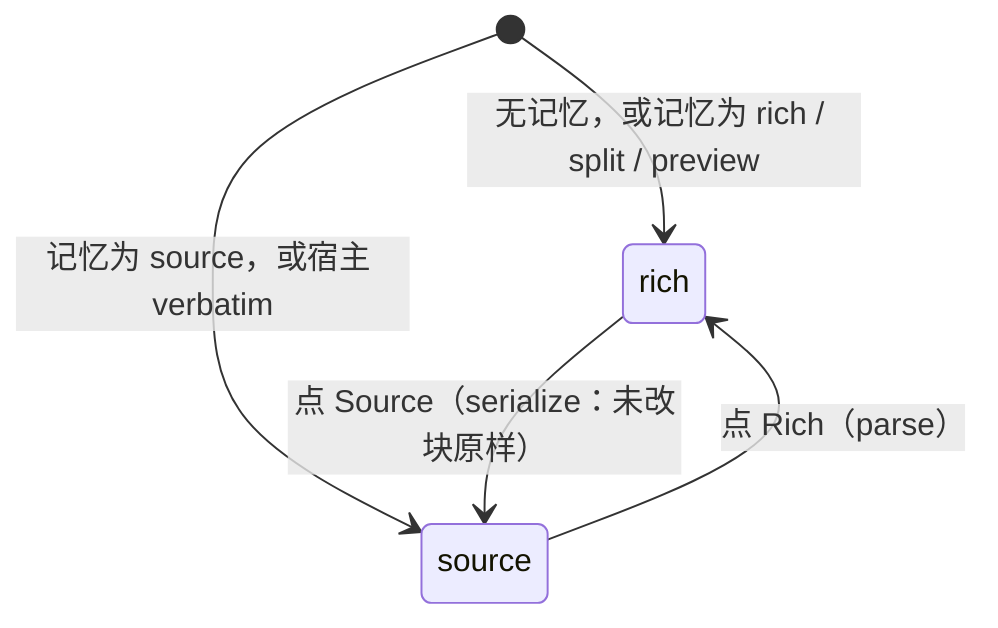
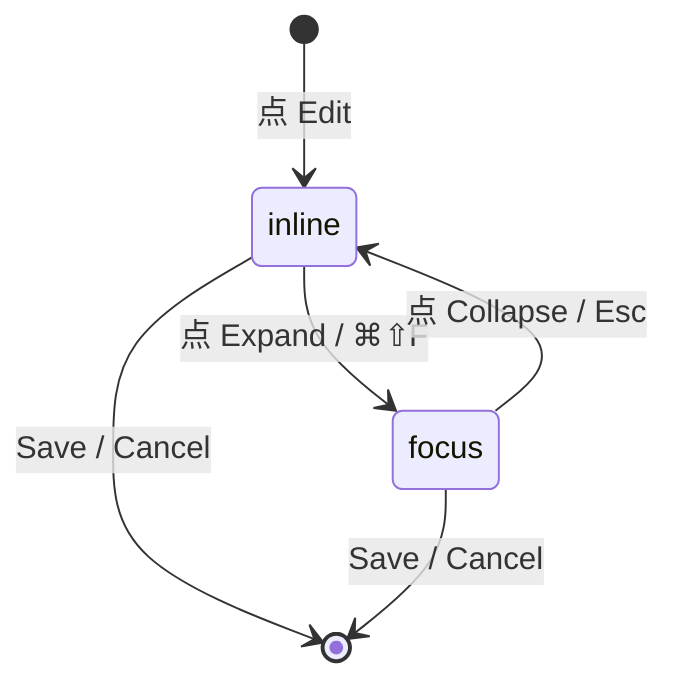
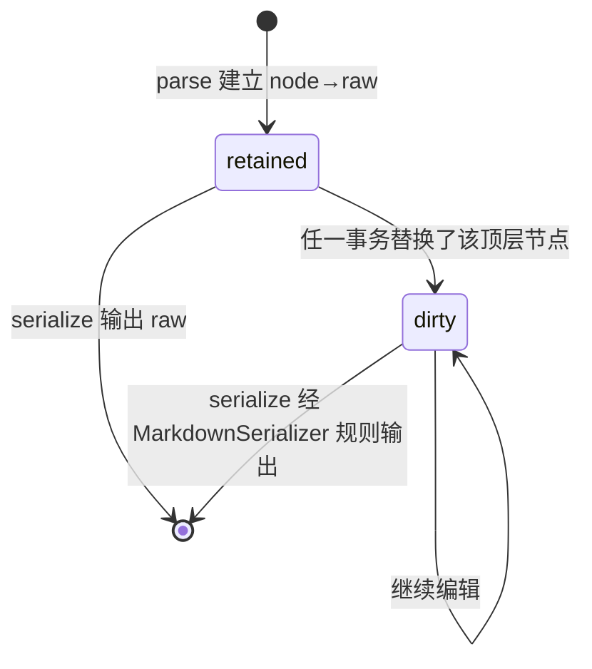

# Feature 编辑器优化（二期）：所见即所得 + 长文编辑

## Intent

一期（F174）把 spec / task body 的编辑器做成了「源码 + 实时预览」分屏，并把 WYSIWYG、滚动同步等列为 non-goal。用了之后发现分屏在真实 spec 上不成立：库里 169 篇 spec 平均 7.8K 字符、35 篇超过 12K、82 篇含表格、64 篇含 gherkin 围栏、20 篇含 mermaid；一个 14 行、自带滚动条的 textarea 被切成两半塞进卡片，既看不清预览也编辑不了长文，表格在源码里尤其难改。

二期做两件事：

1. **所见即所得**：默认在渲染结果上直接编辑（Linear 的方式），源码模式保留为逃生门。
2. **长文即页面**：编辑器不再是卡片里一个有内滚的框，而是随内容生长、随页面滚动的文档流，工具栏吸顶，并可展开为占满内容区的专注模式。

一期的「字节精确回写」前提**不放弃**——它是数据事实而非偏好（544 篇正文做 CommonMark 往返 89% 被改写）。二期用 GitLab Rich Text Editor 已在生产验证的办法化解它：**块级源码保留**——未被用户触碰的块原样回写，只有被改过的块经序列化器重排。打开即保存仍逐字节不变；改一个字只重排一段。

### 调研结论

**类 Linear 产品用的编辑器**（本轮核实）

| 产品 | 编辑器 | Markdown 的角色 | 对本功能的启发 |
|---|---|---|---|
| Linear | ProseMirror（+ y-prosemirror 协同） | 仅作输入快捷方式与「copy issue in markdown」导出，无源码模式 | 单栏 WYSIWYG、描述即页面主体、Markdown 输入规则（`**`、`# `、`- `） |
| Plane | Tiptap 2 + `tiptap-markdown`（React，`packages/editor`） | 存 HTML，Markdown 导入导出 | Tiptap 是这一类产品的事实标准 |
| Huly | Tiptap 2.11（Svelte，`plugins/text-editor`） | 存 ProseMirror 文档 | 同上 |
| GitLab | Tiptap；`content_editor/services/markdown_source.js`，epic 7256「Preserve Markdown when saving」 | **Markdown 是存储格式**；未改块保留原文，仅改过的块重新序列化 | 与本功能约束完全同构，证明可行 |

**候选库**

| 方案 | Vue 3 | 字节保留 | 表格可视化编辑 | 与 `MarkdownContent`（marked）解析一致 | 体积（gz） | 结论 |
|---|---|---|---|---|---|---|
| **Tiptap 3**（`@tiptap/vue-3` 官方；解析自写于 marked lexer 之上；序列化用 `@tiptap/pm/markdown` 的 `MarkdownSerializer` 规则） | 官方 | 块级保留（本 spec） | ✓ `@tiptap/extension-table` | ✓ 同一个 marked | ≈ 120–150 KB，可按需加载 | **采用** |
| `@tiptap/markdown` 官方扩展（3.7+，marked 底层） | 官方 | ✗ 全文重排，Beta，不暴露每块 `raw` | ✓ | ✓ | — | 不直接用；借其 marked 对接经验 |
| Milkdown 7.22 / Crepe | 社区（Crepe 自带 Vue 依赖） | ✗ remark 全文重排 | ✓ | ✗ remark ≠ marked，预览与保存后视图可能不一致 | ≈ 200 KB+ | 否 |
| BlockNote | ✗ React only | — | — | — | — | 否 |
| CodeMirror 6 混合实时预览（codemirror-markdown-hybrid 1.2、atomic-editor（React）、ink） | 框架无关 / React | ✓ 天然字节精确 | ✗ 表格仍是源码；Obsidian 为此单独造了表格编辑器 | — | ≈ 100 KB | 否；作为将来替换 Source 面的候选（一期方案 B） |

**长文怎么展示**（Linear / GitLab / Notion 的共同做法）：描述是页面的一部分，没有内滚框；编辑器随内容生长、整页滚动；工具栏吸顶；阅读宽度限制在约 72–88ch；可一键进入全屏/专注编辑。

**Non-goals**
- 不做多人协同（无 Yjs）。
- 不做 `/` 斜杠命令菜单；工具栏 + Markdown 输入规则 + 快捷键够用。
- 不做源码面的 CodeMirror 替换（一期 B）；Source 模式仍是 `RefTextarea`。
- 不改 `[label](kind:key)`、`` 两条语法契约，不改后端与 PATCH 接口。
- 不渲染 mermaid 图（Rich 模式按代码块编辑，与保存后视图一致）。
- `NewFeatureDialog` / `TaskComposerDialog` / `QuickCaptureBubble` 等**创建**对话框里的正文框不在本期；DefectSymptom 保持一期的 `verbatim` 源码模式（其保存后视图就是原文）。
- 不保证**被编辑过的块**字节不变——那一块按序列化器规则重排，这是用户动过它的后果。

## Model

组件仍是 `frontend/src/components/editor/MarkdownEditor.vue`（一期产物，在 `f174/integration` 上），宿主与 props 契约不变，内部换成两种编辑面。

```typescript
type EditorMode = 'rich' | 'source'
// rich   = Tiptap 所见即所得（默认）；一期的 split / preview 两个模式退役，
//          localStorage 里旧值 'split' | 'preview' 读作 'rich'
// source = 一期的 RefTextarea 源码面（含一期工具栏），字节精确

type Layout = 'inline' | 'focus'
// inline = 在宿主卡片里，随内容生长，整页滚动
// focus  = 占满内容区的专注模式（宿主卡片之外的内容隐去）

type Props = {                       // 与一期相同，新增一项
  modelValue: string
  project: number | null
  feature: number | null
  images: AttachedImage[]
  attach: ((source: DataTransfer) => Promise<number[]>) | null
  previewTestid: string | null       // rich 面 data-testid（feature-spec-rich / task-body-rich）
  verbatim: boolean                  // true 时只有 source 模式，无模式切换
  title: string                      // focus 模式标题行（宿主传 feature/task 标题）
}
type Emits = { 'update:modelValue': string }   // 任一模式下都是源码字节

// ---- 块级源码保留 ----
type Segment =
  | { kind: 'block'; raw: string; node: PMNode }   // marked lexer 的一个块级 token → 一个顶层 PM 节点
  | { kind: 'gap';   raw: string }                  // 块与块之间的空白（marked 的 space token）
// 不变量：segments.map(s => s.raw).join('') === 打开时的源码

type Retained = WeakMap<PMNode, string>            // 解析时建立：顶层节点 → 其 raw
// ProseMirror 文档是结构共享的不可变树：一次事务只重建被改动节点到根的路径，
// 未触碰的顶层节点保持同一对象引用。序列化时：
//   retained.get(child) ?? serialize(child)
// 即「是否被改过」由节点身份判定，不靠 diff 文本、不靠计时。

type BlockKind =                                   // marked token.type → PM 节点
  | 'paragraph' | 'heading' | 'list' | 'blockquote' | 'code' | 'table' | 'hr'
  | 'opaque'      // html、comment、front-matter、任何无对应节点的 token
                  // 以只读卡片呈现（内容用 MarkdownContent 渲染该块），
                  // 双击展开小源码框就地改其 raw；永远按 raw 回写

type InlineKind =
  | 'text' | 'strong' | 'em' | 'code' | 'strike' | 'link' | 'hardbreak'
  | 'ref'    // [label](kind:key) → 原子节点，RefChip 渲染，attrs { kind, key, label }
  | 'image'  //   → 原子节点，attrs { idx, alt }；显示用 images 解析，缺失时显示占位文字
```

### 模式状态机



### 版式状态机（与模式正交）



两个状态机都在 draft 之上切换，切换不丢 draft、不丢撤销栏（source⇄rich 之间撤销栏各自独立）。

### 块的生命周期（rich 模式）



新插入的块没有 raw，天然是 dirty。

## Rules

### 模式与版式选择

| 场景 | 模式 | 版式 |
|---|---|---|
| 无记忆 | `rich` | `inline` |
| `regin_editor_mode` ∈ {rich, split, preview} | `rich` | `inline` |
| `regin_editor_mode` = source | `source` | `inline` |
| 宿主 `verbatim` | `source`，不显示模式切换 | `inline`，不显示 Expand |
| 窄屏（< 768px） | 不再强制 source（rich 本身单栏）；记忆照常读写 | `focus` 仍可用 |
| 宿主 `tracked` | 不进入编辑（同一期） | — |

### 解析（源码 → 文档）

| marked token | PM 节点 | 备注 |
|---|---|---|
| `paragraph` / `heading` / `blockquote` / `hr` | 同名节点 | heading 保留 depth |
| `list` | bulletList / orderedList；`task` 项 → taskList | 嵌套递归；`start` 保留 |
| `code` | codeBlock，attrs `language`（`mermaid`、`gherkin` 等原样） | 围栏字符与长度不进节点，由 raw 保留 |
| `table` | table/tableRow/tableHeader/tableCell，`align` 保留 | 单元格 inline 递归解析 |
| `html`、front-matter、任何未列出的 | `opaque`，attrs `{ raw }` | 含 `<!-- -->`、`<details>` 等 |
| inline `link` 且 href 匹配 `parseRefTarget` | `ref` | 与 `utils/refs.js` 同一判定与 `codeRanges` 排除 |
| inline `image` 且 href 为 `image:N` | `image` | 其它 `` 保留为普通 image 节点 |
| `space` | 不建节点，进 `gap` segment | |

### 序列化（文档 → 源码）

| 顶层节点状态 | 输出 |
|---|---|
| `retained.has(node)` | 原 raw，逐字节 |
| dirty，类型 ≠ opaque | `MarkdownSerializer` 规则：`**` 粗体、`_` 斜体、`-` 列表、`1.` 有序、```` ``` ```` 围栏带 language、表格按列宽对齐、ref → `formatRef(kind,key,label)`、image → `` |
| opaque（无论是否改过） | 其 `raw` attr |
| 相邻块之间 | 两侧都 retained 时用原 gap raw；任一侧 dirty 时用 `\n\n` |

### Rich 面的输入

| 输入 | 行为 |
|---|---|
| 行首 `# `…`#### `、`- `、`* `、`1. `、`- [ ] `、`> `、```` ``` ```` | Markdown 输入规则就地转块 |
| `**x**`、`_x_`、`` `x` ``、`~~x~~` | 输入规则转 mark |
| ⌘/Ctrl+B / I / K | 粗体 / 斜体 / 链接（Popover 取 url，与一期同一组件） |
| ⌘/Ctrl+Enter | Save（宿主已有的快捷键，由组件 emit `submit`） |
| 键入 `@` | `@tiptap/suggestion` 驱动的 `RefMenu`，数据源仍是 `useRefMentions`（分区、预览、kind 下钻、代码块内静默）；接受后插入 `ref` 节点 |
| 粘贴 regin 内部 URL | 经 `refForUrl` 转 `ref` 节点（同一期 `RefTextarea.onPaste`） |
| 粘贴 / 拖拽图片文件 | 宿主 `attach()`；成功后在光标处插入 `image` 节点；失败不插入任何占位，宿主显示错误 |
| 粘贴 Markdown 文本 | 作为源码 parse 后插入（Linear 行为），而非当纯文本 |
| 粘贴 HTML（从网页/文档复制） | Tiptap 默认 HTML 解析为节点 |
| 工具栏 | 一期 8 个按钮的 rich 版（命令直接作用于 PM 选区）+ 表格（插入 / 行列增删 / 删表）+ Expand |
| 点击 `ref` 芯片 | 不导航（编辑态）；悬停显示 `RefPreview` |
| 双击 `opaque` | 就地打开其 raw 的小源码框；失焦收起，新 raw 写回 attr |

### 长文版式

| 规则 | inline | focus |
|---|---|---|
| 高度 | 随内容生长，无内滚；source 面的 textarea 同样自动生长（`input` 事件驱动高度 = scrollHeight；无 `rows` 上限） | 同 |
| 滚动 | 页面的 `.content-scroll` 滚动 | 同 |
| 工具栏 + Save/Cancel | `position: sticky; top: 0` 于 `.content-scroll` 内，编辑器在视口内时始终可见 | 同 |
| 宽度 | 卡片宽度 | 居中 `max-width: 84ch`，左右留白 |
| 其它内容 | 可见 | 宿主页面其它卡片与 section nav 隐去；顶部标题行显示 `title` + Collapse |
| 进入/退出 | — | 光标位置与滚动位置保持在同一块 |
| Esc | 无动作 | 回到 inline，draft 保留 |

### 离开保护

| 动作 | draft 与原文相同 | draft 已改 |
|---|---|---|
| Cancel | 直接退出 | `useConfirm`：「Discard changes?」 |
| 路由跳转 | 放行 | 同上确认 |
| 关闭标签页 | 放行 | 不拦截（非目标） |

### 测试兼容

| 既有 E2E | 变化 |
|---|---|
| `feature-images.spec.js`、`ref-mentions.spec.js`、`task-body-markdown.spec.js`、`f174-split-editor.spec.js`、`f174-toolbar.spec.js`、`f174-images-refs.spec.js`、`f174-reuse.spec.js` | 在 fixture 里预置 `localStorage.regin_editor_mode = 'source'`，其余不改；`editor-mode-split` / `editor-mode-preview` 断言改为 `editor-mode-rich` |
| `defect-symptom-verbatim.spec.js`、`defect-edit-inline.spec.js` | 不改 |

## Invariants

1. **打开即保存，逐字节不变**：对库中每一篇真实正文，`serialize(parse(s)) === s`。单元测试跑在 `frontend/tests/fixtures/bodies/*.md`（从 DB 导出的全部 spec 与 task body 快照）上，零例外。
2. **改动局部化**：一次编辑只重排被触碰的顶层块；其它块与其间空白逐字节不变。
3. **预览即保存后所见**：rich 面的渲染与保存后 `MarkdownContent` 的渲染来自同一个 marked 解析结果（同一 token 流），标题/列表/表格/代码块结构一致。
4. **语法契约不变**：`[label](kind:key)` 与 `` 在 parse、显示、serialize 三条路径上与一期一致；`formatRef` / `parseRefTarget` / `resolveImageRefs` 是唯一实现。
5. **无损模式切换**：rich → source → rich 不改源码字节；source → rich 遇到任何输入都成功（无对应节点的落入 opaque），不存在「无法进入 rich」的输入。
6. **撤销粒度**：rich 面每个工具栏动作、每次输入规则转换是一个撤销步。
7. **无内滚**：inline 与 focus 下编辑面的 `scrollHeight === clientHeight`；滚动只发生在 `.content-scroll`。
8. **按需加载**：Tiptap 及其扩展在独立 chunk 中，点 Edit 才加载；阅读视图的首包不增长。
9. **一期的 verbatim 契约不变**：DefectSymptom 仍是 source-only，预览原样。

## Acceptance

```gherkin
Feature: 所见即所得 + 长文编辑

  Scenario: 默认以 rich 模式打开 — test_rich_is_default
    Given localStorage 无 regin_editor_mode，或其值为 split / preview
    When  用户点击 Feature spec 的 Edit
    Then  出现 data-testid="feature-spec-rich" 的 contenteditable 面
    And   不存在 feature-spec-input 的 textarea
    And   模式切换条只有 Rich / Source 两个按钮

  Scenario: 打开即保存，字节不变 — test_open_then_save_is_byte_exact
    Given 一个 spec 含对齐不齐的表格、```mermaid 围栏、<!-- 注释 -->、[t](task:42)、、以 * 开头的列表
    When  用户 Edit（rich 模式）后直接 Save
    Then  PATCH 的 body 与原字符串逐字节相同

  Scenario: 真实语料往返零改写 — test_roundtrip_corpus_is_identity
    Given frontend/tests/fixtures/bodies/ 下的每一篇正文
    When  对每篇执行 serialize(parse(s))
    Then  结果与 s 逐字节相同，失败数为 0

  Scenario: 改一个段落只重排那一个块 — test_edit_rewrites_only_touched_block
    Given 源码为 "* a\n\n| x |y|\n|--|--|\n| 1 | 2 |\n\npara"
    When  用户在 rich 面把 "para" 改为 "para!" 并 Save
    Then  body 为 "* a\n\n| x |y|\n|--|--|\n| 1 | 2 |\n\npara!"
    And   列表的 "*" 与表格的不对齐原样保留

  Scenario: 在 rich 面编辑表格 — test_table_edit_serializes_table
    Given 源码含一张 2×2 表格
    When  用户点击单元格、经工具栏「插入行」并输入 "z"
    Then  Save 后 body 的表格多出一行含 "z"，其余块逐字节不变

  Scenario: 输入规则 — test_markdown_input_rules
    Given rich 面光标在空段落
    When  用户键入 "## 目标" 回车，再键入 "- 项" 回车
    Then  文档出现 heading(level 2) 与 bulletList
    And   Save 后 body 含 "## 目标\n\n- 项"

  Scenario: @ 引用在 rich 面 — test_mention_in_rich
    Given rich 面
    When  用户键入 "@" 并在 RefMenu 中选择 Task 42「title」
    Then  光标处出现一个 RefChip
    And   Save 后 body 含 "[title](task:42)"

  Scenario: 粘贴图片 — test_paste_image_in_rich
    Given rich 面且 attach() 返回 [3]
    When  用户粘贴一张图片
    Then  光标处出现指向该附件 object URL 的 
    And   Save 后 body 含 ""

  Scenario: 上传失败不残留 — test_failed_upload_in_rich_leaves_doc_untouched
    Given rich 面且 attach() 抛错
    When  用户粘贴一张图片
    Then  文档不变，宿主显示错误

  Scenario: 不可表示的块作为 opaque 保留并可就地改 — test_opaque_block_roundtrip_and_edit
    Given 源码含 "<details><summary>x</summary>y</details>"
    When  用户 Edit
    Then  该块以只读卡片显示
    When  用户双击它，把 x 改为 z，失焦并 Save
    Then  body 中该块为 "<details><summary>z</summary>y</details>"，其它块不变

  Scenario: 模式切换无损 — test_mode_switch_is_lossless
    Given rich 面打开一篇含表格与 mermaid 的 spec
    When  用户点 Source，再点 Rich，再 Save
    Then  PATCH 的 body 与原字符串逐字节相同

  Scenario: 粘贴 Markdown 文本解析为块 — test_paste_markdown_text_parses
    Given rich 面
    When  用户粘贴 "# T\n\n- a\n- b"
    Then  文档出现 heading 与两项 bulletList

  Scenario: 编辑器随内容生长、工具栏吸顶 — test_inline_grows_and_toolbar_sticks
    Given 一篇 300 行的 spec，视口高 800px
    When  用户 Edit 并把 .content-scroll 滚到编辑器中部
    Then  编辑面的 scrollHeight 等于 clientHeight（无内滚）
    And   工具栏与 Save 按钮的 boundingClientRect.top 等于 .content-scroll 的 top

  Scenario: Source 面的 textarea 同样自动生长 — test_source_textarea_autogrows
    Given source 模式与同一篇 300 行 spec
    Then  textarea 的 scrollHeight 等于 clientHeight

  Scenario: 专注模式 — test_focus_mode
    Given inline 编辑中，光标在第 200 行的块
    When  用户点 Expand
    Then  页面其它卡片与 section nav 不可见，编辑面居中且宽度 ≤ 84ch
    And   同一块仍在视口内，draft 不变
    When  用户按 Esc
    Then  回到 inline，draft 不变

  Scenario: 丢弃前确认 — test_cancel_confirms_when_dirty
    Given draft 已改
    When  用户点 Cancel
    Then  出现 useConfirm 对话框；取消则继续编辑，确认则退出且不 PATCH

  Scenario: 旧 E2E 在 source 预置下继续通过 — test_legacy_specs_pass_in_source_mode
    Given fixture 预置 regin_editor_mode=source
    Then  一期与更早的编辑器 E2E 用例不改输入方式即通过

  Scenario: Tiptap 按需加载 — test_rich_editor_is_lazy_chunk
    Given vite build 产物
    Then  入口 chunk 不含 @tiptap/*；点 Edit 后才请求含 tiptap 的 chunk

  Scenario: Task body 同样升级 — test_task_body_uses_rich
    When  用户在 Task 详情点 Edit
    Then  出现 data-testid="task-body-rich"，行为同 Feature spec

  Scenario: Defect symptom 不变 — test_defect_symptom_unchanged
    When  用户内联编辑 defect symptom
    Then  仍是 source 面，无模式切换，无 Expand，预览原样显示 "**x**"
```

## 切片

基线：F174 尚未合入 master，而本功能的组件就在它那里，所以每片直接以 `f174/integration` 为 base 开 worktree 分支，合回 `f174/integration`；F174 ship 时一并进 master。所有 E2E 放 `frontend/tests/`，单测（往返语料）用 node 直接跑 `frontend/tests/unit/*.test.mjs`（`node --test`），不引入 vitest。

| # | Slice | Delivers | Spec refs | Tests | Schema | Depends on | Base | Skill |
|---|---|---|---|---|---|---|---|---|
| S1 | 解析 / 序列化核心 + 真实语料往返 | `frontend/src/editor/markdownDoc.js`：`parse(src) → { doc, segments, retained }`（marked lexer，Rules「解析」表，含 opaque/ref/image 节点的 schema 定义 `frontend/src/editor/schema.js`）与 `serialize(doc, segments, retained) → string`（Rules「序列化」表，`@tiptap/pm/markdown` 的 `MarkdownSerializer` 加 table/ref/image/opaque 规则）。`scripts/export-bodies.py` 从 DB 导出全部 features.body 与 agent_tasks.body 到 `frontend/tests/fixtures/bodies/`；`frontend/tests/unit/markdownDoc.test.mjs` 对全部语料断言恒等，并对 Rules 表每一行各一例。新增依赖：`@tiptap/core @tiptap/pm`（仅 schema 与 serializer，无 UI） | Model 块级源码保留, Rules 解析/序列化, Invariants 1 2 4 5 | test_roundtrip_corpus_is_identity, test_edit_rewrites_only_touched_block（单测版） | — | — | `f174/integration` | goal-verified-treenav |
| S2 | Rich 面：Tiptap 编辑器 + 输入规则 + 工具栏 + 表格 | `frontend/src/components/editor/RichEditor.vue`（`@tiptap/vue-3`，`defineAsyncComponent` 按需加载），扩展：StarterKit 子集、Table、TaskList、Link、Placeholder、输入规则；`EditorToolbar.vue` 改为按 `mode` 分发到 textarea 命令或 Tiptap 命令，新增表格组；`MarkdownEditor.vue` 模式改为 rich/source，旧记忆值映射，窄屏规则删除。`FeatureSpec.vue` 与 `TaskBodyEditor.vue` 传 `previewTestid` 为 `feature-spec-rich` / `task-body-rich`。旧 E2E fixture 预置 source 模式。E2E `f176-rich.spec.js` | Model 模式状态机, Rules 模式选择 / Rich 面输入（输入规则、快捷键、工具栏、表格）, Invariants 3 6 8 | test_rich_is_default, test_open_then_save_is_byte_exact, test_table_edit_serializes_table, test_markdown_input_rules, test_mode_switch_is_lossless, test_paste_markdown_text_parses, test_legacy_specs_pass_in_source_mode, test_rich_editor_is_lazy_chunk, test_task_body_uses_rich, test_defect_symptom_unchanged | — | S1 | `f174/integration` | goal-verified-treenav |
| S3 | Rich 面的引用、图片、opaque | `ref` 节点 NodeView 渲染 `RefChip`（编辑态不导航）+ `@tiptap/suggestion` 接 `useRefMentions` 与 `RefMenu`；内部 URL 粘贴转 ref；`image` 节点 NodeView 经 `images` 解析，粘贴/拖拽经宿主 `attach()`，失败不插入；`opaque` NodeView：只读卡片 + 双击就地源码框。E2E `f176-refs-images.spec.js` | Rules Rich 面输入（@ / 粘贴 / 图片 / opaque）, Invariants 4 5 | test_mention_in_rich, test_paste_image_in_rich, test_failed_upload_in_rich_leaves_doc_untouched, test_opaque_block_roundtrip_and_edit | — | S2 | `f174/integration` | goal-verified-treenav |
| S4 | 长文版式：自动生长、吸顶、专注模式、离开保护 | 两面都无内滚：`RefTextarea` 加 `useAutogrow`（input 事件驱动），rich 面 `min-height` 而无 `max-height`；工具栏 + Save/Cancel 迁入组件头部并 `position: sticky` 于 `.content-scroll`；`Layout` 状态与 Expand/Collapse/Esc/⌘⇧F；focus 时宿主经 `provide/inject` 的 `editorFocus` 隐去其它卡片与 section nav，标题行显示 `title`；进入/退出保持当前块可见；Cancel 与路由离开时 dirty 确认（`useConfirm`，`onBeforeRouteLeave`）。用 `node scripts/dom-measure.mjs --route /features/<id> --explain` 核对 sticky 与无内滚。E2E `f176-layout.spec.js` | Model 版式状态机, Rules 长文版式 / 离开保护, Invariants 7 | test_inline_grows_and_toolbar_sticks, test_source_textarea_autogrows, test_focus_mode, test_cancel_confirms_when_dirty | — | S2 | `f174/integration` | goal-verified-treenav |
| S5 | integrate | S1–S4 都已合回 `f174/integration`；`cd frontend && npx vite build` 通过；chunk 清单确认 tiptap 不在入口 | Invariants 8 | test_every_slice_merged_back | — | S3, S4 | `f174/integration` | goal-verified-treenav |
| S6 | migrate + doctor | `regin migrate` 与 `regin doctor`：确认无 schema 变更 | Non-goals | test_migrate_leaves_no_schema_finding | — | S5 | `f174/integration` | goal-verified-treenav |
| S7 | verify | 全量 pytest 与 playwright；`node --test frontend/tests/unit`；核对 Acceptance 每个 Scenario 都有同名用例 | Acceptance | test_full_suite_passes | — | S6 | `f174/integration` | goal-verified-treenav |
