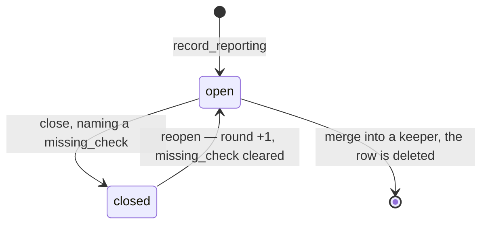
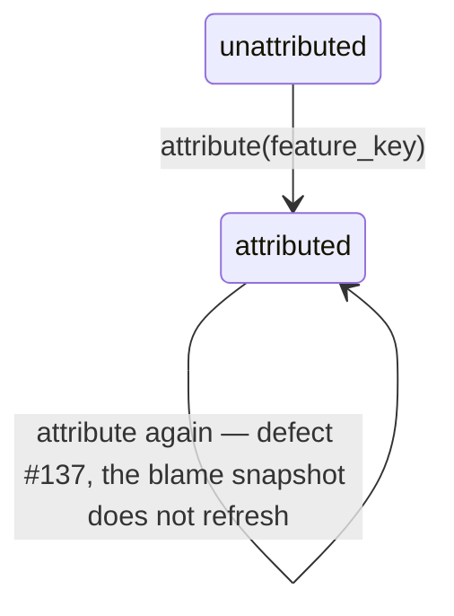

## Intent

The defect ledger is write-only on the web. `web/blueprints/defects.py` exposes
exactly one route — `POST /api/defects` — so a defect's text is readable only
through `regin defects list`. `/features` shows a count of unattributed defects
and deliberately does not link it: the comment in `FeaturesView.vue` says the
remedy is `regin defects attribute`, a write that is not on the web, so a list
reached from there would stop one click short of the only action owed.

This feature adds those writes, which is what earns the list. Its first data is
defects #136–#143, opened unattributed against Task / Feature Ledger / Session.

Notation: `docs/spec-notation.md`.

## Non-goals

- **No new defect semantics.** Dedup, the closed-twin refusal, write-once blame,
  and `close` demanding a `missing_check` stay exactly as `lib/defects/store.py`
  enforces them. This is a surface over that store, never a second rulebook.
- **No inferred attribution.** The web offers the same act the CLI does — a
  human naming a feature — and never suggests one from paths, session or cost.
- **No tracker write-back.** `fix-item` points at an item; regin still never
  writes a defect's status from it, nor its state from the defect.
- **No bulk attribute.** One defect, one assertion. A bulk control is how eight
  rows get one guessed parent.

## Model

Full row in `lib/orm/models/defects.py`; the store's verbs in
`lib/defects/store.py`.

```typescript
type DefectView = {
  id: int
  feature_key: string | null           // null = unattributed, a first-class state
  symptom: string                      // the reporter's wording, verbatim
  status: 'open' | 'closed'
  round: int
  blamed_against_state: string | null  // write-once at first attribution
  missing_check: string | null         // non-NULL iff closed
  suspect_paths: string[]
  fix_provider: string | null
  fix_external_key: string | null
  opened_at: string
  closed_at: string | null
}

type DefectList = {
  items: DefectView[]
  scope: 'unattributed' | 'feature' | 'fix-item'
}
```

### Axis A — `status`, the defect lifecycle



### Axis B — `feature_key`, the attribution

Separate because a defect can close while unattributed, and can be attributed
while closed. One diagram covering both would put two facts in one column.



### Routes

Reads take `require_auth`, writes take `require_editor` — both from `lib/auth.py`,
matching the guard already on `POST /api/defects`.

| method + path | store call | guard |
|---|---|---|
| `GET /api/defects` | `unattributed()` | `require_auth` |
| `GET /api/defects?feature=<key>` | `for_feature(key)` | `require_auth` |
| `GET /api/defects?fix_item=<provider>:<key>` | `by_fix_item(...)` | `require_auth` |
| `POST /api/defects` | `record_reporting(...)` | `require_editor` (exists) |
| `POST /api/defects/<id>/attribute` | `attribute(id, key)` | `require_editor` |
| `POST /api/defects/<id>/close` | `close(id, missing_check=...)` | `require_editor` |
| `POST /api/defects/<id>/reopen` | `reopen(id)` | `require_editor` |

View at `/defects`, and the `/features` counter becomes a link to
`/defects` once the writes exist.

## Rules

### Refusals — every one already raised by the store; the route maps it to a code

| act | condition | outcome |
|---|---|---|
| attribute | `feature_key` blank after strip | 400 — "attribution needs a feature key" |
| attribute | another defect reports this symptom for that feature | 409 — names the `merge` remedy, never absorbs |
| close | `missing_check` blank | 400 — the check is the only output that changes future behaviour |
| reopen | status is already `open` | 409 — a round counts fix attempts walked back, not ones that never happened |
| open | a *closed* twin exists | 409 — points at `reopen`; auto-reopening would let the metric move from a re-typed string |
| any | unknown id | 404 |

### What the list shows per scope

| scope | rows | empty state says |
|---|---|---|
| `unattributed` (default) | every defect with `feature_key IS NULL`, open and closed | nothing is unblamed — not "no defects" |
| `feature` | that key's defects | this feature has none recorded |
| `fix-item` | every defect one tracker item should close | nothing points at this item |

## Invariants

1. For all writes, the web calls `lib/defects/store` and adds no rule of its
   own — enforced by the blueprint holding no `SessionLocal()` of its own, the
   posture `POST /api/defects` already takes.
2. `feature_key` is never defaulted, pre-filled or suggested by the UI. An
   unattributed defect stays unattributed until a human types a key.
3. The `/features` unattributed counter and the `/defects` list read the same
   `unattributed()` function, so the two cannot report different numbers.
4. `session_id` is never read from a request body — a browser has no trace of
   its own to be the reporter (existing rule, `web/blueprints/defects.py`).
5. `missing_check` is non-NULL if and only if `status == 'closed'` — held by
   `reopen` clearing it, not by the route.

## Acceptance

```gherkin
Scenario: 1.1 — the unattributed list is readable from the browser
Given defects #136–#143 exist with feature_key NULL
When  an authenticated viewer opens /defects
Then  all eight are listed with their full symptom text, status and round

Scenario: 1.2 — the counter and the list agree
Given the /features header reports N defects blamed on no feature
When  /defects is opened in the same session
Then  it lists exactly N rows

Scenario: 2.1 — attribution is an assertion, never a suggestion
Given defect #136 is unattributed and its suspect paths name lib/features/cost.py
When  the attribute control is opened
Then  the feature key field is empty, with nothing pre-filled from those paths

Scenario: 2.2 — attributing a symptom a feature already reports is refused
Given defect D and defect E carry the same symptom_key
And   E is attributed to feature K
When  D is attributed to K from the web
Then  the request is refused with 409 and the response names the merge remedy
And   D is still unattributed

Scenario: 3.1 — closing demands the check
Given defect #140 is open
When  a close is submitted with an empty missing_check
Then  the request is refused with 400 and #140 is still open

Scenario: 3.2 — reopening an open defect does not move the round
Given defect #141 is open with round=1
When  a reopen is submitted for it
Then  the request is refused with 409 and round is still 1

Scenario: 4.1 — a viewer cannot write
Given a signed-in user without the editor role
When  they submit an attribute, close or reopen
Then  the request is refused by require_editor and no row changes
```

## Notes for the first run

- `unattributed()`, `for_feature()`, `by_fix_item()`, `attribute()`, `close()`,
  `reopen()` all already exist in `lib/defects/store.py`. The work is the HTTP
  layer plus the view, not the ledger.
- `lib/auth.py` has `require_auth` and `require_editor`; there is no viewer-only
  guard, so reads take `require_auth`.
- Defect #137 (re-attribution keeps the first blame snapshot) is reachable from
  this UI. It is a separate defect and is not fixed here, but the attribute
  control should not make it easier to hit — consider refusing re-attribution
  from the web until #137 is resolved, and say so rather than silently allowing.