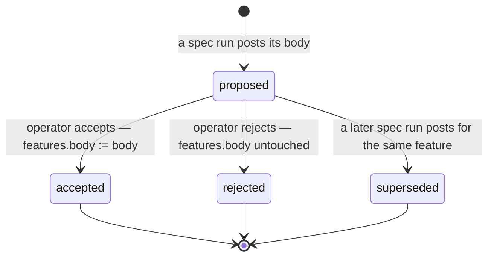
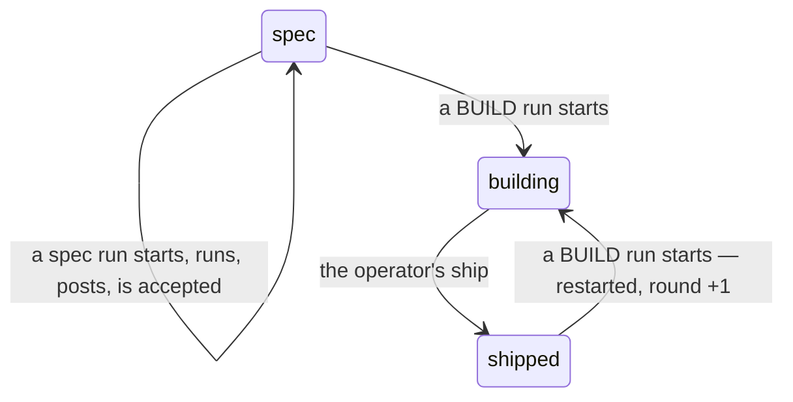

# Auto-driven feature specs

*Seed → proposal → the operator's accept. Written in the notation of
`docs/spec-notation.md`.*

## Intent

Today a feature's spec is typed by a human. `features.body` has exactly one
writer — the operator, through `NewFeatureDialog` / `FeatureSpec.vue` /
`store.set_body` — so a feature that starts as a sentence stays a sentence
until somebody sits down and expands it. This feature's own body was such a
sentence: *"sometimes I just want to give some ideas and let it enrich the
content."*

**Auto-drive** is the missing step: a feature can advance its own spec. The
operator drops a seed; regin runs an agent session **against the feature**, in
the same traced, costed, attributed lane every other run uses; the session
posts back an enriched spec as a **proposal**; the operator accepts it, and
that accept is the only thing that moves `features.body`.

The machine proposes. The operator declares. That split is not politeness — it
is what keeps the pipeline's one number (**rounds-to-done**) honest. The
pipeline's whole discipline is that every input is a declared fact and none is
inferred (`feature-pipeline` skill; `docs/feature-pipeline.md`). An agent that
wrote the spec straight into the column would make the spec an inference, and
the bar a build is later judged against would be something nobody agreed to.

**Non-goals**

- **No new LLM client.** regin already has exactly two ways to reach a model
  and this adds no third. See *Which lane*, below.
- **Auto-drive never ships, never abandons, never blames.** `feature ship` and
  `defects open` remain acts, unchanged.
- **Enrichment costs no round and moves no stage.** Writing a spec is not
  building the thing.
- **Nothing is auto-accepted** — not on a confidence score, not on a timer, not
  when the operator has been quiet.
- **No research surface.** The run reads this repo and this feature. It does not
  search the web, and it does not touch the tracker.
- **This is not a spec template engine.** The output is prose+tables the
  operator can edit, not a rendered form.

### Which lane — the one real design choice

regin has two paths to a model, and the choice between them is the whole
mechanism question.

| | **Stage lane** — `lib/memory/adapters.py::ExternalAgentLLM` | **Run lane** — `lib/tasks/runs.py` → `lib/agent_sdk/` |
|---|---|---|
| shape | one `complete(prompt)` subprocess spawn, stdout back | a long-lived agent session, many turns |
| config | `settings.topic_proposal_external_agents` + a `lib/prompts/` surface | a task, armed with params |
| repo access | only what `--allowedTools` grants, inside one shot | full, and it explores until it has the answer |
| bound | `timeout_seconds` (default 600) and a `max_tokens * 8` char truncation | the session's own | 
| traced | yes — `REGIN_LLM_SURFACE` marks the child `sessions.origin='llm-stage'` | yes, as an ordinary session |
| costed against the feature | **no** — an `llm-stage` trace carries no `session_features` row | **yes**, through `agent_tasks.feature_id` |
| failure | returns `None` on every path; the caller no-ops | a settled run with an exit reason, visible on the task |
| exemplar | `lib/memory/retitle.py`, `lib/memory/distill.py` | every task regin runs |

**Auto-drive takes the run lane.** A spec worth accepting is grounded in the
code — this document's own Rules section exists because a session read
`lib/features/events.py` and found the stage bug. That grounding is many turns
of exploration, which is exactly what the stage lane's one-shot,
timeout-bounded, output-truncated `complete()` is not for. And the cost
difference is not a detail: the ledger exists to answer *what did this feature
cost*, thinking about a feature is spend on that feature, and an enrichment
that landed in an `llm-stage` trace nobody attributes would make the ledger
quietly understate.

The stage lane keeps the jobs it already has. Nothing here retires it.

## Model

Canonical definitions land in `lib/orm/models/tasks.py`,
`lib/orm/models/features.py` and a new `lib/features/proposals.py`. Load-bearing
fields only.

```typescript
type TaskKind = 'build' | 'spec'
// An extensible category, not a boolean: 'review' and 'triage' are the obvious
// next members, and `is_spec_task` would have to be widened into this anyway.

type AgentTask = {
  kind: TaskKind          // NEW. default 'build' — every existing row is a build
  feature_id: FeatureId | null
  params_json: Json | null   // a spec task is armed with { skill: { name: 'spec-enrich' } }
}

type ProposalStatus = 'proposed' | 'accepted' | 'rejected' | 'superseded'

type SpecProposal = {      // feature_spec_proposals
  id: ProposalId
  feature_id: FeatureId
  run_id: RunId            // which attempt produced it — the audit join
  trace_id: TraceId | null // the session to read if you want to know why
  base_sha: string         // sha256 of features.body as the run READ it.
                           // '' for a body that was NULL — the empty seed is a
                           // real state, not a missing one
  body: string             // the proposed spec, <= DESCRIPTION_MAX
  status: ProposalStatus   // write-once away from 'proposed'
  decided_by: string|null  // 'operator' | 'run:<id>' (only a supersede)
  created_at: Timestamp
  decided_at: Timestamp|null
}
```

A spec run and the feature it is about move on **two orthogonal axes**, and the
whole design is keeping them apart.

**Axis A — the proposal.** Written by the run, decided by the operator.



**Axis B — the feature's own log.** A spec run appends **nothing** to it.



Folded into one axis — which is today's behaviour — enriching a shipped
feature's spec would walk back its ship claim and charge a round to a session
that wrote no code. This session is the proof: running against feature #69
appended `build_started` and flipped it `spec → building` before a line of it
existed.

## Rules

### R1 — what a run beginning means, per task kind

Extends `_ON_RUN_START` in `lib/features/events.py` from a 1-D map to a 2-D
one. Total over `TaskKind × STAGES`, so no cell reaches a default branch.

| task kind | feature stage | event appended |
|---|---|---|
| `build` | `spec` / `abandoned` | `build_started` |
| `build` | `building` | none — a second attempt inside one round costs no round |
| `build` | `shipped` / `escaped` | `restarted` (round +1) |
| `spec` | *any* | **none** — writing the spec is not building it |

### R2 — whether an accept is allowed

Content-addressed. No clock is read and no two moments are compared.

| `proposal.status` | `sha256(features.body)` vs `base_sha` | → |
|---|---|---|
| `proposed` | equal | **accepted**; `features.body := proposal.body` |
| `proposed` | differs | refused `stale` — the spec moved under the proposal; re-run or reject |
| `proposed` | equal, but `body` is empty/whitespace | refused `empty` — a run that produced nothing proposes nothing |
| `proposed` | equal, but `len(body) > DESCRIPTION_MAX` | refused at post time, not at accept — see R4 |
| `accepted` / `rejected` / `superseded` | * | refused `decided` — a decision is write-once |

### R3 — what `enrich` does with the feature's spec task

One spec task per feature, reused across attempts, so the history of what was
proposed hangs off one row.

| the feature holds | → |
|---|---|
| no spec task | mint `kind='spec'`, arm it with the skill, start a run |
| a spec task, no open run | reuse it; start a new run (`attempt + 1`) |
| a spec task with a run in `starting`/`running` | refused `busy` — one enrichment at a time |
| no title | unreachable: `store.create` already refuses a titleless feature |

A feature with an empty body is **enrichable** — the title is a seed. "Give it
an idea" is the whole request; demanding a body first would reinstate the work
being removed.

### R4 — what the run may post back

| condition | → |
|---|---|
| `len(body) > DESCRIPTION_MAX` (64 000) | refused, with the count, exactly as `store.set_body` refuses |
| the feature's body changed since the run started | **posted anyway**, as `proposed`; R2 refuses it at accept as `stale` |
| a prior `proposed` row exists for this feature | it becomes `superseded`, declared by `run:<id>` |
| the run settles without posting | nothing. A spec run that proposes nothing is a finished run, not a failure |

Posting a doomed proposal rather than refusing it at post time is deliberate:
the run has already been paid for, and the operator can read what it wrote and
paste from it. Throwing away bought work to keep a table tidy is the expensive
kind of correctness.

### R5 — where the run's subject comes from

A new `<spec>` block in `lib/tasks/runs.py`, appended after the `PROMPT_MAX`
cut like every other block, and only for `kind='spec'`.

| source | in the block | why |
|---|---|---|
| `features.title` | yes | the seed when the body is empty |
| `features.body` | yes, **whole, never clipped** | it is the subject; see Invariant 6 |
| `base_sha` | yes | the run echoes it back when it posts |
| the feature's open defects (`lib/defects/store.py::for_feature`) | yes, symptoms only | what the spec already got wrong is the best enrichment signal there is |
| `docs/spec-notation.md` | by reference, not inlined | the skill reads it; a second copy drifts |
| the tracker issue | no | `<tracker>` already carries identity, and content is deliberately not repeated |

## Invariants

1. **`features.body` has exactly two writers**: the operator's hand edit
   (`PATCH /api/features/<id>`) and the operator's accept. No run, no skill and
   no MCP tool writes it. Auto-drive is a proposal machine, not an author.
2. **Stage and rounds are invariant under enrichment.** For all features `F`:
   running any `kind='spec'` task of `F` appends no row to `feature_events`, so
   `stage(F)` and `rounds(F)` read the same before and after. This is what keeps
   rounds-to-done a count of builds.
3. **An enrichment's cost is visible.** It attributes to the feature through
   `agent_tasks.feature_id` like any other run and appears in
   `feature ledger` — no exempt category, no hidden lane.
4. **Accept is decided by content identity**, never by ordering two timestamps.
   A hand edit concurrent with a run can therefore never be silently
   overwritten, and no host's clock drift can change the outcome.
5. **At most one proposal per feature is `proposed`.** Superseding is an update
   of the older row at the moment the newer one is written, so no reader ever
   has to pick between two.
6. **A `<spec>` block is never truncated.** `PROMPT_MAX` clips a *task's* body;
   the subject of a spec run is the *feature's* body, and a spec rewritten in
   full from a half-read original is worse than no proposal at all.
7. **A rejected proposal is kept, never deleted.** It is the only evidence of
   what the machine proposed and the operator refused — the only input to
   whether auto-drive earns its spend.
8. **`kind` defaults to `'build'`**, so every row written before this feature
   existed, and every caller not updated for it, means what it has always meant.

## Surfaces

| surface | shape |
|---|---|
| CLI | `cli/commands/feature.py`: `regin feature enrich <id>` · `proposals <id>` · `accept <pid>` · `reject <pid>`, all taking the existing `_resolve(key, ref)` id-or-`--ref` argument |
| HTTP | `web/blueprints/features.py`: `POST /api/features/<id>/enrich` · `GET /api/features/<id>/proposals` · `POST /api/proposals/<pid>/accept` · `POST /api/proposals/<pid>/reject`. `@require_editor` on all but the GET, like every other write there |
| MCP | how the run posts. One tool, `propose_spec(feature_id, body, base_sha)` — the run cannot reach `set_body`, by Invariant 1 |
| Web | `FeatureSpec.vue` grows an **Enrich** button, and a proposal panel when one is outstanding: rendered body, a diff against the current one, Accept / Reject, and a link to the trace that wrote it |
| Skill | `spec-enrich` — reads `docs/spec-notation.md`, reads the repo, writes the five sections, posts once. Not a `lib/prompts/` surface: the skill is already editable text, and two authorities for one prompt is how they drift |
| Settings | `settings.feature_pipeline.auto_drive`: `enabled` (default **false**), `skill` (default `spec-enrich`). A nested block is **three** coordinated edits — the `BaseModel` + `Settings` field + `__all__` in `lib/settings.py`, a field list and a `_settings_blocks()` entry in `web/blueprints/settings.py`, and `SECTIONS` + `BLOCK_META` in `SettingsView.vue` |
| Schema | two edits, or fresh installs and migrated installs diverge: `alembic/versions/0029_*.py` (head is `0028_drop_the_key_as_identity`) **and** `db/schema.sql`, plus the SQLModel fields |

### One hazard this surface introduces

`MarkdownContent.vue` renders with `marked` into `v-html` and there is **no
sanitizer in `frontend/package.json`**. That has been safe because every byte it
has ever rendered was typed by an authenticated operator. A proposal panel is
the first regin surface to render *model-generated* markdown, and the model read
this repository to write it. Either sanitize at this surface or accept it
explicitly — but it must be a decision, not a thing that happened.

## Acceptance

Each item is a test name.

```gherkin
Given a feature at stage=spec with a one-sentence body
When  a kind='spec' task of it starts a run
Then  feature_events gains no row, and stage(F) is still 'spec'

Given a feature at stage=shipped with rounds=2
When  a kind='spec' task of it starts a run and the proposal is accepted
Then  stage(F) is still 'shipped', rounds(F) is still 2, and claimed_at is unchanged

Given a feature at stage=spec
When  a kind='build' task of it starts a run
Then  feature_events gains build_started, exactly as before this feature existed

Given a proposal whose base_sha matches the feature's current body
When  the operator accepts it
Then  features.body becomes the proposal body and status becomes 'accepted'

Given a proposal, and the operator hand-edits the spec before deciding
When  the operator accepts that proposal
Then  it is refused as 'stale' and features.body is untouched

Given an already-accepted proposal
When  accept is called on it a second time
Then  it is refused as 'decided' and features.body is untouched

Given a feature with an outstanding proposed row
When  a second spec run posts a proposal
Then  the first becomes 'superseded' with declared_by='run:<id>', and exactly
      one row is 'proposed'

Given a feature whose spec task has a run in status='running'
When  enrich is called again
Then  it is refused as 'busy' and no second run row is written

Given a feature with a NULL body and only a title
When  enrich is called
Then  a run starts and its <spec> block carries the title with base_sha=''

Given a feature whose body is 60 000 characters
When  a spec run is launched
Then  the <spec> block carries all 60 000 — the PROMPT_MAX cut applies to the
      task body only

Given a run that posts a body over DESCRIPTION_MAX
When  the post is handled
Then  it is refused with the character count and no proposal row is written

Given a spec run that settles without posting anything
When  the run is settled
Then  it is recorded as a finished run, with no proposal and no feature event

Given an enrichment session attributed to the feature
When  regin feature ledger runs
Then  its cost is included in the feature's total, not held in a separate lane
```

## Open questions

- **Re-enrichment loop.** Should `spec-enrich` be allowed to run against its own
  last accepted output, or does that only ever inflate? Leaning: allowed, but the
  proposal panel shows the diff, and a proposal that is a pure addition of more
  than ~2× the current body is flagged in the UI, not refused.
- **Enrich-on-create.** A checkbox in `NewFeatureDialog` that fires `enrich`
  right after `create`. Cheap to add, and it is the actual ergonomics the seed
  request describes — but it spends money on a keystroke, so it should be off by
  default and named as spending.
- **Acceptance items as tasks.** The spec's Gherkin block is a list of test
  names; the next auto-drive step is minting a `kind='build'` task per item.
  Out of scope here, deliberately: it is a second feature and it needs its own
  bar.
