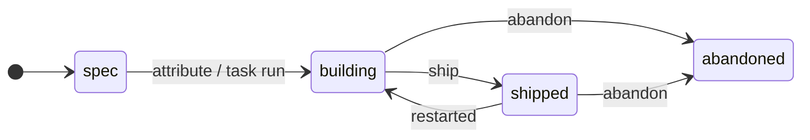
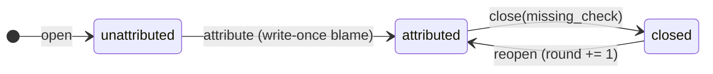
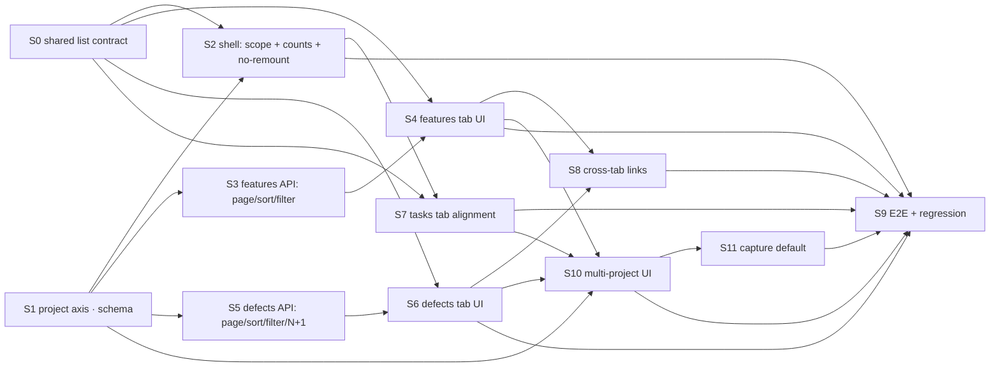

# 完善 Pipeline 页面 — Pipeline as one product, not three tables

Notation: `docs/spec-notation.md`.

## Intent

`/pipeline` is one sidebar entry over three tabs — Tasks, Features, Defects —
that are three readings of one loop: what is queued, what was claimed done,
what came back. The shell says they belong together; nothing below it behaves
as though they do. Each tab was built on its own day and kept its own day's
answer to the same four questions, so the page reads as three unrelated
tables wearing one header.

The four questions, and the three different answers each currently has:

| Question | Tasks | Features | Defects |
|---|---|---|---|
| How do I narrow the list? | 8 controls | one `?q=` | two scope pills |
| Where does that narrowing live? | localStorage | URL | URL |
| How do I see row 200? | keyset cursor | *you cannot* | *you cannot* |
| What order is this in? | 4 sort options | fixed | **`id DESC` in `all`, `id ASC` in every other scope** |

That last cell is not an inconsistency, it is a bug: pressing **Unattributed**
silently reverses the list with no header, no indicator and no control.

This feature makes the four answers one answer each, gives the page the
project axis it is missing — as a **set**, because one feature, task or defect
can concern several registered repos — carries a feature's declared project
down as the default when a task is captured under it, and bounds two unbounded
queries. It is a surface change plus the join tables the project axis
requires. It changes no declaration semantics anywhere.

**Non-goals**

- **No inferred project.** A feature's projects are declared, exactly as its
  attribution and its ship are. Nothing derives them from `session_repos`, a
  suspect path, or a cwd. Inference here would make the primary scope of the
  whole page a guess. Carrying a feature's *already declared* project down as
  the **preselected default** of a task captured under it is not inference —
  it is the same declaration, seen once (R7); it is editable and clearable
  before the row is written, and nothing is stored that the human did not
  confirm by submitting.
- **No project set derived from run activity.** A task run touching a second
  repo does not add that repo to anything.
- **No new task/feature/defect semantics.** Dedup, write-once blame, the
  `missing_check` requirement on close, append-only `feature_events`, and the
  two-deep task grain stay exactly as `lib/tasks/`, `lib/features/` and
  `lib/defects/` enforce them. This is a surface over those stores, never a
  second rulebook.
- **No bulk attribute, on any tab.** One defect, one assertion.
- **No tracker write-back.**
- **No virtualization.** Pagination is the answer to a long list; a virtual
  scroller is the answer to a long *page*, and we are choosing not to have one.
- **No redesign of the task graph panel.** It is out of frame.

## Model

### The list, as one type

Every tab is the same shape. Today each invents its own; that is the defect.

```typescript
type ProjectScope =
  | { kind: 'all' }            // default
  | { kind: 'none' }           // rows in no project — a real scope, not absence
  | { kind: 'project', id: RepoId }

type SortDir = 'asc' | 'desc'
type Sort = { key: string, dir: SortDir }   // key ∈ that tab's SORT_KEYS

type ListQuery = {
  project: ProjectScope         // shell-owned, shared by all three tabs
  q: string                     // free text, per tab
  sort: Sort                    // per tab, always defaulted, never absent
  page: number                  // 0-based; absent on the keyset tab
  cursor: string | null         // keyset tabs only
  size: number                  // ≤ MAX_PAGE_SIZE (lib/utils/pagination.py)
  facets: Record<string, string>   // status / stage / priority / …, per tab
}

type ListResult<Row> = {
  items: Row[]
  total: number | null          // null ⇔ the strategy cannot know it (keyset)
  has_more: boolean
}
```

`ListQuery` is **serialized entirely into `location.search`**. That is the
single rule the whole consistency story rests on: the URL is the list's state,
localStorage holds only the value to restore when you arrive at a bare path.

### The project axis

Ground truth today: `agent_tasks.project_id → repos.id` and
`features.project_id → repos.id` are each **one nullable column**, and
`defects` has no such column at all (`db/schema.sql`). One column is the
defect: a feature, a task and a defect can each concern **several** registered
repos — a schema change in one and its consumer in another is one feature
spanning two projects, and forcing it into a single id makes the operator pick
which half of the work to make invisible.

So the axis is a **set**, not a value.

```typescript
type ProjectSet = RepoId[]      // order irrelevant; [] is "in no project",
                                // a first-class scope and not a gap

type Feature = {
  // … existing fields, lib/orm/models/features.py
  project_ids: ProjectSet       // CHANGED from `project_id: RepoId | null`
}

type Task = {
  // … existing fields, lib/orm/models/tasks.py
  project_ids: ProjectSet       // CHANGED from `project_id: RepoId | null`
}

// A defect still carries no project of its own. Its set is its feature's, and
// an unattributed defect's set is empty — the same first-class gap the ledger
// already carries for blame. Derived at read time, never stored, so a feature
// gaining or losing a project moves its defects with it in the same breath.
function defectProjects(d: Defect): ProjectSet
```

**One writer per axis.** The singular `features.project_id` and
`agent_tasks.project_id` columns are **replaced**, not kept alongside:

| Store | Shape |
|---|---|
| `feature_projects` | `(feature_id, repo_id)`, PK both, `ON DELETE CASCADE` on the feature |
| `task_projects` | `(task_id, repo_id)`, PK both, `ON DELETE CASCADE` on the task |

Neither table has an FK to `repos`, matching the existing columns: a repo
dropped from the registry leaves its rows filed rather than cascading them
away, and R4's "unknown project id" row is what renders that.

The migration is the usual **two** edits (`alembic/versions/00NN_*.py` **and**
`db/schema.sql`, plus the SQLModel relations): create the two tables, insert
one row per non-NULL `project_id`, drop the columns. A fresh install and a
migrated one must agree column-for-column.

| Condition | Behaviour |
|---|---|
| the same repo is declared twice on one row | the PK absorbs it; no error, no duplicate |
| a repo is removed from a feature's set | the feature's defects leave that scope with it, immediately (derived, not copied) |
| a feature's set becomes empty | it is in scope `none`; it is never invisible |

Two orthogonal axes, so two diagrams. **Neither is changed by this feature** —
they are here because the list's rules index into them.





### The shell

```typescript
type PipelineHeader = {
  counts: { tasks: number, features: number, defects: number }  // ALL three
  scope: ProjectScope
}
```

Today a count renders only for the **active** tab, which is the one case where
a tab count carries no information: you already know what you are looking at.

## Rules

### R1 — List state

| Axis | Lives in | Survives reload | Shareable | Restored from localStorage |
|---|---|---|---|---|
| `project` | URL `?project=` | yes | yes | yes, on bare `/pipeline` |
| `q` | URL `?q=` | yes | yes | no |
| `sort` | URL `?sort=key:dir` | yes | yes | yes, on bare path |
| `page` / `cursor` | URL | yes | yes | **never** — a shared position moves |
| facets | URL | yes | yes | yes, on bare path |

| Condition | Behaviour |
|---|---|
| URL carries the axis | URL wins, always |
| URL bare, localStorage has a valid value | restore it **and rewrite the URL** so what is on screen is linkable |
| URL bare, stored value no longer a legal option | fall back to the default, drop the stored value |
| URL carries an unknown *facet value* | **refuse with 400** — a silently dropped filter shows a list that does not match its own controls (`lib/tasks/query.py` already does this; the other two must) |
| URL carries an unknown *sort key* | fall back to that tab's default sort, no error |
| a filter changes | `page`/`cursor` resets; `router.replace`, not `push` |
| the user navigates between tabs | `project` carries over; every other axis is per tab |

### R2 — Pagination strategy, per tab

The split follows the rationale already written in `lib/utils/pagination.py`.

| Tab | Strategy | Why | Today |
|---|---|---|---|
| Tasks | keyset (`CursorPage`) | hot table, rows arrive while you browse | already keyset — **unchanged** |
| Features | offset (`Page`) | grows by operator act; needs "page N" and sortable columns | **none — returns every row** |
| Defects | offset (`Page`) | same; and the row serializer opens a DB session **per row** | **none — returns every row** |

| Condition | Behaviour |
|---|---|
| no `size` given | `DEFAULT_PAGE_SIZE` |
| `size > MAX_PAGE_SIZE` | clamp, do not error |
| offset past the end | empty `items`, `total` still the true total |
| a write lands (close, ship, archive) | reload the **current page under the current query**; never reset to page 0, never lose scroll |

Bounding the defects query is not a nicety. `every()` is unbounded **and** each
row's serialization opens its own session; the page is one unbounded query
times an N+1. Pagination caps N at `size`, and the per-row session must go.

### R3 — Sort

| Tab | Default | Selectable keys |
|---|---|---|
| Tasks | `created:desc` | created, updated, priority *(existing four — unchanged)* |
| Features | `created:desc` — a just-declared feature leads; `activity` would sink it below any older feature with a newer session | activity (gaps last), rounds, open defects, escapes, cost, stage, created |
| Defects | `opened:desc` | opened, updated, round, status, feature |

| Condition | Behaviour |
|---|---|
| any sort, any tab, any scope | the key is followed by `id` as final tiebreaker (Features: `id` in the key's direction, so same-second rows stay newest-first under `created:desc`) |
| Defects, scope switches | direction does **not** change — this is the reported bug |
| a column is sortable | its header is a `button` carrying `aria-sort`; clicking toggles direction |
| a column is not sortable | plain text, no hover affordance suggesting otherwise |

### R4 — Project scope

A scope is a **membership test over a set**, not an equality test on a column.

| Scope | Tasks shows | Features shows | Defects shows |
|---|---|---|---|
| `all` | every task | every feature | every defect |
| `none` | empty set | empty set | defects whose feature's set is empty, **plus every unattributed defect** |
| `project=N` | `N ∈ project_ids` | `N ∈ project_ids` | defects whose feature has `N ∈ project_ids` |

| Condition | Behaviour |
|---|---|
| a row is in several projects | it appears under **each** of those scopes, and once under each — the join must not multiply the row (`DISTINCT` / `EXISTS`, never a bare join) |
| a row's set is empty | it appears under `none`, never hidden from every scope |
| a defect is unattributed | its set is empty; it appears under `all` and `none` only |
| scope is a project with 0 rows on a tab | that tab's empty state names the **scope**, not the ledger |
| a declared repo id the registry does not answer to | it is rendered as the raw id and said to be unknown — never silently dropped from the row's chips, which is today's behaviour on Tasks |
| the repo registry fetch fails | same: raw ids and a stated failure |
| a tab column shows the projects | all of them, as chips; overflow collapses to `+N` with the rest in its title, never a truncated *first* one passed off as the whole set |

### R5 — Cross-surface consistency

One implementation each, used by all three tabs.

| Concern | Rule |
|---|---|
| toolbar | one component: search + facets + sort + reset, in that order |
| pagination control | `PageControls` (offset) or `CursorControls` (keyset) — no hand-rolled pager |
| empty state | one component; the copy is per scope, the chrome is not (three near-identical implementations exist today) |
| dates | one formatter (`shortDate`) on every tab — Features and Defects render the same column two different ways today |
| destructive action | one confirm path; Defects **reopen** bumps a round and today confirms nothing |
| every row | has a permalink; a defect has no detail route at all today |
| a count shown next to a filter | is the count of the **filtered population**, and says so; a page-scoped count says "loaded" |

### R6 — The shell

| Condition | Behaviour |
|---|---|
| any tab is active | all three tab counts render, under the current project scope, from one counts request |
| switching tabs | the leaving tab's list state is kept; returning to it restores query **and** scroll. Remount-on-switch is what drops it today |
| a feature detail is open | the tab strip stays and Features stays marked current — the detail route is a sibling today, so the shell disappears |
| the shell's counts request fails | the tabs render without counts; **the tab content still loads**. A failed counts call renders a blank page with no error today |
| a tab has no toolbar action | `#pipeline-actions` stays empty; it does not collapse the header |

### R7 — The default project when a task is captured under a feature

A task captured from a feature's ledger is a step of work already filed
somewhere. Making the operator re-pick that filing is the second half of
point 2 of the report.

| Feature's `project_ids` | The new-task picker |
|---|---|
| exactly one | that project is **preselected**; the control is editable and clearable |
| two or more | **nothing is preselected**; the feature's own projects are listed first, in a group labelled with the feature, above the rest of the registry |
| empty | nothing preselected, plain registry list |

| Condition | Behaviour |
|---|---|
| the picker is opened outside a feature | unchanged from today: no default |
| the operator changes or clears the default | their choice wins and is written verbatim; the default is never re-applied |
| the feature's set changes after the task exists | **already-created tasks do not move.** The default is a seed at capture time, not a live link — a task's projects are its own declaration |
| the preselected repo is not in the registry response | no preselection; the picker says which id it could not offer rather than defaulting to none silently |
| capture is submitted with no project | allowed — a task with an empty set is legal, exactly as today |

A task's set is written by the same control and is a set too: the sole-project
case seeds **one** member, not a copy of the whole feature.

## Invariants

1. For all tabs T and all reachable list states S: the URL at S round-trips —
   reloading the URL reproduces exactly the rows and controls on screen.
2. For all tabs: no response is unbounded. `len(items) ≤ MAX_PAGE_SIZE`.
3. For all tabs and all sorts: the ordering is total (the key is tie-broken by
   `id`), so no row can appear on two pages or on neither.
4. For all defects D: `projects(D) = projects(feature(D))`, and `projects(D)`
   is empty exactly when `D` is unattributed or its feature's set is empty.
   The set is never stored on the defect, so the two cannot drift.
5. For all rows R: R is visible under `none` **exactly when** its set is empty,
   and under `project=N` **exactly when** `N` is in its set. Every row is
   therefore visible under `all` and under at least one other scope, and a row
   in k projects appears under k project scopes — **once each**.
6. For all filter changes: the row count shown beside the controls is the count
   of the population those controls describe — never of the loaded page,
   unless it says "loaded".
7. For all writes W on any tab: after W the list is on the same page under the
   same query it was before W.
8. No figure on any list is produced by a per-row query. (Features already
   holds this with one CTE; Defects violates it per row.)
9. Nothing on the page writes a project, a feature, or a blame that a human did
   not declare.

## Acceptance

Each item is a test name. Red first.

### Ordering — the reported bug

```gherkin
Scenario: switching defect scope does not reverse the list
  Given defects exist in both scopes
  When I read /defects and then /defects?scope=unattributed
  Then both are newest-first
  And the sort control reads the same in both
```
`test_defects_scope_switch_keeps_sort_direction`

### Pagination

```gherkin
Scenario: the features list is bounded
  Given 250 features
  When I GET /api/features
  Then at most MAX_PAGE_SIZE items return
  And pagination.total is 250

Scenario: page 2 continues page 1 with no gap and no repeat
  Given 120 defects
  When I read page 0 then page 1 at size 50
  Then the two id sets are disjoint
  And together they are the first 100 of the full ordering
```
`test_features_index_is_paginated` ·
`test_defects_index_is_paginated` ·
`test_offset_pages_are_disjoint_and_contiguous` ·
`test_size_above_max_is_clamped_not_rejected`

### Project scope

```gherkin
Scenario: a feature in no project is reachable
  Given a feature whose project set is empty
  When I scope the Pipeline to "No project"
  Then that feature is listed

Scenario: a feature in two projects is listed under both, once each
  Given feature F declared in projects P and Q
  When I scope to P, then to Q, then to All
  Then F appears in all three
  And it appears exactly once in each

Scenario: a defect follows its feature's whole project set
  Given feature F in projects P and Q, and defect D attributed to F
  When I scope to Q
  Then D is listed
  And when I remove Q from F, D leaves that scope with it

Scenario: an unattributed defect belongs to no project
  Given an unattributed defect
  Then it is listed under "All" and "No project" and under no project scope

Scenario: the singular column is carried into the set
  Given a database where features and tasks carry project_id
  When the migration runs
  Then every non-NULL value is one member of that row's set
  And the columns are gone
```
`test_feature_accepts_multiple_projects` ·
`test_feature_empty_project_set_listed_under_none_scope` ·
`test_project_scope_matches_any_set_member` ·
`test_multi_project_row_appears_once_per_scope` ·
`test_defect_projects_follow_feature_set` ·
`test_unattributed_defect_has_empty_project_set` ·
`test_row_visible_under_none_xor_some_project` *(property)* ·
`test_legacy_project_id_backfilled_into_join_table` ·
`test_fresh_schema_matches_migrated_schema`

### The default project on capture

```gherkin
Scenario: a feature with one project seeds the new task
  Given feature F declared in exactly one project P
  When I capture a task from F's ledger
  Then P is preselected in the project control
  And I can clear it before submitting

Scenario: a feature with two projects preselects neither
  Given feature F declared in projects P and Q
  When I capture a task from F's ledger
  Then no project is preselected
  And P and Q are offered above the rest of the registry

Scenario: the default is a seed, not a link
  Given a task captured from F while F was in P alone
  When F is later declared in Q as well
  Then that task is still in P and only P
```
`test_task_from_feature_defaults_sole_project` ·
`test_task_from_feature_with_many_projects_has_no_default` ·
`test_task_from_feature_lists_feature_projects_first` ·
`test_cleared_default_is_written_as_empty_not_reapplied` ·
`test_task_projects_do_not_follow_later_feature_changes` ·
`test_capture_outside_a_feature_has_no_default`

### URL state

```gherkin
Scenario: a filtered list is a shareable link
  When I set a project, a status and a sort on any tab
  Then the URL carries all three
  And opening that URL in a new tab shows the same rows

Scenario: the stored default is rewritten into the URL
  Given a stored task filter
  When I open /tasks with no query
  Then the list is filtered
  And the URL now states that filter
```
`test_task_filters_round_trip_through_url` ·
`test_bare_path_rewrites_stored_filters_into_url` ·
`test_unknown_facet_value_is_refused_not_dropped` ·
`test_filter_change_resets_page_and_replaces_history`

### Shell

```gherkin
Scenario: every tab count is visible from every tab
  When I open any Pipeline tab
  Then all three tab counts render
  And each reflects the current project scope

Scenario: a failed counts request does not blank the page
  Given the counts endpoint fails
  When I open the Tasks tab
  Then the rows still render
  And the failure is stated, not silent

Scenario: tab state survives a round trip
  Given I filtered and scrolled the Tasks tab
  When I visit Features and come back
  Then the filter and the scroll position are as I left them
```
`test_shell_publishes_all_three_counts` ·
`test_counts_failure_does_not_blank_the_list` ·
`test_tab_roundtrip_preserves_query_and_scroll` ·
`test_feature_detail_keeps_the_tab_strip`

### Consistency

```gherkin
Scenario: no dead cross-tab link
  When I follow every link a Pipeline row or figure offers
  Then each lands on the scope it names
```
`test_feature_figures_defect_link_lands_scoped` *(today it emits an undefined
key under the wrong parameter name and silently lands on the unscoped list)* ·
`test_every_tab_uses_the_shared_date_formatter` ·
`test_defect_has_a_permalink` ·
`test_reopen_asks_for_confirmation` ·
`test_close_without_missing_check_is_refused_client_side` ·
`test_abandon_is_reachable_from_the_ui` ·
`test_no_list_figure_issues_a_per_row_query`

## Work slices and their dependencies

Ten slices. Each is one run; the arrows are hard ordering, and everything not
connected is parallel.



| # | Slice | Delivers | Depends on |
|---|---|---|---|
| S0 | Shared list contract | the `ListQuery`↔URL composable, one toolbar, sortable header, one empty state, one date formatter | — |
| S1 | Project axis | the project **set**: `feature_projects` + `task_projects` in **both** the Alembic revision and `db/schema.sql`, the backfill-and-drop of the two singular columns, the SQLModel relations, the `defectProjects` derivation, and the CLI surface for declaring membership | — |
| S2 | Shell | project selector; one counts endpoint feeding all three tabs; state kept across tab switches; feature detail keeps the strip | S0, S1 |
| S3 | Features API | offset pagination, sort keys, stage + project filters, `q` over the spec body | S1 |
| S4 | Features tab | toolbar, sortable columns, pager, the **rounds** column (already in the payload, never rendered), abandon, adopt-a-tracker-issue, row hit target | S0, S3 |
| S5 | Defects API | offset pagination, status + project filters, `q` over symptom, one consistent order, kill the per-row session | S1 |
| S6 | Defects tab | toolbar with a status filter, pager, `/defects/:id` permalink, confirm on reopen, client-side `missing_check` guard, the missing fix-item banner | S0, S5 |
| S7 | Tasks tab | filters move to the URL (stored value becomes the default only); `route.query` watched, not read once; expose the tag/source/feature filters the API already serves; publish the count; fix the blank-on-counts-failure; prune stale selection on collapse; resolve the dead expand/nested code — implement the parent→run nesting or delete it | S0, S2 |
| S10 | Multi-project UI | the set editor on the feature and task detail surfaces (add/remove a member), project chips with `+N` overflow on every list row, and the scope selector reading set membership | S1, S4, S6, S7 |
| S11 | Capture default (R7) | the feature-scoped task composer gains the project control, preseeded per R7 and grouping the feature's projects first | S1, S10 |
| S8 | Cross-tab links | the broken defects tile link; Features→Tasks; sessions→trace; defect→fix task | S4, S6 |
| S9 | E2E + regression | Playwright specs for every Gherkin above | S2, S4, S6, S7 |

## Operating constraint

The backend serving this session must not be restarted. Verify against a
second instance on its own port and its own copy of the DB; a restart of the
running server ends the session doing the work.


