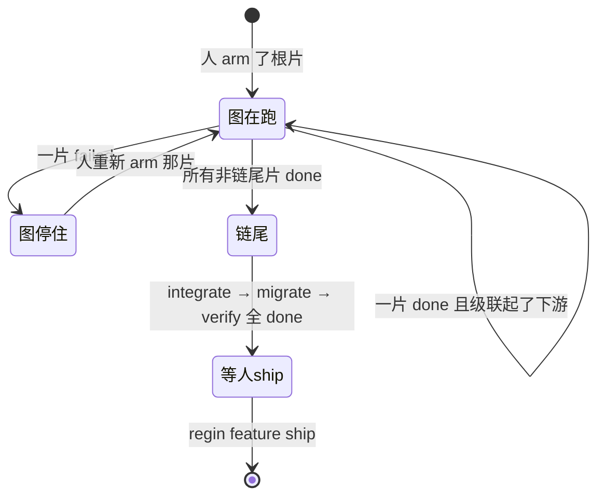
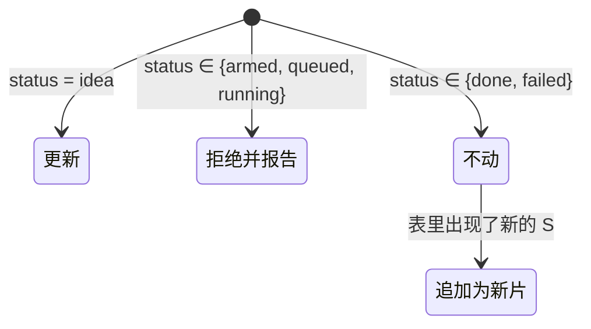
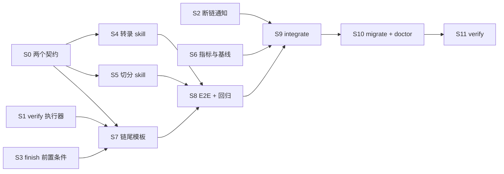

# spec → 图 → 跑完：落地 wayfinder #74 的决定

## Intent

今天一个大需求要跑起来，人得手打一句「build a task graph」，再手写十段
prompt。DAG 的**执行器**早就有了（`agent_task_deps` + 完成即级联），缺的是
**作者**和**拓扑**。wayfinder 地图 #74 用十张决策票把该怎么做定死了，本 feature
把那些决定变成代码。

判据只有一个：**一个 feature 需要几次人类介入**。目标 2 —— 写 spec、批准图。
基线是 feature 73 的 8 次。

**Non-goals**

- **不造 plan 实体**。没有草案表、没有版本链、没有「我批准的是哪张图」的记录。
  图住在 spec 里，spec 的修订历史就是那个记录。（W3）
- **不新开 prompt 模板表**。build prompt 的可变部分就是 task 行本身。（W8）
- **不加第四个 run 状态**。DO-NOT-SHIP 和合并冲突都是 `failed`。（W9）
- **不做闸门清单的导出方法**（W10）。那是另一个 feature；本 feature 只落地四道
  已经有落点的闸门。
- **不改 tracker、不碰 trace / memory 子系统。**

## Model

```typescript
// 项目的命令表 —— 项目内的文件，进 git，不进 DB。
// 三个键必须出现；没有就显式 null 加理由，"缺了"和"忘了"必须可分辨。
type ProjectCommands = {          // .regin/commands.json
  test:    string | null
  migrate: string | null
  e2e:     string | null
  reasons: { [K in "test" | "migrate" | "e2e"]?: string }   // null 时必填
}

// spec 里那张切片表的一行。它就是 plan —— 没有别的载体。
type SliceRow = {
  n: string            // "S0" —— 一个 feature 内的稳定标识，幂等键的一半
  title: string
  delivers: string     // 这片交付什么
  spec_refs: string[]  // Rules / Acceptance 的段落号
  tests: string[]      // 验收测试的名字，不是描述
  depends_on: string[] // 其它 SliceRow.n
  base: string         // 分支名，人审 spec 时填；机器推不出来
  skill?: string       // 默认 goal-verified-treenav
  verify_cmd?: string  // 缺省 = ProjectCommands.test
}

// 转录的产物。没有新表。
type Transcribed = {
  task: AgentTask      // status='idea'，title 以 "<n> — " 开头
  deps: TaskId[]       // agent_task_deps
  arm: {               // 未 arm；arm 是人的动作
    worktree: { branch: string, base: string }
    verify_cmd: string
    skill: { name: string }
  }
}
```

一片的生命周期（task 自己的状态机没变，这里画的是**图**的读法）：



`图停住` 不是存下来的字，是「有片 failed 且没人重 arm」的读法。

转录对已存在片的处理，按 task 状态分三支：



## Rules

### R1 — 命令表

| 情况 | 行为 |
|---|---|
| 三个键齐全 | 读取 |
| 某键缺席（不是 `null`，是没写） | **拒绝**，报出缺哪个键 |
| 某键为 `null` 且 `reasons` 里没有它 | **拒绝**，报「null 必须带理由」 |
| 文件不存在 | 探测生成**草案**写到 stdout，**不落盘**；提示人确认 |
| 探测不出来 | 草案里该键为 `null`，理由写「探测不出」 |

### R2 — 转录（第二段）

| 表里的情况 | 行为 |
|---|---|
| `S<n>` 在本 feature 下不存在 | 建 task，`status='idea'` |
| `S<n>` 已存在且 `status='idea'` | 更新 title / body / 边 / arm 参数 |
| `S<n>` 已存在且 `status ∈ {armed,queued,running}` | **拒绝该片并继续其余**，报出哪片被拒 |
| `S<n>` 已存在且 `status ∈ {done,failed}` | 不动，并在输出里说明"未更新" |
| `depends_on` 指向不存在的 `S<n>` | **整体拒绝**，不建任何 task |
| 表里有环 | **整体拒绝** |
| 某行缺 `delivers` / `spec_refs` / `tests` / `base` | **整体拒绝**，报出哪行缺哪列 |
| 两片都要改 schema | **整体拒绝** —— 一个 schema 变更只能归一片 |

### R3 — 一片的 `body` 必须含四节

| 节 | 来源 | 缺了 |
|---|---|---|
| Delivers | `SliceRow.delivers` | 拒绝 |
| Spec 依据 | `SliceRow.spec_refs` | 拒绝 |
| 验收测试名 | `SliceRow.tests` | 拒绝 |
| 收尾动作 | 固定：合回 integration | 由转录写入，不由人填 |

### R4 — `verify_cmd` 的执行

| 情况 | 行为 |
|---|---|
| run 结束，`verify_cmd` 为空 | 按 run 自己的结果结算 |
| run 结束，`verify_cmd` 非空，退出码 0 | 结算为 `done` |
| run 结束，`verify_cmd` 非空，退出码非 0 | 结算为 **`failed`**，`exit_reason` 带退出码 |
| 执行 verify 本身失败（找不到命令等） | 结算为 `failed`，理由说明是 verify 没跑起来 |
| 任何情况 | **写 `verify_exit_code`** |

### R5 — 断链通知

| 一次完成之后 | 行为 |
|---|---|
| 有 dependent 被解锁并起来了 | 现状不变 |
| 有 dependent 仍被**一个 failed 的片**挡着 | **发一条消息**，指名是哪片断的 |
| 有 dependent 仍被一个未完成的片挡着 | 不发 —— 那是正常等待 |

### R6 — `<finish>` 的前置条件

| run 的种类 | 报告完成之前先做 |
|---|---|
| 远程 tracker 的 feature | 更新 issue 并移动状态（现状） |
| **native feature** | **合回 integration**（新增） |

## Invariants

1. 对任意 feature，**不存在**一张与它的 task 集合并列的 plan 记录。图的唯一载体
   是 spec 里的切片表，运行时的唯一载体是 `agent_tasks` + `agent_task_deps`。
2. 对任意片，`(feature_id, S<n>)` 唯一。重跑转录不产生第二份。
3. 对任意片，它的 worktree 的 base **不是**仓库默认分支，除非切片表显式写了它。
4. 对任意 run，`verify_cmd` 非空 ⇒ `verify_exit_code` 非 NULL。
5. 对任意 `.regin/commands.json`，三个键都出现 —— 值可以是 `null`，键不可以缺。
6. 对任意一次因 failed 而中断的级联，存在一条指名该片的消息。
7. 人类 prompt 数只统计**不在 `agent_task_runs` 里**的 session。该口径不读散文、
   不比时钟。

## Acceptance

```gherkin
# R1
Scenario: test_commands_missing_key_is_refused
  Given a .regin/commands.json with only "test" and "e2e"
  When  the reader loads it
  Then  it refuses, naming "migrate"

Scenario: test_commands_null_without_reason_is_refused
  Given a .regin/commands.json whose "migrate" is null and reasons has no "migrate"
  Then  the reader refuses, saying a null needs a reason

Scenario: test_commands_draft_is_not_written_to_disk
  Given a project with pyproject.toml and no .regin/commands.json
  When  the detector runs
  Then  a draft naming pytest is printed
  And   no file is created

# R2
Scenario: test_transcribe_is_idempotent_on_slice_id
  Given a spec slice table with S0..S3 already transcribed
  When  the table's S2 title changes and transcription runs again
  Then  S2's task is updated in place
  And   no fourth task is created

Scenario: test_transcribe_refuses_a_running_slice
  Given S2's task is running
  When  transcription runs with a changed S2
  Then  S2 is reported refused
  And   S0, S1 and S3 are still updated

Scenario: test_transcribe_refuses_an_unknown_dependency
  Given a slice row depending on "S9" which the table does not define
  Then  transcription refuses wholesale and creates no task

Scenario: test_transcribe_refuses_a_row_missing_base
  Given a slice row with no Base
  Then  transcription refuses wholesale, naming the row and the column

Scenario: test_transcribe_writes_worktree_base_from_the_table
  Given a slice row with Base "f76/integration"
  When  it is transcribed
  Then  its arm params carry worktree.base "f76/integration"

# R4
Scenario: test_verify_cmd_non_zero_settles_the_run_failed
  Given an armed task whose verify_cmd exits 1
  When  its run completes
  Then  the task settles failed
  And   verify_exit_code is 1

Scenario: test_verify_cmd_zero_settles_the_run_done
  Given an armed task whose verify_cmd exits 0
  Then  the task settles done and verify_exit_code is 0

Scenario: test_absent_verify_cmd_leaves_verify_exit_code_null
  Given an armed task with no verify_cmd
  Then  the run settles on its own result and verify_exit_code is NULL

# R5
Scenario: test_a_failed_slice_announces_the_broken_chain
  Given S1 depends on S0 and both are armed
  When  S0 settles failed
  Then  a message names S0 as the slice that stopped the chain
  And   S1 is still armed

Scenario: test_a_merely_unfinished_dependency_announces_nothing
  Given S0 is still running
  Then  no chain-stopped message exists

# R6
Scenario: test_native_finish_block_requires_merging_back_first
  Given a run of a native feature
  Then  its prompt's finish block names merging back to integration as a precondition

Scenario: test_remote_finish_block_is_unchanged
  Given a run of a remotely tracked feature
  Then  its finish block still names the issue update first

# Invariant 7
Scenario: test_human_prompt_count_excludes_task_runs
  Given a feature with two declared human sessions and five task runs
  Then  the human-prompt figure sums only the two
```

## Work slices and their dependencies

**Base: `master`** — 本 feature 的主体代码（`lib/tasks/`、`lib/features/`、skills）
都在 master 上。S0 从 master 建立 integration 分支；其余每片都从 integration 切，
并在跑完时合回去。



| # | Slice | Delivers | Spec refs | Tests | Depends on | Base | Schema |
|---|---|---|---|---|---|---|---|
| S0 | 两个契约 | `.regin/commands.json` 的读取与拒绝（R1）；spec 切片表的列定义与解析器。建立 `integration` 分支 | R1, Invariant 5 | test_commands_missing_key_is_refused, test_commands_null_without_reason_is_refused, test_commands_draft_is_not_written_to_disk, test_the_table_parses_into_rows, test_a_row_missing_base_names_the_row_and_the_column | — | `master` | — |
| S1 | verify 执行器 | R4 全部；关闭 **d158** | R4, Invariant 4 | test_verify_cmd_non_zero_settles_the_run_failed, test_verify_cmd_zero_settles_the_run_done, test_absent_verify_cmd_leaves_verify_exit_code_null, test_verify_runs_in_its_own_process_in_the_attempts_tree | — | integration | — |
| S2 | 断链通知 | R5 全部；关闭 **d157** | R5, Invariant 6 | test_a_failed_slice_announces_the_broken_chain, test_a_merely_unfinished_dependency_announces_nothing | — | integration | — |
| S3 | finish 前置条件 | R6 的 native 一支 | R6 | test_native_finish_block_requires_merging_back_first, test_remote_finish_block_is_unchanged | — | integration | — |
| S4 | 转录 skill（第二段） | R2、R3；幂等；机械，遇含糊即拒绝 | R2, R3, Invariant 2 | test_transcribe_is_idempotent_on_slice_id, test_transcribe_refuses_a_running_slice, test_transcribe_refuses_an_unknown_dependency, test_transcribe_refuses_a_row_missing_base, test_transcribe_writes_worktree_base_from_the_table, test_a_slice_body_carries_the_four_sections | S0 | integration | — |
| S5 | 切分 skill（第一段） | 把切片表写进 `features.body`；无可证伪验收项即拒绝；切分前的 G-SURFACE 自检 | Invariant 1, Acceptance | test_a_sliceable_spec_yields_its_rows, test_slicing_refuses_a_spec_without_named_tests, test_the_rendered_table_round_trips_through_the_parser, test_slicing_refuses_two_slices_owning_one_schema_change | S0 | integration | — |
| S6 | 指标与基线 | 人类 prompt 数的读数（不变量 7）；f73 归属的一次性考古 | Invariant 7 | test_human_prompt_count_excludes_task_runs | — | integration | — |
| S7 | 链尾模板 | 第一段每次固定写入的三片；命令全部来自 `.regin/commands.json` | R1, Invariant 3 | test_tail_slices_read_every_command_from_the_project_table, test_the_tail_chains_off_every_leaf_of_the_graph, test_a_null_command_renders_its_reason_instead_of_a_guess | S0, S1, S3 | integration | — |
| S8 | E2E + 回归 | 上面每条 Gherkin 一个测试 | Acceptance | test_every_acceptance_scenario_is_a_collected_test, test_the_transcribed_names_match_the_live_spec | S4, S5, S7 | integration | — |
| S9 | integrate | **检查**十一片都在 integration 上、无人落零 commit | Invariant 1 | test_every_slice_merged_back | S2, S6, S8 | integration | — |
| S10 | migrate + doctor | `regin migrate` 后 `regin doctor` 无 schema 发现 | R1 | test_migrate_leaves_no_schema_finding | S9 | integration | — |
| S11 | verify | 全量 pytest + Playwright | Acceptance | test_full_suite_passes | S10 | integration | — |

**没有 schema 变更**，所以没有哪片拥有一个 alembic revision。S10 仍然跑，它证明
的是"这个安装没落后"，不是"本 feature 加了迁移"。

**ship 不在表里** —— 那是操作者的动作。

## Operating constraint

`verify_cmd` 的执行器（S1）会在 run 结束时起子进程。**不要让它跑会重启 regin
服务的命令** —— 那会杀掉正在写结算的进程自己。S1 的验收里要有一条：verify 在
独立子进程里跑，失败不影响结算被写下。
